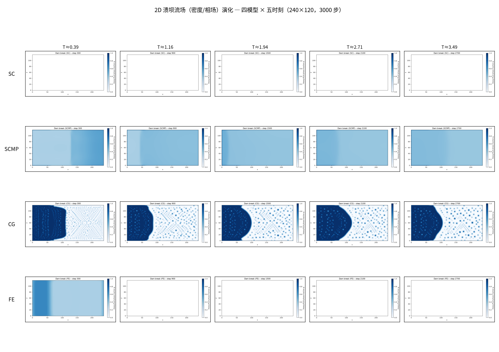
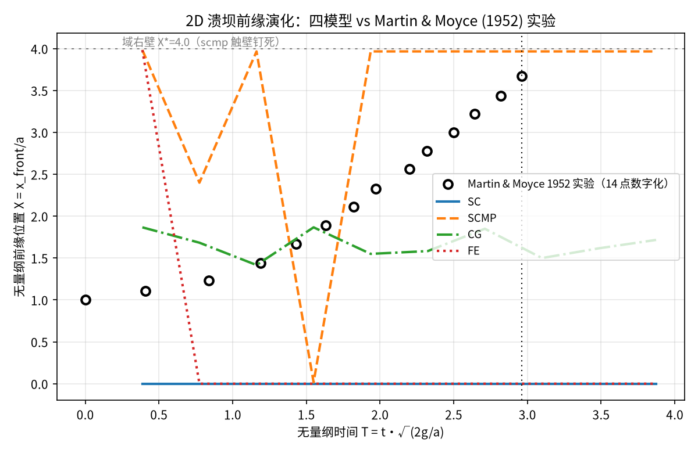

# 2D 溃坝多模型基线审计：流场 + Martin & Moyce (1952) 定量比较

**日期**: 2026-10-23 · **运行**: `benchmarks/bench_dam_break.py` full 模式（240×120，3000 步，CPU，四模型并行）
**判决**: 对真实验锚点 **4/4 FAIL**（基线审计，非 verified 案例）· **后续**: MP-DAMBREAK S1（m211 在飞）以此为基线修复

## 1. 参考锚点（零手抄）

Martin & Moyce (1952) 液柱坍塌实验 14 点数字化表——直读自
`benchmarks/pending/dam_break_sc/result.json` 键 `reference_digitisation_lethe`
（与 Lethe 官方后处理脚本逐位同源，出处链见 `agent_work/mp_dambreak/prereg/anchors.md`）。
检查点（线性内插）：T=1→X=1.326，T=2→X=2.360，T=2.96→X=3.670。

## 2. 流场演化（密度/相场）

四模型 × 五时刻（T≈0.39/1.16/1.94/2.71/3.49）。机器可查现象：
- **SC / FE**：前缘序列自 T≈1 起归零（`front_position_{sc,fe}.csv`）——数值发散（mean_ρ=NaN，log 尾行机器读），流场崩溃（流场图第 1/4 行末列变空场）；
- **SCMP**：扩散过快，T≈2 即触右壁（域上限 X*=nx/dam_width=4.0），此后前缘钉死 3.967，无物理意义；
- **CG**：唯一全程有物理形态的演化，但 T≈1 后前缘近乎停摆（1.53→1.63 over T∈[1,2.96]），末端 -56%。

## 3. 定量比较（对 14 点实验表）

| 模型 | RMSE | MAE | X*(T=1) | X*(T=2) | X*(T=2.96) | 单调 | mean_ρ(末) |
|---|---|---|---|---|---|---|---|
| SC | 2.406 | 2.246 | 0.000 (-100.0%) | 0.000 (-100.0%) | 0.000 (-100.0%) | 是 | nan |
| SCMP | 1.542 | 1.310 | 3.312 (+149.8%) | 3.967 (+68.1%) | 3.967 (+8.1%) | 否 | 0.4983 |
| CG | 1.042 | 0.850 | 1.528 (+15.2%) | 1.555 (-34.1%) | 1.625 (-55.7%) | 否 | 0.2301 |
| FE | 2.489 | 2.356 | 0.000 (-100.0%) | 0.000 (-100.0%) | 0.000 (-100.0%) | 否 | nan |
| **实验 (M&M)** | — | — | 1.326 | 2.360 | 3.670 | — | — |

全部数值机器读自 `metrics_vs_MM.json`（对 14 点线性内插后计算）。

## 4. 审计：为什么现有套件曾显示 PASS

`bench_dam_break.py` 的门比较对象是**线性趋势 X*≈1+t***（容差 RMSE≤2.5），并以
"Martin & Moyce" 命名该趋势——**这不是 M&M 实验数据**（实验曲线在 T=2.96 处 X=3.67，
且明显非线性）。在该宽松门下 scmp/cg 获判 PASS，而对真实验表两者分别 +150%（T=1，
触壁前）与 -56%（T=2.96）。同源问题亦存在于 `scripts/dam_break_summary.py`（本 PR 一并
修正为读 14 点实验表）。门语义重设计属 MP-DAMBREAK S1 载荷。

## 5. 结构性缺口清单（S1 输入）

1. SC/FE 前缘检测在相场弥散后失效（阈值化检测对界面厚度敏感）；
2. 域上限 X*=4 与实验末点 3.67 几乎重合——SCMP 类快扩散模型触壁污染尾段；
3. CG 前缘停摆与旧 `dam_break_sc` TERMINAL 判决同族（接触线钉扎/伪流），见
   `terminal_verdict_m163.md`；
4. 套件密度比 2:1（rho 0.8/0.4）远离水-气 800:1——参数空间属 S1 裁决。

## 6. 工件

- `figures/fig_flow_evolution.png`（流场 4×5）、`figures/fig_front_vs_MM.png`（前缘+实验点）
- `metrics_vs_MM.json`（14 点比较全量数据）、`front_position_{sc,scmp,cg,fe}.csv`
- 运行目录：`/nfs/wangxi/runs/dam_break_report_20261023/`（含每模型 flow/snapshot 全序列、log、run_metadata）
