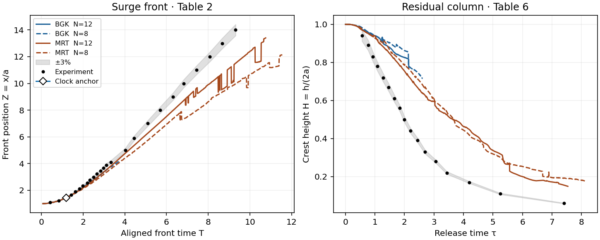

# 矩形通道溃坝 · Martin & Moyce (1952)

**判定为 pending。** D3Q19 自由表面求解器在两档 MRT 网格上都取得了全部实验时刻的读数。直接验收量为前锋位置和残余水柱高度。下列误差相对于论文实验均值。



[自由滑移数值对照与前锋跳变诊断](crosscheck/README.md)提供 waLBerla、Basilisk 的实算结果及跳变前后场数据。

## 实验与测量

Martin 与 Moyce 在矩形通道中用加热释放的蜡纸约束水柱，用摄影记录前锋和水柱下降。此处选矩形平面对称、原始半底宽 $a=2.25$ 英寸、高 $2a$ 的那组；下游通道略宽于上游。原文将实验结果列成到达指定位置或高度时的平均时间。逐行抄录印刷页 317 的表 2 和页 320 的表 6；同一表内其它尺寸的列未混入。[论文 DOI](https://doi.org/10.1098/rsta.1952.0006) · [原文扫描](https://www.math.ntu.edu.tw/~shyue/orch08/benchmarks/lowmach/broken-dam/91519.pdf) · [参考数据](experiment.csv)

| 观测 | 时钟及读数 | 独立测点 |
|---|---|---:|
| 前锋 $Z=x/a$ | $T=t\sqrt{2g/a}$。作者统一令 $Z=1.44$ 时 $T=1.19$；数值历程首次向前穿过该位置时作同样平移，其余点沿用同一偏移 | 24（另有 1 个校时点） |
| 高度 $H=h/(2a)$ | $\tau=t\sqrt{g/a}=T/\sqrt{2}$。实验零点是加热器通电，模拟零点是撤去隔板。原文从弯月面观察到运动最迟在 $\tau=0.16$ 已开始 | 17（初始 $H=1$ 不计） |

逐点对比在论文给出的时刻对数值位置、高度作线性内插。JSON 同时给出各指定位置、高度的首达时间，便于按实验原始读数复核。前锋附录列保存未平移预测，高度附录列保存统一取最大释放延迟时的预测，均不参加判定。记录终止后的测点标为 `null`。

## 数值设置和验收

使用 `tensorlbm.free_surface_lbm.free_surface_step`，CPU 单线程、双精度 D3Q19、静水压力初始分布、重力、表面张力、大气压自由面重构和半格反弹固壁。水的名义物性为 $\rho=998\,\mathrm{kg/m^3}$、$\nu=10^{-6}\,\mathrm{m^2/s}$、$\sigma=0.072\,\mathrm{N/m}$，$g=9.81\,\mathrm{m/s^2}$。初态瞬时释放；气相用压力边界表示。计算域内长 $18a$、名义高 $2.6a$（上取整到整格）、通道宽 $a$。下游增宽量、实测接触角、蜡纸运动和实验水温缺乏定量输入。

每半底宽格数为 $N$。$\Delta x=a/N$，$\Delta t=c_0\Delta x/\sqrt{2ga}$。两档正式网格固定 $c_0=0.06$，按相同物性重算格子重力、黏度和表面张力。$c_0=0.04$ 检查时间步敏感性；三层展向周期域检查侧壁敏感性。两类对照均单独计分。数值前锋由与水柱底部连通的液体在俯视投影中的最外侧半填充交点确定；高度取上游壁第一列液体的展向投影半填充高度。测量排除脱离主体的液滴。

晋级要求两档网格各自的 41 个独立位置/高度误差均 ≤3%，且同一工况细化后每点绝对误差严格下降。两档都需完成 $T=11.5$，全程最大 Mach ≤0.30、活动液体密度为正且有限，液体质量与几何体积各自相对初始值的最大漂移 ≤0.01%。液体质量取所有满液格的密度与界面格所带质量之和。几何体积取所有格子的填充率之和。

## 实算结果

按“达标点 / 有有效读数的点”列出。完整覆盖分别需要 24 和 17 个点。漂移为全程最大绝对值。

| 碰撞、边界 | N | $c_0$ | 最后有效 $T$ | 前锋通过 / 覆盖 | 高度通过 / 覆盖 | 质量漂移 | 体积漂移 |
|---|---:|---:|---:|---:|---:|---:|---:|
| BGK · 侧壁 | 8 | 0.06 | 3.697 | 2 / 14 | 0 / 11 | 0.208% | 0.816% |
| BGK · 侧壁 | 12 | 0.06 | 3.035 | 2 / 13 | 0 / 9 | 0.100% | 0.837% |
| MRT · 侧壁 | 8 | 0.06 | 11.505 | 2 / 24 | 0 / 17 | 0.529% | 1.019% |
| MRT · 侧壁 | 12 | 0.06 | 10.660 | 2 / 24 | 0 / 17 | 0.522% | 1.019% |
| BGK · 侧壁 | 8 | 0.04 | 4.195 | 2 / 15 | 0 / 12 | 0.541% | 0.369% |
| MRT · 侧壁 | 8 | 0.04 | 11.500 | 2 / 24 | 0 / 17 | 0.229% | 0.449% |
| BGK · 展向周期 | 12 | 0.06 | 2.970 | 3 / 12 | 1 / 9 | 0.247% | 0.858% |
| BGK · 展向周期 | 24 | 0.06 | 2.337 | 5 / 8 | 2 / 6 | 0.137% | 0.872% |
| MRT · 展向周期 | 12 | 0.06 | 11.500 | 2 / 24 | 2 / 17 | 0.480% | 0.986% |

在正式 MRT 工况，细化使 41 个测点中的 37 个更接近实验均值。粗、细网格各有 2/24 个前锋点进入 ±3%，高度均为 0/17。细网格在最后一个实验时刻之后、第 2133 步（$T=10.665$）以 Mach 0.30467 超过上限，未完成目标 $T=11.5$。两个 BGK 网格则在更早阶段超过上限。

| 细网格 MRT 的实验读数 | 实验 | 模拟 | 相对误差 |
|---|---:|---:|---:|
| 前锋 Z，T=8.67 | 13.000 | 9.563 | -26.44% |
| 前锋 Z，T=9.31 | 14.000 | 11.506 | -17.81% |
| 高度 H，τ=2 | 0.500 | 0.755 | +51.00% |
| 高度 H，τ=5.25 | 0.110 | 0.319 | +190.11% |
| 高度 H，τ=7.4 | 0.060 | 0.156 | +159.43% |

侧壁敏感性有可直接复查的信号。在 $\tau=2$，相同 N=12、相同 MRT 和物性，侧壁工况 $H=0.755$，展向周期对照 $H=0.705$，实验为 0.500。晚期实验 $H=0.06$ 在细网格仅相当于 1.44 个格距，但中期高水位也已明显偏离。进一步区分壁面附近液膜、读数展向投影和数值耗散的贡献，需要保留跨展向高度剖面并细化近壁区域。

## 求解器修正与适用范围

均匀满液周期域内施加单步重力，在松弛时间 0.5001、0.7、1.0 处，旧自由面 MRT 的实测冲量分别为理论值的 0.019996%、28.5714%、50.0%。原因是动量矩的松弛率为零，标量 BGK 力因子无法补足冲量。此次按 MRT 各矩的松弛率施加 Guo 源项，修复后三档实测冲量均为理论值的 100.000000%（六位小数）。回归覆盖三轴、有初速和 SGS 分支；本算例使用无 SGS 的 MRT。单步测试检验体力，整场误差以实验曲线判决。

## 复算

在仓库根目录使用安装了 TensorLBM、PyTorch、NumPy、SciPy、Matplotlib 的环境，清除自行设置的 `TL_FS_*` 调试覆盖项。九条工况的状态、网格、时间步、松弛时间、停止原因和原始逐步 CSV 均在压缩包内。

```bash
export PYTHONPATH=src:. OMP_NUM_THREADS=1 OPENBLAS_NUM_THREADS=1
case_dir=benchmarks/pending/dam_break_mm_channel
python "$case_dir/score.py" "$case_dir/histories.zip" --out /tmp/mm-rescore
# 重新计算通道里的两种碰撞模型、两档正式网格和小时间步。
for collision in bgk mrt; do
  for n in 8 12; do
    python "$case_dir/run.py" --cells "$n" --collision "$collision" \
      --out "/tmp/mm-replay/${collision}_channel_${n}_006"
  done
  python "$case_dir/run.py" --cells 8 --celerity 0.04 --collision "$collision" \
    --out "/tmp/mm-replay/${collision}_channel_8_004"
done
for n in 12 24; do
  python "$case_dir/run.py" --cells "$n" --span periodic --out "/tmp/mm-replay/bgk_periodic_${n}_006"
done
python "$case_dir/run.py" --cells 12 --span periodic --collision mrt --out /tmp/mm-replay/mrt_periodic_12_006
python "$case_dir/score.py" /tmp/mm-replay --out /tmp/mm-replay-scored --require-pass
pytest -q tests/test_dam_break_mm_channel.py
```

`--require-pass` 在未通过时返回退出码 1，仍写出逐点 JSON 和图。参考 CSV 的 SHA-256 为 `8361490898d9a618b49673d8f5b48f7d14c1c24031a243c2a878c25d5a5809c3`。原文扫描 PDF 的 SHA-256 为 `c592069cfb76e09e28c8734b637732644794ebad32142186cf769426533d1c76`。[逐点结果](result.json) · [逐步计算记录](histories.zip) · [求解入口](run.py) · [评分程序](score.py)
