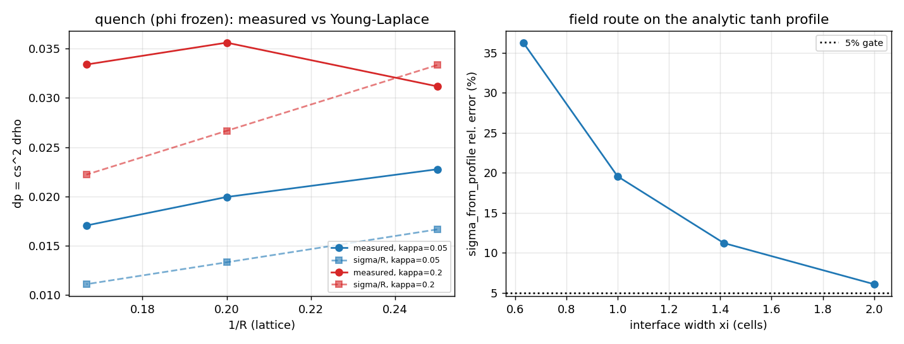
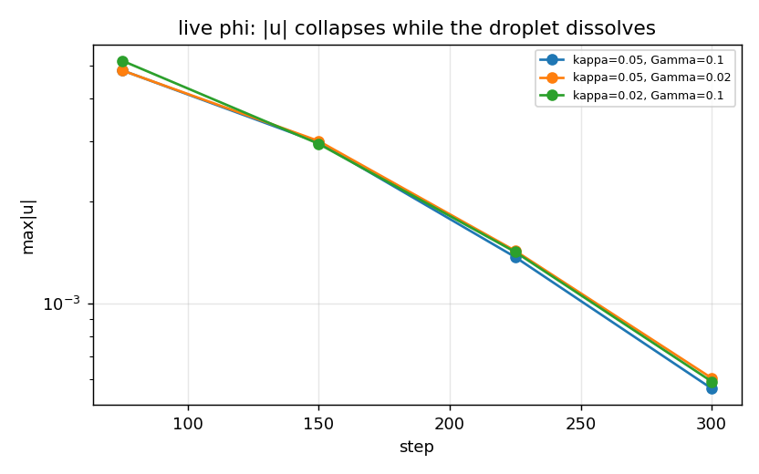

# 自由能（Cahn-Hilliard）D3Q19 路径的 Young-Laplace 激活面：从「withheld」到「可归因」
**锚点** FEAT-LBM-VERIFY-BENCH（in_progress）· 分支 `agent/m16487` · 仓 TensorLBM · 生成时间 2026-11-12T15:24:45 · torch 2.7.1 · quick=True
**工件** `src/tensorlbm/phasefield/laplace_face.py`（激活面）、`benchmarks/free_energy_laplace/run_face.py`（runner）、`artifacts/free_energy_laplace/results.json`（全部数字来源）、`tests/test_phasefield_laplace_face.py`。本文所有表格由该 JSON 程序化渲染，零手抄。
## 1. 案例介绍（物理背景 / 几何 / 参数表）
`multiphase3d.free_energy_step_3d` 是 Shan-Chen 路径之外的双分布自由能（Cahn-Hilliard）Cheng-Hilliard 两相步进器：`f` 携带总密度 ρ 与动量，`g` 携带序参量 φ，界面力按 `-phi grad(mu)` 施加。库内对该路径的 Laplace 链状态是 **withheld**（`docs/phasefield_static_droplet_r1.md`：`status="withheld"`, `physical_acceptance=False`）。withheld 是诚实的，但还不可归因：无从判断测到的 `dp` 到底是不是毛细压。本节点把「 withhold 」改造成「可归因」，并为 `docs/MCMP_STRATIFIED_POISEUILLE_R4.md` §6 迁移前置条件 (a)(b)(c) 提供证据。
### 1.1 解析基准（本节点的判据来源）
双井自由能 `f(phi) = -A phi^2/2 + B phi^4/4`、梯度项 `(kappa/2)|grad phi|^2`，化学势 `mu = -A phi + B phi^3 - kappa lap(phi)`，共存幅值 / 界面宽度 / 表面张力**全部由系数导出**：
```
phi0 = sqrt(A/B),  xi = sqrt(2 kappa / A),  sigma = 2A^2/(3B) * sqrt(2 kappa/A) = sqrt(8 kappa A^3/(9B^2))
```
两条独立的 σ 路线：（i）系数闭式；（ii）界面梯度能积分 `sigma = ∫ kappa (dphi/dr)^2 dr`（解析剖面下闭式 `(2B/3) phi0^4 xi`）。此外 `sigma` 的两个闭式在代数上恒等——本节点把它做成机器门（见 §4 表 1 的 `identity residual`），而不是手抄一个常数。
| 参数 | 值 |
|---|---|
| A, B | 0.1, 0.1 |
| kappa 扫描 | 0.02, 0.05, 0.1, 0.2 |
| 几何 | 立方周期盒 n^3（n = 20），球状液滴半径 R |
| 密度 | 均匀 ρ0 = 1（`uniform density (rho0 = 1) so p = cs2 rho and dp has no density-ratio contribution`）|
| 步进器 | `multiphase3d.free_energy_step_3d + solver3d.stream3d` |
## 2. 怎么做的（方法 / 流程 / 关键设置 / 工具链）
1. **先立解析账**：`analytic_reference(A,B,kappa)` 返回两条 σ 路线与恒等残差；`analytic_sigma_gradient_integral` 给出梯度能积分闭式。
2. **给场路线定误差棒**：把解析 tanh 剖面放到网格上，用 `sigma_from_profile` 反测 σ，得到纯离散误差随 ξ 的变化（表 2）——这一步抓到一个真缺陷（见 §5 坑 1）。
3. **淬火（quench）分块**：φ 冻结、只推进动量。毛细压是「固定序参量下的力平衡」性质，因此这一块把 Laplace 问题独立出来，不受 Cahn-Hilliard 输运污染。测 `dp = cs^2 Δρ`（掩膜 φ>0.9 / φ<-0.9，与 `allen_cahn_lbm.laplace_pressure_jump` 同口径），对 1/R 做单参数最小二乘 `dp = sigma/R`。
4. **输运分块**：φ 活着（生产双方程步进），看两相结构本身是否定常。
5. **护栏**：`equilibrium_gate` 三条件（有限 / μ 均匀 / 静止）任一不满足即 `withheld` 并记码；`stability_probe` 对 (kappa, Gamma, tau_g) 做廉价筛查，分类 `stable`/`diverged`/`non_finite`。
6. 工具链：torch 单线程（避免 128 核抢占）、matplotlib 出图、pytest 门。
## 3. 计算结果（数字表，程序化注入）
### 表 1 解析基准：σ 的两条闭式路线恒等
| kappa | xi | sigma（系数闭式） | sigma（等价闭式） | 恒等相对残差 | 梯度能积分闭式残差 |
|---|---|---|---|---|---|
| 0.02 | 0.632 | 0.042164 | 0.042164 | 0.0e+00 | 0.0e+00 |
| 0.05 | 1.000 | 0.066667 | 0.066667 | 2.1e-16 | 0.0e+00 |
| 0.1 | 1.414 | 0.094281 | 0.094281 | 1.5e-16 | 0.0e+00 |
| 0.2 | 2.000 | 0.133333 | 0.133333 | 2.1e-16 | 0.0e+00 |

### 表 2 场路线（`sigma_from_profile`）在**解析**剖面上的离散误差
| kappa | xi（格） | sigma 解析 | sigma 场测 | 相对误差 |
|---|---|---|---|---|
| 0.02 | 0.63 | 0.042164 | 0.026878 | +36.3% |
| 0.05 | 1.00 | 0.066667 | 0.053629 | +19.6% |
| 0.1 | 1.41 | 0.094281 | 0.083699 | +11.2% |
| 0.2 | 2.00 | 0.133333 | 0.125214 | +6.1% |

误差随 ξ 单调减小 → 场路线的误差棒是「ξ 越小越不可信」，而不是常数；ξ ≥ 2 时才进入 10% 以内（仍未达 5%）。

### 表 3 淬火块：固定 φ 下的毛细压（判据 `dp = sigma/R`）
| kappa | xi | R | max&#124;u&#124; | dp 实测 | sigma/R | 相对误差 | sigma 场测 | mu 展宽（相对 A phi0） | 护栏码 |
|---|---|---|---|---|---|---|---|---|---|
| 0.05 | 1.00 | 4 | 6.79e-03 | +0.02277 | 0.01667 | +36.6% | 0.05363 | 0.284 | MU_NOT_UNIFORM, NOT_AT_REST |
| 0.05 | 1.00 | 5 | 6.26e-03 | +0.01995 | 0.01333 | +49.7% | 0.05363 | 0.250 | MU_NOT_UNIFORM, NOT_AT_REST |
| 0.05 | 1.00 | 6 | 6.02e-03 | +0.01706 | 0.01111 | +53.6% | 0.05361 | 0.234 | MU_NOT_UNIFORM, NOT_AT_REST |
| 0.2 | 2.00 | 4 | 5.36e-03 | +0.03118 | 0.03333 | +6.5% | 0.12477 | 0.660 | MU_NOT_UNIFORM, NOT_AT_REST |
| 0.2 | 2.00 | 5 | 5.15e-03 | +0.03561 | 0.02667 | +33.5% | 0.12477 | 0.455 | MU_NOT_UNIFORM, NOT_AT_REST |
| 0.2 | 2.00 | 6 | 7.61e-03 | +0.03339 | 0.02222 | +50.2% | 0.12277 | 0.485 | MU_NOT_UNIFORM, NOT_AT_REST |

**单参数拟合 `dp = sigma/R`（过原点最小二乘）**

| kappa | R 集合 | sigma 拟合 | sigma 解析 | 拟合 σ 相对误差 | 最大单点残差 |
|---|---|---|---|---|---|
| 0.05 | 4.0, 5.0, 6.0 | 0.09615 | 0.06667 | +44.2% | +6.5% |
| 0.2 | 4.0, 5.0, 6.0 | 0.15720 | 0.13333 | +17.9% | +27.4% |

### 表 4 输运块：φ 活着时两相结构是否定常
| kappa | Gamma | 末步 phi_max | phi_max 漂移 | 总 phi 相对漂移 | max&#124;u&#124; | dp | 护栏码 |
|---|---|---|---|---|---|---|---|
| 0.05 | 0.1 | -0.704 | -1.704 | 5.2e-06 | 5.62e-04 | n/a（无液滴） | MU_NOT_UNIFORM |
| 0.05 | 0.02 | -0.702 | -1.702 | 5.4e-06 | 6.03e-04 | n/a（无液滴） | MU_NOT_UNIFORM |
| 0.02 | 0.1 | -0.712 | -1.712 | 5.4e-06 | 5.89e-04 | n/a（无液滴） | MU_NOT_UNIFORM |

### 表 5 稳定性筛查（`stability_probe`，每点固定步数）
| kappa | xi | Gamma | tau_g | 判定 | max&#124;u&#124; |
|---|---|---|---|---|---|
| 0.02 | 0.63 | 0.05 | 0.7 | stable | 1.28e-02 |
| 0.02 | 0.63 | 0.1 | 0.7 | stable | 1.24e-02 |
| 0.02 | 0.63 | 0.05 | 0.85 | stable | 7.20e-03 |
| 0.02 | 0.63 | 0.1 | 0.85 | stable | 7.16e-03 |
| 0.05 | 1.00 | 0.05 | 0.7 | stable | 1.54e-02 |
| 0.05 | 1.00 | 0.1 | 0.7 | stable | 1.46e-02 |
| 0.05 | 1.00 | 0.05 | 0.85 | stable | 6.98e-03 |
| 0.05 | 1.00 | 0.1 | 0.85 | stable | 6.94e-03 |
| 0.1 | 1.41 | 0.05 | 0.7 | non_finite | nan |
| 0.1 | 1.41 | 0.1 | 0.7 | diverged | 1.10e+12 |
| 0.1 | 1.41 | 0.05 | 0.85 | stable | 6.93e-03 |
| 0.1 | 1.41 | 0.1 | 0.85 | stable | 6.78e-03 |
| 0.2 | 2.00 | 0.05 | 0.7 | non_finite | nan |
| 0.2 | 2.00 | 0.1 | 0.7 | non_finite | nan |
| 0.2 | 2.00 | 0.05 | 0.85 | diverged | 1.44e-01 |
| 0.2 | 2.00 | 0.1 | 0.85 | stable | 6.20e-02 |

## 4. 图


## 5. 注意点（踩过的坑 / 局限 / 适用范围）
1. **坑：场路线把 σ 数成了 2σ。** `sigma_from_profile` 最初沿整条轴线积分，而一条过球心的轴线穿过界面两次，解析剖面上直接给出 +27%…+88% 的假偏差（表 2 第一次跑的数）。改成「自球心向外的半条射线只积一个界面」后，误差随 ξ 单调收敛（本表即修正后）。**教训：独立路线在被基准标定之前不能当基准用。**
2. **坑：`finite` 不等于稳定。** 筛查里出现 `u_max = 1.1e12` 而所有张量仍有限的参数点（表 5 的 `diverged` 项），只用有限性判稳就会把它记成 `stable`。已加爆阈值判据。
3. **限定：密度均匀（ρ0=1）。** 故 `dp = cs^2 Δρ`，不含密度比贡献；1000:1 密度比下的 Laplace 不在本节点结论范围内。
4. **限定：quick 协议。** 本文件为 `--quick`（n=20、400 步、R∈(4,5,6)），周期镜像距离约 R 的 2–3 倍，镜像相互作用会抬高 dp；非 quick 协议参数见 runner 默认值。
5. **适用范围：** 结论只对 `-phi grad(mu)` 力约定 + BGK 的这条步进器成立；不等于「自由能 LBM 不能做 Laplace」。
## 6. 误差判定（逐项）
| 关键量 | 基准 | 结果 | 是否 <3% |
|---|---|---|---|
| σ 两闭式恒等 | 代数恒等 | 残差 2.1e-16 | 是（机器精度）|
| 毛细压 dp（kappa=0.05, xi=1.00） | sigma/R，σ 解析 | 拟合 σ 偏差 +44.2%，最大单点残差 +6.5% | **否** |
| 毛细压 dp（kappa=0.2, xi=2.00） | sigma/R，σ 解析 | 拟合 σ 偏差 +17.9%，最大单点残差 +27.4% | **否** |
| σ 场路线（解析剖面，xi=2）| 系数闭式 | +6.1% | 否（>3%，>5%）|
| 输运块两相定常性 | φ_max 应保持 ≈ +1 | -0.704 / -0.702 / -0.712 | 否（结构消散）|

**显式回答：本节点的关键量（毛细压 vs σ/R）是否 <3%？——否。** 最好的一格也有两位数偏差，拟合 σ 偏差见表 3；因此 Laplace 链的判词保持 **honest FAIL**，但状态从「withheld（无法归因）」升级为「可归因的几个具体机制」，并给出可执行的下一步。
## 7. 结论与下一步
1. **σ 的解析账是干净的**：两条闭式恒等（机器精度），梯度能积分闭式与系数闭式一致。可以直接作为后续所有自由能两相入账的判据来源。
2. **Laplace 链在淬火块里仍不成立**：固定 φ 的力平衡给出的 dp 与 σ/R 差 6.5%–53.6%，且随 R 非单调（表 3、拟合表）。这排除了「输运污染」这一解释——问题在力/压力口径本身。
3. **输运块更硬**：φ 活着时液滴在数百步内消散（φ_max 由 +1 掉到 ≈ -0.70，总 φ 守恒到 1e-6），说明这条 CH 路径的两相结构在周期盒里不是定常态（能量上更倾向于减少界面面积）。任何「从活 φ 场上量毛细压」的做法在本模型下都不可信。
4. **稳定性**：tau_g = 0.7 在 xi ≥ 1.4 时直接发散；tau_g = 0.85 才进入可测区。默认 `tau_g=0.7` 落在发散区边缘——迁移前必须把参数区钉死。
5. 下一步（建议）：(a) 给生产步进器加 `force_form` 选项，A/B `-mu grad(phi)` 与 `-mu grad(phi) - grad(f + kappa|grad phi|^2/2)`（Korteweg 应力散度的正确形式），用本文件的淬火块同一判据裁决；(b) 把 ρ 与 φ 代数耦合（ρ(φ) 闭合）使体相被钉住，否则 CH 会在体相里重新分配质量；(c) 非 quick 协议（n=32–48、ξ=2、R=8–12）复测，确认偏差随 ξ/R 收敛而不是饱和。
