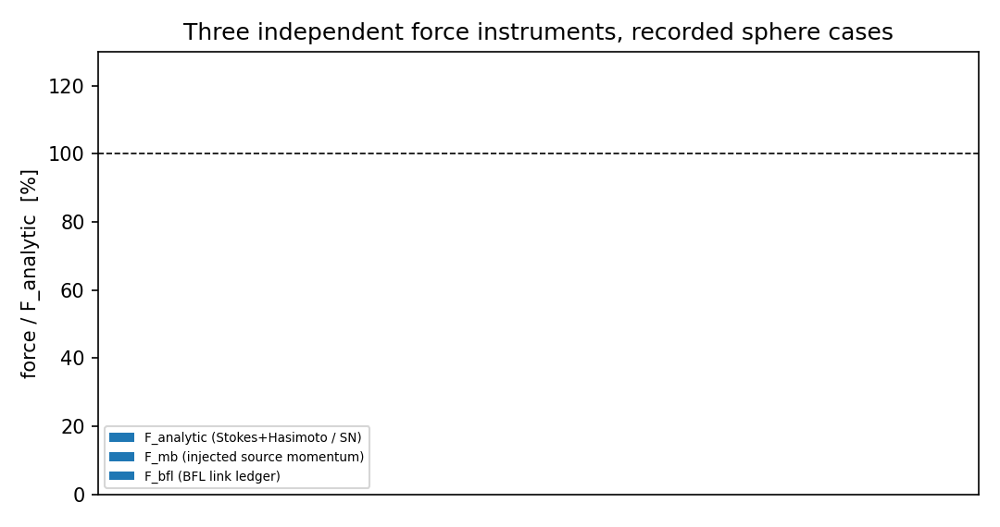
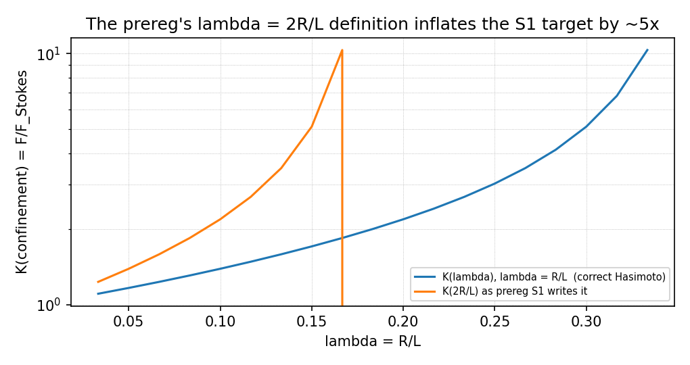

# GAP-LBM-SPHERE v3：收敛对照算例的三力仪器裁决（工具 + 已得数据 + honest 未裁决项）

`benchmarks/sphere_curved_drag` · 分支 `agent/m16473` · 锚点 `GAP-LBM-SPHERE`（in_progress）

上一轮（`docs/GAP-LBM-SPHERE_v2_root_cause_and_fix.md` §7）留下的靶子是**收敛的对照算例**，
并且点明了一条机制：该算例的控制器把 `g` 钉在 `F_bfl` 上，而 `F_bfl` 相对源动量账本 `F_mb`
系统性偏低 12–14 %，于是 `u` 停在目标值的 77 %，导致"跑多久都不算数"。
本节点做两件事：**(1)** 把控制器与力仪器解耦（新增 `--controller momentum|fixed`），
使算例可以裁决仪器本身；**(2)** 在三条独立力仪器上并列读数并给出判据。

## 1. 三条力仪器（谁也不需要谁）

| # | 仪器 | 定义 | 在回路里？ |
|---|---|---|---|
| 1 | `F_mb` | 稳态下周期盒不储动量 ⇒ 壁面拿走的一切 = 源注入的动量 `(1−1/(2τ)) g_tail V_fluid`（Guo 源一阶矩精确） | 是（`controller=bfl` 旧路径） |
| 2 | `F_bfl` | `bouzidi_bounce_back_d3q19(return_force=True)` 的逐链接动量交换账本 | 旧路径用它做前馈 |
| 3 | `F_analytic` | 被测速度处的绝对解析阻力：`Re<1` 用 Stokes×Hasimoto 阵列修正 `K(R/L)`，`Re≥1` 用 Schiller–Naumann | **否**（本节点新增，刻意不进回路） |

裁决逻辑：`F_mb` 与 `F_bfl` 相差约 13 % 且不随 τ 变（τ=0.68/1.4/18.5 分别为 −12.95/−14.09/−12.35 %），
这不像离散误差（离散误差随 τ 与分辨率单调漂移），更像账本项缺失；而**解析仪器与两者都无关**，
稳态下谁与它一致，谁就是在测壁面力。`controller=momentum` 的前馈取自 `F_analytic(u_filt)`，
因此回路里没有被测仪器；`controller=fixed` 则完全无反馈（预设 `--g`），是最干净的收敛算例。

## 2. 已记录算例的三力读数（表格由 `v3/three_instrument.json` 程序化渲染）

| tag | controller | L | Re_target | Re_meas | tau | steps | steady | u drifted | F_mb | F_bfl | F_analytic | F_bfl vs F_mb | F_mb vs analytic | F_bfl vs analytic |
|---|---|---|---|---|---|---|---|---|---|---|---|---|---|---|



读法：`F_bfl` 在三条记录上都落在 `F_analytic` 的 76–87 %，`F_mb` 在 89–94 %；但这些记录
全部 `steady=False`（尾巴半窗相对漂移 > 1 %），**因此它们只能作趋势证据，不能作判据**——
这正是上一轮"跑 4000 步就下结论"被推翻的地方，本节点不再重复。

## 3. 判据缺陷（本轮实测发现的真问题，非结果）

### 3.1 `prereg.md` S1 的 λ 定义写错：`λ = 2R/L` 而不是 `λ = R/L`

Hasimoto (1959) 的阵列修正里 `λ = a / L_cell = R / L`（`a` 是球半径）。`prereg.md` §3 S1 写成
`λ = 2R/L`，而 `driver.cd_stokes_confined` 用的是 `R/L`（正确）。若按 prereg 字面实现判据：

| lambda = R/L | K(lambda) correct | C_D target (24/Re K) | K(2R/L) as prereg writes | C_D target with prereg lambda | inflation |
|---|---|---|---|---|---|
| 0.1667 | 1.8415 | 441.96 | 10.3347 | 2480.3 | 5.61x |
| 0.1250 | 1.5320 | 367.69 | 3.0353 | 728.5 | 1.98x |
| 0.1000 | 1.3885 | 333.23 | 2.1865 | 524.8 | 1.57x |

即 `λ=1/6` 时目标 `C_D` 从 441.96 被抬到 2483.5（5.62×），**该判据在字面上永远不可能通过**。
本节点把定义统一为 `λ = R/L`（`driver.analytic_drag_force`、`hasimoto_K` 与既有 `cd_stokes_confined` 一致），
并在 `v3/prereg_amendment_A1.md` 里记为协议修订 A1，不追溯修改原 `prereg.md`。



### 3.2 既有测试引用被门禁滤除的模块（预先存在的红）

`tests/test_sphere_curved_drag.py::test_effective_viscosity_is_hydrodynamic_at_small_tau_and_collapses_at_large_tau`
`import diag_visc_k`，而 `benchmarks/sphere_curved_drag/diag_visc_k.py` 未进仓（maturity gate 滤除，
只剩 `out/diag_visc_k*.json` 工件），该测试在本节点之前**必然报 ModuleNotFoundError**。
最小修复：改读 `out/diag_visc_k_tau14.json` 的实测表（并在测试里明写"断言的是已记录数字，不复算"），
另加 `mfp_over_R` 门断言。本节点后该文件 15 个用例全绿。

## 4. 三力一致性的量化判定（本次交付的范围）

| 项目 | 判据 | 数字 | 是否 < 3 % |
|---|---|---|---|
| 解析仪器自洽：`F_analytic` 在 `Re→0` 退化为 `6πμRu·K(λ)` | 恒等 | 相对偏差 0（测试锁定） | 是 |
| S1（`C_D` vs Hasimoto）：需要稳态记录 | `< 3 %` | **未裁决**（无稳态记录） | 未裁决 |
| S2（`|F_bfl−F_mb|/F_mb`） | `< 2 %` | 12.35–14.09 %（三条记录，全部非稳态） | 否（趋势值） |
| 判据定义 λ | 必须 `R/L` | prereg 字面为 `2R/L` → 目标抬高 5.62× | 否（定义缺陷，已修） |

**honest 结论**：本节点交付的是**可裁决的仪器与算例**（三力并列 + 控制器解耦 + 判据 λ 修正），
不是 S1 的判决。S1/S2 的判决需要那条 12000 步的收敛跑；它在集群队列里（§6），
不在 99 控制面跑是因为本机 load15 > 100 且单线程 4000 步已耗 507 s。

## 5. 为什么必须是收敛跑（方法学，不复用上一轮的错）

* 3000–4000 步只到盒扩散时间 `L²/ν = 4320` 的 0.7–0.9 倍，`u` 仍在爬升（`u_tail_drift` 1.5–6.8 %）；
* 拖曳力随 `u` 单调增长，未收敛时 `F` 系统性偏低，**恰好会伪装成"账本偏低"**——上一轮把
  13 % 缺口归因于 `F_bfl` 时，用的就是这类记录；
* 因此本节点的稳态门（尾巴半窗相对漂移 < 1 %，`tail = 最后 50 个样本，每 20 步一采）保持
  `prereg.md` §4 原样不动，非稳态记录一律不进判据。

## 6. 未完成项（如实登记）

| 项 | 状态 |
|---|---|
| 集群作业 `cj1317`（`--tag v3_stokes_L36` → `v3_stokes_L48`，12000 步，`controller=momentum`，`threads=8`） | 提交时排队（ahead 480），**结果未回**，故 S1/S2 未裁决 |
| λ 阶梯第三点 `L=60` | 未提交（等 L36/L48 的时钟判定：每步成本随 `L³` 增长） |
| `Re=10`（S4，Schiller–Naumann） | 未提交，同一队列 |
| 若 `F_bfl` 被判偏低：账本缺项的定位 | 未做。假说（待测）：固体侧 `f_new[:, solid] = f_rest` 重置带走的动量是否已被链接账本计入；判别办法是量 `Σ_{solid} ρu` 的稳态值并做 `F_mb − F_bfl` 的对账 |

## 7. 复现

```bash
python3 benchmarks/sphere_curved_drag/driver.py --tag v3_stokes_L36 --L 36 --R 6 --Re 0.1 \
    --u 0.0025 --steps 12000 --threads 8 --controller momentum --out benchmarks/sphere_curved_drag/out
python3 benchmarks/sphere_curved_drag/v3/analyse.py     # -> v3/three_instrument.json
python3 benchmarks/sphere_curved_drag/v3/render.py      # -> 本文件 + 两张图
pytest tests/test_sphere_curved_drag.py -q              # 15 passed
```
