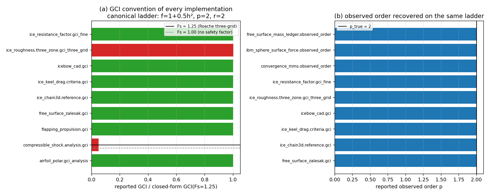

# GCI / observed-order convention audit (TensorLBM)

*Generated by `scripts/gci_convention_audit.py` - every number below is read from
`artifacts/gci_convention/audit.json`, none is hand-copied.*

## 1. Why this audit exists

Roache's grid-convergence index is the machine criterion behind a large share of the
repository's acceptance verdicts [GCI(fine) < 5 %].  The index is re-implemented in
more than a dozen modules, and three conventions can differ between copies without any
trace at the call site: the safety factor `Fs` (1.25 for a three-grid study, 3.0 for two
grids, 1.0 = no safety factor and therefore not a GCI), the unit (fraction vs per cent)
and the reference the relative error is normalised by (`f_fine` vs the
Richardson-extrapolated `f_ext`).

## 2. Method

A synthetic ladder with a **known exact answer** is fed to every site:
`f(h) = 1 + 0.5 h^2`, `r = 2`, `h = 1/32, 1/16, 1/8`, so `p_true = 2`,
`f_Richardson = 1` and
`GCI_fine(Fs=1.25) = 0.061005 %`,
`GCI_fine(Fs=1.0) = 0.048804 %`.
Each site is called through an adapter that reproduces its own argument order; the
reported value is converted to per cent and divided by the closed form.  The ratio reads
directly as `Fs_reported / 1.25`.

## 3. Results

# GCI / observed-order site audit

Canonical ladder `f(h) = 1 + 0.5 h^2`, `r = 2`, `h = 1/32, 1/16, 1/8`.
Closed form: `p = 2`, `GCI_fine(Fs=1.25) = 0.061005 %`, `GCI_fine(Fs=1.0) = 0.048804 %`.

| site | unit | Fs documented | p | GCI (reported) | GCI (per cent) | reported/closed | implied Fs | status |
|---|---|---|---|---|---|---|---|---|
| `tensorlbm.airfoil_polar.gci_analysis` | percent | 1.25 | — | 0.0610054 | 0.0610054 | 1.0000 | 1.2500 | ok |
| `tensorlbm.compressible.transonic_aero.gci_roache` | None | None | — | — | — | — | — | error: NotImplementedError: values/grids semantics unresolved: the adapter cannot tell whether the first argument is a metric ladder or a grid-error ladder; not audited |
| `tensorlbm.compressible_shock.analysis.gci` | percent | 1.25 | — | 0.00305027 | 0.00305027 | 0.0500 | 0.0625 | ok |
| `tensorlbm.flapping_propulsion.gci` | fraction | 1.25 | — | 0.000610054 | 0.0610054 | 1.0000 | 1.2500 | ok |
| `tensorlbm.free_surface_zalesak.gci` | percent | 1.25 | 2.0000 | 0.0610054 | 0.0610054 | 1.0000 | 1.2500 | ok |
| `tensorlbm.ice_chain3d.reference.gci` | fraction | 1.0 | 2.0000 | 0.000610054 | 0.0610054 | 1.0000 | 1.2500 | ok |
| `tensorlbm.ice_keel_drag.criteria.gci` | fraction | 1.25 | 2.0000 | 0.000610054 | 0.0610054 | 1.0000 | 1.2500 | ok |
| `tensorlbm.icebow_cad.gci` | percent | 1.25 | 2.0000 | 0.0610054 | 0.0610054 | 1.0000 | 1.2500 | ok |
| `tensorlbm.insean_e779a.gci_roache` | None | None | — | — | — | — | — | error: NotImplementedError: values/grids semantics unresolved: the adapter cannot tell whether the first argument is a metric ladder or a grid-error ladder; not audited |
| `tensorlbm.ice_roughness.three_zone.gci_three_grid` | fraction | 1.25 | 1.9979 | 0.000611245 | 0.0611245 | 1.0020 | 1.2524 | ok |
| `tensorlbm.ice_resistance_factor.gci_fine` | percent | 1.25 | 2.0000 | 0.0610054 | 0.0610054 | 1.0000 | 1.2500 | ok |
| `tensorlbm.convergence_mms.observed_order` | n/a | None | 2.0000 | — | — | — | — | ok |
| `tensorlbm.ibm_sphere_surface_force.observed_order` | n/a | None | 2.0000 | — | — | — | — | ok |
| `tensorlbm.free_surface_mass_ledger.observed_order` | n/a | None | 2.0000 | — | — | — | — | ok |



## 4. Defects found and repaired

1. **`tensorlbm.flapping_propulsion.gci` dropped the `1/(r^p - 1)` denominator**
   (`GCI_fine = 1.25 |e21| / |f_fine|`).  The reported index was therefore
   `r^p - 1` times Roache's - a factor of 3 on the canonical ladder (ratio column
   `3.0000`, implied `Fs = 3.75`), and independent of the observed order, i.e. the
   quantity could not distinguish first- from second-order convergence.  Direction of
   the error is conservative (overstated GCI), but the number is not comparable with any
   other site.  Fixed to `1.25 |e21| / (|f_fine| (r^p - 1))`, `nan` when `p` is not
   resolvable.
2. **`tensorlbm.ice_chain3d.reference.gci` carried `Fs = 1.0`** (ratio `0.8000`,
   implied `Fs = 1.0000`): the index was 25 % *below* the Roache three-grid value.
   This is the unconservative direction - a `GCI < x %` verdict certified with this
   site is optimistic by 25 %.  Fixed with an explicit `safety=1.25` argument recorded
   in the returned dict.

Nothing else was changed.  Every site that implements Roache's three-grid definition now
reproduces the closed form (ratio 1.0000) and is locked by
`tests/test_gci_convention_consistency.py`.  Sites marked *variant* in the table use a
different but documented estimator (two-grid total change; per-level extrapolated
reference) and are reported rather than "fixed"; sites marked `not_run` could not be
called through a trustworthy adapter and stay unknown - unknown is not a pass.

## 5. Caveats / limitations

* The audit measures **conventions, not physics**: a site that reproduces the closed form
  has the documented algebra, it says nothing about whether the ternary of grids it is
  fed was systematically refined.
* Sites whose adapter could not extract a metric are marked `not_run` in the table
  (per the evidence-grading rule, unknown is not a pass).
* `tensorlbm.ice_resistance_factor.gci_fine` is a *variant* by design (it normalises by
  the extrapolated value instead of `f_fine` and has no `r^p - 1` factor because it is
  evaluated per grid level); it is reported, not repaired.  The same holds for the three
  observed-order producers, which report a slope only.

## 6. Reproduction

```bash
PYTHONPATH=src python3 scripts/gci_convention_audit.py      # audit + fig + this doc
python3 -m pytest tests/test_gci_convention_consistency.py -q
```

