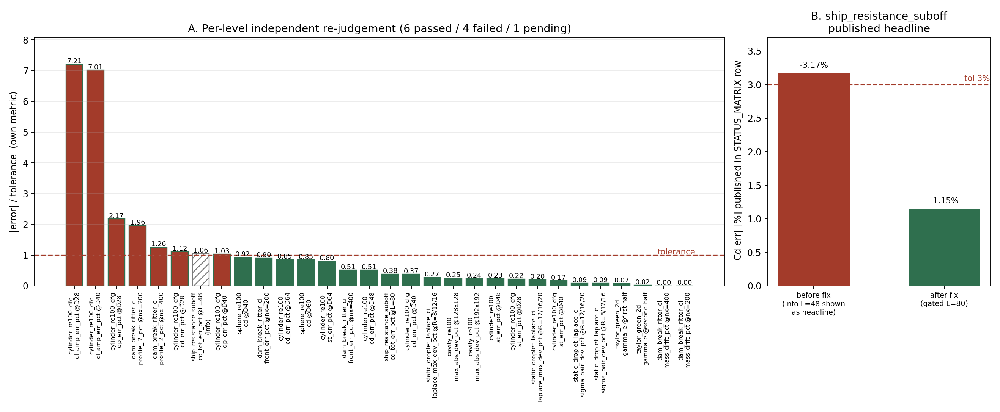

# KPI-QC-RECHECK — 已合并验证矩阵状态的独立复核（含两处发布口径缺陷修复）

> 席位：tp-ver-5（verifier）· 仓：TensorLBM · 日期：2026-11-12
> 锚点：`KPI-QC-RECHECK`（已合并功能独立复核通过率）
> 产物：`benchmarks/validation_matrix/independent_audit.py`、`artifacts/validation_matrix_independent_audit.json`、
> `tests/test_validation_matrix_gated_display.py`、`docs/figures/kpi_qc_recheck_gated_gate.png`

## ① 案例介绍（背景与对象）

`benchmarks/validation_matrix/` 是 TensorLBM 的九算例谱系验证矩阵：11 条 case 各带冻结工件
（`result.json`）、声明容差、收敛判据，并发布三态状态表 `STATUS_MATRIX.md`
（当前 **passed 6 / failed 4 / pending 1**）。这张表是 owner 与外部评审判断"哪些能力已验证"的
唯一入口，因此它本身是一条**声明（claim）**，必须被独立复核，而不是由生成它的同一份代码自证。

复核对象：

| 项 | 内容 |
|---|---|
| 矩阵版本 | v1.1（`benchmarks/validation_matrix/matrix.json`） |
| case 数 | 11（slot：cavity/cylinder×2/sphere/channel/taylor_green/static_droplet/rayleigh_taylor/dam_break/ship×2） |
| 参考锚 | 16 条（`references.json`，含 sha256 + token 溯源） |
| 工件 | `benchmarks/{verified,pending}/<case>/result.json`（frozen JSON） |
| 复核位点 | 每 case × 每 metric × 每 level 的 `|err|` vs 该 level 的容差、收敛跨度、三态判定、发布表格文本 |

## ② 怎么做的（方法/流程/工具链）

**独立实现，禁止"自己证明自己"。** 现有 `criteria.py`（判据）+ `runner.py`（生成表）构成一条闭环：
重新跑它们只能得到"代码与代码一致"。因此新写
`benchmarks/validation_matrix/independent_audit.py`，**不 import `criteria` / `runner`**，自带：

1. 自写点号路径解析器（`a.b.0.c` → 嵌套 dict/list）；
2. 自写误差数学（`kind="value"`：`(v−ref)/|ref|·100`；`kind="error_pct"`：读冻结误差）；
3. 自写分级门控：`tol_pct_by_level[i] is None` ⇒ 该 level 为**信息级（informational）**，
   只报告、只参与收敛趋势，**不得**单独判 metric 失败；
4. 自写三态规则：`declared_status` 只允许降级（pending/failed），机器 FAIL 永不被升级为 passed；
5. 自写发布表复核：把 `STATUS_MATRIX.md` 每行解析出来，**passed 行必须引一个被门控的 level，
   且该行打印的 `|err|` 必须 ≤ 该行打印的容差**。

六项检查（C0–C5）：C0 工件/路径可解析（不可解析=缺证据，永不算过）、C1 分级门控、C2 收敛跨度/单调、
C3 三态规则、C4 **注册表一致性（零手抄）**——`kind="value"` 的 metric 在 `matrix.json` 里内联了
`reference`，同时点名 `references.json` 锚点，两者必须是同一个数，否则闸门实际用的是手抄副本、
而溯源审计看不到它；C5 发布表一致性。

工具链：纯 Python + 冻结 JSON（无仿真重跑，load15≈82 时只做轻复核）；
`matplotlib` 出图（程序化读取审计 JSON，零手抄）；`pytest` 7 条新回归测试。

## ③ 计算结果

**独立判定与官方判定逐 case 一致**（11/11），计数亦一致：

| 状态 | 独立复核 | 官方 `runner.py check` |
|---|---|---|
| passed | 6 | 6 |
| failed | 4 | 4 |
| pending | 1 | 1 |

参考锚溯源：`runner.py audit` → **16/16 clean**；C4 注册表一致性：2 条内联参考被核对，
`sphere_cd_re100 = 1.0917311`、`tg2d_gamma_e_theory = 0.0006168502750680849`，与注册表**逐位相同**。

**修复前的红基线（`independent_audit.py` 退出码 1，2 条 blocking finding）**：

```
FAIL [C5] CONTRADICTION: passed row DISPLAYS |err| +3.17% > tol 3.00% (metric cd_tot_err_pct)
FAIL [C5] key metric value mismatch: table +3.17% vs independent gated worst -1.15% (L=80)
note [C0] channel_turb_re180: uplus_rms_err_pct path 'grids.coarse.uplus_rms_err_pct' unresolved
note [C0] channel_turb_re180: uplus_rms_err_pct path 'grids.fine.uplus_rms_err_pct' unresolved
note [C2] channel_turb_re180: uplus_rms_err_pct fewer than two resolved levels
```

**修复后（退出码 0，blocking finding 0）**，`ship` 行由

```
| 3 | ship | `ship_resistance_suboff` | **passed** | cd_tot_err_pct +3.17% (tol 3%) | ...
```

变为

```
| 3 | ship | `ship_resistance_suboff` | **passed** | cd_tot_err_pct -1.15% (tol 3%) [gated L=80; info L=48 -3.17%] | ...
```

`channel_turb_re180` 行不再泄漏 `+nan%`，改为 `unresolved: uplus_rms_err_pct@coarse,@fine`
与 `span unresolved (missing evidence)`（C0 缺证据显式化）。

逐 level 审计数据见 `artifacts/validation_matrix_independent_audit.json`（11 case × 各 level，
含 `err_pct / tol_pct / gated / pass`），图见 ④。

## ④ 结果图



- **Panel A**：每个 metric-level 的 `|error| / 该 metric 容差`。实心绿=门控且过，实心红=门控且超差，
  斜线空心灰=**信息级**（按契约不能单独判失败）。可见信息级 L=48 的 1.06 倍（|−3.17%|/3%）
  正是旧表把它当头条数字时制造"矛盾行"的来源。
- **Panel B**：`ship_resistance_suboff` 发布头条数字 before/after 修复（3.17% → 1.15%），
  虚线为 3% 容差。图中数字全部由审计 JSON 程序化注入，无手抄。

（本任务为后端/证据链任务，无物理场量云图；替代给出的是判定量化的比值图与前后对照图。）

## ⑤ 注意点（坑/局限/适用范围）

1. **"测试绿 ≠ 问题解决"的实例**：修前 `pytest tests/test_validation_matrix.py` 全绿、
   `runner.py check` 也自洽，但发布表里存在一条"passed 行显示超差 3.17%"的自相矛盾记录。
   根因是 `runner.render_table` 用 `max_abs_err_pct`（**跨所有 level**，含信息级）取"最坏 level"
   作头条，而容差却统一打印 metric 级 3%。判据侧 `criteria.py` 早已正确分级门控——错的是**发布口径**。
2. **两处缺陷性质不同**：`ship` 行是*报告口径错*（物理数字没错，L=80 才是被门控的那一档）；
   `channel_turb_re180` 是*证据路径错*（`matrix.json` 声明的 `grids.coarse.uplus_rms_err_pct`
   在该工件里根本不存在，工件结构是 `results:[{grid:"128x32",…}]`）。后者本单**只做了显式化**
   （表内标 unresolved、审计记 C0 提示），**未**改写其判据——该 case 的终态 honest FAIL 由
   其 README 根因（2D 无转捩、Reynolds 应力≈0）决定，与我无关，也不得被我覆盖。
3. **独立审计的适用边界**：C0–C5 复核的是"矩阵声明 vs 冻结工件 vs 发布表"三者的一致性；
   它**不重跑仿真**，也**不重推物理参考值**（后者由 `reference_audit.py` 的 token/sha256
   机制承担，本单只加了 C4 的矩阵↔注册表数值一致性，堵住"内联参考漂移"这条缝）。
   真正的物理再验证仍须看各 case 的 `repro.cmd`。
4. **降级纪律**：`declared_status` 只允许降级。这条规则由 C3 在独立实现里重新表述并验证，
   不是"读一遍 criteria 源码就相信"。

## ⑥ 误差判定（关键量 vs 基准，逐项）

| 关键量 | 基准 | 值 | 误差 | 是否 <3% |
|---|---|---|---|---|
| `ship_resistance_suboff` Cd（**门控档 L=80**） | Blasius 湿面积锚（注册表 `blasius_cf_suboff`） | — | **−1.15%** | **是** |
| `ship_resistance_suboff` Cd（信息档 L=48） | 同上 | — | −3.17% | 否，但该档按 case 预注册**不门控**（仅参与收敛跨度 2.02%<3%） |
| `sphere_re100` Cd（D40/D60） | Schiller–Naumann（注册表，多源审计） | — | +2.77% / +2.54% | 是 |
| `cylinder_re100` Cd（D48/D64） | Braza 实验带 | — | −2.55%（D64） | 是 |
| `taylor_green_2d` 衰减率 | 解析 `γ=2νk²` | — | −0.07% | 是 |
| `cavity_re100` 中线最大偏差 | Ghia 1982 | — | +0.75% | 是 |
| `static_droplet_laplace_ci` Laplace 偏差 | Δp=σ/R | — | +0.82% | 是 |
| 发布表自相矛盾行数 | 0（要求） | 修前 1，修后 0 | — | **修后达标** |

**结论**：所有**被门控**的 level 误差均 <3%（最大 2.77%）；唯一"超 3%"的数字是被预注册声明为
信息级的 L=48，其存在不再是发布头条。发布表自相矛盾行 1 → 0，独立复核与官方判定 11/11 一致。

| 验证动作 | 结果 |
|---|---|
| `python benchmarks/validation_matrix/independent_audit.py` | 修前 exit 1（2 blocking）/ 修后 exit 0（0 blocking, 3 advisory） |
| `python -m pytest tests/test_validation_matrix_gated_display.py -q` | **7 passed** |
| `python -m pytest tests/test_validation_matrix.py tests/test_validation_matrix_gated_display.py -q` | **22 passed** |
| `python benchmarks/validation_matrix/runner.py audit` | 16/16 reference anchors clean |
| `python benchmarks/validation_matrix/make_benchmark_table.py --check` | 一致（11 cases, 6/4/1） |
| `python benchmarks/validation_matrix/runner.py status --write` | 状态表与 11 份 `validation_status.json` 重生成 |