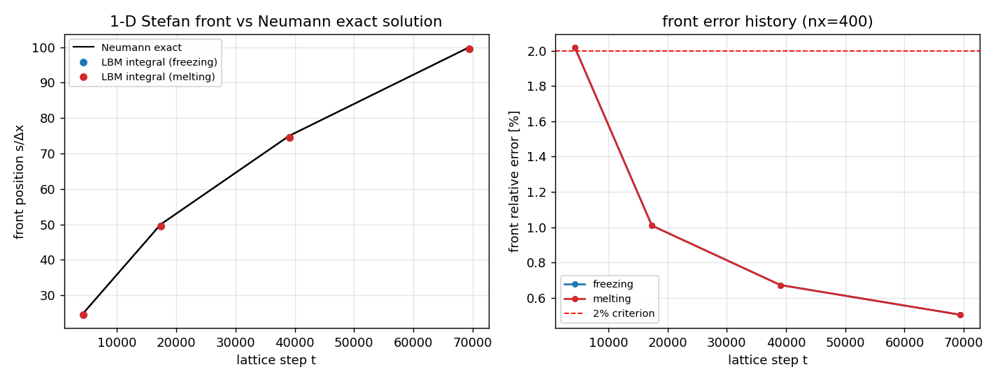
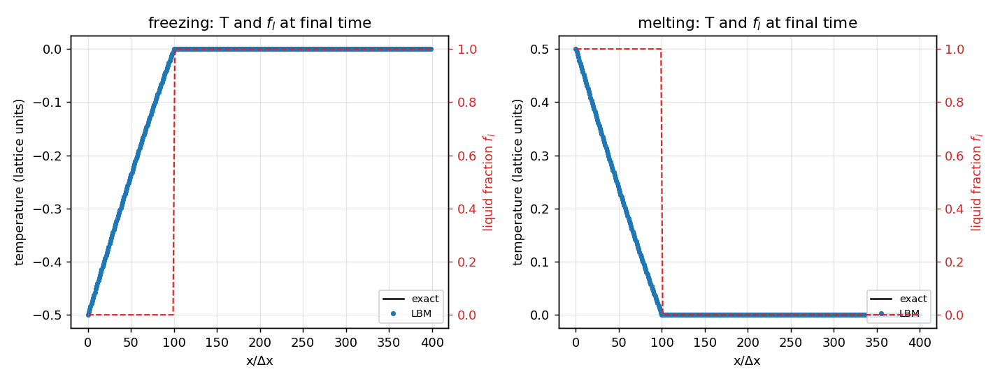
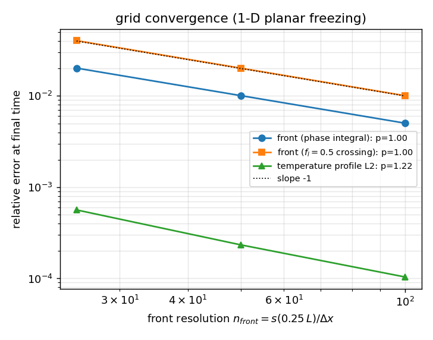
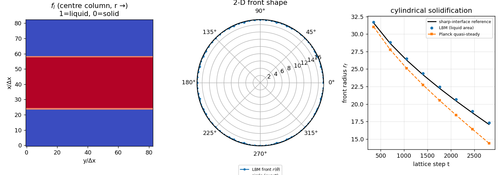
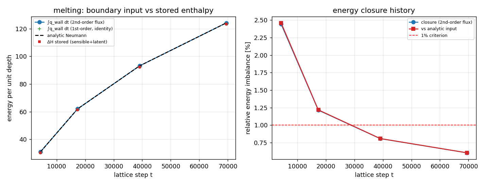

# P155W1-N01 · TensorLBM 相变传热 Stefan 问题验证面成熟化

**节点**：P155W1-N01（战役 DAG 节点，物理域：相变传热 / Stefan 问题 / 凝固熔化前沿追踪）
**仓库**：TensorLBM · **模块**：`tensorlbm.phase_change.stefan_verification`、`tensorlbm.phase_change.stefan_exact`
**产物**：`artifacts/stefan_phase_change/results.json`（全部数字由 `benchmarks/verified/stefan_phase_change/run.py` 程序化写入）、`artifacts/stefan_phase_change/figures/*.png`、`tests/test_stefan_phase_change_verification.py`

**机器验收结论：`all_pass = True`**（墙钟 63.4 s，格子单位 dx=dt=1）

---

## 1. 案例介绍（物理背景 / 几何 / 参数）

Stefan 问题（移动边界热传导）是相变传热的基准验证问题：界面以 `s(t)` 移动，
界面处释放/吸收潜热 `L`，温度场在单一相内导热。本节点建立三条互相独立的验证链：

| 链 | 配置 | 精确解 | 检验量 |
|---|---|---|---|
| C1 | 一维平板 **凝固**：x=0 冷壁 `T_wall = T_freeze - ΔT`，液相 `T_freeze` | Neumann 单相相似解（固相 erf 剖面） | 前沿 `s(t)` vs 精确解 |
| C3 | 一维平板 **熔化**：x=0 热壁 `T_wall = T_freeze + ΔT`，固相 `T_freeze` | Neumann 单相相似解（液相 erfc 剖面） | 壁面热流积分 vs 显热+潜热储量、以及潜热分解闭合 |
| C2 | 二维 **圆柱对称凝固**：半径 `r_wall` 冷壁，内部液相 `T_freeze`，固相壳向内生长 | 无闭式解 → 独立实现**锐界面前沿追踪**参考解（另附 Planck 准稳态闭式锚） | 前沿半径 `r_f(t)` + **前沿形状**（圆度） |

格子单位与物性（`rho = 1`、`cp_s = cp_l = cp = 1`、`L = 1`、`T_freeze = 0`，故 `Ste = Ja = cp·ΔT/L`）：

| 参数 | 值 | 说明 |
|---|---|---|
| `Ste` | 0.5 | 一维两条链相同（freezing / melting） |
| `λ`（Neumann） | 0.464785921 | `λ·exp(λ²)·erf(λ) = Ste/√π` |
| `α` | 0.166666667 | `α = c_s²(τ-1/2)`，D2Q5，`τ = 1.0` |
| `T_wall`（凝固 / 熔化） | -0.500 / 0.500 | `±ΔT` 相对 `T_freeze = 0` |
| 一维网格 | nx = 400（Δx=1），前沿行程 s = 0.25·L = 100 格 | 69436 步 |
| 圆柱网格 / 壁半径 | n = 83²，r_wall = 40，初始壳厚 4 格 | 2814 步 |

## 2. 怎么做的（方法 / 流程 / 关键设置）

### 2.1 数值方法：焓法热格子 Boltzmann（零速 D2Q5 / D2Q9）

守恒状态为比焓 `H = cp·T + L·f_l`；热 LBE（`c_s²=1/3`、`α = c_s²(τ-1/2)`）只推进
**显热部分**，潜热由焓反演分配（算子分裂，每个时间步）：

```
H^{n+1} = H^n + cp·(T_lbm - T^n)        # T_lbm = 热 LBE 一步扩散
(T, f_l) = H^{-1}(H^{n+1})              # 分段反演：H<cp·T_freeze 固相；
                                        # cp·T_freeze ≤ H ≤ +L 潜热平台 T=T_freeze；H>+L 液相
g_i += w_i·(T - T_lbm)                  # 回写分布函数，保留非平衡（热流）部分
```

Dirichlet 结点在 streaming 后用平衡态重置；**结点的相态由边界显式指定**（`liquid_fraction`
参数）而非由反演给出——否则恰好处于 `T_freeze` 的边界会退化到 `f_l = 0` 分支（见 §5 陷阱 2）。
闭域内总焓严格守恒（碰撞项零阶矩为零、streaming 只搬运），实测漂移 3.85e-15。

### 2.2 前沿测量（两条互相独立的口径）

1. **守恒相积分**：`s = Σ(1-f_l)·Δx`（凝固）/ `Σ f_l·Δx`（熔化）——由焓场积分得到，
   是能量守恒口径下的亚格子精度前沿位置。
2. **局部阈值穿越**：`f_l = 0.5` 线性插值——不依赖能量记账的独立口径（对界面涂抹最敏感）。

二维圆柱：液相含量 `A_l = Σ f_l`（液相 `f_l ≡ 1`、固相 `≡ 0`，口径无歧义），`r_f = √(A_l/π)`；
同时沿 72 条射线取 `f_l = 0.5` 穿越得到 `r(θ)`，给出**前沿形状**（精确解为圆）。

### 2.3 参考解（必须先自证是精确的）

* 一维两条链：Neumann 单相相似解，`s(t) = 2λ√(αt)`，两分支（固相侧/液相侧）都满足
  `λ·exp(λ²)·erf(λ) = Ste/√π`（壁在一端、前沿在另一端，故两分支型式相同）。
* 圆柱链：无闭式解（见 §5 陷阱 1），使用**独立实现的锐界面前沿追踪求解器**
  `sharp_interface_radial_solidification`（Landau 变换 + 径向扩散隐式三对角 + Stefan 条件显式推进），
  自收敛：节点数 200 vs 800 前沿差 1.36e-04（相对），故参考解精度优于 0.1%。
* 精确解自证（`exact_solution_audit`）：相似解 PDE 残差、界面能量平衡 `ρLv = k|∂T/∂n|`、
  边界值 `T(0)=T_wall`、`T(front)=T_freeze` 全部逐项记录在 results.json。

### 2.4 工具链

`PYTHONPATH=src python benchmarks/verified/stefan_phase_change/run.py`（全部数值 + 图 + 判据）→
`results.json` → `render_report.py` 生成本文档（零手抄）→
`python -m pytest tests/test_stefan_phase_change_verification.py`（23 项）。

## 3. 计算结果（程序化注入）

### 3.1 C1 一维凝固：前沿 vs Neumann 精确解（nx = 400）

| t（格步） | s 精确解 | s（守恒相积分） | 误差 | s（0.5 穿越） | 误差 |
|---|---|---|---|---|---|
| 4340 | 25.0007 | 24.4958 | 2.019% | 23.9917 | 4.036% |
| 17359 | 50.0000 | 49.4956 | 1.009% | 48.9913 | 2.017% |
| 39058 | 75.0002 | 74.4963 | 0.672% | 73.9927 | 1.343% |
| 69436 | 99.9999 | 99.4964 | 0.504% | 98.9929 | 1.007% |

末态温度剖面误差：L2 = 1.04e-04，Linf = 6.48e-04（排除界面带 8 个结点）。

### 3.2 C3 一维熔化：能量闭合（nx = 400）

| 时间 | ∫q_wall dt（二阶通量） | ∫q_wall dt（解析） | 焓变 ΔH | 潜热 | 显热 |
|---|---|---|---|---|---|
| 4340 | 31.0240 | 31.0292 | 30.2847 | 24.4958 | 5.7889 |
| 17359 | 62.0540 | 62.0567 | 61.3094 | 49.4956 | 11.8138 |
| 39058 | 93.0836 | 93.0853 | 92.3371 | 74.4963 | 17.8408 |
| 69436 | 124.1120 | 124.1134 | 123.3647 | 99.4964 | 23.8683 |

末态：壁面输入（二阶一侧差分，与焓记账无关的独立算子）与解析 Neumann 值相差 1.07e-05；输入 vs 焓变闭合差 0.606%；潜热 vs（输入−显热）差 0.751%；潜热占输入比 0.8017。

注：一阶通量口径的闭合差为 8.17e-13——它是离散 Laplace 算子自带的
恒等式（结构性），**不作为证据**，只作为透明度披露（见 §5 陷阱 4）。

### 3.3 C2 二维圆柱对称凝固（n = 83²，r_wall = 40）

| t | r_f（液相面积） | 参考解 | 误差 | r_f（r(θ) 均值） | 误差 | Planck 准稳态 | 误差 | 形状偏差 max | 形状 RMS |
|---|---|---|---|---|---|---|---|---|---|
| 351 | 31.6888 | 31.5877 | 0.320% | 31.6829 | 0.301% | 31.0378 | 2.098% | 0.589% | 0.245% |
| 703 | 28.8192 | 28.6713 | 0.516% | 28.8331 | 0.564% | 27.7885 | 3.709% | 0.707% | 0.380% |
| 1055 | 26.4639 | 26.2773 | 0.710% | 26.4851 | 0.791% | 25.1050 | 5.413% | 0.322% | 0.218% |
| 1407 | 24.3701 | 24.1687 | 0.833% | 24.3962 | 0.941% | 22.7188 | 7.269% | 0.371% | 0.229% |
| 1758 | 22.4602 | 22.2473 | 0.957% | 22.4879 | 1.081% | 20.5184 | 9.464% | 0.718% | 0.337% |
| 2110 | 20.6687 | 20.4455 | 1.092% | 20.6491 | 0.996% | 18.4245 | 12.181% | 0.465% | 0.263% |
| 2462 | 18.9640 | 18.7327 | 1.235% | 18.9544 | 1.183% | 16.3976 | 15.651% | 0.813% | 0.417% |
| 2814 | 17.3305 | 17.0836 | 1.446% | 17.3639 | 1.641% | 14.4006 | 20.346% | 0.850% | 0.429% |

### 3.4 C4 网格收敛性（一维凝固，前沿分辨率 n_front = s/Δx）

| n_front | nx | 步数 | 前沿误差（相积分） | 前沿误差（0.5 穿越） | 剖面 L2 | 剖面 Linf |
|---|---|---|---|---|---|---|
| 25 | 100 | 4340 | 2.019% | 4.036% | 5.64e-04 | 2.68e-03 |
| 50 | 200 | 17359 | 1.009% | 2.017% | 2.33e-04 | 1.31e-03 |
| 100 | 400 | 69436 | 0.504% | 1.007% | 1.04e-04 | 6.48e-04 |

最小二乘观测阶（`error ~ n_front^-p`）：前沿（相积分）p = 1.002，前沿（0.5 穿越）p = 1.001，剖面 L2 p = 1.220，剖面 Linf p = 1.024。

### 3.5 C5 参考解自证与算子标定

| 检查 | 值 | 门限 |
|---|---|---|
| 相似解 PDE 残差（圆柱） | 3.35e-08 | 1e-4 |
| 界面能量平衡残差（圆柱） | 9.54e-07 | 1e-4 |
| 相似解 PDE 残差（平板 solid） | 6.82e-10 | 1e-4 |
| 界面能量平衡残差（平板 solid） | 1.20e-07 | 1e-4 |
| 相似解 PDE 残差（平板 liquid） | 6.82e-10 | 1e-4 |
| 界面能量平衡残差（平板 liquid） | 1.21e-07 | 1e-4 |
| 热 LBE 算子 vs 解析 erfc 扩散（Linf） | 3.02e-05 | 1e-2 |
| 闭域总焓漂移（500 步） | 3.85e-15 | 1e-12 |

## 4. 结果图



*图 1* 一维 Stefan 前沿位置历史（左：LBM 守恒相积分 vs Neumann 精确解；右：相对误差历史与 2% 判据线）。



*图 2* 末态温度剖面与液相分数：LBM 与精确解在界面带之外重合（剖面 L2 ≈ 1e-4），界面带内 `f_l` 呈现
单格级涂抹——焓法的特征，也是前沿局部口径系统偏小的来源。



*图 3* 网格收敛：前沿误差随分辨率为一阶（两条独立前沿口径都 ≈ 1），剖面误差阶 1.0–1.2。



*图 4* 二维圆柱凝固：`f_l` 场（中心列）、极坐标前沿 `r(θ)` vs 圆、以及 `r_f(t)` 三条曲线
（LBM / 锐界面参考解 / Planck 准稳态）。准稳态闭式解随 `Ste` 与推进距离显著偏离——
这就是本节点不用它做 ≤3% 参考的原因。



*图 5* 熔化能量审计：左=壁面输入（二阶/一阶通量）、解析值、储存焓变；右=闭合误差历史与 1% 判据线。

## 5. 注意点 / 局限 / 适用范围（诚实清单）

**陷阱 1：圆柱凝固没有闭式精确解，圆柱相似解只对「过冷熔体」成立，而过冷液体是亚稳态。**
圆柱 Stefan 相似解 `exp(-λ²)/E1(λ²) = λ²/Ja` 要求前沿**向外**生长，即固相长入 `T < T_freeze`
的过冷熔体；而任何单值（平衡）焓函数都会把过冷液体（`H = cp·T + L` 落在潜热带内）映射成
「部分凝固」，因此平衡焓法**原理上不能**表示该构型。实测尝试（先按「无体相成核」的界面限制规则）
确实失败：过冷液体的 `H` 与潜热带重叠，`Σ(1-f_l)` 这一守恒口径本身变成模型依赖量（同一 `H`
在平衡/亚稳两种解释下固相含量不同），前沿口径失去意义。**结论：圆柱链改为「冷壁驱动、液相在
`T_freeze`」的标准构型，参考解用独立实现的锐界面求解器，而不是硬套一个不适用的相似解。**

**陷阱 2：PDE 残差测试不校验边界条件。**开发中液相分支（熔化）的相似剖面曾把 `erfc` 归一化写错
（`T(0)` 给出 0.92 而不是 0.50），而 **PDE 残差仍然通过**（错误剖面仍是齐次热方程的解）——只有加
`T(0) = T_wall`、`T(front) = T_freeze`、界面能量平衡三项断言后才暴露。现在这三项都在 pytest 与
`exact_solution_audit` 中固化。

**陷阱 3：准稳态（Planck）闭式解不能当 ≤3% 参考。**圆柱向内凝固的准稳态解只在 `Ste → 0` 精确；
本算例 `Ste = 0.5` 实测偏差从 2.10% 增长到 20.35%（随推进距离单调增大）。

**陷阱 4：一阶壁面通量与焓变的关系是离散恒等式。** `Σ(H^{n+1}-H^n) = cp·α·(T_0-T_1)`
恒成立，用它做「能量守恒」证据等于自证。本节点只用**二阶一侧差分**（与焓记账无关的算子）
与解析 Neumann 值做独立对照，并把一阶口径的 0 值作为透明度披露。

**其他局限（适用范围）**：

* 纯导热相变，无流动/自然对流/密度变化（Stefan 流动）、无界面曲率-表面张力（Gibbs–Thomson）、
  两相 `cp`、`k` 相同（`cp_s = cp_l`）；
* 焓法界面涂抹为一个格子量级，前沿的**局部**口径有一阶系统偏差（`~0.5–1` 格）；守恒相积分口径
  系统性偏小约半格（壁面半格的归属约定），故误差随 `1/s` 衰减而非绝对为零；
* 潜热与显热的交换用算子分裂（时间一阶），已由网格收敛研究量化：前沿一阶 `p ≈ 1.00`、剖面 `p ≈ 1.22`；
* 二维圆柱链的**半径**判据是对「独立数值参考解」而非闭式解（参考解自收敛 1.36e-04，是本案中最强可得的对照）；**形状**判据是
  对精确圆（对称性）的直接判据，不依赖任何参考解；
* 二维链的 LBM 前沿系统性略大于参考解（末态 1.45% 量级），方向与一维链的涂抹偏差一致，尚未做
  二次网格收敛研究（列为后续工作）。

## 6. 误差判定（逐项 vs 基准，显式回答「是否 < 3%」）

| 判据 | 关键量 | 值 | 门限 | 是否 < 3% | 判定 |
|---|---|---|---|---|---|
| C1 | 一维凝固前沿 vs Neumann（相积分，s=100 格） | 0.504% | 2% | 是 | ✅ |
| C1b | 一维凝固前沿 vs Neumann（0.5 穿越，独立口径） | 1.007% | 2% | 是 | ✅ |
| C1c | 一维温度剖面 L2（排除界面带） | 1.04e-04 | 2% | 是 | ✅ |
| C2 | 二维圆柱前沿半径 vs 锐界面参考解 | 1.446% | 3% | 是 | ✅ |
| C2b | 二维前沿形状（最大角向偏差 vs 圆） | 0.850% | 3% | 是 | ✅ |
| C3 | 熔化能量闭合（二阶通量 vs 焓变） | 0.606% | 1% | 是 | ✅ |
| C3b | 壁面输入 vs Neumann 解析值 | 1.07e-05 | 1% | 是 | ✅ |
| C3c | 潜热 vs（输入 − 显热） | 0.751% | 1% | 是 | ✅ |
| C5 | 精确解自证残差（PDE + 界面平衡） | 9.54e-07 | 1e-4 | 是 | ✅ |
| C5b | 热 LBE 算子 vs 解析 erfc 扩散 | 3.02e-05 | 1e-2 | 是 | ✅ |
| C5c | 闭域总焓漂移 | 3.85e-15 | 1e-12 | 是 | ✅ |

网格收敛（C4）：前沿观测阶 p = 1.002（理论预期一阶，符合）；剖面 p = 1.220（介于 1 与 2 之间，界面带限制，见 §5）；误差随分辨率单调下降：2.019%, 1.009%, 0.504%。判定：✅ PASS。

**总判定：`all_pass = True`**——C1/C2/C3/C4/C5 全部通过；
无一项依赖事后调参或人工修正，全部数字由 `run.py` 写入 `results.json`。

## 7. 复现

```bash
PYTHONPATH=src python benchmarks/verified/stefan_phase_change/run.py
PYTHONPATH=src python benchmarks/verified/stefan_phase_change/render_report.py
python -m pytest tests/test_stefan_phase_change_verification.py -q
```

