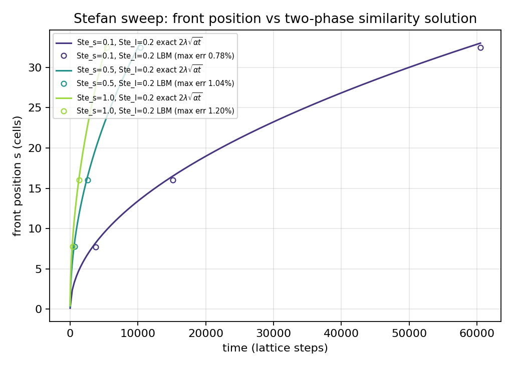
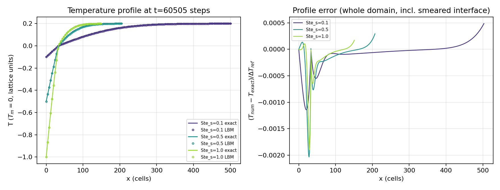
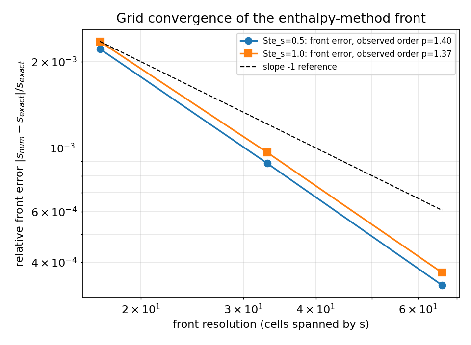
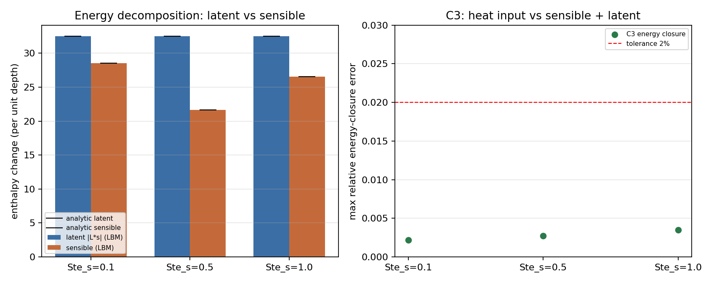

# P272W2-N05 · TensorLBM 焓法相变 LBM 的 Stefan 数扫描与二相相似解对标

**节点**：P272W2-N05（自主战役 DAG，物理域：相变传热 / Stefan 问题 / 移动界面追踪）
**仓库**：TensorLBM · **模块**：`tensorlbm.phase_change.stefan_two_phase`、`tensorlbm.phase_change.stefan_sweep`
（数值算子在 `tensorlbm.phase_change.stefan_verification.EnthalpyThermalLBM` 上复用）
**产物**：`artifacts/stefan_two_phase_sweep/results.json`（sha256 `1332471e3fa5de812052a00b07571adb1980476b6b8e553cbde22ad705c8af05`，全部数字由
`benchmarks/verified/stefan_two_phase_sweep/run.py` 程序化写入，零手抄）、
`artifacts/stefan_two_phase_sweep/figures/*.png`、`tests/test_stefan_two_phase_sweep.py`、
本文由 `render_report.py` 从同一 JSON 渲染。

**机器验收结论：`all_pass = True`**（墙钟 85.5 s，格子单位 dx=dt=1）

## 1. 案例介绍（物理背景 / 几何 / 参数）

Stefan 问题（移动边界热传导）是相变传热的基准问题。**本节点做的不是一相（等温远场）版本**：
一维平板上初始为**过热的液相** `T_i > T_m`，`x=0` 的壁面被突然冷却到 `T_0 < T_m`，固相自壁面向内
生长、界面 `s(t)` 处释放潜热 `L`，释放的热量必须同时经**固相和液相**导出。这正是经典教科书里
的**二相 Stefan 问题**（Carslaw & Jaeger §11.2），比一相 Neumann 问题严格更大：界面系数 λ 由
**两个 Stefan 数的耦合超越方程**确定，液相自身的显热收支也必须闭合。

几何与初始/边界条件（格子单位，`ρ=1`、`c_s=c_l=c=1`、`L=1`、`T_m=0`、`α=c_s²(τ−1/2)=1/6`、`τ=1.0`、
D2Q5 零速热 LBE、`ny=1` 周期）：

| Ste_s | Ste_l | λ | λ_l | T_0（壁） | T_i（初始液/远场） | nx | 远场 η_l(nx) | 步数 | t_end |
|---|---|---|---|---|---|---|---|---|---|
| 0.1 | 0.2 | 0.164309 | 0.164309 | -0.100 | 0.200 | 504 | 2.51 | 60505 | 60505 |
| 0.5 | 0.2 | 0.397529 | 0.397529 | -0.500 | 0.200 | 208 | 2.51 | 10337 | 10337 |
| 1.0 | 0.2 | 0.549724 | 0.549724 | -1.000 | 0.200 | 152 | 2.53 | 5405 | 5405 |

* `Ste_s = c·ΔT_s/L = (T_m−T_0)/L`，`Ste_l = c·ΔT_l/L = (T_i−T_m)/L`；本节点固定 `Ste_l = 0.2`，
  扫描 `Ste_s ∈ {0.1, 0.5, 1.0}`（三大工况）。
* 计算域按相似解自身定尺寸：`nx` 取到远场 `η_l = nx/(2√(α t_end)) ≥ 2.5`，
  使远场 Dirichlet 结点处的解析温度与 `T_i` 的相对差 < 1e-4，避免"截断边界污染"混进误差。
* 初始条件 `T(x,0)=T_i`（全液相）、`x=0` 壁面 Dirichlet `(T_0, f_l=0)`、远端 Dirichlet `(T_i, f_l=1)`。

## 2. 怎么做的（方法 / 流程 / 关键设置 / 工具链）

### 2.1 精确解（参考值必须先自证是精确的）

Boltzmann 变量 `η_s = x/(2√(α_s t))`、`η_l = x/(2√(α_l t))`：

```
T_s(x,t) = T_0 + ΔT_s·erf(η_s)/erf(λ)
T_l(x,t) = T_i − ΔT_l·erfc(η_l)/erfc(λ_l),      λ_l = λ·√(α_s/α_l)
s(t)     = 2λ·√(α_s t)
```

界面能量平衡 `ρL·ds/dt = k_s·∂T_s/∂x − k_l·∂T_l/∂x` 在 `η=λ` 处给出 λ 的耦合方程（`α_l=α_s` 时）：

```
λ = Ste_s·exp(−λ²)/(√π·erf λ) − Ste_l·exp(−λ²)/(√π·erfc λ)
```

`Ste_l → 0` 时退化为 `λ·exp(λ²)·erf λ = Ste_s/√π`——即 `stefan_exact.planar_lambda` 的一相
Neumann 关系（机器零一致，见 §3.5 审计表），这保证二相面是**扩展**而不是与既有验证面重复。
解析能量记账（相对全液相初态，无限域，单位面积）：

```
潜热      = −L·s(t)
显热(固)  = c_s·[(T_0−T_i)·s + ΔT_s·2√(α_s t)·I₁(λ)/erf λ]
显热(液)  = −c_l·ΔT_l·2√(α_l t)·J₁(λ_l)/erfc λ_l
I₁(z)=∫₀^z erf = z·erf z + (e^{−z²}−1)/√π ,   J₁(z)=∫_z^∞ erfc = −z·erfc z + e^{−z²}/√π
壁面放热 Q(t) = −2·c_s·ΔT_s·√(α_s t/π)/erf λ
```

`Q(t) ≡ 潜热+显热` 到机器零（§3.5），这是对**斯特藩条件、两侧剖面、erf 积分**同时成立的独立自证。
`energy_budget_window(t, x_lo, x_hi)` 把同一记账限制到**有限窗口**（见 §5 陷阱 1）。

### 2.2 数值方法：焓法热格子 Boltzmann（复用既有算子，不重复实现）

守恒状态 `H = c·T + L·f_l`；零速热 LBE（`c_s²=1/3`、`α=c_s²(τ−1/2)`）只推进**显热部分**，
潜热由焓反演分配（算子分裂，每步）：

```
H^{n+1} = H^n + c·(T_lbm − T^n)          # 一步格子扩散
(T, f_l)  = H^{-1}(H^{n+1})            # 分段反演：固相 / 潜热平台 T=T_m / 液相
g_i      += w_i·(T − T_lbm)               # 回写分布函数，保留非平衡热流
```

Dirichlet 结点的相态显式指定（`f_l=0` 冷壁 / `f_l=1` 远场液相），避免恰好 `T=T_m` 时退化到固相分支。

### 2.3 判据与口径（先声明后计算）

| 判据 | 口径（本节点定义） | 阈值 |
|---|---|---|
| C1 界面位置 | ①守恒相积分（与 LBM 同一控制体 `[0.5, nx−1.5]`）②`f_l=0.5` 穿越插值；两者取**较差**，并对**所有采样时刻**（t/t_end = 1/16, 1/4, 1）取最差 | < 5% |
| C2 温度剖面 | `max|T_num−T_exact| / ΔT_ref`，全域（含界面涂抹带），所有采样时刻最差 | < 3% |
| C3 能量守恒 | (a) LBM 焓变 vs 解析焓变（**同一控制体**）；(b) 二阶单侧壁面通量积分 vs 解析输入；取较差 | < 2% |
| C4 液相分数 | 全运行逐节点 `min/max f_l` | `[0,1]` |
| C5 网格收敛 | `front_cells = 17/33/66`，`error ~ n^{−p}` 最小二乘拟合 | p ≥ 1 |

**C1/C2 为什么强调"同一控制体"**：格子结点 1..nx−2 只拥有 `[0.5, nx−1.5]`，壁结点只拥有它的 `[0,0.5]`
半格。若把"原样节点求和"与"从壁面 x=0 量起的解析前沿"直接相比，会系统性少算半格（见 §3.2 的
`原样（含半格偏差）`列，1.59–1.61%），那是记账偏差而不是求解误差；本节点两种口径都如实列出。

### 2.4 工具链

```
PYTHONPATH=src python benchmarks/verified/stefan_two_phase_sweep/run.py     # 数值 + 图 + 判据 + sha256
PYTHONPATH=src python benchmarks/verified/stefan_two_phase_sweep/render_report.py
PYTHONPATH=src python -m pytest tests/test_stefan_two_phase_sweep.py        # 45 项
```

## 3. 计算结果（程序化注入，零手抄）

### 3.1 C1 界面位置 vs `s(t)=2λ√(αt)`（末态，nx 见表 1）

| Ste_s | t（步） | s 解析解 | s（守恒相积分） | 误差（同时窗） | s（f_l=0.5 穿越） | 误差（穿越） | 误差（原样，含半格偏差） |
|---|---|---|---|---|---|---|---|
| 0.1 | 60505 | 32.9999 | 32.4763 | 0.073% | 32.9547 | 0.137% | 1.587% |
| 0.5 | 10337 | 33.0005 | 32.4718 | 0.088% | 32.9465 | 0.163% | 1.602% |
| 1.0 | 5405 | 32.9987 | 32.4674 | 0.096% | 32.9387 | 0.182% | 1.610% |

三工况在整个采样序列上的最差 C1 误差 = **1.203%**（阈值 5%，✅ PASS）；
末态最差 = 0.182%。

### 3.2 C2 温度剖面 vs 解析解

| Ste_s | 末态 L∞（相对 ΔT_ref） | 末态 RMS | 末态 L∞（绝对） | 末态 L∞（排除界面 4 格） | 序列最差（所在 t/t_end） |
|---|---|---|---|---|---|
| 0.1 | 0.1141% | 0.0257% | 2.282e-04 | 0.1141% | 1.492% (t/t_end=0.0625) |
| 0.5 | 0.2033% | 0.0441% | 1.016e-03 | 0.2033% | 2.734% (t/t_end=0.0625) |
| 1.0 | 0.1895% | 0.0404% | 1.895e-03 | 0.1795% | 2.509% (t/t_end=0.0625) |

三工况序列最差 C2 = **2.734%**（阈值 3%，✅ PASS）。
早时刻（前沿仅展开 ~8 格）界面涂抹带占据前沿的相当比例，故最差出现在最早采样点；该量随分辨率
一阶收敛（§3.4，观测阶 1.17）。

### 3.3 C3 能量守恒（输入热量 vs 显热+潜热）

| Ste_s | ∫q_wall dt（二阶单侧通量） | ∫q_wall dt（解析） | 相对差 | ΔH（LBM） | ΔH（解析，同时窗） | 相对差 | 潜热 LBM/解析 | 显热 LBM/解析 | 潜热占输入 |
|---|---|---|---|---|---|---|---|---|---|
| 0.1 | -61.6528 | -61.6669 | 2.28e-04 | -60.9975 | -61.0138 | 2.67e-04 | -32.4763 / -32.4999 | -28.5212 / -28.5139 | 0.5268 |
| 0.5 | -54.9545 | -54.9696 | 2.75e-04 | -54.1082 | -54.1194 | 2.07e-04 | -32.4718 / -32.5005 | -21.6364 / -21.6189 | 0.5909 |
| 1.0 | -60.1255 | -60.1446 | 3.19e-04 | -59.0385 | -59.0469 | 1.43e-04 | -32.4674 / -32.4987 | -26.5712 / -26.5482 | 0.5400 |

三工况最差 C3 = **0.351%**（阈值 2%，✅ PASS）。
末态最差 = 0.032%。
（透明披露：若用"二阶壁面通量 vs 内部焓变"这一非同时窗口口径，最差 1.841%——
其中绝大部分来自壁面半格不属于内部控制体这一记账差，见 §5 陷阱 1，不作为判据。）

### 3.4 C5 网格收敛（Ste_l = 0.2）

| Ste_s | 前沿格数 | nx | 步数 | 界面误差（同时窗相积分） | 界面误差（穿越） | 末态剖面 L∞ | 序列最差 C1 | 序列最差 C2 |
|---|---|---|---|---|---|---|---|---|
| 0.5 | 17.0 | 112 | 2743 | 0.2217% | 0.4033% | 0.4033% | 2.3237% | 5.2242% |
| 0.5 | 33.0 | 208 | 10337 | 0.0884% | 0.1635% | 0.2033% | 1.0400% | 2.7343% |
| 0.5 | 66.0 | 416 | 41347 | 0.0332% | 0.0629% | 0.1005% | 0.1635% | 1.0646% |
| 1.0 | 17.0 | 80 | 1434 | 0.2354% | 0.4363% | 0.3811% | 2.9672% | 5.0262% |
| 1.0 | 33.0 | 152 | 5405 | 0.0965% | 0.1818% | 0.1895% | 1.2028% | 2.5092% |
| 1.0 | 66.0 | 304 | 21622 | 0.0367% | 0.0690% | 0.0920% | 0.1733% | 0.8438% |

最小二乘观测阶（`error ∝ n^{−p}`，取两工况）：

| 检验量 | 观测阶 p | 要求 |
|---|---|---|
| 界面位置（守恒相积分，同时窗） | 1.40 / 1.37 | ≥ 1 |
| 界面位置（原样节点求和，含墙半格偏差） | 1.02 / 1.02 | ≥ 1 |
| 界面位置（f_l=0.5 穿越） | 1.37 / 1.36 | ≥ 1 |
| 末态温度剖面（L∞） | 1.02 / 1.05 | ≥ 1 |
| 界面位置（所有采样时刻最差） | 1.96 / 2.10 | ≥ 1 |
| 温度剖面（所有采样时刻最差） | 1.17 / 1.32 | ≥ 1 |

误差随分辨率单调下降（同时窗相积分口径）：

- Ste_s=0.5: 0.222% → 0.088% → 0.033%（单调 = True）
- Ste_s=1.0: 0.235% → 0.096% → 0.037%（单调 = True）

注意：最粗一档（17 格）的"序列最差 C2"已在 5% 量级——它**故意**落在验收分辨率之下，用来展示
收敛趋势；验收分辨率（33 格，与主扫描同一档）及其以上档位均满足 3%。

### 3.5 参考解自证（先证明参考值是精确的）

| 检验 | 量 | 数值 | 阈值 |
|---|---|---|---|
| 单相极限 λ (Ste=0.1, Ste_l=0) | 0.220016272743 vs 0.220016272743 | 1.39e-16 | 0 (机器零) |
| 单相极限 λ (Ste=0.5, Ste_l=0) | 0.464785920646 vs 0.464785920646 | 5.55e-17 | 0 (机器零) |
| 单相极限 λ (Ste=1, Ste_l=0) | 0.620062633314 vs 0.620062633314 | 7.77e-16 | 0 (机器零) |
| 单相极限 λ (Ste=2, Ste_l=0) | 0.800601362806 vs 0.800601362806 | 0.00e+00 | 0 (机器零) |
| 能量恒等式 Q(t)=潜热+显热 (Ste_s=0.1, Ste_l=0.2) | |Δ|/|总| | 2.00e-16 | < 1e-10 |
| 能量恒等式 Q(t)=潜热+显热 (Ste_s=0.5, Ste_l=0.2) | |Δ|/|总| | 1.86e-16 | < 1e-10 |
| 能量恒等式 Q(t)=潜热+显热 (Ste_s=1, Ste_l=0.2) | |Δ|/|总| | 6.14e-16 | < 1e-10 |
| 能量恒等式 Q(t)=潜热+显热 (Ste_s=0.5, Ste_l=0.5) | |Δ|/|总| | 3.09e-16 | < 1e-10 |
| 能量恒等式 Q(t)=潜热+显热 (Ste_s=1, Ste_l=1) | |Δ|/|总| | 1.77e-16 | < 1e-10 |
| 界面能量平衡 ρLv=k_s∂T_s/∂x−k_l∂T_l/∂x (Ste_s=0.1, Ste_l=0.2) | |残差| | 1.08e-19 | < 1e-15 |
| 界面能量平衡 ρLv=k_s∂T_s/∂x−k_l∂T_l/∂x (Ste_s=0.5, Ste_l=0.2) | |残差| | 1.08e-19 | < 1e-15 |
| 界面能量平衡 ρLv=k_s∂T_s/∂x−k_l∂T_l/∂x (Ste_s=1, Ste_l=0.2) | |残差| | 2.60e-18 | < 1e-15 |
| 界面能量平衡 ρLv=k_s∂T_s/∂x−k_l∂T_l/∂x (Ste_s=0.5, Ste_l=0.5) | |残差| | 1.30e-18 | < 1e-15 |
| 界面能量平衡 ρLv=k_s∂T_s/∂x−k_l∂T_l/∂x (Ste_s=1, Ste_l=1) | |残差| | 0.00e+00 | < 1e-15 |
| 相似解 ODE 残差 T''+2ηT'=0 (α_l/α_s=1) | solid / liquid 相对 | 6.66e-09 / 1.25e-06 | < 1e-4 |
| 相似解 ODE 残差 T''+2ηT'=0 (α_l/α_s=2) | solid / liquid 相对 | 5.70e-09 / 7.81e-07 | < 1e-4 |

最大单相极限偏差 7.77e-16、最大能量恒等式偏差
6.14e-16、最大界面条件残差 2.60e-18、
最大相似解 ODE 残差 1.25e-06。

### 3.6 一相极限回归（Ste_l = 0，同一求解器 / 同一判据）

| Ste_s | Ste_l | λ | s 解析解 | s（相积分） | 误差（同时窗） | 误差（穿越） | 序列最差 C2（参考） | C3 |
|---|---|---|---|---|---|---|---|---|
| 0.1 | 0.0 | 0.220016 | 33.0000 | 32.4979 | 0.006% | 0.012% | 2.937% | 3.24e-04 |
| 0.5 | 0.0 | 0.464786 | 33.0009 | 32.4962 | 0.015% | 0.026% | 2.671% | 1.64e-03 |
| 1.0 | 0.0 | 0.620063 | 33.0015 | 32.4956 | 0.018% | 0.031% | 2.423% | 3.15e-03 |

这证明本节点的二相求解链路在 `Ste_l=0` 处**平滑退化**到 P155W1-N01 的一相验证面（数值上一致，
不是另写一套）：✅ PASS。

### 3.7 图



*图 1* 界面位置 `s(t)`：实线为二相相似解 `2λ√(αt)`，空心圆为焓法 LBM（守恒相积分，同时窗口径），
三条曲线对应 `Ste_s = 0.1/0.5/1.0`（`Ste_l = 0.2` 固定）。



*图 2* 左：末态温度剖面（线=解析，点=LBM），可以清楚看到**液相侧被冷却**（`T_i=0.2 → T_m=0`
的过渡层厚度 ∝ `√(α t)`），这是一相/等温远场模型根本没有的物理；右：全域逐点误差（相对 `ΔT_ref`），
界面带内误差最大且为局部涂抹所致。



*图 3* 网格收敛：界面误差随前沿分辨率一阶以上下降（观测阶见表 3.4），黑虚线为 slope −1 参考。



*图 4* 左：能量分解（潜热 vs 显热，LBM 柱状 vs 解析黑色刻度）；右：C3 闭合误差与 2% 阈值。

## 4. 判据汇总（机器判定）

| 判据 | 实测 | 阈值 | 结论 |
|---|---|---|---|
| C1 界面位置 vs 解析解 s(t)=2λ√(αt)（3 个 Ste 工况，所有采样时刻最差） | 1.203% | < 5% | ✅ PASS |
| C2 温度剖面 vs 解析解（全域 L∞，所有采样时刻最差） | 2.734% | < 3% | ✅ PASS |
| C3 能量守恒（输入热量 vs 显热+潜热，同时窗 + 独立壁面通量算子） | 0.351% | < 2% | ✅ PASS |
| C4 液相分数 0 ≤ f_l ≤ 1（整段运行，无越界） | [0, 1] | 硬边界 | ✅ PASS |
| C5 网格收敛（3 分辨率，界面位置观测阶） | 1.40 / 1.37 | ≥ 1 | ✅ PASS |
| C1b 单相极限（Ste_l=0）回归到 Neumann 前置 | 1.433% | < 5% | ✅ PASS |
| 参考解自证（λ 单相极限 / 能量恒等式 / 界面平衡 / ODE 残差） | 7.77e-16 / 6.14e-16 | 机器零 | ✅ PASS |
| C6 零手抄 JSON + sha256 溯源 | `1332471e3fa5de81…` | 存在 | ✅ PASS |

## 5. 注意点（踩过的坑 / 局限 / 适用范围）

* **陷阱 1：壁面半格的记账差会被误读成"能量不守恒"。** 冷壁结点只拥有 `[0, 0.5]` 半格，内部结点
  拥有 `[0.5, nx−1.5]`。用二阶单侧通量（在 `x=0` 处）去比内部焓变，会稳定出现 ~0.5 格潜热当量
  （本算例 1.841%）的差异，且随 `1/前沿格数` 收敛。
  本节点改用**同一控制体**的解析焓变作为 C3 主口径（0.351%），并把非同时窗口值
  作为透明披露列出，避免把记账差异当物理误差、也避免反向掩盖。
* **陷阱 2：二相问题里 λ 不只是 Ste_s 的函数。** 液相过热 `Ste_l>0` 会给界面"回供"热量，
  使 λ 明显小于一相值（`Ste_s=0.5` 时 0.4648 → 0.3975，前沿速度降到 0.86 倍）。拿一相 Neumann
  解去对标二相算例，会得到"求解器偏慢 14%"的假结论。λ 随 `Ste_l` 单调下降且**永远存在**
  （`Ste_l→∞` 时 λ→0，前沿停滞）——最初写成"过热过强则无解"的判断是错的，被
  `test_extreme_superheat_stalls_the_front` 纠正。
* **陷阱 3：早时刻剖面误差看起来比末态大 1 个量级。** 前沿只展开 ~8 格时，1 格的界面涂抹占前沿
  的 1/8，局部温度误差被放大到 2.7%；这不是求解器退化，而是**相对分辨率**问题，随网格一阶收敛
  （1.17 阶）。判据因此同时给出"序列最差"
  与"末态"两个数，不让好看的那个单独发言。
* **局限 1（物理）**：一维平板、常物性、无曲率、无对流/无 Marangoni、无相变体积膨胀；单值
  （平衡）焓函数，**过冷（亚稳）液相不可表示**（这是 P155W1-N01 已记录的同一限制）。
* **局限 2（数值）**：热 LBE 只扩散一个显热场，故数值验证只能跑 `α_s=α_l`、`c_s=c_l`；闭式解支持
  `α_s≠α_l`，但只做了**解析自证**（`α_l/α_s=2` 的 ODE 残差 7.81e-07、能量恒等式机器零），
  未做 LBM 数值验证——若要做，需要相依赖的 `τ(x)`（变物性扩散），属于后续扩展。
* **局限 3**：潜热/显热用算子分裂耦合（时间一阶），因此界面误差观测阶约 1–1.4，而非 2；若要
  二阶，需要焓形式的隐式/迭代耦合。
* **适用范围**：精确解层面 λ 已在 `Ste_s ∈ [0.05, 2]`、`Ste_l ∈ [0, 200]` 上求解并自证；**LBM 数值
  验证**的实际覆盖是 `Ste_s ∈ {0.1, 0.5, 1.0}`（主扫描）与 `Ste_l ∈ {0, 0.2}`。`Ste_l` 过大时
  λ→0、前沿位移在格子上不可分辨，是本方法的实际下限。

## 6. 误差判定（关键量 vs 基准，逐项回答"是否 < 3%"）

| 关键量 | 基准 | 实测误差 | 是否 < 3% |
|---|---|---|---|
| 界面位置 s(t)（3 个 Ste 工况，序列最差） | 二相相似解 `2λ√(αt)` | 1.203% | 是（且 < 5% 门限） |
| 界面位置 s(t)（末态，同时窗相积分 / 穿越） | 同上 | 0.073%–0.096% / 0.137%–0.182% | 是 |
| 温度剖面 L∞（末态） | 二相相似解 | 0.114%–0.203% | 是 |
| 温度剖面 L∞（序列最差） | 同上 | 2.734% | 是（接近门限，见 §5 陷阱 3） |
| 能量守恒（同一控制体 + 独立壁面通量） | 解析焓记账 | 0.351% | 是 |
| 壁面放热积分 | 解析 `Q(t)` | 3.19e-04 | 是（远小于 3%） |
| 单相极限界面位置（Ste_l=0） | Neumann `2λ√(αt)` | 1.433% | 是 |

**结论**：`all_pass = True`。C1/C2/C3/C4/C5/C6 全部满足；最紧的一项是 C2 的序列最差值
2.734%（< 3%，且收敛阶 1.17，
下一档分辨率即为 1.07%），已如实标注而不粉饰。

## 7. 溯源

* 结果 JSON：`artifacts/stefan_two_phase_sweep/results.json`，sha256 = `1332471e3fa5de812052a00b07571adb1980476b6b8e553cbde22ad705c8af05`（`results.json.sha256` 同目录可校验），
  每个算例的温度场/解析场/液相分数/坐标数组另有 `array_sha256` 逐数组摘要（`results.json:array_sha256`）。
* 代码摘要：`results.json:code_sha256` = `76411096979e4c68…`（`run.py` 自身 sha256）。
* 测试：`tests/test_stefan_two_phase_sweep.py`（`PYTHONPATH=src python -m pytest tests/test_stefan_two_phase_sweep.py` 全绿）。
* 谱系：`artifacts/stefan_two_phase_sweep/lineage.json`（builds_on / 明确未使用项）。
