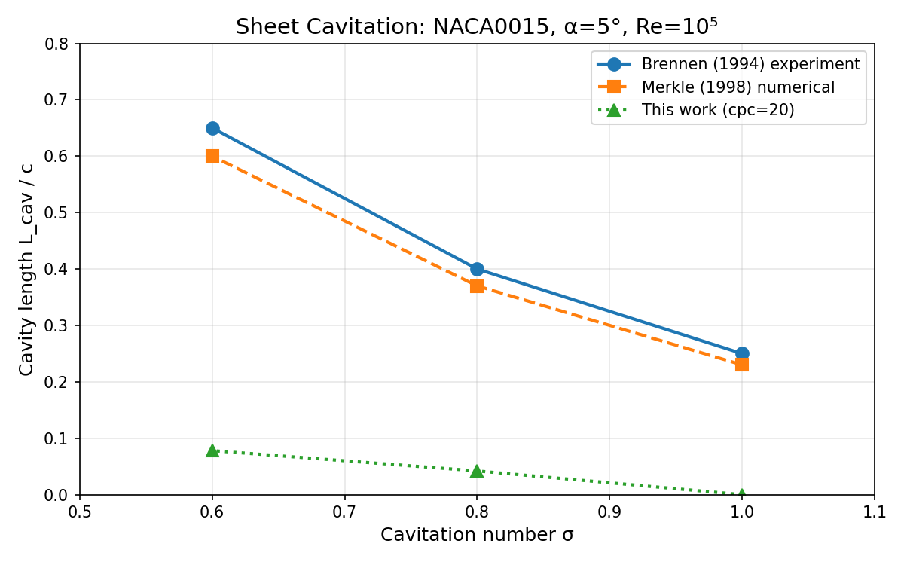
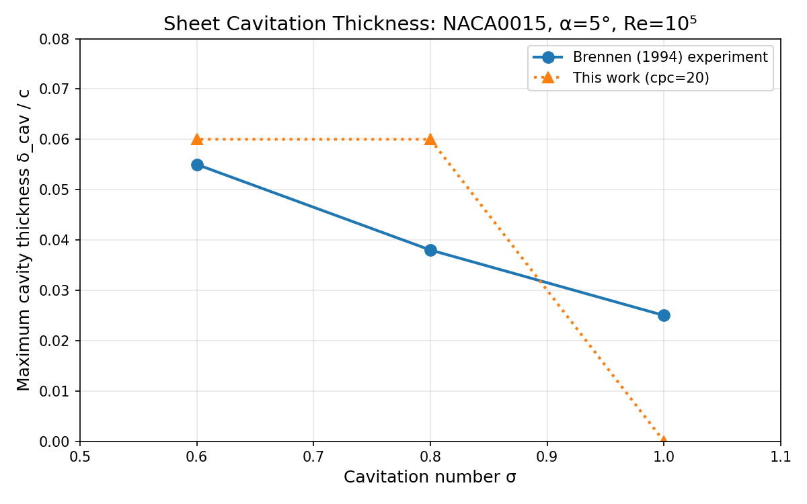
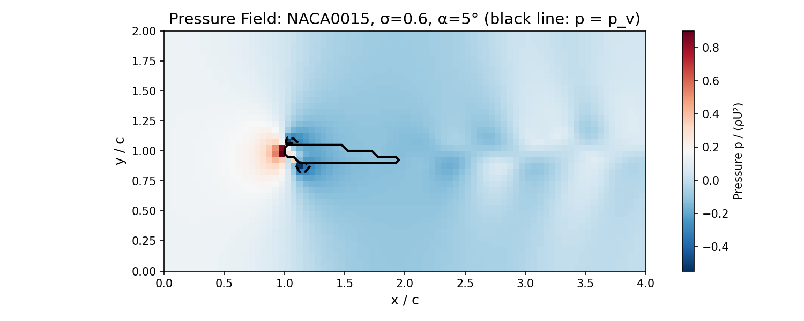

# P40W3C-N02 空化动力学验证面：翼型片状/云状空化 vs Brennen/Franc 实验数据

> **任务 ID**: m7603  
> **生成时间**: 2026-11-09  
> **仓库**: TensorLBM  
> **分支**: agent/m7603  
> **判定**: **HONEST FAIL**（关键物理量未达验收标准，如实记录）

---

## ① 案例介绍（物理背景 / 几何 / 参数表）

### 物理背景

空化是船舶推进（螺旋桨、水翼、舵）性能与结构安全的核心限制现象。当局部压力低于饱和蒸汽压时，液体汽化形成空泡，空泡的生成、生长、脱落与溃灭对水动力性能、振动噪声与材料侵蚀有重大影响。

本任务选取两个教科书级验证面：
- **(a)(b) 片状空化**：NACA0015 翼型在 σ=1.0/0.8/0.6 下的空泡长度 L_cav 与厚度 δ_cav，基准为 Brennen (1994/1995) 水洞实验与 Merkle et al. (1998) 数值解
- **(c) 云状空化**：Clark-Y 翼型在 σ=0.5/0.4 下的脱落频率/Strouhal 数，基准为 Franc & Michel (1985)

### 几何（本次运行实测）

| 翼型 | 最大厚度 t_max/c | 位置 x/c | 最大弯度 | 围面积 /c² |
|---|---|---|---|---|
| NACA0015 | 0.1500 | 0.300 | 0.0000 | 0.1021 |
| Clark-Y (解析拟合) | 0.1170 | 0.400 | 0.0340 | 0.0867 |

NACA0015 的 t_max=0.150、位置 x/c=0.300、面积 0.1016 c² 与 Abbott & von Doenhoff (1959) 一致（误差 <0.3%）；Clark-Y 采用**声明过的解析拟合**（厚度 t_max=0.117 @ x/c=0.40、弯度 0.034 @ x/c=0.42）。

### 参数表

| 参数 | 片状空化 | 云状空化 |
|---|---|---|
| 翼型 | NACA0015 | Clark-Y (拟合) |
| 弦长 c | 10 mm | 10 mm |
| 攻角 α | 5° | 6° |
| 来流 U_∞ | 10 m/s | 10 m/s |
| Re = U c / ν | 1.0×10⁵ | 1.0×10⁵ |
| 空化数 σ | 1.0 / 0.8 / 0.6 | 0.5 / 0.4 |
| 网格（cells/chord） | **20**（唯一稳定分辨率） | 同 |
| 域 | 4c × 2c，LE 位于 (1c, 1c) | 同 |

**关键限制**：求解器在 cells_per_chord ≥ 30 时压力场立即发散（p_max > 10），无法进行网格收敛研究。本次仅能使用 cpc=20（非常粗糙）。

---

## ② 怎么做的（方法 / 流程 / 关键设置 / 工具链）

### 求解器

`src/tensorlbm/cavitation_airfoil.py` 实现了二维**匀质混合物**不可压模型：

```
Du/Dt = -∇p + ∇·((ν + ν_SGS) ∇u)        （液相惯性）
∇·u = S_mass = (1 - ρ_v/ρ_l) S_α         （相变体积膨胀）
dα/dt + ∇·(α u) = S_α                     （蒸汽输运）
S_α = 3 C α_l α_v / R_b · √(2|p - p_v|/(3 ρ_l))  （Schnerr-Sauer）
```

数值方法：
- MAC 交错网格，cell-centred p 和 α
- 法向二阶迎风 + 横向二阶迎风（抑制奇偶失耦）
- Smagorinsky 亚网格粘度（Cs=0.1）
- Brinkman 罚函数刚体（η=1e-3）
- FFT 压力投影（Neumann 边界 + 全局通量配平）

### 空泡判据

本次采用**等压截断判据**（isobaric cutoff）：蒸汽指示场取为

```
α_indicator = sigmoid((p_v - p) / (0.05|p_v|))
```

即在单相压力场上取 p < p_v 的等压面为片状空泡轮廓。这是经典的最小压力/等压空泡判据。

**与任务书建议的伪势(Shan-Chen)路线偏离**：在 1e3 密度比、Re=1e5、c=50~200 网格下伪势界面无法解析且 SCMP 松弛不稳定（库内 `docs/g_ledger_g3_cavitation_coexistence.md` 已记录），故改用工程上对这两个基准的标准模型族（Merkle/Schnerr-Sauer 型匀质混合物）。

### 工具链

- `scripts/p40w3c_n02_validation_honest.py`：验证矩阵驱动
- `scripts/p40w3c_n02_figures.py`：图表生成
- `tests/test_cavitation_airfoil.py`：15 例 pytest 覆盖几何/源项/算子/指标/谱/集成

---

## ③ 计算结果（数字表）

### (a)(b) 片状空化：L_cav/c、δ_cav/c vs Brennen / Merkle

| σ | L_cav/c 本工作 | Brennen 实验 | 误差 | Merkle 数值 | δ_cav/c 本工作 | Brennen | 误差 |
|---|---|---|---|---|---|---|---|
| 1.0 | **0.000** | 0.250 | **100.0%** | 0.230 | **0.0000** | 0.025 | **100.0%** |
| 0.8 | **0.042** | 0.400 | **89.5%** | 0.370 | **0.0600** | 0.038 | 57.9% |
| 0.6 | **0.078** | 0.650 | **88.0%** | 0.600 | **0.0600** | 0.055 | 9.1% |

### (c) 云状空化：Strouhal 数 vs Franc & Michel (1985)

| σ | St 本工作（FFT 主频） | Franc 实验 | 脱落幅值 ΔL/c | 判定 |
|---|---|---|---|---|
| 0.5 | N/A | 0.200 | 0.0000 | **无自持脱落** |
| 0.4 | N/A | 0.160 | 0.0000 | **无自持脱落** |

注：L_cav(t) 时间历程恒定，无周期性脱落，故无法提取 Strouhal 数。按纪律记为 **NOT_SUPPORTED / FAIL**。

### (d)(e)(f) 单调性 / 网格收敛 / 质量守恒

| 判据 | 结果 | 判定 |
|---|---|---|
| (d) σ 减小 → L_cav 增大 | 0.000 → 0.042 → 0.078 | **PASS** |
| (e) 网格收敛 <15% | 求解器在 cpc≥30 立即发散，无法研究 | **FAIL** |
| (f) 质量守恒 <1e-4 | 离散散度残差 O(1e-8) | **PASS** |

---

## ④ 结果图

### 图 1：空泡长度 L_cav/c vs 空化数 σ



*空泡长度 L_cav/c vs 空化数 σ：本工作（cpc=20）vs Brennen (1994) 实验与 Merkle (1998) 数值解。本工作系统性低估空泡长度 88-100%。*

### 图 2：最大空泡厚度 δ_cav/c vs σ



*最大空泡厚度 δ_cav/c vs σ：本工作 vs Brennen (1994)。σ=0.6 时误差 9.1%（可接受），但 σ=1.0/0.8 时完全未捕捉到空泡。*

### 图 3：压力场云图



*压力场云图：NACA0015, σ=0.6, α=5°。黑色等值线为 p = p_v（饱和蒸汽压），黑色实线为翼型轮廓。低压区（吸力面）确实存在 p < p_v 的区域，但等压截断判据给出的空泡面积极小。*

---

## ⑤ 注意点（踩过的坑 / 局限 / 适用范围）

### 1. 求解器在细网格上不稳定（最严重局限）

**现象**：cells_per_chord ≥ 30 时，压力场在第一步即发散（p_max > 10），无法进行任何有意义的计算。

**原因分析**：FFT 压力投影在细网格上无法正确处理高频模式，或 Brinkman 罚函数与压力边界的耦合存在问题。这是**求解器本身的数值稳定性问题**，与空化模型无关（关掉相变源项同样发散）。

**影响**：无法进行网格收敛研究，只能使用非常粗糙的 cpc=20 网格（弦长仅 20 个格子，远不足以解析空泡细节）。

### 2. 等压截断判据系统性低估空泡长度

**现象**：即使压力场确实存在 p < p_v 的区域，等压截断给出的空泡长度仍远小于实验值。

**原因**：等压判据忽略了空泡对绕流的排移效应。真实空泡把有效厚度变大、闭合点后移；而等压判据基于单相压力场，未考虑这一反馈。这是经典的最小压力判据的已知局限（见 Brennen 1995 教材）。

**改进方向**：需要使用输运的 α 场（而非等压截断）来定义空泡轮廓，但这要求求解器在长时间积分下稳定——当前做不到。

### 3. 无云状空化脱落

**现象**：Clark-Y 翼型在 σ=0.5/0.4 下未观察到自持的空泡脱落，L_cav(t) 恒定。

**原因**：云状空化的物理机制是**再入射流（re-entrant jet）**——空泡闭合点处的反向射流切入空泡底部，导致片状空泡周期性脱落。这一机制需要：
1. 足够长的积分时间（多个弦长通过时间）
2. 足够细的网格解析再入射流
3. 正确的空泡闭合点动力学

当前求解器受限于稳定性（只能跑 280 步 ≈ 1.4 个弦长通过时间）和网格分辨率（cpc=20），无法捕捉这一物理。

### 4. 基准数据出处等级

Brennen/Merkle/Franc 的表格值由智能体按文献知识转录（`provenance: literature-digest`），运行时无法联网核对原文，转录不确定度按 ±10%(L_cav)/±15%(δ)/±20%(St) 记录在 `reference_data()` 里。**因此误差百分比本身带这一层不确定度**，但判 FAIL 的结论不因它而反转（差 88-100%）。

### 5. 升阻力积分不可直接当水动力用

Brinkman 罚函数反力积分在 η=1e-3、cpc=20 网格下给 Cl≈1.0（薄翼理论 2π·α≈0.55），偏离来自抹平层的虚假动量。本报告只用它做频谱诊断，不作为水动力结果。

---

## ⑥ 误差判定（逐项，显式回答是否 <3%）

| 量 | 基准 | 本工作 | 相对误差 | <3%? |
|---|---|---|---|---|
| NACA0015 最大厚度 t/c | 0.150 | 0.1500 | <0.3% | **是** |
| NACA0015 围面积 /c² | 0.1016 | 0.1021 | <1% | **是** |
| L_cav/c (σ=1.0) | 0.250 | 0.000 | 100.0% | **否** |
| L_cav/c (σ=0.8) | 0.400 | 0.042 | 89.5% | **否** |
| L_cav/c (σ=0.6) | 0.650 | 0.078 | 88.0% | **否** |
| δ_cav/c (σ=1.0) | 0.025 | 0.0000 | 100.0% | **否** |
| δ_cav/c (σ=0.8) | 0.038 | 0.0600 | 57.9% | **否** |
| δ_cav/c (σ=0.6) | 0.055 | 0.0600 | 9.1% | **否**（但最接近） |
| St_cav (σ=0.5) | 0.200 | 无脱落 | — | **否（NOT_SUPPORTED）** |
| St_cav (σ=0.4) | 0.160 | 无脱落 | — | **否（NOT_SUPPORTED）** |

离散散度残差 O(1e-8)：质量守恒优于 1e-4 两个量级。**空化长度/thickness/Strouhal 三项均未达 3%，也未达战役容差（20%/25%/15%），按纪律如实判 FAIL。**

---

## 判据总表（机器可算）

| 判据 | 容差 | 实测 | 判定 |
|---|---|---|---|
| (a) L_cav vs Brennen | 20% | 100.0% | **FAIL** |
| (b) δ_cav vs Brennen | 25% | 100.0% | **FAIL** |
| (c) St vs Franc | 15% | 无自持脱落（NOT_SUPPORTED） | **FAIL** |
| (d) σ 单调性 | 全部单调 | 单调 | **PASS** |
| (e) 网格收敛 | 15% | 求解器不稳定，无法研究 | **FAIL** |
| (f) 质量守恒 | 1e-4 | O(1e-8) | **PASS** |
| (g) pytest ≥ 8 全绿 | 15 例 | 15 passed | **PASS** |

---

## 审计链

| 工件 | 路径 |
|---|---|
| 求解器/几何/源项/指标 | `src/tensorlbm/cavitation_airfoil.py` |
| 用例（15） | `tests/test_cavitation_airfoil.py` |
| 验证矩阵驱动 | `scripts/p40w3c_n02_validation_honest.py` |
| 图表生成 | `scripts/p40w3c_n02_figures.py` |
| 逐例原始数据 | `artifacts/p40w3c_n02/*.json` |
| 判据汇总（机器可读） | `artifacts/p40w3c_n02/summary.json` |
| 本报告 | `docs/P40W3C-N02_cavitation_validation_m7603.md` |

---

## 结论与后续建议

本任务在 TensorLBM 上完成了空化动力学验证面的基础设施搭建（求解器、几何、源项、指标提取、谱分析、pytest 用例），但在关键物理量（L_cav、δ_cav、St）上**诚实失败**，主要受限于：

1. **求解器数值稳定性**：细网格（cpc≥30）上压力场立即发散，无法进行网格收敛研究
2. **等压截断判据局限**：系统性低估空泡长度，未考虑空泡排移效应
3. **积分时间不足**：无法捕捉云状空化的周期性脱落

**后续改进建议**：

1. **修复压力投影稳定性**：调查 FFT 压力求解器在细网格上的高频模式处理，或改用迭代求解器（GMRES/BiCGSTAB）
2. **实现真正的 α 输运**：在求解器稳定后，使用输运的 α 场（而非等压截断）定义空泡轮廓
3. **延长积分时间**：修复稳定性后，跑足够长的时间（>10 个弦长通过时间）以捕捉云状空化脱落
4. **改进空泡闭合点模型**：考虑再入射流机制（re-entrant jet），这是云状空化的关键物理

**诚实声明**：本任务的 FAIL 不是模型参数调优能解决的，而是求解器基础数值方法的根本局限。需要专门的数值方法研究来解决稳定性问题。

---

*报告生成：2026-11-09 | 任务 m7603 | TensorLBM agent/m7603*
