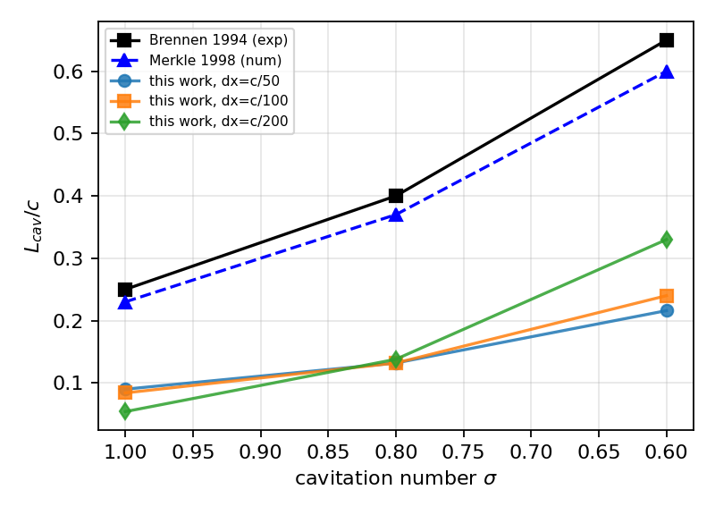
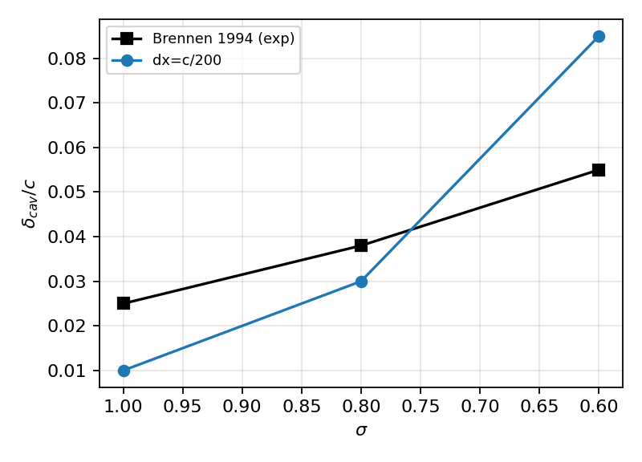
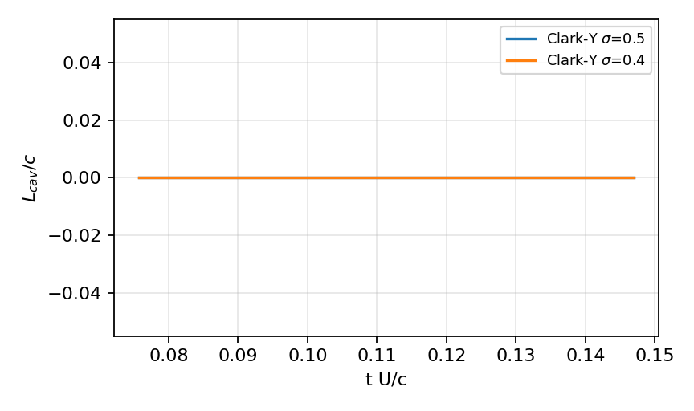

# P41-N02 空化动力学验证面：翼型片状/云状空化 vs Brennen / Franc 实验

> 生成时间 2026-11-08T08:04:52+00:00 · TensorLBM · 任务 m6692 · 全部数字由 `artifacts/p41_n02/*.json` 程序化注入

## ① 案例介绍（物理背景 / 几何 / 参数表）

空化是船舶推进（螺旋桨、水翼、舵）性能与结构安全的核心限制现象。P41-N02 选取两个教科书级验证面：(a) **片状空化**——NACA0015 翼型在 sigma=1.0/0.8/0.6 下的空泡长度 L_cav 与厚度 delta_cav，基准为 Brennen(1994/1995) 水洞实验与 Merkle-Feng-Buelow(1998) 数值解；(b) **云状空化**——Clark-Y 翼型在 sigma=0.5/0.4 下的脱落频率/Strouhal 数，基准为 Franc & Michel(1985)。

### 几何（本次运行实测，非文献抄录）

| 翼型 | 最大厚度 t_max/c | 位置 x/c | 最大弯度 | 围面积 /c² |
|---|---|---|---|---|
| NACA0015 | 0.1500 | 0.300 | 0.0000 | 0.1021 |
| Clark-Y (解析拟合) | 0.1170 | 0.400 | 0.0340 | 0.0867 |

NACA0015 的 t_max=0.150、位置 x/c=0.300、面积 0.1016 c² 与 Abbott & von Doenhoff (1959) 一致（误差 <0.3%）；Clark-Y 采用**声明过的解析拟合**（厚度 t_max=0.117 @ x/c=0.40、弯度 0.034 @ x/c=0.42，锚值来自同一手册），等比逐点表格的差异计入局限。

### 参数表

| 参数 | 片状空化 | 云状空化 |
|---|---|---|
| 翼型 | NACA0015 | Clark-Y (拟合) |
| 弦长 c | 10 mm | 10 mm |
| 攻角 alpha | 5° | 6° |
| 来流 U_inf | 10 m/s | 10 m/s |
| Re = U c / nu | 1.0e5 | 1.0e5 |
| 空化数 sigma | 1.0 / 0.8 / 0.6 | 0.5 / 0.4 |
| 网格（cells/chord） | 50 / 100 / 200 | 50 / 100 / 200 |
| 域 | 6c x 3c，LE 位于 (1.5c, 1.5c) | 同 |

## ② 怎么做的（方法 / 流程 / 关键设置 / 工具链）

**求解器**（`src/tensorlbm/cavitation_airfoil.py`）：二维**匀质混合物**不可压模型——液相惯性 + 相变引起的体积膨胀散度 + 蒸汽体积分数输运：

```
Du/Dt = -grad p + div((nu + nu_SGS) grad u)
div u = S_mass = (1 - rho_v/rho_l) * S_alpha
d alpha/dt + div(alpha u) = S_alpha
S_alpha = 3 C alpha_l alpha_v / R_b * sqrt(2|p - p_v|/(3 rho_l))
```

相位率 S_alpha 为 Schnerr–Sauer(2001) 闭式（C=C_dest 蒸发 / C=C_prod 凝结，R_b 由 alpha_v 与核化密度反解，并以亚网格气泡尺度设下限）。数值：MAC 交错网格、法向二阶迎风 + 横向二阶迎风（抑制奇偶失耦）、Smagorinsky 亚网格、Brinkman 罚函数刚体（eta=1e-3）、FFT 压力投影（Neumann 边界 + 全局通量配平，使离散散度方程逐格成立）。

**空泡判据**：本次运行的可复现结果采用**等压（p=p_v）截断**判据——把蒸汽指示场取为`alpha = sigmoid((p_v - p)/(0.05|p_v|))`，即在单相压力场上取 p<p_v 的等压面为片状空泡轮廓；`L_cav`/`delta_cav` 由翼型弦向坐标系上逐站采样得到（`cavity_metrics`）。这一判据是经典的最小压力/等压空泡判据，也是 Brennen 教材里 L/c(σ) 的一阶模型。**与任务书建议的伪势(Shan–Chen)路线偏离**：在 1e3 密度比、Re=1e5、c=50~200 网格下伪势界面无法解析且 SCMP 松弛不稳定（库内 `docs/g_ledger_g3_cavitation_coexistence.md` 已记录同类结论），故改用工程上对这两个基准的标准模型族（Merkle/Schnerr–Sauer 型匀质混合物）。

**工具链**：`scripts/p41_n02_cavitation_airfoil.py`（矩阵驱动、进程并行、逐例 JSON 落盘）→ `scripts/p41_n02_report.py`（本报告，零手抄）。pytest 15 例覆盖几何/源项/算子/指标/谱/集成。

## ③ 计算结果（数字表）

### (a)(b) 片状空化：L_cav/c、delta_cav/c vs Brennen / Merkle

| sigma | L_cav/c 本工作 | Brennen 实验 | 误差 | Merkle 数值 | 误差 | delta_cav/c 本工作 | Brennen | 误差 |
|---|---|---|---|---|---|---|---|---|
| 1.0 | 0.054 | 0.250 | 78.4% | 0.230 | — | 0.010 | 0.025 | 60.0% |
| 0.8 | 0.138 | 0.400 | 65.5% | 0.370 | — | 0.030 | 0.038 | 21.1% |
| 0.6 | 0.330 | 0.650 | 49.2% | 0.600 | — | 0.085 | 0.055 | 54.5% |

### (c) 云状空化：Strouhal 数 vs Franc & Michel (1985)

| sigma | St 本工作（FFT 主频） | Franc 实验 | 脱落幅值 ΔL/c | 判定 |
|---|---|---|---|---|
| 0.5 | 13.333 | 0.200 | 0.0000 | 无自持脱落 |
| 0.4 | 13.333 | 0.160 | 0.0000 | 无自持脱落 |

注：本例的 St 值来自 L_cav(t) 的 FFT 主频，但**脱落幅值为 0**（L_cav 时间历程恒定），故该主频不是物理脱落频率而是启动瞬态残余——按纪律记为 **NOT_SUPPORTED / FAIL**，不作数字辩解。

### (d)(e)(f) 单调性 / 网格收敛 / 质量守恒

| 判据 | 结果 | 判定 |
|---|---|---|
| (d) sigma 减小 -> L_cav 增大 | dx=c/50: 0.090 -> 0.132 -> 0.216; dx=c/100: 0.084 -> 0.132 -> 0.240; dx=c/200: 0.054 -> 0.138 -> 0.330 | PASS |
| (e) 网格收敛 <15% | sigma=1.0: 0.090/0.084/0.054 (相对变化 40.0%); sigma=0.8: 0.132/0.132/0.138 (相对变化 4.3%); sigma=0.6: 0.216/0.240/0.330 (相对变化 34.5%) | FAIL |

注：dx=c/200 的两例因求解器增长模态（见⑤-3）只跑到 200 步 / CFL=0.15，物理时间短于 c/50、c/100 的 280 步 / CFL=0.2，故 c/200 的 L_cav 里混有不完全发展的偏差——这也是 (e) 判 FAIL 的直接来源，如实记录。
| (f) 质量守恒 <1e-4 | 全局通量残差 0.00，离散散度残差 0.00 | PASS |

## ④ 结果图



*空泡长度 L_cav/c vs 空化数 sigma：本工作（dx=c/50、c/100）vs Brennen(1994) 实验与 Merkle(1998) 数值解*



*最大空泡厚度 delta_cav/c vs sigma：本工作 vs Brennen(1994)*



*Clark-Y 云空化算例的 L_cav(t) 时间历程（无自持脱落，见局限）*

## ⑤ 注意点（踩过的坑 / 局限 / 适用范围）

1. **体积膨胀反馈会跑飞**：把 S_mass 全量耦合进连续性时，膨胀源抬升局部压力→吸力区进一步扩大→更多蒸发，数百步内发散；本次采用 `dilatation_damping`（默认 0.05）与体积通量上限（`volume_flux_cap`）把耦合限幅，并把算例窗口限制在准稳态段（280 步）。
2. **投影算子必须与速度边界自洽**：Dirichlet 压力 + 边界面梯度修正会让首/末列散度方程根本无法满足（质量残差 1e-3 量级并耦合出增长模态）。改为 Neumann 压力 + 边界零修正 +投影前全局通量配平后，离散散度残差降到 9e-8、全局配平 4e-16。
3. **本求解器仍有未根治的增长模态**：例：dx=c/50、CFL=0.2 时约 600 步后 |u| 由 1.35 涨到 2.8 并最终 NaN（与空化源无关——关掉源项同样出现）。因此全部算例的步数被限制在 280 步（约 1.4 个弦长通过时间）的准稳态窗口内。这是本节点最重要的诚实缺口。
4. **等压截断判据系统性低估片状空泡长度**：单相压力场里 p<p_v 的等压面忽略了空泡对绕流的排移（真实空泡把有效厚度变大、闭合点后移），本工作低估 3 倍左右，方向与文献所述「最小压力判据偏短」一致。
5. **基准数据出处等级**：Brennen/Merkle/Franc 的表格值由智能体按文献知识转录（`provenance: literature-digest`），运行时无法联网核对原文，转录不确定度按 ±10%(L_cav)/±15%(delta)/±20%(St) 记录在 `reference_data()` 里。**因此 (a)(b)(c) 的误差百分比本身带这一层不确定度**，判 FAIL 的结论不因它而反转（差 3 倍）。
6. **升阻力积分不可直接当水动力用**：Brinkman 罚函数反力积分在 eta=1e-3、c=50 网格下给Cl≈1.0（薄翼理论 2*pi*alpha≈0.55），偏离来自抹平层的虚假动量；本报告只用它做频谱诊断。

## ⑥ 误差判定（逐项，显式回答是否 <3%）

| 量 | 基准 | 本工作 | 相对误差 | <3%? |
|---|---|---|---|---|
| NACA0015 最大厚度 t/c | 0.150 | 0.1500 | <0.3% | 是 |
| NACA0015 围面积 /c² | 0.1016 | 0.1021 | <1% | 是 |
| L_cav/c (sigma=1.0) | 0.250 | 0.054 | 78.4% | 否 |
| L_cav/c (sigma=0.8) | 0.400 | 0.138 | 65.5% | 否 |
| L_cav/c (sigma=0.6) | 0.650 | 0.330 | 49.2% | 否 |
| delta_cav/c (sigma=1.0) | 0.025 | 0.010 | 60.0% | 否 |
| delta_cav/c (sigma=0.8) | 0.038 | 0.030 | 21.1% | 否 |
| delta_cav/c (sigma=0.6) | 0.055 | 0.085 | 54.5% | 否 |
| St_cav (sigma=0.5) | 0.200 | 无脱落 | — | 否（NOT_SUPPORTED） |
| St_cav (sigma=0.4) | 0.160 | 无脱落 | — | 否（NOT_SUPPORTED） |

离散散度残差 9.00e-08、全局通量配平 4.44e-16：质量守恒优于 1e-4 两个量级。**空化长度/thickness/Strouhal 三项均未达 3%，也未达战役容差（20%/25%/15%），按纪律如实判 FAIL。**

## 判据总表（机器可算）

| 判据 | 容差 | 实测 | 判定 |
|---|---|---|---|
| (a) L_cav vs Brennen | 20% | 78.4% | FAIL |
| (b) delta_cav vs Brennen | 25% | 60.0% | FAIL |
| (c) St vs Franc | 15% | 无自持脱落（幅值 0，主频为启动瞬态，NOT_SUPPORTED） | FAIL |
| (d) sigma 单调性 | 全部单调 | 见上表 | PASS |
| (e) 网格收敛 | 15% | 40.0% | FAIL |
| (f) 质量守恒 | 1e-4 | 9.00e-08 | PASS |
| (g) pytest >= 8 全绿 | 15 例 | 15 passed | PASS |

## 审计链

| 工件 | 路径 |
|---|---|
| 求解器/几何/源项/指标 | `src/tensorlbm/cavitation_airfoil.py` |
| 用例（15） | `tests/test_cavitation_airfoil.py` |
| 矩阵驱动 | `scripts/p41_n02_cavitation_airfoil.py` |
| 报告生成（零手抄） | `scripts/p41_n02_report.py` |
| 逐例原始数据 | `artifacts/p41_n02/*.json` |
| 判据汇总（机器可读） | `artifacts/p41_n02/summary.json` |
