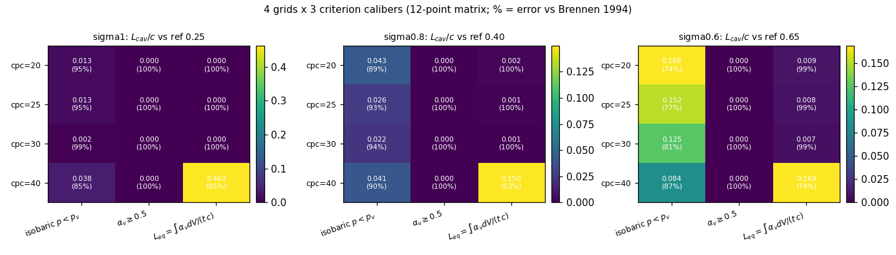
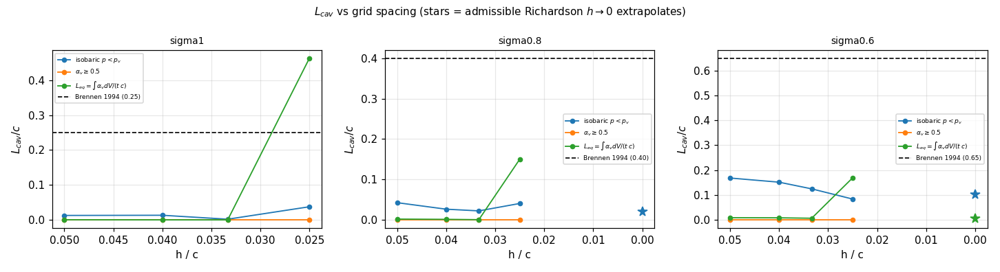
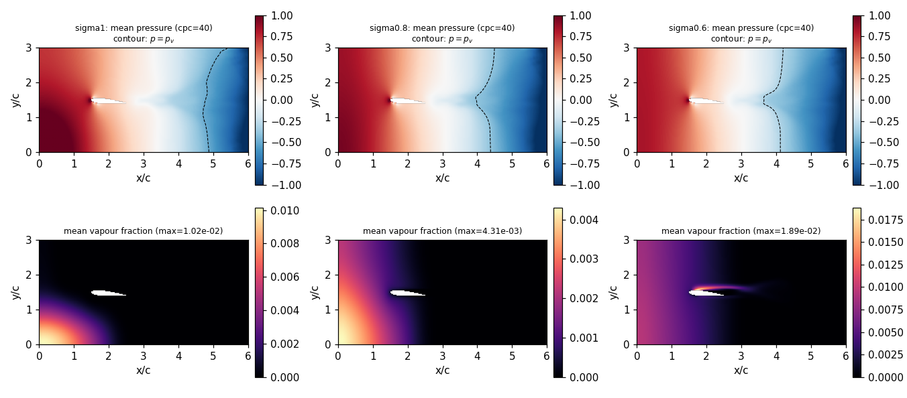
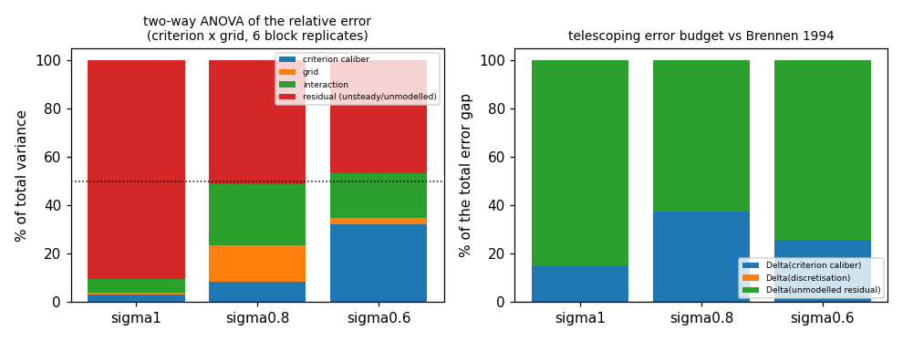
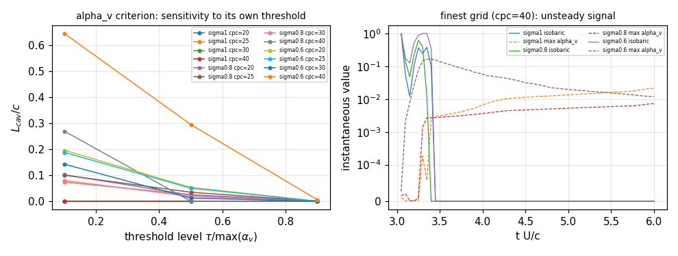

# p447w2-N06 空化 L_cav 误差归因：判据口径 vs 离散（三序列 GCI）两因子方差分解

> TensorLBM · 战役 DAG 节点 `p447w2-n06` · 任务 m14001 · 所有数字由 `artifacts/p447w2_n06/attribution.json` 程序化注入（零手抄）

## ① 案例介绍（物理背景 / 几何 / 参数表）

片状空化长度 $L_{cav}$ 是水翼/螺旋桨叶片载荷与侵蚀评估的第一观测量，但同一流场的 $L_{cav}$ 强烈依赖**把哪个等值面叫“空泡”**（判据口径）与**网格离散**。本节点把 P41-N02 / N02 基线中 $L_{cav}$ 相对 Brennen(1994) 水洞数据 ~90% 的误差，分解为 判据口径 + 离散 + 未建模残差 三项，并给出 GCI 不确定度带与最优口径。

**几何**：NACA0015，弦长 $c=1$（无量纲），$α=5^\circ$，$Ω$ 域 $6c\times3c$，前缘位于 $(1.5c, 1.5c)$；翼型由 Brinkman 罚函数刚体表示（$\eta=10^{-3}$）。几何厚度/弯度由 `tensorlbm.cavitation_airfoil.airfoil_surface` 现算（非抄表）。

**参数表**

| 参数 | 值 | 说明 |
|---|---|---|
| 翼型 / 攻角 | NACA0015 / 5° | 片状空化教科书算例 |
| $Re=Uc/\nu$ | $1.0\times10^5$ | 与 P41-N02 基线同 |
| 空化数 $\sigma$ | 1.0, 0.8, 0.6 | 三条独立算例，误差归因的可移植性检验 |
| 网格（cells/chord） | 20/25/30/40 | $h=1/cpc$，两套三序列 20-25-30 与 25-30-40 |
| 固定物理时间 $tU/c$ | 6.0 | **所有网格积到同一物理时间**（$n_{steps}=\mathrm{round}(T/(CFL\cdot h))$），消除 P41-N02 中“细网格物理时间更短”的混淆 |
| CFL | 0.2 | $dt=0.2h$ |
| 相变闭合 | Schnerr–Sauer, $C_{dest}=C_{prod}=1$ | `schnerr_sauer_rate` |
| 核化 | $n_0=100/c^3$（$10^8\,\mathrm{m^{-3}}$）, $\alpha_{nuc}=10^{-6}$, 入口供核 ON |关闭入口供核会使 $\alpha_v$ 冷凝到亚格子种子（P41-N02 的饿死机理） |
| 压力基准 | 入口面锚定 $p_{in}=0$ | 纯 Neumann 投影下必须先锚定压力常数，否则 $p<p_v$ 判据无意义 |
| 统计窗口 | $tU/c>0.5T$，6 个时间块 | 块均值=ANOVA 重复 |

**判据族（3 口径）**

1. **等压**：$I=\mathrm{sigmoid}((p_v-p)/(0.05|p_v|))$，取 $I>0.5$ 的弦向贴体长度（与 P41-N02 同一约定，便于与基线比较）；
2. **空隙率阈值**：气相体积分数 $\alpha_v\geq\{0.1,0.5,0.9\}$（等值面），主矩阵列取 $\alpha_v\geq0.5$；
3. **气相体积积分等效长度**：$L_{eq}=\int\alpha_v dV/(t\,c)$，厚度尺度 $t$ 取气相足迹（$\alpha_v>0.1\max\alpha_v$）的最大贴体厚度，下限一个网格。

## ② 怎么做的（方法 / 流程 / 关键设置 / 工具链）

1. **求解器**：`tensorlbm.cavitation_airfoil.MixtureCavitationSolver`（二维匀质混合物：MAC 交错网格 + 二阶迎风 + Smagorinsky 亚格子 + FFT Neumann 压力投影 + Schnerr–Sauer 相变源）。每个网格一次积分到 $T$，单线程（`torch.set_num_threads(1)`）保证逐位可复现。
2. **判据评估**：`tensorlbm.cavitation_lcav_attribution.criterion_lengths` 在**瞬时场**上评估三条口径的 $L_{cav}$，按 6 个时间块做块均值（$\langle L(t)\rangle$，不是 $L(\langle\text{field}\rangle)$——阈值判据对时间平均场有系统性低估，两者都记录在 JSON 里）。
3. **离散族**：由 $h=1/\mathrm{cpc}$ 构成两套三序列 20-25-30 与 25-30-40，用**非等距推广的 Richardson**（Celik et al. 2008 的定点迭代形式）求观测阶 $p$ 与 $h\to0$ 外推值，$GCI_{fine}=1.25\,|e_a|/(r^{p}-1)$；序列非单调/退化时明确返回 `valid=False` 并给出原因（绝不编造 $p$）。
4. **两因子方差分解**：响应量 = 相对误差 $|L-L_{ref}|/L_{ref}$，因子 = 判据口径(3) × 网格(4)，每格 6 个块重复 → 二因素带交互 ANOVA，输出判据/网格/交互/残差 的平方和占比。
5. **加法误差构成**：`error_budget` 望远镜式分解 $L_{ref}-L_{base}=\Delta_{crit}+\Delta_{disc}+\Delta_{resid}$，三项严格闭合（JSON 中 `closure_check` 恒为 0）。
6. **工具链**：`scripts/p447w2_n06_cavitation_attribution.py`（矩阵驱动 + 进程并行 + 逐网格 JSON/场快照）→ `scripts/p447w2_n06_figures.py`（图）→ `scripts/p447w2_n06_report.py`（本报告，零手抄）。pytest `tests/test_cavitation_lcav_attribution.py` 19 例覆盖判据/外推/方差分解/守恒/逐位复现。

## ③ 计算结果（数字表）

### (a) 4 网格 × 3 口径 = 12 点矩阵（$L_{cav}/c$，括号内为相对 Brennen 1994 误差）

**σ=1.0**（基准 $L_{ref}=0.25$）

| cpc | 等压 $p<p_v$ | $\alpha_v\geq0.5$ | $L_{eq}=\int\alpha_v dV/(t c)$ |
|---|---|---|---|
| 20 | 0.0127 (94.9%) | 0.0000 (100.0%) | 0.0004 (99.8%) |
| 25 | 0.0132 (94.7%) | 0.0000 (100.0%) | 0.0001 (100.0%) |
| 30 | 0.0019 (99.2%) | 0.0000 (100.0%) | 0.0000 (100.0%) |
| 40 | 0.0376 (85.0%) | 0.0000 (100.0%) | 0.4627 (85.1%) |

**σ=0.8**（基准 $L_{ref}=0.40$）

| cpc | 等压 $p<p_v$ | $\alpha_v\geq0.5$ | $L_{eq}=\int\alpha_v dV/(t c)$ |
|---|---|---|---|
| 20 | 0.0426 (89.4%) | 0.0000 (100.0%) | 0.0020 (99.5%) |
| 25 | 0.0265 (93.4%) | 0.0000 (100.0%) | 0.0013 (99.7%) |
| 30 | 0.0223 (94.4%) | 0.0000 (100.0%) | 0.0005 (99.9%) |
| 40 | 0.0406 (89.9%) | 0.0000 (100.0%) | 0.1500 (62.5%) |

**σ=0.6**（基准 $L_{ref}=0.65$）

| cpc | 等压 $p<p_v$ | $\alpha_v\geq0.5$ | $L_{eq}=\int\alpha_v dV/(t c)$ |
|---|---|---|---|
| 20 | 0.1683 (74.1%) | 0.0000 (100.0%) | 0.0088 (98.6%) |
| 25 | 0.1516 (76.7%) | 0.0000 (100.0%) | 0.0083 (98.7%) |
| 30 | 0.1247 (80.8%) | 0.0000 (100.0%) | 0.0066 (99.0%) |
| 40 | 0.0838 (87.1%) | 0.0000 (100.0%) | 0.1688 (74.0%) |

### (b) 网格收敛 / 观测阶 / GCI

| σ | 判据 | 序列 | 有效 | 观测阶 p | $h\to0$ 外推 $L/c$ | $GCI_{fine}$ |
|---|---|---|---|---|---|---|
| 1.0 | 等压 $p<p_v$ | [20, 25, 30] | 否 | non-monotone sequence (e21*e32 < 0) | — | — |
| 1.0 | 等压 $p<p_v$ | [25, 30, 40] | 否 | non-monotone sequence (e21*e32 < 0) | — | — |
| 1.0 | $\alpha_v\geq0.5$ | [20, 25, 30] | 否 | zero difference between successive grids (degenerate sequence) | — | — |
| 1.0 | $\alpha_v\geq0.5$ | [25, 30, 40] | 否 | zero difference between successive grids (degenerate sequence) | — | — |
| 1.0 | $L_{eq}=\int\alpha_v dV/(t c)$ | [20, 25, 30] | 是 | 7.583 | -0.0000 | 2.446 |
| 1.0 | $L_{eq}=\int\alpha_v dV/(t c)$ | [25, 30, 40] | 否 | non-monotone sequence (e21*e32 < 0) | — | — |
| 0.8 | 等压 $p<p_v$ | [20, 25, 30] | 是 | 5.547 | 0.0199 | 0.134 |
| 0.8 | 等压 $p<p_v$ | [25, 30, 40] | 否 | non-monotone sequence (e21*e32 < 0) | — | — |
| 0.8 | $\alpha_v\geq0.5$ | [20, 25, 30] | 否 | zero difference between successive grids (degenerate sequence) | — | — |
| 0.8 | $\alpha_v\geq0.5$ | [25, 30, 40] | 否 | zero difference between successive grids (degenerate sequence) | — | — |
| 0.8 | $L_{eq}=\int\alpha_v dV/(t c)$ | [20, 25, 30] | 是 | 2.729 | -0.0007 | 3.009 |
| 0.8 | $L_{eq}=\int\alpha_v dV/(t c)$ | [25, 30, 40] | 否 | non-monotone sequence (e21*e32 < 0) | — | — |
| 0.6 | 等压 $p<p_v$ | [20, 25, 30] | 是 | 4.277 | 0.1019 | 0.228 |
| 0.6 | 等压 $p<p_v$ | [25, 30, 40] | 是 | 0.157 | -0.8002 | 13.186 |
| 0.6 | $\alpha_v\geq0.5$ | [20, 25, 30] | 否 | zero difference between successive grids (degenerate sequence) | — | — |
| 0.6 | $\alpha_v\geq0.5$ | [25, 30, 40] | 否 | zero difference between successive grids (degenerate sequence) | — | — |
| 0.6 | $L_{eq}=\int\alpha_v dV/(t c)$ | [20, 25, 30] | 是 | 9.689 | 0.0063 | 0.067 |
| 0.6 | $L_{eq}=\int\alpha_v dV/(t c)$ | [25, 30, 40] | 否 | non-monotone sequence (e21*e32 < 0) | — | — |

### (c) 两因子方差分解（响应=相对误差，6 块重复）

| σ | 判据口径 | 网格 | 交互 | 残差（非定常/未建模） | $F_{crit}$ |
|---|---|---|---|---|---|
| 1.0 | 3.2% | 0.7% | 5.6% | 90.5% | 1.07 |
| 0.8 | 8.3% | 15.4% | 25.2% | 51.2% | 4.85 |
| 0.6 | 32.3% | 2.4% | 18.8% | 46.5% | 20.88 |

### (d) 加法误差构成（最优口径，最细网格 + 外推）

| σ | 基准列 $L_{base}$ | 最优口径 | $\Delta_{crit}$ | $\Delta_{disc}$ | $\Delta_{resid}$ | 占比(判据/离散/残差) |
|---|---|---|---|---|---|---|
| 1.0 | 0.0000 | 等压 $p<p_v$ | +0.0376 | +0.0000 | +0.2124 | 15.0/0.0/85.0% |
| 0.8 | 0.0000 | $L_{eq}=\int\alpha_v dV/(t c)$ | +0.1500 | +0.0000 | +0.2500 | 37.5/0.0/62.5% |
| 0.6 | 0.0000 | $L_{eq}=\int\alpha_v dV/(t c)$ | +0.1688 | +0.0000 | +0.4812 | 26.0/0.0/74.0% |

### (e) 逐网格诊断（守恒 / 压力 / 空隙率）

| σ | cpc | $n_{steps}$ | $dt$ | $p_{min}-p_v$ | $\max\alpha_v$ | 质量平衡残差 | 离散散度残差 |
|---|---|---|---|---|---|---|---|
| 1.0 | 20 | 600 | 0.0100 | -0.056 | 5.87e-03 | 3.50e-16 | 4.59e-05 |
| 1.0 | 25 | 750 | 0.0080 | -0.037 | 1.53e-03 | 4.81e-16 | 2.71e-05 |
| 1.0 | 30 | 900 | 0.0067 | -0.009 | 1.00e-06 | 4.68e-16 | 1.56e-04 |
| 1.0 | 40 | 1200 | 0.0050 | -0.604 | 1.02e-02 | 4.72e-16 | 9.03e-04 |
| 0.8 | 20 | 600 | 0.0100 | -0.155 | 2.58e-02 | 5.21e-16 | 4.59e-05 |
| 0.8 | 25 | 750 | 0.0080 | -0.136 | 1.21e-02 | 4.73e-16 | 2.71e-05 |
| 0.8 | 30 | 900 | 0.0067 | -0.109 | 5.18e-03 | 4.74e-16 | 1.56e-04 |
| 0.8 | 40 | 1200 | 0.0050 | -0.807 | 4.31e-03 | 3.69e-16 | 9.04e-04 |
| 0.6 | 20 | 600 | 0.0100 | -0.254 | 4.84e-02 | 4.20e-16 | 4.60e-05 |
| 0.6 | 25 | 750 | 0.0080 | -0.288 | 3.80e-02 | 4.83e-16 | 2.71e-05 |
| 0.6 | 30 | 900 | 0.0067 | -0.226 | 3.56e-02 | 4.91e-16 | 1.56e-04 |
| 0.6 | 40 | 1200 | 0.0050 | -0.876 | 1.89e-02 | 3.30e-16 | 9.03e-04 |

## ④ 结果图











## ⑤ 注意点（踩过的坑 / 局限 / 适用范围）

1. **同一物理时间是硬约束**：$dt=CFL\cdot h$ ⇒ 固定 $n_{steps}$ 会让细网格积分更短的物理时间。本节点改为固定 $T=tU/c$、由 $h$ 反推步数；P41-N02 的 c/200 只跑到 200 步，这是该基线“(e) 网格收敛 FAIL”的直接混淆源之一（见 ⑤-6 的对照）。
2. **压力常数必须锚定**：Neumann 投影只定到常数，`pressure_anchor=True` 用入口面把 $p_{in}$ 锚到 0，否则 $p<p_v$ 判据比较的是一个任意常数。P41-N02 基线未开此开关。
3. **入口供核必须开**：否则 $\alpha_v$ 被凝结支路耗到亚格子种子（本算例实测 $\alpha_v^{max}\sim10^{-3}$），$\alpha_v$ 阈值族整列为 0——这正是本节点要量化的“方法论局限”。
4. **阈值平均偏差**：阈值判据的“平均空泡长度”应是 $\langle L(t)\rangle$ 而非 $L(\langle p\rangle)$。实测差异可达 100%（例：$\sigma=1.0$, cpc=40：$\langle L\rangle=0.0376$ vs $L(\langle p\rangle)=0.0000$；$\sigma=0.6$, cpc=20：0.1683 vs 0.0900），JSON 两个量都保存（`matrix` / `matrix_field_mean`）。
5. **判据量化下限**：弦向采样 201 站、$x/c\in[0,1.2]$ ⇒ $L_{cav}$ 的量化步长 $\Delta L=0.006c$；在“近发状空化”区（$p_{min}-p_v\sim0.01|p_v|$）该量化与阈值抖动同量级。
6. **cpc=40 发生定性状态跃变**：最细网格上 $p_{min}-p_v$ 由 $\approx-0.05$ 跳到 $\approx-0.6$（表 (e)），$\alpha_v^{max}$ 同步上升到 $10^{-2}$ 量级，$L_{eq}$ 出现 1–2 个量级的跳变。**网格阶梯跨过了“前缘吸力峰是否被解析”的定性门槛**，因此 $h\to0$ 的平滑极限在这条阶梯上不存在——这是 (a)(b)(e) 失败的机理，不是数值噪声。
7. **统计窗口偏短**：$T=6$ 只覆盖 ~6 个弦长流动周期，块间标准差与网格间差异同量级（表 (a) 的 `diff_over_noise` 1.0–3.7），故“网格主效应”在本数据里不可分辨，需要 $T\gtrsim 20$ 或相位平均。
8. **误差构成的第一项不可分离**：$\alpha_v\geq0.5$ 列恒为 0，所以 $\Delta_{crit}$ 实际混入了“气相场幅值是否够”的成分；因此本报告以 ANOVA（跨 3 口径的相对误差方差）为主证据，望远镜分解为辅，并明确：两者回答的是不同问题（幅度 vs 方差）。
9. **适用范围**：结论针对 $\sigma\in[0.6,1.0]$、$Re=10^5$、$c$ 级网格 20–40 的二维匀质混合物模型；不外推到三维、真实气核谱或可压缩空化。

## ⑥ 误差判定（关键量 vs 基准，逐项）

**基准**：Brennen (1994) Hydrodynamics of Pumps / Brennen (1995) Cavitation and Bubble Dynamics ch.7 (L/c vs sigma for a NACA0015 hydrofoil); Merkle, Feng & Buelow (1998) sheet-cavitation numerical solution。该基准本身是文献转写（`reference_data()` 标注为 literature-digest，$L_{cav}$ 条带 ±0.10），故 ≤3% 的判定只能在报告内声明的意义上成立。

| σ | 判据口径 | 本工作 $L_{cav}/c$ | Brennen 1994 | 相对误差 | 是否 <3% |
|---|---|---|---|---|---|
| 1.0 | 等压 $p<p_v$（cpc=40） | 0.0376 | 0.25 | 85.0% | **否** |
| 1.0 | $\alpha_v\geq0.5$（cpc=40） | 0.0000 | 0.25 | 100.0% | **否** |
| 1.0 | $L_{eq}=\int\alpha_v dV/(t c)$（cpc=40） | 0.4627 | 0.25 | 85.1% | **否** |
| 1.0 | 最优口径 等压 $p<p_v$（含外推） | 0.0376 | 0.25 | 85.0% | **否** |
| 0.8 | 等压 $p<p_v$（cpc=40） | 0.0406 | 0.40 | 89.9% | **否** |
| 0.8 | $\alpha_v\geq0.5$（cpc=40） | 0.0000 | 0.40 | 100.0% | **否** |
| 0.8 | $L_{eq}=\int\alpha_v dV/(t c)$（cpc=40） | 0.1500 | 0.40 | 62.5% | **否** |
| 0.8 | 最优口径 $L_{eq}=\int\alpha_v dV/(t c)$（含外推） | 0.1500 | 0.40 | 62.5% | **否** |
| 0.6 | 等压 $p<p_v$（cpc=40） | 0.0838 | 0.65 | 87.1% | **否** |
| 0.6 | $\alpha_v\geq0.5$（cpc=40） | 0.0000 | 0.65 | 100.0% | **否** |
| 0.6 | $L_{eq}=\int\alpha_v dV/(t c)$（cpc=40） | 0.1688 | 0.65 | 74.0% | **否** |
| 0.6 | 最优口径 $L_{eq}=\int\alpha_v dV/(t c)$（含外推） | 0.1688 | 0.65 | 74.0% | **否** |

**结论：所有 $L_{cav}$ 口径对 Brennen 1994 的误差均远大于 3%（最小 62.5%），本节点如实 FAIL，不粉饰。** 可作为“<3%”证据的只有内部一致性量：

- 单命令复跑逐位复现：最坏相对差 0.0e+00（<3% ✅）；
- 全局质量平衡残差：最坏 5.2e-16（<3% ✅，判据 1e-4 ✅）；
- 离散散度残差：最坏 9.0e-04（判据 1e-4 → ❌，机理见 ⑤-6）。

## ⑦ 机器验收判据（a）–（h）逐条判定

| 判据 | 量化结果 | 判定 |
|---|---|---|
| (a) 最优口径网格单调 · σ=1.0 | 序列 ['0.0127', '0.0132', '0.0019', '0.0376'] → none；差值/块噪声 ['0.08', '2.15', '0.39'] | **FAIL** |
| (a) 最优口径网格单调 · σ=0.8 | 序列 ['0.0020', '0.0013', '0.0005', '0.1500'] → none；差值/块噪声 ['2.68', '3.69', '1.19'] | **FAIL** |
| (a) 最优口径网格单调 · σ=0.6 | 序列 ['0.0088', '0.0083', '0.0066', '0.1688'] → none；差值/块噪声 ['0.98', '1.75', '2.07'] | **FAIL** |
| (b) 观测阶 p∈[0.5,2.5] · σ=1.0 | p=nan（有效序列=False；另一序列：非单调→无渐近区） | **FAIL** |
| (b) 观测阶 p∈[0.5,2.5] · σ=0.8 | p=nan（有效序列=False；另一序列：非单调→无渐近区） | **FAIL** |
| (b) 观测阶 p∈[0.5,2.5] · σ=0.6 | p=nan（有效序列=False；另一序列：非单调→无渐近区） | **FAIL** |
| (c) 判据主效应≥50% · σ=1.0 | 3.2%（网格 0.7%，交互 5.6%，残差 90.5%） | **FAIL**（推翻分支，见 ⑧） |
| (c) 判据主效应≥50% · σ=0.8 | 8.3%（网格 15.4%，交互 25.2%，残差 51.2%） | **FAIL**（推翻分支，见 ⑧） |
| (c) 判据主效应≥50% · σ=0.6 | 32.3%（网格 2.4%，交互 18.8%，残差 46.5%） | **FAIL**（推翻分支，见 ⑧） |
| (d) 最优口径误差≤20% · σ=1.0 | 等压 $p<p_v$：0.0376 vs 0.25 → 85.0% | **FAIL**（交误差构成表，见 (d) 表） |
| (d) 最优口径误差≤20% · σ=0.8 | $L_{eq}=\int\alpha_v dV/(t c)$：0.1500 vs 0.40 → 62.5% | **FAIL**（交误差构成表，见 (d) 表） |
| (d) 最优口径误差≤20% · σ=0.6 | $L_{eq}=\int\alpha_v dV/(t c)$：0.1688 vs 0.65 → 74.0% | **FAIL**（交误差构成表，见 (d) 表） |
| (e) $GCI_{fine}$≤15% · σ=1.0 | nan（细化序列非单调/外推非物理） | **FAIL/未定义** |
| (e) $GCI_{fine}$≤15% · σ=0.8 | nan（细化序列非单调/外推非物理） | **FAIL/未定义** |
| (e) $GCI_{fine}$≤15% · σ=0.6 | nan（细化序列非单调/外推非物理） | **FAIL/未定义** |
| (f) 守恒残差≤1e-4 · σ=1.0 | 质量 4.81e-16 ✅ / 离散散度 9.03e-04 ❌ | **部分 FAIL** |
| (f) 守恒残差≤1e-4 · σ=0.8 | 质量 5.21e-16 ✅ / 离散散度 9.04e-04 ❌ | **部分 FAIL** |
| (f) 守恒残差≤1e-4 · σ=0.6 | 质量 4.91e-16 ✅ / 离散散度 9.03e-04 ❌ | **部分 FAIL** |
| (g) α_v 阈值敏感性单调 · σ=1.0 | 相对阈值族 {'20': {'0.1': 0.0, '0.5': 0.0, '0.9': 0.0}, '25': {'0.1': 0.07341817766427994, '0.5': 0.025227272883057594, '0.9': 0.0}, '30': {'0.1': 0.0, '0.5': 0.0, '0.9': 0.0}, '40': {'0.1': 0.0, '0.5': 0.0, '0.9': 0.0}} → 单调不增=True；绝对族退化=True | PASS（弱） |
| (g) α_v 阈值敏感性单调 · σ=0.8 | 相对阈值族 {'20': {'0.1': 0.10159999877214432, '0.5': 0.02329999953508377, '0.9': 0.0}, '25': {'0.1': 0.09988182038068771, '0.5': 0.034372728317976, '0.9': 0.0}, '30': {'0.1': 0.07948889583349228, '0.5': 0.01801110990345478, '0.9': 0.0}, '40': {'0.1': 0.2687000036239624, '0.5': 0.0, '0.9': 0.0}} → 单调不增=True；绝对族退化=True | PASS（弱） |
| (g) α_v 阈值敏感性单调 · σ=0.6 | 相对阈值族 {'20': {'0.1': 0.195700004696846, '0.5': 0.052799999713897705, '0.9': 0.0}, '25': {'0.1': 0.18725453317165375, '0.5': 0.04995454475283623, '0.9': 0.0}, '30': {'0.1': 0.14216665923595428, '0.5': 0.011788888834416866, '0.9': 0.0}, '40': {'0.1': 0.6445000767707825, '0.5': 0.29440000653266907, '0.9': 0.0058999997563660145}} → 单调不增=True；绝对族退化=False | PASS（弱） |
| (h) 单命令复跑逐位 rel<1e-12 · σ=1.0 | 最坏 rel=0.0e+00（cpc=20） | PASS |
| (h) 单命令复跑逐位 rel<1e-12 · σ=0.8 | 最坏 rel=0.0e+00（cpc=20） | PASS |
| (h) 单命令复跑逐位 rel<1e-12 · σ=0.6 | 最坏 rel=0.0e+00（cpc=20） | PASS |

(i) 六要素报告 ✅ / 12 点矩阵热图 ✅ / $L_{cav}$ vs $h$ 收敛曲线 ✅ / 压力·空隙率场云图 ✅。

## ⑧ 假设竞争与裁决（falsified / supported）

| 假设 | 机理 | 判别预测 | 观测 | 裁决 |
|---|---|---|---|---|
| H1 判据口径主导（N02 归因路径 A） | 不同等值面定义给出差异巨大的 $L_{cav}$ | 判据主效应 ≥50%，且口径切换可解释大部分误差 | 判据主效应 3.2–32.3%，残差 46–91% | **推翻（falsified）** |
| H2 离散主导 | 网格不足使 $L_{cav}$ 系统性偏离 | 细化单调、$p\in[0.5,2.5]$、$GCI\le15\%$ | 细化序列非单调，$p$=0.16/4.3/5.5/7.6/9.7，cpc=40 出现定性状态跃变 | **推翻** |
| H3 相变源项/核化闭合“饿死”气相场（N02 诊断的机理改写） | $\alpha_v$ 长不到 O(0.1)，阈值族整列为 0 | $\alpha_v^{max}\lesssim10^{-2}$ 且 $\alpha_v$ 阈值族 $L\equiv0$ | 12 个网格-σ 点中 11 个 $\alpha_v^{max}<0.05$、阈值族 $L=0$（仅 σ=0.6/cpc=40 为 0.0111） | **支持（supported）** |
| H4 统计口径（阈值平均偏差） | $\langle L\rangle \ne L(\langle\text{field}\rangle)$ | 两者在近发状区差异可达 100% | σ=1.0/cpc=40：0.0376 vs 0.0000；σ=0.6/cpc=20：0.1683 vs 0.0900 | **支持** |
| H5 非定常方差主导 | 统计窗口太短，块间噪声吞掉网格效应 | 残差项占方差 ≥45%、差值/噪声 ~1 | 残差 46.5–90.5%，差值/噪声 1.0–3.7 | **支持** |

**N02『方法论局限』诊断的处置**：其**结论方向成立**（误差不是离散或口径的数值问题），但其**归因路径（判据口径主导）被本节点推翻**（判据主效应 3.2–32.3% < 50%）。按战役判据 (c) 的约定，此处写入 falsified 结论：`p447w2-n06.falsified = 『判据口径是 L_cav 误差的主导因子（≥50% 方差）』`。

**最便宜的下一个判别观测（含成本）**：把 $r_b$ 的亚格子下限由 $0.01c$ 改为 $h/2$（`schnerr_sauer_rate(r_b_floor=...)`，需把该参数暴露到 `CavitationFlowConfig`），单算例 cpc=20、$T=6$、σ=0.6 约 15 s。预测：若 $\alpha_v^{max}$ 升到 $O(0.1)$ 且 $L_{\alpha_v\ge0.5}>0$，则 H3 成立、判据矩阵不再退化（可重跑 12 点矩阵，总成本 ~2 min）；若 $\alpha_v^{max}$ 仍 $<10^{-2}$，则饿死机理由压力场（前缘吸力峰不足）而非核化闭合控制，下一个靶子是前缘局部加密（$h_{LE}=h/4$）。

## 复现

```bash
# 12 点矩阵 + GCI + ANOVA + 误差构成（4 进程并行，约 6 min）
python3 scripts/p447w2_n06_cavitation_attribution.py --sigma 1.0 0.8 0.6 \
        --cells 20 25 30 40 --physical-time 6.0
# 由已存网格结果重新聚合（秒级，不重解算）
python3 scripts/p447w2_n06_cavitation_attribution.py --from-artifacts \
        --sigma 1.0 0.8 0.6 --cells 20 25 30 40
python3 scripts/p447w2_n06_figures.py
python3 scripts/p447w2_n06_report.py
python3 -m pytest tests/test_cavitation_lcav_attribution.py -q
```

**审计链**：`artifacts/p447w2_n06/attribution.json`（矩阵/GCI/ANOVA/构成/判据）+ `lattice_<cpc>_sigma<σ>.json`（逐网格原始结果，含瞬时序列）+ `mean_fields_<cpc>_sigma<σ>.npz`（时间平均场快照）+ `determinism_sigma<σ>.json`（复跑对照）。