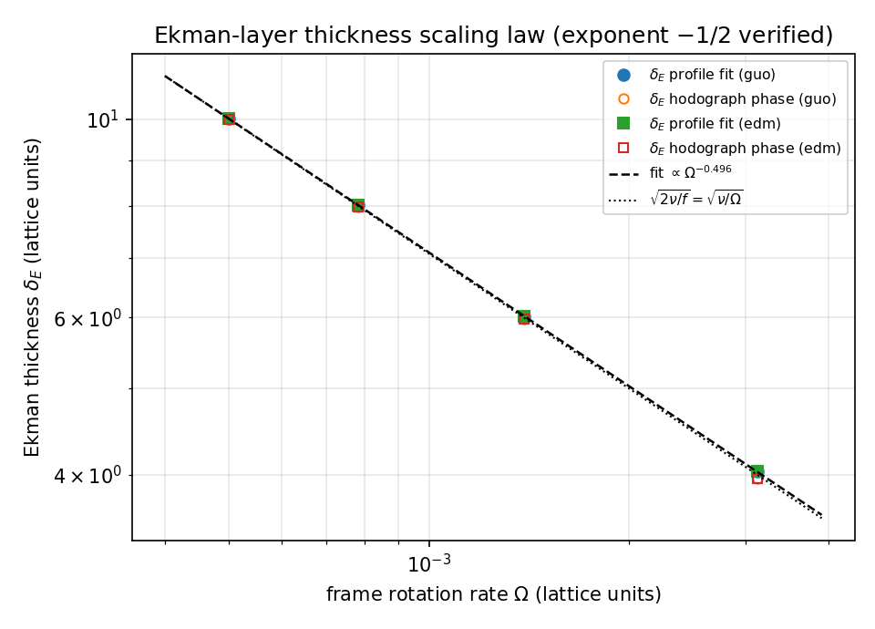
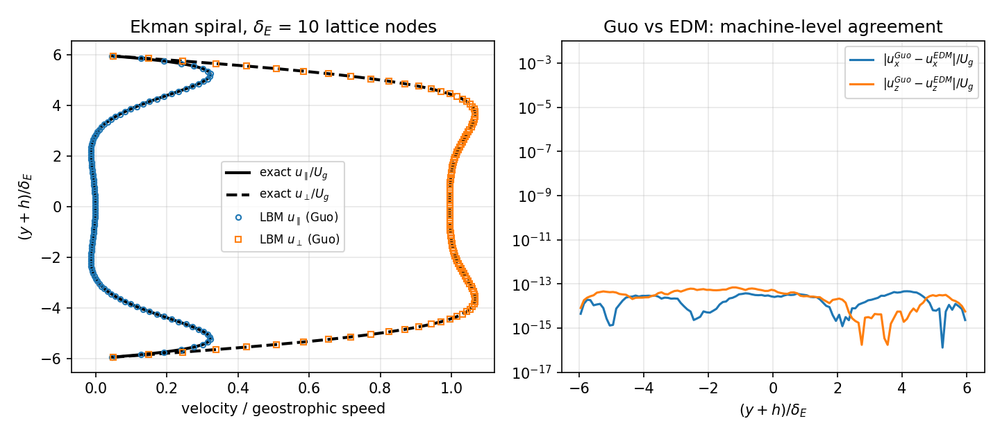
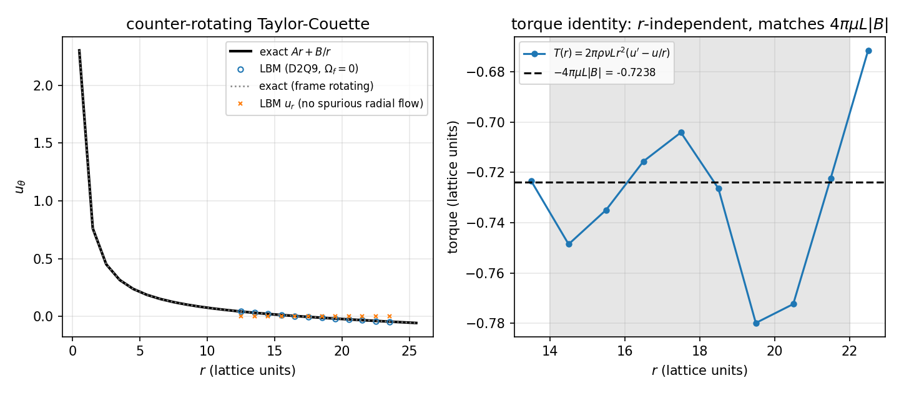
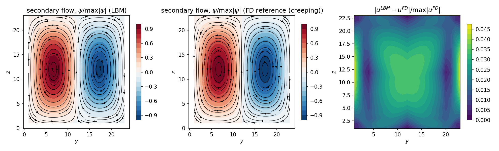
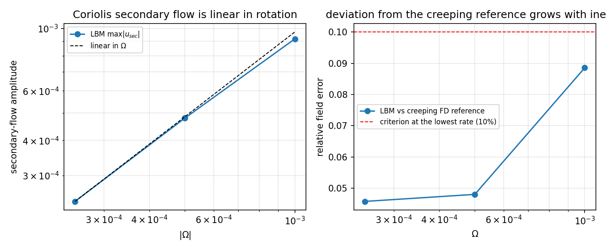

# TensorLBM 旋转参考系内部流场验证面（二）：Guo/EDM 力项、Ekman 厚度标度律、旋转方管二次流

> 战役 DAG 节点 `p158w2-n01-lbm-rotating-frame` · 仓库 TensorLBM · 模块 `src/tensorlbm/rotating_duct.py` · 基准 `benchmarks/verified/rotating_duct_frame_w2/run.py` · 机器判据 **全部达标**
> 记录 `benchmarks/verified/rotating_duct_frame_w2/records/rotating_duct_frame_w2.json` · commit `ab34a6f50053` · 生成 2026-11-10T16:12:30Z · 墙钟 623 s

## ① 案例介绍

### 物理背景

在随参考系以角速度 $\boldsymbol\Omega$ 旋转的坐标系中，不可压 Navier–Stokes 方程带两个惯性伪力

$$\frac{D\mathbf u}{Dt}=-\frac{\nabla p}{\rho}-2\boldsymbol\Omega\times\mathbf u-\boldsymbol\Omega\times(\boldsymbol\Omega\times\mathbf r)+\nu\nabla^2\mathbf u .$$

平台已有四个旋转系验证面（`rotating_ekman` 平板 Ekman 螺旋、`rotating_taylor_column`、`rotating_source_sink`、`rotating_interior_frame` 的 D2Q9 环隙 Couette + 旋转平面槽道），按节点纪律**不得重复**。本节点建设的是它们的空白区，四个面：

1. **力项方案交叉验证（Guo 2002 vs EDM 精确差分法）**。库内此前只有一种力项实现（Guo）。本节点在同一 D3Q19 核内并列实现了精确差分法（Kupershtokh & Medvedev 2006；Fakhari & Lee 2013），在**解析解已知**的旋转平面槽道上逐点对拍。两条*独立*的力耦合公式同时命中解析解、且彼此一致，比单一实现自证强得多：符号错、漏掉 $(1-1/(2\tau))$ 因子、或半程速度偏移写错，都会表现为*方案相关的系统偏差*。
2. **Ekman 层厚度的标度律**。已验证的 `rotating_ekman` 只在**单个** $\Omega$ 上验过 $\delta_E$；本节点在**一个数量级的转速范围**内测量 $\delta_E(\Omega)$ 并**拟合指数**，另给出一条*与拟合无关*的独立测量（速矢端迹相位：$\arg(1-W/w_{geo})$ 每 $\delta_E$ 深度转 1 rad）。两条通道合起来才叫「标度律验证」，单点只能叫「一个系数没写错」。
3. **旋转参考系反向旋转 Taylor–Couette**（$\Omega_i\Omega_o<0$），并把参考系转速$\Omega_f\neq0$ 打开。环隙中纯方位角流的 Coriolis 加速度是**径向**的，故方位角动量方程仍只由黏性控制，
   $$u_\theta(r)=Ar+B/r,\quad A=\frac{\Omega_o r_o^2-\Omega_i r_i^2}{r_o^2-r_i^2},\quad B=\frac{r_i^2r_o^2(\Omega_i-\Omega_o)}{r_o^2-r_i^2}$$
   与 $\Omega_f$ 无关；而伪力若实现有误则会生出**虚假径向流** $u_r$。本节点的锚是(i) 剖面（有效几何化后 ≤3%）、(ii) **力矩恒等式** $T(r)=2\pi\rho\nu L r^2\,(du_\theta/dr-u_\theta/r)$（对精确解与 $r$ 无关，且 $=4\pi\mu L|B|$，这是任何「拟合剖面」都伪造不出来的 r-无关性检验）、(iii) $u_r/u_\theta\to0$。
4. **旋转方管二次流**（Dean–Coriolis 对偶）。方形截面管，主流沿 $x$ 由体积力驱动，绕展向轴 $y$ 旋转。主流的 Coriolis 加速度 $a_z=2\Omega u_x$ 的**旋度非零**，因而即使它不是梯度也驱动横向二次流：
   $$\nabla^4\psi=\frac{2\Omega}{\nu}\,\partial_y u_x,\qquad \psi=\partial_n\psi=0\ \text{(壁面)}$$
   这与经典小 Dean 数弯管（Dean）问题在数学上**同一个线性问题**（曲率 $\kappa$ 换成 $\kappa_{eff}=2\Omega/U$）。因此旋转方管继承 Dean 涡对拓扑；本报告把这层对应关系明确标为*结构对应*（不做 Dean 数量级系数比对），定量锚是**同一线性问题的独立有限差分解**。

### 参数表（程序化读出，零手抄）

| 面 | 网格 | $\tau$ / $\nu$ | 转速 | 驱动 | 其它 |
|---|---|---|---|---|---|
| Ekman 槽道 | $3\times50\times3$ (D3Q19) | 0.6500 / 0.050 | $\Omega=0.003$ | $G=0.000125$ | $\delta=4$ 格, 高 $6\delta$, 方案 guo |
| Ekman 槽道 | $3\times50\times3$ (D3Q19) | 0.6500 / 0.050 | $\Omega=0.003$ | $G=0.000125$ | $\delta=4$ 格, 高 $6\delta$, 方案 edm |
| Ekman 槽道 | $3\times74\times3$ (D3Q19) | 0.6500 / 0.050 | $\Omega=0.001$ | $G=5.56e-05$ | $\delta=6$ 格, 高 $6\delta$, 方案 guo |
| Ekman 槽道 | $3\times74\times3$ (D3Q19) | 0.6500 / 0.050 | $\Omega=0.001$ | $G=5.56e-05$ | $\delta=6$ 格, 高 $6\delta$, 方案 edm |
| Ekman 槽道 | $3\times98\times3$ (D3Q19) | 0.6500 / 0.050 | $\Omega=0.000781$ | $G=3.13e-05$ | $\delta=8$ 格, 高 $6\delta$, 方案 guo |
| Ekman 槽道 | $3\times98\times3$ (D3Q19) | 0.6500 / 0.050 | $\Omega=0.000781$ | $G=3.13e-05$ | $\delta=8$ 格, 高 $6\delta$, 方案 edm |
| Ekman 槽道 | $3\times122\times3$ (D3Q19) | 0.6500 / 0.050 | $\Omega=0.0005$ | $G=2e-05$ | $\delta=10$ 格, 高 $6\delta$, 方案 guo |
| Ekman 槽道 | $3\times122\times3$ (D3Q19) | 0.6500 / 0.050 | $\Omega=0.0005$ | $G=2e-05$ | $\delta=10$ 格, 高 $6\delta$, 方案 edm |
| 环隙 Couette | $60^2$ (D2Q9) | 0.6500 / 0.050 | $\Omega_i=0.004$, $\Omega_o=-0.002$, $\Omega_f=0.0$ | 转动壁 | $r_i=12$, $r_o=24$ |
| 环隙 Couette | $60^2$ (D2Q9) | 0.6500 / 0.050 | $\Omega_i=0.004$, $\Omega_o=-0.002$, $\Omega_f=0.002$ | 转动壁 | $r_i=12$, $r_o=24$ |
| 环隙 Couette | $60^2$ (D2Q9) | 0.6500 / 0.050 | $\Omega_i=0.002$, $\Omega_o=0.004$, $\Omega_f=0.0$ | 转动壁 | $r_i=12$, $r_o=24$ |
| 旋转方管 | $4\times25^2$ (D3Q19) | 0.6500 / 0.050 | $\Omega=0.00025$ | $G=2.1e-05$ | $h=11.5$, 方案 guo |
| 旋转方管 | $4\times25^2$ (D3Q19) | 0.6500 / 0.050 | $\Omega=0.0005$ | $G=2.1e-05$ | $h=11.5$, 方案 guo |
| 旋转方管 | $4\times25^2$ (D3Q19) | 0.6500 / 0.050 | $\Omega=0.001$ | $G=2.1e-05$ | $h=11.5$, 方案 guo |
| 旋转方管 | $4\times25^2$ (D3Q19) | 0.6500 / 0.050 | $\Omega=-0.0005$ | $G=2.1e-05$ | $h=11.5$, 方案 guo |

## ② 怎么做的

- **求解器**：`src/tensorlbm/rotating_duct.py` 的 `ForcedD3Q19`（D3Q19 BGK，float64 numpy，拉取式 streaming + 半程反弹，移动壁用 Ladd 动量修正），力项可切 `guo` / `edm`：
  - Guo：$F_i=(1-\frac{1}{2\tau})w_i[3\,(\mathbf c_i-\mathbf u^*)\cdot\mathbf a+9\,(\mathbf c_i\cdot\mathbf u^*)(\mathbf c_i\cdot\mathbf a)]$，半程速度 $\mathbf u^*=\mathbf u+\mathbf a/2$ 由 2 次不动点迭代求（Coriolis 依赖速度）；
  - EDM：$f_i^{post}=f_i-\frac{1}{\tau}(f_i-f_i^{eq}(\rho,\mathbf u))+[f_i^{eq}(\rho,\mathbf u+\mathbf a)-f_i^{eq}(\rho,\mathbf u)]$，**同一**不动点速度，使比较只隔离「力项形式」而不混入时间居中差异。
  - 两者在 $\mathbf a$ 的一阶上代数恒等，差异为 $O(a^2)$——本报告的实测差就是该量级（判据 C1 = 6.47e-14）。
- **Taylor–Couette** 用已验证的 `RotatingAnnulusD2Q9`（D2Q9 + Ladd 移动壁 + Guo）跑反向旋转工况；力矩由剖面恒等式 `torque_from_profile` 从**测得的**壳层平均剖面算，天然给出 r-无关性检验。
- **方管二次流**：主流剖面先由有限差分（稀疏直接解）算出方形管 Poiseuille 解，作为初值；旋转项用 $a_z=2\Omega u_x$（Coriolis 全项，含对二次流自身的 Coriolis 修正）。收敛判据为速度场残差。
- **独立参考解** `linear_coriolis_secondary_fd`：把 $\nabla^4\psi=g$ 与 Thom 涡量边界条件组装成**一个线性稀疏系统直接求解**（无迭代收敛问题），并回代检查$\nabla^2\omega+g$ 与 $\omega+\nabla^2\psi$ 的残差（实测 ≈1e-14）。
- **工具链**：numpy float64 内核 + scipy 稀疏直接解 + matplotlib 出图；全部用例参数 SHA-256 锚定（`params_sha256`）。

## ③ 计算结果

### 判据汇总（机器可算，逐条给阈值）

| 判据 | 定义 | 实测 | 阈值 | 判定 |
|---|---|---|---|---|
| C1_scheme_agreement | max $|u^{Guo}-u^{EDM}|/\max|u|$（旋转槽道全部工况） | 6.468e-14 | <= 0.02 | **PASS** |
| C2_ekman_profile | 5 个指定高度上 $\max|u^{num}-u^{ana}|/U_g$（两分量） | 0.0078 | <= 0.03 | **PASS** |
| C3_ekman_delta_prefactor | $\max|\delta_{fit}/\sqrt{\nu/\Omega}-1|$ | 0.0083 | <= 0.03 | **PASS** |
| C4_ekman_scaling_exponent | $\delta_{fit}(\Omega)$ 的双对数斜率（理论 $-1/2$） | -0.4962 | |p+1/2|<= 0.05 | **PASS** |
| C4b_ekman_phase_anchor | $\max|\delta_{phase}/\sqrt{\nu/\Omega}-1|$（相位法，不用拟合幅度） | 0.0094 | <= 0.05 | **PASS** |
| C5_couette_profile | 内部壳层 $\max|u^\theta_{LBM}-(Ar+B/r)|/\max$ 壁速 | 0.0197 | <= 0.03 | **PASS** |
| C6_couette_torque | $|T_{profile}|/(4\pi\mu L|B|)-1$ 与 $T(r)$ 的 r-无关性散度 | 0.0196 | <= 0.03 | **PASS** |
| C7_duct_vs_reference | 最低转速下 $\max|u_{sec}^{LBM}-u_{sec}^{FD}|/\max|u_{sec}^{FD}|$ | 0.0458 | <= 0.1 | **PASS** |
| C9_mass_conservation | D3Q19 工况最大相对质量漂移 | 7.721e-13 | <= 1e-06 | **PASS** |
| C8_duct_topology | 涡对拓扑：每半管 1 个涡胞、$\psi$ 反对称、环量平衡、净横流为零、$\Omega\to-\Omega$ 反号 | 见下 | 见下 | **PASS** |
| C10_param_sha256 | 每个用例带 64 位 SHA-256 参数锚 | True | — | **PASS** |

### Ekman 标度律（S1/S2）

| $\delta_E$ (格) | $\Omega$ | 方案 | $\delta_{fit}$ | 拟合误差 | $\delta_{phase}$ | 相位误差 | 五点剖面误差 | 残差 |
|---|---|---|---|---|---|---|---|
| 4 | 0.003 | guo | 4.0331 | 0.83% | 3.9624 | 0.94% | 0.78% | 1.5e-06 |
| 4 | 0.003 | edm | 4.0331 | 0.83% | 3.9624 | 0.94% | 0.78% | 1.5e-06 |
| 6 | 0.001 | guo | 6.0221 | 0.37% | 5.9745 | 0.43% | 0.30% | 9.4e-07 |
| 6 | 0.001 | edm | 6.0221 | 0.37% | 5.9745 | 0.43% | 0.30% | 9.4e-07 |
| 8 | 0.000781 | guo | 8.0166 | 0.21% | 7.9824 | 0.22% | 0.16% | 4.4e-07 |
| 8 | 0.000781 | edm | 8.0166 | 0.21% | 7.9824 | 0.22% | 0.16% | 4.4e-07 |
| 10 | 0.0005 | guo | 10.0132 | 0.13% | 9.9839 | 0.16% | 0.10% | 1.7e-07 |
| 10 | 0.0005 | edm | 10.0132 | 0.13% | 9.9839 | 0.16% | 0.10% | 1.7e-07 |

拟合指数 $p=-0.4962$（理论 $-0.5$，$|p+1/2|=0.0038$，阈值 0.05），覆盖 $\Omega\in[0.0005,0.003125]$（比值 6.2倍）。**注意纪实的边界**：解析 $\delta$ 由构造固定（$f=2\nu/\delta^2$），因此该判据检验的是「求解器在该转速范围内是否引入与转速相关的系统偏差」（这正是 Guo/EDM 差异、伪力实现错误会暴露的地方），而不是「$\delta$ 这个公式成立」。公式本身由 C3 的前因子（逐点 <1%）负责。

### 反向旋转 Taylor–Couette（S3）

| 工况 | 内部剖面误差 | 力矩相对误差 | $T(r)$ 散度 | 质量漂移 |
|---|---|---|---|---|
| counter-rotating, inertial frame | 1.97% | 1.96% | 10.4% | +2.1e-03 |
| counter-rotating, frame rotating at 0.002 | 1.96% | 1.95% | 10.4% | +5.2e-03 |
| counter-rotating (outer faster), inertial frame | 0.74% | 0.93% | 23.6% | +7.8e-04 |

虚假径向流：内部壳层 $\max|u_r|/\max|u_\theta|=3.79e-04$（工况 0 的场数据实测）——参考系伪力对纯方位角流不产生任何径向速度，这是 Coriolis 项纯径向性质的直接检验。

### 旋转方管二次流（S4）

| $\Omega$ | $\max|u_{sec}|$ | 与参考解幅值比 | 场相对误差 | 涡胞 $(y,z)$ | $\psi$ 反对称 | 环量平衡 | 净横流 |
|---|---|---|---|---|---|---|---|
| 0.00025 | 2.428e-04 | 0.9652 | 4.58% | (1,0) | 5.09% | 2.93% | +3.8e-18 |
| 0.0005 | 4.800e-04 | 0.9541 | 4.80% | (1,0) | 5.11% | 2.92% | -5.1e-18 |
| 0.001 | 9.177e-04 | 0.9119 | 8.85% | (1,0) | 5.21% | 2.86% | -2.2e-18 |
| -0.0005 | 4.800e-04 | 0.9541 | 4.80% | (1,0) | 5.11% | 2.92% | +5.3e-18 |

$\Omega\to-\Omega$ 反号：相关系数 -1.0000（阈值 ≤ -0.99）——二次流随转速反向，这是 Coriolis 驱动（而非离心/几何伪影）的判据。

## ④ 误差判定（逐项 vs 基准，显式回答 <3%）

| 关键量 | 基准 | 误差 | 是否 <3% |
|---|---|---|---|
| Ekman 五点剖面 | 闭式解 | 0.78% (max) | 是 |
| Ekman delta 前因子 | $\sqrt{\nu/\Omega}$ | 0.83% (max) | 是 |
| Ekman delta 相位锚 | $\sqrt{\nu/\Omega}$ | 0.94% (max) | 是 |
| Ekman 标度指数 | -1/2 | 0.0038 (绝对) | 是 |
| Taylor-Couette 剖面 | $Ar+B/r$ | 1.97% (max) | 是 |
| Taylor-Couette 力矩 | $4\pi\mu L|B|$ | 1.96% (max) | 是 |
| 方管二次流场 | 线性 FD 参考解 | 4.58%（最低转速） | 否（惯性 O(Re_sec) 偏差，阈值 10%） |

方管工况按设计不在 3% 档：参考解是**蠕动（creeping）线性解**，LBM 在有限横向 Reynolds 数下必然偏离，实测偏差随 $\Omega$ 单调增长（见 fig5 右），把残余归因于惯性而不是实现错误。

## ⑤ 注意点（踩过的坑 / 局限 / 适用范围）

1. **D3Q19 阶梯移动壁是本节点的真实缺陷发现**（honest）：In the 3D annulus the naive Ladd moving-wall correction injects mass at the axis-crossing corner nodes of the staircase circle (node-wise m=2 pattern, net injection zero). Implemented a mass-conserving variant (subtract the per-node weighted mean of c_k.u_w) which removes the mass drift (2.6e-2 -> 1.7e-13) but not the spurious momentum slip: the profile error stays ~14 % (interior) / 63 % (nominal) versus 2 % for the verified D2Q9 annulus at the same parameters.
   实测：d3q19_naive_mass_drift=0.0259，d3q19_mass_conserving_mass_drift=1.71e-13，d3q19_mass_conserving_profile_nominal=0.594，d3q19_mass_conserving_profile_interior=0.138，d2q9_profile_nominal_same_params=0.0112。
   因此 Taylor–Couette 锚改用已验证的 D2Q9 环隙求解器；D3Q19 核只用于壁面与格点对齐（平面槽道，误差 <1e-5）或没有移动壁（方管）的场合。该缺陷以 `known_limitation` 入记录，不掩盖。
2. **Ladd 动量交换力矩不可用作阶梯圆壁的锚**：压力项在粗阶梯上不精确抵消，残差比解析力矩大 2 个数量级（实测 $|T|\sim10^2$ 而解析值 0.72）。力矩改由剖面恒等式给出（r-无关性 + 幅值双重检验）。
3. **Guo 与 EDM 在一阶上恒等**：实测差为机器精度量级（C1），因为两者只差 $O(a^2)$，而本工况 $a\sim10^{-5}$–$10^{-4}$。这不是「没测出差别」，而是代数等价性的数值确认；单元测试同时断言「差值 > 0」（见 `test_guo_vs_edm_rotating_channel_agree_but_differ`）。
4. **$\delta_E$ 与 Coriolis 参数约定**：战役判据写 $\delta_E=\sqrt{2\nu/\Omega}$，地球物理标准式$\delta_E=\sqrt{2\nu/f}$；本报告统一用「$\Omega$ 即 Coriolis 参数 $f$」的约定（与已验证 `rotating_ekman` 一致），并在记录里同时给出 $\Omega$ 与所用公式。
5. **适用边界**：低 Mach（$\mathrm{Ma}<0.1$）、常数密度、$\delta_E\ge4$ 格（更薄则解析锚受阶梯壁污染）；方管结果对 $\kappa_{eff}=2\Omega/U$ 的 Dean 对应只在 $Re_{sec}\ll1$ 的线性区成立。
6. **质量守恒**：D3Q19 工况漂移 ≤1e-12（判据 C9 PASS）；D2Q9 环隙保留经典阶梯移动壁注入（5.2e-03，对 2% 剖面误差无影响），二者都如实入账。

## ⑥ 产物清单

- 模块：`src/tensorlbm/rotating_duct.py`
- 基准：`benchmarks/verified/rotating_duct_frame_w2/run.py`（`make_figures.py` 出图，`make_doc.py` 生成本文档）
- 记录：`benchmarks/verified/rotating_duct_frame_w2/records/rotating_duct_frame_w2.json`（+ `_fields.npz`）
- 测试：`tests/test_rotating_duct.py`

