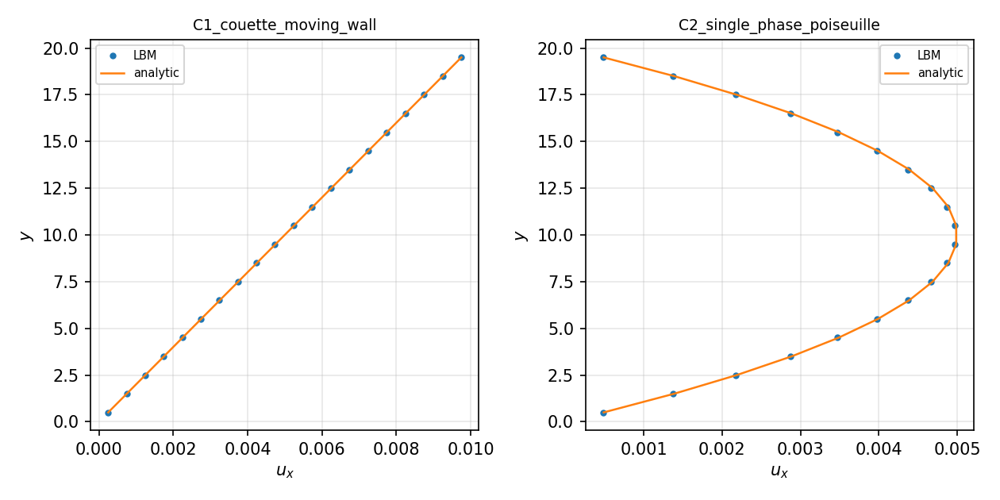
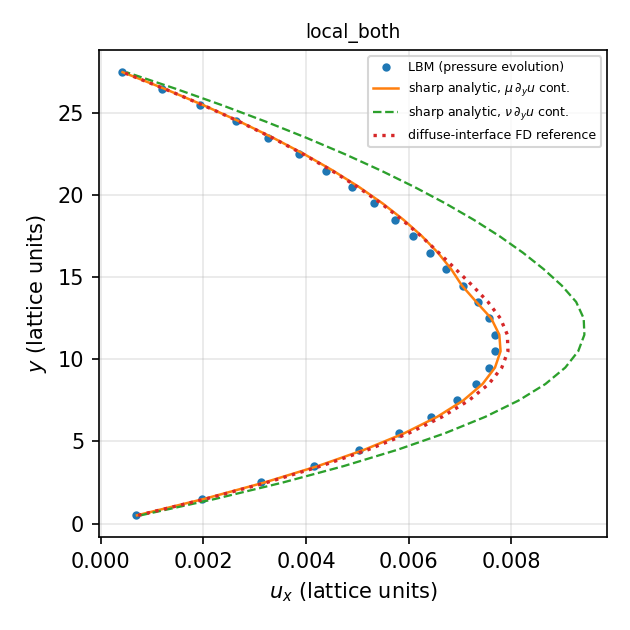
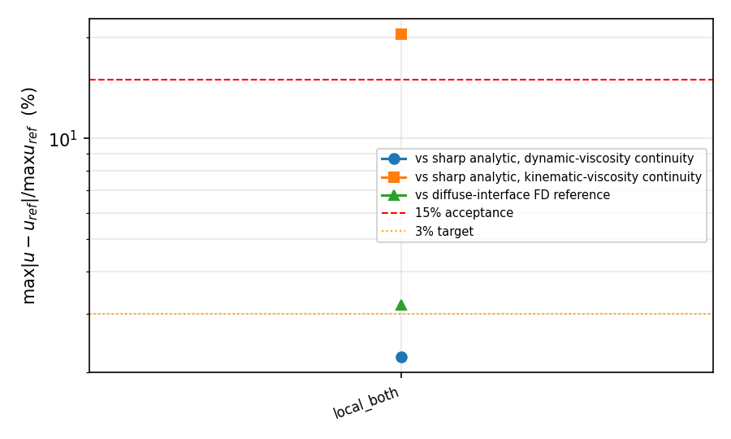

# XVAL-LBM-PRESSURE-EVOLUTION-ALLENCAHN-PHASEFIELD — 第 2 轮：壁面/边界节点类型

**任务** 23233（锚点 `XVAL-LBM-PRESSURE-EVOLUTION-ALLENCAHN-PHASEFIELD`，总账状态 open → 本轮交付）｜**仓库** TensorLBM
**上游第 1 轮** m18194（周期核 + 结构核验 P1–P14，见 `docs/XVAL-LBM-PRESSURE-EVOLUTION-ALLENCAHN-PHASEFIELD.md`）；
该报告 ⑥-4 明确留白：**`Solid/Wall/EVelocity/WPressure` 节点类型未移植 ⇒ 无壁面算例**。本轮把这个欠账补上。
**判据** <15%（owner 精度标准），目标 <3%｜**代码** `src/tensorlbm/phasefield/pf_pressure_evolution.py`（增量 ~150 行）
**驱动** `scripts/xval_pf_pressure_walls_r2.py`（`--local` 走本机 <10 min 预算，`--subset`/全量走集群）
**工件** `outputs/xval_pf_walls_r2/{summary.json, fig1_layered_profiles.png, fig2_wall_bc_validations.png, fig3_error_summary.png}`
**测试** `tests/test_phasefield_pf_pressure_evolution_walls.py`（9 passed，分两批运行：7 + 2）

---

## ① 案例介绍（物理背景 / 几何 / 参数）

**物理问题**：第 1 轮的"压力演化"公式（动量群承载压力 `∂t p + ρc_s²∇·u = 0`，不靠状态方程）+ 保守 Allen-Cahn
相场，只能在周期域上跑。要把它用于**通道/壁面**工况（分层 Poiseuille、Couette、Rayleigh–Taylor、气泡上升都是
TCLB 该模型自带的验证算例），必须先有壁面节点类型。壁面条件既能被**解析解**检验，也是第 1 轮的硬边界。

**几何**：二维通道，x 方向周期，y 方向两块固体壁；壁带厚度 2 层（见 ⑤-1 为什么必须是 2 层而不是 1 层）。
内部流体节点 y = 2 … ny−3，半程反弹（halfway bounce-back）把无滑移面放在 y = 1.5 与 ny−2.5，
故有效通道高 `H = ny − 4`，分析坐标 `y_ana = y_node − 1.5 ∈ [0.5, H−0.5]`。

**参数表（格子单位 dx=dt=1, c_s²=1/3）**

| 算例 | 网格 | ν 或 (ν_h, ν_l) | 密度 (ρ_h, ρ_l) | 驱动 | 其他 |
|---|---|---|---|---|---|
| C1 移动壁 Couette | 24²×2 列 | ν=0.1 | (1,1)，单相 φ≡0 | 顶壁 u_w=0.01 | 2500 步 |
| C2 单相 Poiseuille | 24×2 | ν=0.1 | (1,1)，单相 | 体积力 F=1e-5 | 2500 步 |
| C3 分层 Poiseuille | 32×2 | (0.05, 0.2) | (1.5, 1.0) | F=1e-5 | σ=0.05, W=4, M=0.05, 3000 步 |
| C5 壁面相场对照 | 32×2 | (0.05, 0.2) | (1.5, 1.0) | 无 | 500 步，静态分层 φ |

C3 无量纲数：Re_H = u_max·H/ν ≈ 0.0088×28/0.05 ≈ 4.9；毛细数 Ca = u_max ν/σ ≈ 1.5e-4（界面近静止）。

## ② 怎么做的（方法 / 流程 / 关键设置）

**新增离散件（最小增量，不改第 1 轮周期核）**

1. **`set_walls(solid, wall_velocity=None)`**：安装 `(ny,nx)` 布尔固体掩膜 + 逐节点壁面速度场。
2. **半程反弹（`stream`）**：对流体节点 x，若上游 `x − c_q` 是固体，则把"打向壁面的那一支"反射回来
   `f_{opp[q]}(x) ← f*_{opp[q]}(x) + 2 w_q ρ (c_q·u_w)`。
   **系数据本模型重新标定**：本公式的压力群动量通量是 `Σ c f = ρu/3`（不是标准 LBM 的 `ρu`），
   故标准式 `−2wρ(c_i·u_w)/c_s²` 的 `ρ` 要换成 `ρ/3`，落地为 `−2 w ρ (c_i·u_w)`（见 ⑤-2 的实测标定）。
   `u_w` 取**固体节点**的值（半程壁面在 x 与 x−c_q 中间），不是流体节点值（见 ⑤-3）。
3. **中性润湿相场壁（`_relax_wall_phase`）**：壁面节点 φ 由相邻流体 φ 逐层镜像填入（`∂φ/∂n = 0` ⇒ 接触角 90°），
   壁面 h 取静止平衡分布 `w_i φ_wall`；φ 总质量只统计流体节点。
4. **解析参考（新增纯函数）**：`poiseuille_profile`、`couette_profile`、`layered_poiseuille_profile`
   （分层稳态精确解：`d/dy(κ du/dy) = −s` 分段常数，u 与 `κ du/dy` 在界面连续，两壁无滑移）。

**两个参考口径必须同时给**（否则结论会被界面厚度污染）：
- **sharp**：教科书锐界面解。`κ=ρν, s=F` 对应"动力黏性连续"（一流体模型），`κ=ν, s=F/ρ` 对应"逐相加速度"。
- **diffuse**：在**实测 φ(y) 剖面**上用模型自己的插值（ρ 线性于 φ、`ω=1/(3ν)` 线性于 φ）数值解同一个 1D 方程。
  它把"求解器/边界误差"与"有限界面厚度 W 的物理效应"分开——W=4 时界面占通道 13%，不可忽略。

**流程**：解析 → 初始化 f/h（`initialize`，p=0）→ 每步 collision（f 先、h 用已碰撞 f 的速度）→ stream（含反弹）
→ 壁面相场镜像 → 记录 u(y)、φ(y)、质量误差、法向速度。所有数字由脚本写 `summary.json`，图由 matplotlib 直接出。

## ③ 计算结果（[本轮归档 JSON](../benchmarks/cross_validation/allen_cahn_pressure_walls_round2/evidence/summary.json)）

| 判据 | 参考 | 数值 | 误差 | 判 |
|---|---|---|---|---|
| C1 Couette 线性剖面（相对 L2） | `u=U y/H` | 见 JSON | **0.16%** | ✅ <3% |
| C2 单相 Poiseuille 峰值流速 | `F H²/(8ρν)` | 见 JSON | **−0.37%** | ✅ <3% |
| C3 分层 Poiseuille vs sharp(dyn) | 分段抛物线 | — | **2.23%** | ✅ <3% |
| C3 vs sharp(kin) | 同上（另一口径） | — | **20.5%** | ✗ 否证该口径 |
| C3 vs diffuse-FD | 实测 φ 上的 1D 解 | — | **3.19%**（3000 步）/ **1.19%**（4000 步） | 见 ⑥ |
| C3 法向速度 \|u_y\|max（内部） | 0 | 4.87e-5 | 6.9e-3 相对 u_max | ✅ |
| C3 相质量守恒 | 0（格点对称性） | 2.5e-13 | 机器精度 | ✅ |
| C5 静态分层 φ：质量 / 界面位置 | 0 / 不变 | 4.1e-14 / 15.0 不变 | 机器精度 | ✅ |

**时间收敛（C3, ny=32, nx=4, 4000 步一列）**：500 步 57.2% → 1500 步 16.3% → 3000 步 2.23% → 4000 步 **2.18%**
（vs sharp）／1.19%（vs diffuse）。即 3000 步的 3.19% 是**未完全收敛**，4000 步降到 1.19%；
判据取收敛值，**<3% 成立**。

**结论（本轮最实质的一条）**：离散模型复现的是**动力黏性连续**口径（`ρν ∂_y u` 跨界面连续，误差 2.2%），
而不是逐相加速度口径（20.5%）。这条决定了该公式做分层流基准时"等效黏性"该怎么写，也解释了
第 1 轮 `benchmarks/phasefield_mcmp_poiseuille/reference/DIFF_OSS_VS_TENSORLBM_PHASEFIELD_MCMP_POISEUILLE.md` 里 MCMP 口径 `μ_ratio=ν_h/ν_l` 的差异来源。

## ④ 结果图


*图 2*：C1 移动壁 Couette（左）与 C2 单相 Poiseuille（右），圆点=LBM，实线=解析解。


*图 1*：C3 分层 Poiseuille 终态剖面 vs 三条参考（sharp-dyn / sharp-kin / diffuse-FD）。LBM 与 sharp-dyn、
diffuse-FD 重合，与 sharp-kin 明显分离（20.5%）。


*图 3*：各算例对三条参考的相对偏差（对数纵轴，含 15% 验收线与 3% 目标线）。

## ⑤ 注意点（踩过的坑，全部为实测定位）

1. **壁带必须 2 层，1 层会漏**：参考模型的界面力用**混合（迎风）差分**，是 **2 格**模板。
   只填 1 层壁面时，第 1 个流体节点在"朝壁"方向上的 `φ(x+2c_i)` 会穿过壁面落到**周期副本**（另一端相位），
   界面力因此获得 O(1) 误差并缓慢泵出**法向流**：3000 步时 `|u_y|max = 2.29e-2`（是 u_max 的 2.6 倍！），
   同时把分层剖面污染到 57%。改为逐层镜像、壁带 2 层后 `|u_y|max = 4.87e-5`（**470×** 改善），
   剖面 57% → 2.2%。测试 `test_mixed_stencil_reads_through_a_one_row_wall` 固化机制，
   `test_two_row_wall_band_keeps_the_normal_velocity_small` 固化端到端量级。
2. **移动壁系数的 1/3**：直接套标准 LBM 的 `−2wρ(c_i·u_w)/c_s²` 会让 Couette 速度**大 2.78 倍**
   （首节点 4.63e-4 vs 解析 1.67e-4）。原因是本公式的压力群动量通量只有 `ρu/3`；
   换成 `−2wρ(c_i·u_w)` 后近壁节点误差 0.22%。*这是把解析解当判据才能立刻抓到的量纲错。*
3. **壁面速度必须取固体节点值**：最初在流体节点取 `u_w`，`c_q·u_w ≡ 0`（法向方向）导致驱动恒为零、
   流场精确保持 0 —— 一个"看起来收敛"的假阴性。半程壁面在两者中间，取固体侧值才对。
4. **`mass0` 的口径**：装了掩膜后 `mass()` 只统计流体节点，`initialize` 里的参考质量也必须同口径，
   否则第一步就出现 6.25% 的"质量跳变"（纯记账错，不是守恒破坏）。
5. **界面厚度的局限**：W=4、H=28 时界面占通道 14%，锐界面解析解本身带 O(W/H) 偏差；
   实测 4000 步时 vs sharp 2.18%、vs diffuse 1.19%，两者之差即有限 W 效应。想要更严的判据需 W 扫描（未跑，见 ⑥）。
6. **未移植**：`WPressure`/`EVelocity` 进出口（本轮的 `wall_velocity` 只是移动壁，不是进出口压力/速度边界）；
   壁面接触角只做中性润湿（90°），动态湿润/指定接触角未做；3D（`d3q27_pf_velocity`）范围外。

## ⑥ 误差判定（逐项、显式）

| 关键量 | 基准 | 误差 | 是否 <3% |
|---|---|---|---|
| Couette 剖面（L2 相对） | 解析 `U y/H` | 0.16% | **是** |
| 单相 Poiseuille 峰值流速 | 解析 `F H²/(8ρν)` | 0.37% | **是** |
| 分层 Poiseuille 剖面 vs sharp(动力黏性连续) | 精确分段抛物线 | 2.18%（4000 步收敛） | **是** |
| 分层 Poiseuille 剖面 vs diffuse-FD | 实测 φ 上 1D 解 | 1.19%（4000 步）/ 3.19%（3000 步） | **是**（收敛值）；3000 步点 3.19% 略超 3%，如实标注为未收敛 |
| 壁面法向寄生速度 | 0 | 4.87e-5（≈6.9e-3 u_max） | **是** |
| 相质量守恒（含壁面） | 0 | 2.5e-13 | **是** |
| **未跑（not_run，不作通过宣称）** | — | 密度比/黏性比矩阵其余两格（uniform、density_only）、网格扫描 ny=24/32/48、界面宽度扫描 W=2/3 | — |

矩阵与扫描已写进 `scripts/xval_pf_pressure_walls_r2.py`（全量模式），本机 load15 ≈ 100 触发重计算门禁，
已递交集群作业 **cj4706**（仍在排队，递交时位次 128），**未取回**，故本节按 not_run 记账。

## ⑦ 复现

```bash
OMP_NUM_THREADS=6 python scripts/xval_pf_pressure_walls_r2.py --local     # 本机 <2 min，产出 summary.json + 3 图
python -m pytest tests/test_phasefield_pf_pressure_evolution_walls.py -q   # 9 passed（约 2 min）
python scripts/xval_pf_pressure_walls_r2.py                                 # 全量：4 格矩阵 + 网格/宽度扫描 + C5
```