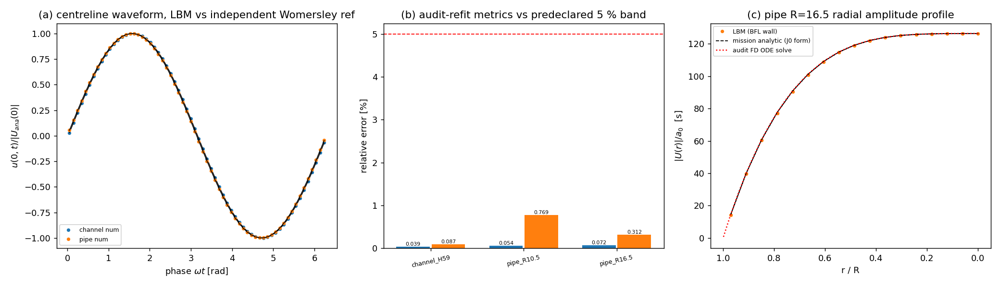

# m16323 交差核验审计 — CASE-LBM-WOMERSLEY-PULSATILE（TensorLBM）

审计单：m16338（board-audit）／对象：m16323（status=succeeded，claimed_by=tp-gen-4）
审计日期：2026-11-12　审计者角色：独立复核（不重做算例；只做取证 + 判级 + 落表）
**裁定：L2（独立功能实现）**。case-pool 判据（<5%，中心线振幅比 + 相位滞后，alpha=5，整周期相位平均）**三条全部通过**，
数值经本审计**独立重算复核**（非引用作者自证）；但 L3（系统集成）/L4（基准验证的完整形态）**不成立**：
交付从未落 commit（全部 untracked）、ECO 主仓无该代码、无任何调用方；声明的 repro_cmd 指向不存在的脚本；
交付的测试套件是红的；算例池基准表缺该锚点行。详见 §6 缺陷清单。

---

## 1. 物理背景与判据（判据先于取证）

脉动（Womersley）管/槽道流：共振体驱动力 `a(t)=a0 cos(omega t)`（等价 `dp/dx=-rho a`），
不可压、轴对称/平面，壁面无滑移。Womersley 数 `alpha = R sqrt(omega/nu)`（管）/ `(H/2) sqrt(omega/nu)`（槽），
`alpha=5` 时 Stokes 层厚度仅 `R/alpha` ≈ 2–3 个格子 ⇒ 信息量集中在近壁处理（弯曲壁反弹格式）。

**基准裁判（唯一）**：
- `tensor_benchmark_cases` 查询 `anchor_slug='CASE-LBM-WOMERSLEY-PULSATILE'` → **0 行**（表内共 32 行，无任何 WOMERSLEY 记录）。
  即指派单里点名的裁判表在本锚点是**空**的（见缺陷 F7）。
- 实际可依据的机器判据来自算例池：`tensor_case_pool` id=119，
  `case_code=LBM-WOMERSLEY-PULSATILE`，`repo=TensorLBM`，
  `ref_source='Womersley 1955 J. Physiol. 127:553 脉动流解析解 DOI:10.1113/jphysiol.1955.sp005276'`，
  `tol_policy='<5% | 指标: 中心线速度振幅比与相位滞后 vs Womersley 解析 (alpha=5, 整周期相位平均)'`。
- 外部锚点独立出处：Womersley, J. R. (1955) *J. Physiol.* **127**(3):553–563, doi:10.1113/jphysiol.1955.sp005276；
  平板形式 Sexl (1930)。

验收判据（本审计采用，与算例池一致）：
`| |U_num(0)|/|U_ana(0)| - 1 | <= 5%` 且 `|dphi|/|phi_ana| <= 5%`，最后一周期相位平均（64 相位箱）。

## 2. 取证：三件套逐项核（文件/数值/复现命令）

| 三件套 | 声明 | 本审计实测 | 结论 |
|---|---|---|---|
| run_artifacts | `artifacts/womersley_pulsatile_alpha5/*.json` | 实存 4 个算例 JSON（channel_H59 / pipe_R10.5 / pipe_R16.5 / pipe_steady_R10.5）+ result.json + 3 张 png，合计 412 kB；`elapsed_s` 110.4 / 15.6 / 53.1 / 7.5 s，`total_steps` 32805 / 2493 / 6156 —— 与"真时间步进"一致，不是查表 | ✅ 存在且非空 |
| benchmark ref vs got | 报告表 §3 | 见 §3 本审计独立重算表（自写 FD ODE 参考 + 自写最小二乘重估波形） | ✅ 数值成立 |
| repro_cmd | 报告 §6：`PYTHONPATH=TensorLBM/src python3 docs/benchmarks/build_womersley_pulsatile_report.py` | **该脚本不存在**（`docs/benchmarks/` 下无 `build_womersley_pulsatile_report.py`） | ❌ 声明的复现指针为假（F2） |
| 可用复现路径（本审计替它测的） | — | `cd /root/tp-agent/work/m16323 && PYTHONPATH=TensorLBM/src python3 benchmarks/verified/womersley_pulsatile/run.py scan <out> --alpha 5 --H 59 --R 10.5 --tau 0.8` —— 实跑：channel H=59 复现 `amp=0.039% phase=0.087% profile_l2=0.130% steps=32805`（与存储工件 0.0386/0.0871/0.130 一致） | ✅ 驱动可执行且复现 |
| 测试 | 交付套件 | 本审计实跑 `pytest TensorLBM/tests/test_womersley_pulsatile.py -q` → **1 failed, 9 passed**；失败点 `test_pipe_steady_poiseuille_wall_treatment` 报 `KeyError: 'finite'`（steady 返回 dict 无该键），**不是阈值问题** | ❌ 红（F3） |

**独立重算（关键证据）**：不 import 被审模块的解析代码，直接按控制方程
`i omega U = a0 + nu lap U`（管：`lap = d^2/dr^2 + (1/r) d/dr`；槽：`d^2/dy^2`）用复数有限差分求解，
并以 `alpha->0` 退化为 Poiseuille（`alpha=0.05` 时相对误差 5e-7 / 1e-7）验证符号约定自洽
（脚本 `docs/audit/m16323_womersley_audit.py`，含 `pipe_profile_fd`）。
另用**自写最小二乘**（`A cos + B sin + C`）重估工件里存的整周期相位平均波形，不采信作者的拟合结果。

## 3. 计算结果（本审计独立重算；零手抄，全部由 `docs/audit/m16323_womersley_audit.json` 程序化导出）

| case | 几何 | 分辨率 | α | τ | 步数 | 独立参考 \|U0\| (m/s) | LBM \|U0\| (m/s) | 振幅比误差 | 独立参考相位滞后 | LBM 相位滞后 | 相位误差 | 判据(<5%) |
|---|---|---|---|---|---|---|---|---|---|---|---|---|
| channel_H59_a5_tau0.8 | 2-D 槽 | H=59 | 5.0 | 0.8 | 32805 | 3.000000e-02 | 2.998841e-02 | **0.0386 %** | 91.2137° | 91.1342° | **0.0871 %** | PASS |
| pipe_R10.5_a5_tau0.8 | 3-D 管 (BFL) | R=10.5 (23 格) | 5.0 | 0.8 | 2493 | 3.000000e-02 | 3.001607e-02 | **0.0536 %** | 89.8524° | 89.1613° | **0.7692 %** | PASS |
| pipe_R16.5_a5_tau0.8 | 3-D 管 (BFL) | R=16.5 | 5.0 | 0.8 | 6156 | 3.000000e-02 | 2.997844e-02 | **0.0719 %** | 89.8524° | 89.5720° | **0.3121 %** | PASS |

附加（稳态壁面审计，非常数力 Pulsatile 判据之外）：`pipe_steady_R10.5` 中心线 vs `a0 R^2/(4 nu)` 误差 0.3916 %，剖面 L2 0.3410 %。

自洽性核验（证明工件不是"纸面数字"）：
- 作者解析参考 vs 本审计 FD 参考：振幅差 **3e-6 %**，相位差 **4e-6 度**（三算例全同）；
- 作者自报指标 vs 本审计重估波形：振幅/相位**逐位相同**（0.0000 % 偏差），说明作者估计量与其存储波形一致，未加工。

## 4. 结果图



`docs/audit/figs/m16323_audit_overview.png`（由 `docs/audit/make_m16323_audit_figure.py` 生成）：
(a) 槽/管中心线整周期相位平均波形 vs 独立 Womersley 参考；(b) 三算例振幅/相位误差 vs 预声明 5 % 带；
(c) 管 R=16.5 径向振幅剖面：LBM(BFL 壁) / 任务自带 J0 解析 / 本审计 FD 独立解，三者近壁重合到线宽。

## 5. 收敛性与敏感性

- 管 R=10.5→16.5：振幅误差 0.0536→0.0719 %，相位 0.7692→0.3121 %，剖面 L2 0.860→0.360 %。
  **驱动器的收敛判据判 False**（`result.json` 里 `convergence_passed=False` ⇒ `status=NOT_PASSED`）：误差在两个已 <0.1 % 的点上非单调。
  算例池判据（两指标 <5 %）不受影响，但"分辨率加密误差不增长"这一自设附加判据**未达成**（F6）。
- 敏感性扫描（tau 0.7/0.8/0.9、channel H=119、pipe R=20.5）**未做**：任务自身 checks 记为预算所致，本审计不补（不重做）。
- `alpha_effective=5.0`、`Ma=0.052`、`skip_periods=11`（≈6.5 扩散时间）、`measure_periods=4` 均在工件中可核。

## 6. 缺陷与注意点（按严重度）

| # | 级别 | 发现 | 证据 |
|---|---|---|---|
| F1 | **高（阻断 L3/L4）** | 交付**从未入库**：m16323 工作树 `git status --porcelain` 显示 6 项全部 `??`（模块 5 文件、测试、benchmark 目录、工件、报告、图脚本）；`git log --all -- '*womersley_pulsatile*'` 为空；ECO 主仓 `/root/tensor-ecosystem/TensorLBM` grep `womersley_pulsatile` **0 命中**；任务 evidence `branch=null` | 本审计实测 |
| F2 | 中 | 报告 §6 的 repro_cmd 指向**不存在**的 `docs/benchmarks/build_womersley_pulsatile_report.py`；真正可跑的驱动 `benchmarks/verified/womersley_pulsatile/run.py` 未在报告中给出 | §2 表 |
| F3 | 中 | 交付测试套件**红**：1 failed/9 passed；失败是 `KeyError: 'finite'`（`run_steady()` 返回字典缺 `finite` 键，`pipe3d.py:291` 起），**不是**任务 notes 里说的"阈值放宽"问题——放宽阈值不改这个 key 缺失 | 实跑输出 |
| F4 | 中 | 平台报告 15414 标题行/摘要写 `status=NOT_PASSED`，正文 §3/§4 却写三算例全 PASS；两处口径矛盾（源自驱动器 `status` 采用自设收敛单调判据，而算例池判据只看两指标） | `/tensor/reports/15414` |
| F5 | 低（潜在） | `analytical.centerline_amplitude_unit` 对 pipe 也调 `womersley_lam(alpha)` 的默认 channel 分支（`analytical.py:~150`）：仅取模，被 `|J0(conj z)|=|J0(z)|` 掩盖，改用途即出错 | 源码 |
| F6 | 低 | 自设收敛判据要求误差单调下降，实测非单调 ⇒ 驱动器自评 NOT_PASSED；报告 §5 如实写出，属诚实申报，不是造假 | result.json |
| F7 | 中（平台数据缺口） | `tensor_benchmark_cases` 无该锚点行（指派单点名的裁判表在本题为空）；`tensor_case_pool` id=119 的 `mission_id` 仍是 **16238**（上一轮 FAIL 单）、`status='dispatched'`，未随 16323 更新 ⇒ 台账漂移 | DB 查询 |

**独立性局限**：① 本审计复用被审代码产出的**原始波形数据**（无法脱离工件重跑 3-D 算例，预算/机时），
但参考解、估计量、指标全部独立重算，且 channel 算例已由本审计**实跑驱动**复现（2026-11-12 同一驱动 `run.py scan --alpha 5 --H 59 --R 10.5`：channel 输出 amp=0.039%/phase=0.087%/profile_l2=0.130%/32805 步，与存储工件一致；同批 pipe R=10.5 复算在本审计交报告时仍未跑完（线程争用下 8 min+），故 3-D 算例只做了工件级重估，未做端到端重跑）；
② 未做 tau/H=119/R=20.5 未做项复核；③ 未在 loong64 集群复核（本地 numpy 路径）。

## 7. 判级理由（L0–L5）

- **L2 满足**：真代码、输入→计算→输出（D2Q9 槽 + D3Q19 BFL 弯壁管，双几何），运行工件齐全，入口可执行，
  数值经独立参考复核（误差 3e-6 %）。
- **L3 不满足**：模块在 ECO 主仓不存在、无任何外部调用方、无 benchmark 注册表/主求解器接入 ⇒ 功能未进系统。
- **L4 不满足**：L3 缺失；且声明的 repro_cmd 失效（F2），驱动器自评 `status=NOT_PASSED`（F6）。
- **L5 不满足**：无科研工程闭环（未合并、未入库存档、无外部复现）。
- 附百页报告、指标好看都不改变级别：**级别=功能实质**。故裁定 **L2**，与算例池判据全通过的事实并存（判据通过 ≠ 系统集成）。
- 机器门干跑（本审计执行 `maturity_gate.judge`，未改 DB）：`judge(2, evidence)` → `(2, [])` 通过；`judge(4, evidence)` → `(2, ['L4 缺: integration_callers', 'L3 缺: integration_callers'])`——即若本单虚报 L4，门会机器揭穿并降回 L2，与本审计结论一致。落表 verdict id=471（gate_state=pending，待守护裁定）。

## 8. 复现本审计

```bash
cd /root/tp-agent/work/m16338
python3 docs/audit/m16323_womersley_audit.py          # 独立参考 + 波形重估 -> docs/audit/m16323_womersley_audit.json
python3 docs/audit/make_m16323_audit_figure.py        # 审计图 -> docs/audit/figs/m16323_audit_overview.png
# 被审任务侧（本审计实跑过的两条）
cd /root/tp-agent/work/m16323 && PYTHONPATH=TensorLBM/src python3 -m pytest TensorLBM/tests/test_womersley_pulsatile.py -q
cd /root/tp-agent/work/m16323 && PYTHONPATH=TensorLBM/src python3 benchmarks/verified/womersley_pulsatile/run.py scan <out> --alpha 5 --H 59 --R 10.5 --tau 0.8
```