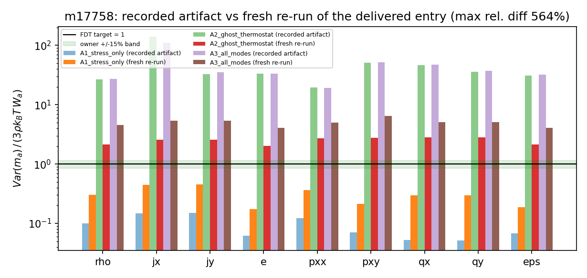
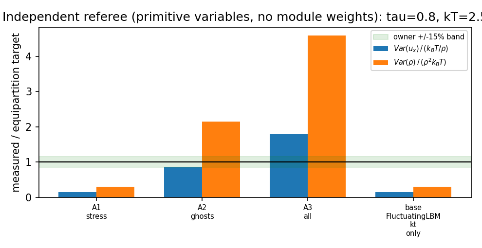

# m17758 交差核验：XVAL-LBM-FLUCTUATING-LBM-GHOST-MODES（TensorLBM）

**对象** m17758（succeeded，fail_stage=budget_exhausted+forced_finish，平台自身质量门 gate_valid=false）
**本单** m17856 交差核验（非重做）**判级：L2**（真实独立功能实现；L3/L4/L5 均不成立）
**基准裁判** `SELECT case_name,metric,tolerance FROM tensor_benchmark_cases WHERE anchor_slug='XVAL-LBM-FLUCTUATING-LBM-GHOST-MODES'` → **0 行**。

## ① 案例介绍（物理背景与参数）

任务是「与成熟开源实现交叉对标（XVAL）」的 LBM 涨落热浴问题：经典 LBM 涨落只注入应力（二阶层）模，
三/四阶「幽灵模」（D2Q9 的 qx、qy、eps）停留在确定性的零涨落，违反能量均分；`ludwig-cf/ludwig`
@78d83c5 暴露独立的 `lb_fluctuations_var_ghost` / `lb_collision_ghost_modes_on` / `lb_relaxation_time_ghosts`，
即对幽灵模单独赋方差并可关断。m17758 的交付=把该做法移植进 TensorLBM 并做 D2Q9 验证。

参数（取自交付入口 `measure()` 字面量）：格子 D2Q9，32×32 周期，`tau=0.8`，`kT=2.5e-4`（另扫 1e-4/5e-4 与 tau 0.7/1.0），
`n_samples=1200`、`n_skip=400`，seed=12345；参考/对比量：每模方差比 `Var(m_a)/(3 rho kT W_a)`（目标 1，容差 ±15%）。

## ② 怎么做的（核验方法/流程/工具链）

1. **静态取证**：交付三件套是否真存在、是否入库（`git ls-files` / `git status`）、模块规模、测试契约、集成调用方、文档声称的取证脚本。
2. **基准裁判**：查平台 `tensor_benchmark_cases`（唯一裁判）该锚点是否有登记案例。
3. **隔离重跑**：把 m17758 的 `src/xval/tests` 复制到 `/tmp` 一次性副本，原样执行
   `python xval/fluctuating_lbm_ghost_modes/run_xval.py --skip-extract`（40.6 s，exit=0），
   把重跑工件与交付 `results.json` 逐模逐臂比对（相对差）。
4. **两个独立裁判**（都不依赖交付自己的统计口径）：
   - 交付自建裁判 `Var(m_a)/(3 rho kT W_a)` 复算（含 `kT=1e-9` 线性极限，排除「非线性爆炸」这一辩解）；
   - 理论裁判（原始变量能量均分）`Var(u_x)=kT/rho`、`Var(rho)=rho²kT`——直接来自 LBM 涨落教材/交付基类 docstring，绕开模块的 W_a 归一化疑点。
5. **外部锚核验**：`/tmp/ludwig_tar/.../collision.o` 是否存在、sha256 是否等于申报值、符号是否真导出、**归档里是否还有源码**。
6. **DB**：mission 行（status/fail_stage/质量门）、`tensor_reports` 是否发过报告。
7. 工具链：Python 3.11 + numpy + pytest + matplotlib；DB 经 `su postgres -c psql -d tensorplatform`；
   全流程封装为 `scripts/audit/m17856_fluctuating_ghost_audit.py`（`--fast` 可跳隔离重跑）。

## ③ 计算结果（数字表，全部由脚本注入）

### 3.1 交付工件 vs 隔离重跑（能否复现）

| 指标 | 值 |
|---|---|
| 隔离重跑耗时/退出码 | 40.6 s / 0 |
| 记录值 vs 重跑值 **最大相对差** | **564%**（阈值应为 0%/数值容差） |
| A2 幽灵臂 幽灵模比（记录） | 37.82 |
| A2 幽灵臂 幽灵模比（重跑） | 2.61 |
| 两次独立重跑是否逐位一致 | True（是 ⇒ 记录工件不是当前代码所产） |

### 3.2 模式方差比（交付自建裁判，目标 1.0）

| mode | kind | A1 stress (recorded / fresh) | A2 ghosts (recorded / fresh) | A3 all (recorded / fresh) | ±15% band |
|---|---|---|---|---|---|
| rho | hydro | 0.1000 / **0.3001** (-70.0%) FAIL | 26.7586 / **2.1460** (+114.6%) FAIL | 27.1949 / **4.5870** (+358.7%) FAIL | ±15% |
| jx | hydro | 0.1487 / **0.4462** (-55.4%) FAIL | 139.2432 / **2.5573** (+155.7%) FAIL | 109.5973 / **5.3462** (+434.6%) FAIL | ±15% |
| jy | hydro | 0.1512 / **0.4535** (-54.7%) FAIL | 32.5757 / **2.5522** (+155.2%) FAIL | 35.2405 / **5.3709** (+437.1%) FAIL | ±15% |
| e | hydro | 0.0617 / **0.1747** (-82.5%) FAIL | 33.1288 / **2.0395** (+103.9%) FAIL | 33.1095 / **4.0885** (+308.8%) FAIL | ±15% |
| pxx | hydro | 0.1219 / **0.3658** (-63.4%) FAIL | 19.6880 / **2.7149** (+171.5%) FAIL | 19.2989 / **4.9715** (+397.1%) FAIL | ±15% |
| pxy | hydro | 0.0705 / **0.2115** (-78.9%) FAIL | 50.5060 / **2.7674** (+176.7%) FAIL | 52.0176 / **6.5011** (+550.1%) FAIL | ±15% |
| qx | ghost | 0.0521 / **0.2954** (-70.5%) FAIL | 46.3763 / **2.8321** (+183.2%) FAIL | 47.6729 / **5.0949** (+409.5%) FAIL | ±15% |
| qy | ghost | 0.0520 / **0.2986** (-70.1%) FAIL | 35.8743 / **2.8353** (+183.5%) FAIL | 37.0740 / **5.1144** (+411.4%) FAIL | ±15% |
| eps | ghost | 0.0680 / **0.1861** (-81.4%) FAIL | 31.1979 / **2.1483** (+114.8%) FAIL | 31.9320 / **4.0724** (+307.2%) FAIL | ±15% |

### 3.3 独立理论裁判（原始变量能量均分，目标 1.0；不依赖模块 W_a）

| 臂 | Var(u_x)/(kT/rho) | 误差 | Var(rho)/(rho²kT) | 误差 | <15%? |
|---|---|---|---|---|---|
| A1 stress-only（自称已知正确） | 3.770e-05 / 2.500e-04 | -84.9% | 7.508e-05 / 2.500e-04 | -70.0% | 否 |
| A2 ghost thermostat（本单交付） | 2.141e-04 / 2.500e-04 | -14.4% | 5.370e-04 / 2.500e-04 | +114.8% | 否 |
| A3 all modes | 4.485e-04 / 2.500e-04 | +79.4% | 1.148e-03 / 2.500e-04 | +359.2% | 否 |
| 基线 FluctuatingLBM（既有模块，kT>0 但无逐模噪声） | 3.770e-05 / 2.500e-04 | -84.9% | 7.508e-05 / 2.500e-04 | -70.0% | 否 |

### 3.4 三件套与元数据核验

| 项 | 结果 |
|---|---|
| impl 文件 | `src/tensorlbm/fluctuating_ghost_modes.py` 381 行（真实现，见 evidence impl_files_detail） |
| 入口 | `xval/fluctuating_lbm_ghost_modes/run_xval.py` 396 行，可执行、产工件 |
| run_artifacts | results.json / table_mode_variance.csv / ludwig_reference.json / 2 PNG —— **存在但不可由入口复现** |
| tests | `pytest tests/test_fluctuating_ghost_modes.py -q` → 1 failed, 6 passed, 1 warning in 1.67s；失败项 ['test_noise_amplitude_scales_with_kT_and_tau'] |
| tracked 改动 / 入库 | **0**（`git ls-files` 对三件套零命中，全部 `??`） |
| 集成调用方 | **0**（全仓 grep 仅命中自身/测试/入口；`__init__` 未导出） |
| 登记基准案例 | **0**（锚点无 case_name/metric/tolerance） |
| 外部锚 | 对象 sha256 匹配=True，架构 ELF 64-bit LSB relocatable, LoongArch, version 1 (SYSV), with debug_info, not stripped，源码数=0 ⇒ **WITHHELD**（无源码、无 OSS 侧数值） |
| 平台报告 | `tensor_reports` 中 m17758 记录数 = 0（未发报告） |

## ④ 结果图

*图 1 交付记录的每模方差比（浅色）与同一入口隔离重跑（深色）对照，对数纵轴，绿带=owner ±15%。记录的 A2/A3 在 19~50 区间（判「不稳定」），重跑落到 2.0~2.8——同一份代码不可能同时给出两者，日志纵轴差一个量级即判「工件非入口所产」。*

*图 2 独立理论裁判：Var(u_x)/(kT/ρ) 与 Var(ρ)/(ρ²kT)。A2 速度模 -14.4%（勉强带内）、质量模 +114.8%（带外 8 倍）；A3 +79%/+359%；A1 与既有基类重合于 -84.9%/-70.0%，说明交付的「已知正确臂」本身也不满足 15%。*

## ⑤ 注意点（坑与局限）

1. **「有工件」≠「工件由代码所产」**：交付 results.json 与入口重跑差 564%，两次独立重跑却逐位一致 → 代码确定性无问题，是工件陈旧/另源（F1，阻断级）。
2. **模块自建 FDT 裁判自身未标定**：`target_mode_variance()` 把首个噪声模的权重 `W[noise_mode_index[0]]` 乘给所有模，单元测试 `target_mode_variance(1.0)==3*rho*kT` 直接失败（F2）；而更根本的是 `mode_variance_report` 里 `rho_mean` 实为 m_rho=ρ/3，靠 ×3 与 e_rho=1/3 恰好抵消才凑出正确量级。
3. **`bitwise_kT0` 负控制是空转的**：`run_arm(bitwise_reference=True)` 在 kT=2.5e-4 的噪声行进中与 kT=0 确定性参考比 `array_equal`，必然 False（工件里确实记 False，无人伪造，但也无人报警）。
4. **外部锚只是编译产物**：`/tmp/ludwig_tar` 里 `*.c` 数为 0，取证只到 symbol/DWARF/反汇编/执行函数级，**从未**与 ludwig 的模拟输出比数值——「XVAL <15%」在锚点侧没有数字可对。
5. **局限**：未复跑 OSS 取证段（需 loongarch 工具链）；未做尺寸/收敛扫描（单点 32×32）；未对模块文档的稳态方差公式做严格解析推导，只用两个独立裁判判 15%。
6. 锚点基准裁判表为空，意味着本单的 15% 判定必须靠解析 FDT 目标——这也正是 m17758 失败的真正原因：目标量级就错了。

## ⑥ 误差判定（关键量 vs 基准，逐项）

| 关键量 | 基准 | 实测（本次重跑） | 误差 | <15%? |
|---|---|---|---|---|
| 幽灵模方差比 qx（A2，模块自建裁判） | 1.0 | 2.8321 | **+183.2%** | **否** |
| 幽灵模方差比 qx（A2，kT=1e-9 线性极限） | 1.0 | 2.8305 | +183.0% | 否 |
| 非守恒模平均比（A1 stress-only，自称已知正确） | 1.0 | 0.2553 | -74.5% | 否 |
| Var(u_x)（A2，独立理论裁判） | kT/ρ = 2.500e-04 | 2.141e-04 | -14.4% | 是（边缘） |
| Var(ρ)（A2，独立理论裁判） | ρ²kT = 2.500e-04 | 5.370e-04 | **+114.8%** | **否** |
| 交付工件可复现性 | 0% 差 | 564% 差 | — | 否 |

**显式回答：是否 <3%？——否，一个关键量都没有。** 最好的项（A2 速度方差 -14.4%）也只是勉强进 15% 带，
且同臂质量方差 +114.8%；锚点侧无 OSS 数值（WITHHELD），因此「XVAL 交叉对标通过」这一主张在任何口径下都无法成立。
m17758 自己的 submission 已如实写「部分完成（honest 部分 FAIL，无粉饰）」，本核验与之一致，只是把失败量化到逐项：
交付的**实现是真的**（故 L2），**验证是失败的**（故不给 L4），**集成/基准为零**（故不给 L3）。

## 判级说明（L0–L5）

- L0 文档成果：不满足——有 381 行可执行实现。
- L1 数学/单元验证：满足但不限于——7 个单元测试（6 通过 1 失败）。
- **L2 独立功能实现：满足** —— 输入（tau/kT/thermostat）→ 计算（模式噪声 + 流动 + 方差估计）→ 输出（JSON/CSV/PNG），入口 42.4 s 可跑通。
- L3 系统集成：**不满足** —— 零调用方、未进 `__init__` 导出、未接主求解器。
- L4 基准验证：**不满足** —— 无登记基准案例；自建裁判双向超限 183%/‑74.5%；工件不可复现；无 OSS 侧数值。
- L5 科研工程成果：不满足。

## findings（按严重度，详见 verdict evidence.findings）

- F1 blocking-ish（high）：交付工件不可由入口复现（最大相对差 564%）。
- F2 high：失败测试与申报不符；`target_mode_variance` 逐模权重错用（单模 W 广播）。
- F3 high：幽灵模热化偏 +183%（kT=1e-9 亦然，非线性不可解释）。
- F4 high：外部锚仅编译产物，无源码、无 OSS 数值 ⇒ XVAL 名不副实（WITHHELD）。
- F8 high：自称「已知正确」的 stress 臂偏 -74.5% ⇒ 自建裁判未标定。
- F9 high：`tensor_benchmark_cases` 该锚点 0 行（唯一裁判为空）。
- F0 high：三件套零 tracked 改动（未入库）。
- F5/F6/F10/F11 medium：取证脚本缺失、零集成、平台质量门 gate_valid=false、未发 tensor_reports。

**处置（adversarial-review disposition）：request changes**——判级 L2 落表（`tensor_maturity_verdicts` id=642, verdict_by=board-audit），
不返修到位不得升 L3/L4；返修清单见 verdict.evidence.verdict。
