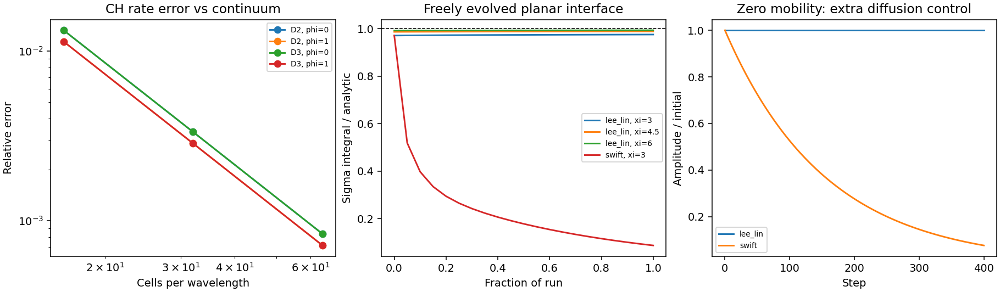
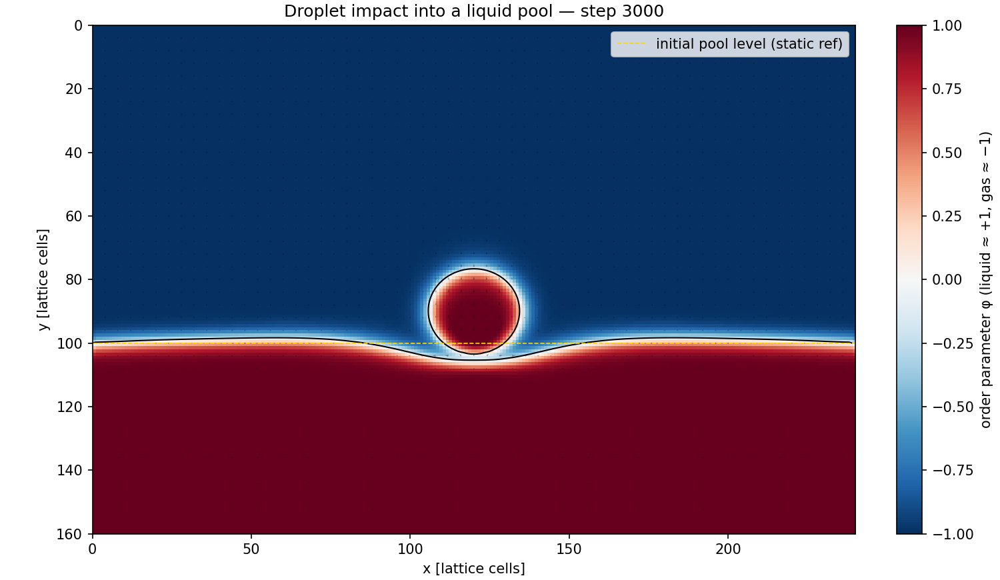

# Cahn–Hilliard 核心修正与实算验收（2026-11-17）

本轮修复 D2Q9/D3Q19 自由能相场的额外普通扩散，补齐已经被仓库测试调用、但实际不存在的 `geq_convention` 接口。**限定配置的 21 个 CH／平界面实验通过；完整多相物理验证仍未通过。** 较强表面张力的两组长期失稳完整保留，不能用通过配置替它们背书。

源码 SHA-256、逐时刻测量、判据、负对照和失败参数见 [report.json](report.json)。本报告由实际 CPU/float64 碰撞及迁移生成；本轮未重新执行外部 OSS 求解器，不将旧 XVAL 叙述当作本轮交叉验证。



## 改动及兼容性

- `free_energy_step`、`free_energy_step_3d` 和对应 `init_free_energy_g*` 增加关键字 `geq_convention="lee_lin"`；初始化另可接收离散化学势 `mu` 和 `Gamma`。求解器 API 默认保留 `swift`，既有 D3Q19 单步位级兼容测试通过。初始化与推进必须选择相同约定。
- 新平衡分布满足 `Σg=phi`、`Σcg=phi*u`、`Σccg=phi*uu+Gamma*mu*I`，迁移率 `M=Gamma*(tau_g-0.5)`。去掉旧公式二阶矩中的 `cs²*phi*I`；旧路径的普通扩散系数为 `cs²*(tau_g-0.5)`，即使 Gamma=0 也不为零。`lee_lin` 是兼容仓库既有接口名称的局部 Hermite 构造，**不表示移植完整 Lee–Lin 流体模型**。
- 正确路径使用运行精度的权重；D3Q19 相对流采用与 D2Q9 一致的半步力物理速度。动量碰撞模型没有更换。没有据此验证非定常强对流的高阶修正项或 LES。
- 入水示例默认采用修正路径、float64、`tau_g=1`、`A=B=0.004`、`xi=3`、`kappa=0.018`、解析 `sigma=0.008`。参数与原默认不同，不能把前后图像当成相同无量纲工况的精度对比。双井参数必须匹配示例的 ±1 相；显式宽度须满足 `xi=sqrt(2*kappa/A)`。
- 新报告格式 `schema_version=1`，含 `physical_validation_passed=false`、范围和未验收列表。原验证矩阵及 TensorPhysics/TensorPlatform 协议均未更改。数值方法、实算和验收属于 TensorLBM 本地职责。

## 实际结果

Python 3.12.14，PyTorch 2.15.0+cpu，单线程。

| 实验 | 实际结果 | 可支持的结论 |
|---|---|---|
| 修复前仓库已有 CH 测试 | 4 failed / 2 passed，失败均为缺少 `geq_convention` | 文档／测试声明曾超出实际接口 |
| 最终相关回归 | **353 passed / 1 skipped / 0 failed**，103.96 秒 | 当前选择的代码及兼容路径回归；非全仓测试 |
| CH 线性增长与衰减，2D/3D | n=16/32/64，最细相对误差分别约 0.0834% / 0.0713%；观测阶 1.993–1.999 | 规定物理速度为零时的 CH 方程、迁移率和空间／时间联合加密 |
| 非零迁移率敏感性 | `(tau_g,Gamma)=(0.8,0.2),(1.2,0.4)` 均通过 | 在所测配置下满足 M 的标定关系 |
| 零迁移率负对照 | 修正路径幅值不变；旧公式显著衰减并被相同门槛拒绝 | 守恒不能替代正确的界面动力学 |
| 自由演化平界面 | xi=3/4.5/6，分别 1,000/5,062/16,000 步；表面张力积分误差 **2.423% / 1.088% / 0.614%** | 所测低表面张力配置保持界面；没有冻结或重置 phi |
| 旧公式平界面负对照 | 同低表面张力配置，积分误差 **91.28%** | 旧路径会耗散界面，不能被健康门槛认证 |
| 较强表面张力失败 | kappa=0.18、xi=4.5：5,062 步积分误差 53.75%，寄生速度约 0.233；xi=6：10,648 步失去正密度／有限健康状态 | **未解决、未准入**；不保证任意参数稳定 |
| 入水探索运行 | 240×160、3,000 步；最大归一化相总量漂移 1.496e-16，最大原始动量速度 0.007586，最大 abs(phi)=1.073514 | 数值健康通过，尚未证明撞击／并合、飞溅高度或载荷精度 |

CH 模式解析关系由线性化得到：

\[
\omega=-M k^2[-A+3B\bar\phi^2+\kappa k^2].
\]

测试冻结的是物理速度而非原始 `j/rho`：后者补偿半步力，使相方程不混入流体反作用。该项不是耦合 Navier–Stokes 验证。n 加倍时 kappa 乘 4、步数乘 4，保持相同物理模式并联合细化；它不是独立空间／时间误差分离。

平界面使用一对周期相容的 tanh 界面，f 与 g 均真实碰撞／迁移。测量 `kappa * integral((dphi/dx)^2)/2`，除以 2 是因为有两个界面；独立连续目标为 `(2/3)*sqrt(2*kappa*A)`。固定 kappa=0.018，A 随 xi^-2 缩放，CH 时间随 xi^4 缩放。此为静态界面保持／应力积分实验，不是动态流体相似律收敛，也不是从 f 实测的 Laplace 压差。

## 复现

```bash
export OMP_NUM_THREADS=1 MKL_NUM_THREADS=1 PYTHONPATH=src
python benchmarks/phasefield_ch_core/run.py --output artifacts/ch_core/report.json --plot
python -m pytest -q tests/test_ch_moment_closure.py tests/test_xval_m17762_free_energy_ch.py
python examples/droplet_impact.py --n-steps 3000 --output-interval 750 --output-root outputs/ch_core_impact --overwrite
python tools/lint_ratchet.py --check  # ruff 0.15.0
python benchmarks/status_ledger.py --check
python benchmarks/validation_matrix/runner.py audit
python benchmarks/validation_matrix/independent_audit.py
```

全面相关回归的命令见 [pytest_command.txt](pytest_command.txt)，输出见 [pytest.txt](pytest.txt)。唯一 skip 为既有高级碰撞空参数化；另有 21 个含 Triton 的文件因环境缺依赖被排除收集，均不算通过。两条环境警告为旧 pytest 配置／插件弃用。

新增测试包括两种精度的完整矩约束、五个坐标方向的解析增长／衰减、迁移率、网格阶、半步力对流、闭槽内部固体守恒、非有限态注入和 CLI 失败前落盘。CI 已接入测试和完整 CH 报告，报告先写严格 JSON，再按限定范围门槛退出；没有提高原有容差、取消失败或提升原验证矩阵等级。工作流文件存在不表示远端执行成功。

实际 CI 使用的 `tools/lint_ratchet.py --check` 通过：3022 个既有 lint finding（baseline 3023），2195 个格式债务（baseline 2195），新增／修改 Python 文件 lint 均为零。另一旧工具 `tools/ci_ratchet.py` 使用不一致的历史基线，仍失败，未改写其基线。布局检查基线及当前均 207 项旧违规，新增 0；台账 hard 0、soft 17，参考锚点 17/17，独立矩阵审计 0 阻塞。

[入水参数和指标](impact_metadata.json)、[逐时刻历史](impact_history.csv)、[执行命令及源文件／产物哈希](impact_provenance.json)与末帧保留于本目录。总产物不到 1 MB；用于代码审查和后续复现，完整场数据／每帧未加入 Git。



此图中液滴仍可与液池区分，不能据此宣称完成并合或出现了可信飞溅。下一道物理门仍是**同一求解路径**的静滴实测压差、毛细波频率／阻尼与强表面张力稳定性；之后才能做入水的定量参考比较。其他 SC、CAC、压力张量模型的通过结果不自动转移到本修正路径。
