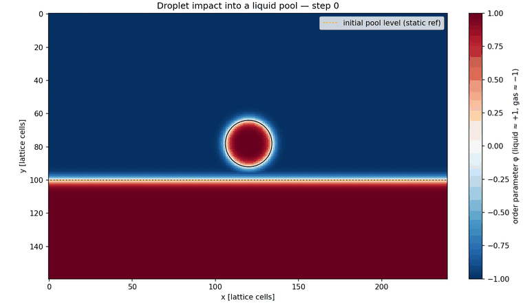
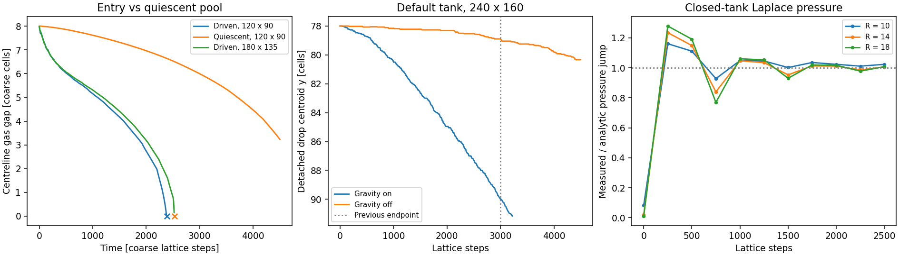

# 2026-11-18 入水实算

240×160 的静止释放液滴在第 3,000 步尚余 1.911 格的中心线气隙，首次观测到连入液池的区间为 **(3,220, 3,230] 步**。示例默认时长延至 4,500 步，可直接看到液桥形成和以后的界面演变。重力关闭后，同一时刻的末态仍有 3.789 格气隙。[默认运行 CSV](histories/default/interface_history.csv) · [配对判定](default_control.json)





## 动力学对照

数值模型为封闭槽内二维 D2Q9 自由能 CH，均匀惯性密度，Boussinesq 重力，FP64。基础配置为 ξ=3、σ=0.008、M=0.25，初始池面与水滴边界均由 φ=0 定义。接触取首个满足条件的观测点，给出开闭区间。真正的薄气膜破裂、三维飞溅与载荷还需要独立参考。

| 网格、半径、初始间隙（格） | 重力、初速尺度（格子单位） | 末步 | 首次液桥区间（步） |
|---|---|---:|---|
| 240×160，14，8 | 2e-5，0 | 4500 | (3220, 3230] |
| 同上 | 0，0 | 4500 | 始终分离 |
| 120×90，10，8 | 2e-5，0.045 | 4500 | (2380, 2390] |
| 同上 | 0，0 | 4500 | 始终分离，末态间隙 3.234 |
| 180×135，15，12 | 5.92593e-6，0.03 | 10125 | (5676, 5698] |
| 120×90，10，5 | 2e-5，0.045 | 1600 | (932, 933] |
| 同上 | 0，0 | 1600 | (1437, 1438]，短间隙配对判定失败 |

加密系数 s=1.5。格子速度除以 s，重力除以 s³，A、B 除以 s²，κ 固定，Γ 乘以 s²，界面宽度、半径和间隙乘以 s，步数乘以 s²。黏性、表面张力、惯性、重力和 CH 迁移率按相同物理尺度换算。细网格换回粗网格的接触区间为 (2522.7, 2532.4]，区间中点相差约 **6.0%**。两个分辨率只能估计本次敏感性。固定一格厚的固体边界仍带有亚格点几何差异。

5 格间隙对照表明，撤去平动和重力后仍可因弥散界面作用在观测窗内连通。8 格案例在同样的判定下把受驱动接触与静止对照区分开。该结论限于表列的时间窗。[8 格配对判定](driven_control.json) · [5 格失败判定](short_gap.json) · [七组逐步／采样记录](histories/)

检测器跟踪初始液滴区域，只有先分离且下一次观测有超过一半的原区域通过 φ>0 的四邻域通路连到深水池时才记录首个液桥。它支持偏离中心线的连接；中心线零等值间隙另做线性插值。跟踪丢失、初始已连通和未发生事件均有独立状态。首次连通后停止报告独立液滴质心；池体顶部坐标包括连入的液滴，故会跳变。格点连通时刻随界面离散与阈值变化。

## 同求解器的静滴压差

在 88×88 封闭槽中关闭重力，分别放入初始半径 10、14、18 的液滴。使用与入水一致的求解器、碰撞参数和相场初值约定，演化 2,500 步。在内外体相区域测量总机械压力之差，并与 σ/R 比较。R 由演化后正相区域面积估计。压力取动量分布二阶中心矩半迹，加上二维自由能应力的半迹 φμ−f_bulk；后者的梯度平方项在二维取迹时抵消。该压力约定对应动量方程使用的 −φ∇μ 体力。固定测量区与初始界面相距超过 2.5ξ。

| 初始 R | 演化后 R | 实测 Δp | 解析 σ/R | 末步相对误差 |
|---:|---:|---:|---:|---:|
| 10 | 9.9015 | 0.00082703 | 0.00080796 | 2.36% |
| 14 | 13.9116 | 0.00057868 | 0.00057506 | 0.63% |
| 18 | 18.0188 | 0.00044749 | 0.00044398 | 0.79% |

带截距拟合 Δp 对 1/R 的斜率为 **0.008364**，比输入表面张力高 4.55%。三组都满足末段各样本压差误差 <15%、压差变化范围 <解析压差的 5%、寄生速度 <1e-3 和综合斜率误差 <15% 的判据。仍需毛细波频率／阻尼、强表面张力的长期稳定性和入水实验参照。[静滴原始结果](laplace.json)

## 计算开销与检查

固定几何时，提前生成 D2Q9 取数索引，两组分布共享该索引。240×160、CPU 单线程、FP64，冷热预备后交替测量 8 组，每组 30 次。原迁移中位耗时 8.113 ms，预计算后 1.542 ms，**该迁移步骤加速 5.26 倍**。一次构造耗时 36.9 ms，索引占 2,764,800 字节。计时范围仅含 f、g 的迁移。两种边界、两种精度、非连续张量与内部固体的逐元素一致性均通过。相场碰撞也跳过了原先会被丢弃的旧平衡分布计算。[计时记录](timing.json)

CPU 相关测试 111 项通过。当前选择的测试文件中没有失败或跳过，环境未安装 Triton，仓库自动排除了 21 个依赖文件。GPU 性能和三维入水未测。可复现实验见下列命令。[测试日志](pytest.txt) · [源码与原始数据 SHA-256、完整配置](provenance.json)

```bash
export OMP_NUM_THREADS=1 MKL_NUM_THREADS=1 PYTHONPATH=src
python examples/droplet_impact.py --require-contact --run-name default
python examples/droplet_impact.py --g 0 --run-name default_zero
python benchmarks/water_entry/paired.py outputs/droplet_impact/default outputs/droplet_impact/default_zero --output outputs/default_pair.json
python benchmarks/water_entry/animate.py outputs/droplet_impact/default --output outputs/entry.gif
python benchmarks/water_entry/static_drop.py --output outputs/laplace.json
python benchmarks/water_entry/stream_timing.py --output outputs/timing.json
python -m pytest -q tests/test_droplet_contact.py tests/test_droplet_impact_initialization.py tests/test_gh408_droplet_impact.py tests/test_ch_moment_closure.py tests/test_xval_m17762_free_energy_ch.py tests/test_multiphase.py tests/test_phasefield_common_operators.py
```

[算例教程及 CLI 参数](../../benchmarks/droplet_impact.md)
