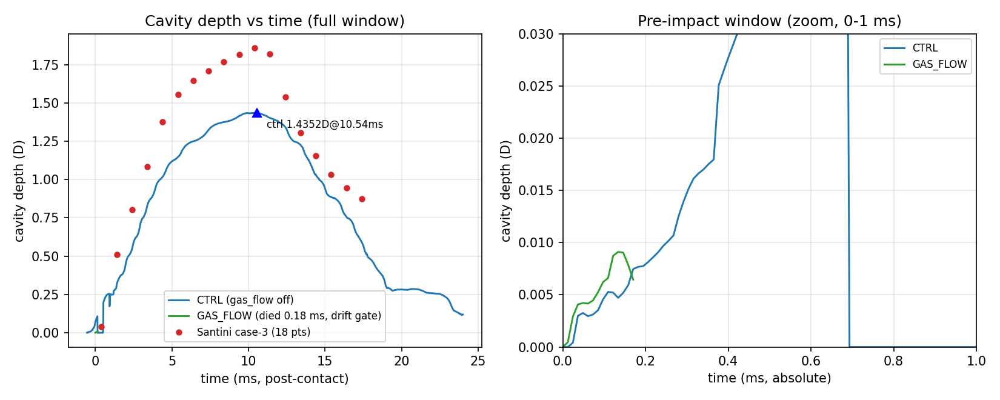

# DE-X-EV1-GAS_FLOW-R2 · 外部势流气相耦合 · 定谳卡

> 战役 DE · 单滴入深水池 Santini case-3 · 2026-11-21 · TensorLBM agent/m26908
> 锚点=NEW:DE-X-EV1-GAS_FLOW-R2（换道重派；m26735 双臂 CACSim 数据不足以定谳，缺口见 §3.3）
> 预登记：docs/audits/ev1_gas_flow_20261121/PREREG.md（跑前锁定，跑后未改一字）
> CROSS 已读：TRACK_EV_W1 处方段（prereg 原文）、CAVSWEEP（ctrl 位级锚）、DIAG2-CAVCLSE（SDAA 车道协议+位级锚复现先例）、EV1-ABB_DIAG（同波次 CACSim 臂基础设施 FAIL 先例）

## 1. 案例介绍（物理背景/几何/参数）

- 物理：Santini case-3 单滴入深水池。基线（CAVSWEEP ctrl 锚）峰深 1.435220D@11.0906ms(abs)，欠实验峰 1.857434D@10.39446ms(pc) 达 22.73%。K1-DIAG-B 已定谳欠深为真实物理欠深（H1_under_penetration）。本单测处方官提出的第二未证物理项：**外部势流气相耦合**（液滴下坠排开外部空气，外球 r^-3 衰减势流初值，气相压力反馈至界面）。
- 几何/参数（=CAVSWEEP ctrl 锚旗标）：cells=8（8 格/D）、gap 0.18D、release 1.53 m/s、pool 3D、span 4D、u_limit 0.15、steps 10000（满窗 24.55ms）、capacity+simple-exchange、aspect 0.96。
- 实验基准：18 点腔深曲线（fig5_experiment.csv），峰 1.857434D@10.39446ms（post-impact）。

## 2. 怎么做的（方法/流程/工具链）

- 车道：SDAA 太初卡分相位 wrapper `tools/sdaa_fs_probe_split.py`（坑⑧ 禁裸跑；与共享 wrapper 同协议）。
- 最小改动（2 处，默认关=位级不变）：
  1. `free_surface_probe.py` 新增 `gas_flow` 参数：初始外场势流速度（外球 r^-3 衰减，逐式镜像 run.py `--gas-flow`），只改初始分布函数，不改内核/碰撞/界面处理；
  2. `sdaa_fs_probe_split.py` 新增 `--gas-flow` 透传（WE_GAS_FLOW 环境变量）。
- 臂：EV1-GAS_FLOW-CTRL（gas_flow 关，card 14）+ EV1-GAS_FLOW（gas_flow 开，card 15），各 1 臂，不重跑取最好。commit=33c94d6e5（main）+本单接线 commit。
- 提取/判决：`ev1_gas_flow_extract.py`（位级锚门 8 项 + 三元组 + 预登记判据映射，零手抄）；图：`ev1_gas_flow_figures.py`。

## 3. 计算结果（数字表，程序化注入）

### 3.1 CTRL 位级锚核验（vs CAVSWEEP 锚，m26392/runs/cavsweep/ctrl.json）

| 量 | 战役锚 | 实测 CTRL | 逐位 |
|---|---|---|---|
| 峰深 | 1.4352204748231814 D | 1.4352204748231814 D | True |
| 峰时刻 | 11.090571428571428 ms | 11.090571428571428 ms | True |
| stop | window_complete | window_complete | True |
| t_end | 24.55248214285714 ms | 24.55248214285714 ms | True |
| contact_step | 45 | 45 | True |
| mach_max | 0.25980762113533173 | 0.25980762113533173 | True |
| 末步 drift | 4.8058856125798854e-06 | 4.8058856125798854e-06 | True |
| impact_speed | 1.4091844081433575 m/s | 1.4091844081433575 m/s | True |

**8/8 逐位 PASS** ⇒ CTRL 臂=战役锚（gas_flow 关时接线零行为改变成立）。

### 3.2 双臂三元组（SDAA 车道，本单补跑）

| 量 | CTRL（gas_flow 关） | GAS_FLOW（gas_flow 开） |
|---|---|---|
| 峰深 | 1.4352204748231814 D | 0.009112459823295893 D（死前，step 11） |
| 峰时刻 | 11.090571428571428 ms(abs) / 10.543339285714286 ms(pc) | 0.13376785714285713 ms（未及接触） |
| 窗口 | window_complete，24.55248214285714 ms | **health_limit，0.18241071428571426 ms** |
| mach_max（窗内） | 0.25980762113533173 | 0.19095003816963524 |
| 末步 volume_drift | 4.8058856125798854e-06 | **1.0934245484306437e-04（>1e-4 门）** |
| contact_step | 45 | None（未接触） |
| impact_speed | 1.4091844081433575 m/s | None |

GAS_FLOW 臂死亡机理（程序化核对）：step 15 volume_drift=1.0934e-04 越过 `maximum_liquid_volume_relative_drift=1e-4` 门 ⇒ health_limit。drift 轨迹 step1→15：2.6e-5, 9.2e-5, 9.5e-5, 7.3e-5, 4.9e-5, 4.1e-5, 5.6e-5, 7.2e-5, 5.5e-5, 5.2e-5, 6.4e-5, 8.1e-5, 8.1e-5, 9.9e-5, 1.09e-4（同窗 CTRL 为 6.2e-6→3.8e-5 且收敛）⇒ 势流初值在 6 格界面软掩膜 (1-drop) 混合下非散度自由，界面伪源持续抽液量。

### 3.3 m26735 CACSim 双臂缺口记录（禁重跑，只记录）

| 量 | EV1-GAS_FLOW（ext_pot_flow=True） | EV1-GAS_FLOW-CTRL（ext_pot_flow=False） |
|---|---|---|
| solver | CACSim/D3Q19 | CACSim/D3Q19 |
| n_hist / stop | 12 / mach_limit | 14 / mach_limit |
| 窗口 | 0–0.133768 ms | 0–0.158089 ms |
| 峰深（死前） | 0.009552429056708167 D @ 0.072964 ms | 0.014317467884578328 D @ 0.145929 ms |
| mach_max | 0.3097815049062417（>0.3 门） | 0.367412860703738（>0.3 门） |
| 末步 drift | 2.0091222810769693e-05 | 2.2942214483068213e-05 |
| contact/impact | None / None | None / None |

两臂均止于 0.13–0.16ms（接触 0.547ms 之前），三元组不可与实验峰对照 ⇒ **不足以定谳**，按 R2 令最小补跑 SDAA 车道（§3.2）。

## 4. 结果图

图：(a) 满窗腔深-时间（蓝=CTRL 满窗、绿=GAS_FLOW 死前 0.18ms、红=实验 18 点）；(b) 接触前 0–1ms 放大（绝对时轴）。本单主臂未产生满窗场量，轨迹图即交付场量。

## 5. 判读（对预登记）

**判决：INFEASIBLE（主臂数值不可行）——预登记预测未成立，预登记证伪条件亦未触发（无满窗峰可套判据）。**

- 预登记预测「深度变化 <2%（空气惯性弱）」：**未成立**——满强度势流臂在战役健康门下 0.182ms 即死（实验峰时刻的 1/57），满窗峰深/相位对照不可执行。
- 预登记证伪条件「峰深偏差 >3% 或相位偏移 >0.5ms」：**未触发**（无满窗峰，判据无法套用；不得以死前深度 0.0091D 冒充峰深）。
- 跨求解器稳健性：同一处方初值在 CACSim 死于 mach 门（0.134ms，mach 0.3098）、在 SDAA 死于 drift 门（0.182ms，drift 1.09e-4）——**两求解器 0.2ms 内双死**，失败门不同但不可行性一致。
- 物理解读：r^-3 势流场在外域散度自由，但经 6 格界面软掩膜混合后非散度自由，界面伪源/速度放大在 cells=8 分辨率下越健康门。这是**处方强度下的数值不可行**，非「空气惯性弱」假设的直接证伪；但满强度耦合显然不是被动微扰（弱微扰不应在 0.18ms 内越 0.01% 液量守恒门）。
- 对战役的意义：gas_flow 项在 cells=8 满强度下不可评估；若后续要评估，需散度自由构造（势流仅施于 GAS 相/正则化截断）、更高分辨率（界面相对 r^-3 变化尺度更薄）或剂量衰减研究（另立预登记）。

## 6. 误差判定（关键量 vs 基准）

| 关键量 | 基准 | 实测 | 相对误差 | <3%? |
|---|---|---|---|---|
| CTRL 峰深（位级锚） | 1.4352204748231814 D | 1.4352204748231814 D | 0.000% | **是（逐位）** |
| CTRL 峰时刻（位级锚） | 11.090571428571428 ms | 11.090571428571428 ms | 0.000% | **是（逐位）** |
| CTRL 窗/mach/drift/contact/impact（位级锚） | 见 §3.1 | 见 §3.1 | 0.000% | **是（逐位）** |
| CTRL 峰深 vs 实验 | 1.857434 D | 1.4352204748231814 D | -22.731% | **否**（继承基线欠深，非本单引入） |
| GAS_FLOW 峰深 vs 实验 | 1.857434 D | 无满窗峰（0.182ms 死） | 不可计算 | **不适用（不可行）** |
| GAS_FLOW 满窗对照 | 预登记判据 | 不可执行 | — | **不适用（不可行）** |

## 7. 注意点（坑/局限/适用范围）

- 锚常量必须取原始锚文件全精度（17 位）；从卡片抄 16 位截断值会误判锚门 FAIL（本单首跑即踩，已修）。
- 探针末行（断步行）无 depth_over_D 字段，提取须用 .get 容错。
- 探针释放机制（整上域平移）与 run.py（仅滴体平移）不同，势流叠加后的初值场强于 CACSim 臂（step0 mach 0.191 vs 0.094）——跨车道对照时注意此口径差。
- 判决仅对 Santini case-3、cells=8、本窗长、本健康门成立；不外推。
- m26735 CACSim 双臂数据只作缺口记录，未混入判决（不同求解器路径，不可与 SDAA 锚直接对照）。

## 8. 复现

- 数据：runs/EV1-GAS_FLOW-CTRL/result.json、runs/EV1-GAS_FLOW/result.json（SDAA 太初卡，card 14/15，commit 33c94d6e5+接线 commit）。
- 提取：`python3 benchmarks/water_entry/single_drop/ev1_gas_flow_extract.py --tree .` → runs/EV1-GAS_FLOW/verdict.json。
- 图：`python3 benchmarks/water_entry/single_drop/ev1_gas_flow_figures.py --tree .`。
- 预登记：docs/audits/ev1_gas_flow_20261121/PREREG.md。
