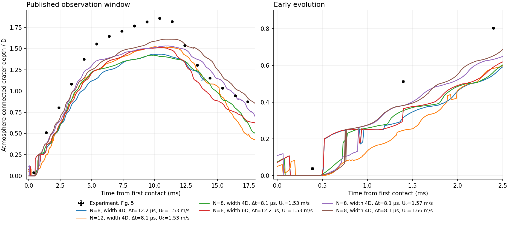
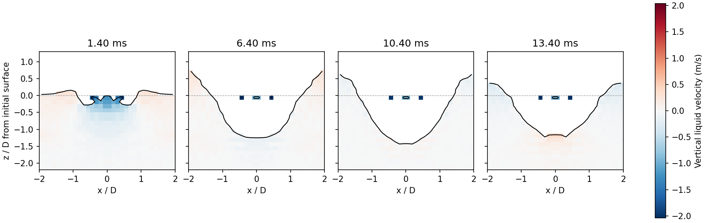

# 三维单滴入深池 · 2026-11-18 定量记录

**结论为待验证。** 使用 Santini 等的第 3 工况与图 5 全部 18 个实验点。实验观测峰值为 1.857434 D，时刻为 10.39446 ms。固定 8 格/滴径并将格子速度从 0.06 减为 0.04 后，计算覆盖整个实验时窗。模拟峰值为 1.4239 D，出现在 9.907 ms，峰值相对误差为 23.34%。18 个点中有 0 个满足逐点 3% 要求。[案例说明书](../../../benchmarks/water_entry/single_drop/README.md) · [逐点判定 JSON](../../../benchmarks/pending/droplet_impact_3d_pool/result.json)

按实验相机 1 ms 帧间隔测速的最终校正组，在撞前得到 1.418 m/s，目标为 1.400 m/s。该组模拟峰值为 1.612 D，峰值误差为 13.20%。在完整观测窗口中，有 1 个实验时刻符合 3% 要求。该组几何体积最大漂移为 0.0680%，门限为 0.0100%。首触后 19.7 ms 触发 Ma 限值，晚于最后一个实验测点 17.398 ms。

## 网格、时间步与计算域

除双相组外均使用 D3Q19 定压自由面。基线启用局部保守质量分配。组合改动使用对称界面通量，同时按基线实测撞前速度 1.27970 m/s 将释放速度校正为 1.53 m/s。该释放速度在两档网格、时间步和水槽对照中固定，逐点时刻与深度直接使用原值。单独改动初速和通量的两组用于分辨其早期作用。1.53 m/s 是数值初值。从高分辨率实验方法核实，高速相机根据轮廓中心的位移测速。为此，对沿侧向投影的半填充闭合轮廓计算亚格面积质心并拟合撞前轨迹。表中另列中心速度。8 格、较小步长组的内部速度与轮廓速度分别为 1.427 和 1.136 m/s。按轮廓速度的独立校正组只使用撞前轨迹确定释放速度 1.53 × 1.40 / 1.13593 = 1.88567919 m/s。复算均早于首触就固定初值。0.18 D 间隙组的分离时段不足实验相邻影像间的 1 ms，因此只能给出短时段中心速度估计。[原实验测速方法](https://www.sciencedirect.com/science/article/abs/pii/S0997754616302977)

| 配置 | 内部速度，m/s | 轮廓全程拟合，m/s | 最后 1 ms 影像速度，m/s | 可插值点 | 误差 ≤3% 点 | 在 10.39446 ms 的深度/D | 全时窗峰值/D | 峰值相对误差 | 停止条件 |
|---|---:|---:|---:|---:|---:|---:|---:|---:|---|
| 基线，8 格 | 1.280 | — | — | 1/18 | 0 | — | — | — | 库存漂移 1.12e-04 |
| 基线，12 格 | 1.272 | — | — | 1/18 | 0 | — | — | — | 库存漂移 1.01e-04 |
| 双相，12 格 | 1.373 | — | — | 1/18 | 0 | — | — | — | Ma 0.333 |
| 只校正初速，8 格 | 1.409 | — | — | 1/18 | 0 | — | — | — | 库存漂移 1.03e-04 |
| 只改界面通量，8 格 | 1.280 | — | — | 1/18 | 0 | — | — | — | 预设观察步数 |
| 组合改动，8 格 | 1.409 | 1.122 | — | 14/18 | 0 | 1.434 | — | — | Ma 0.301 |
| 组合改动，12 格 | 1.425 | 1.302 | — | 18/18 | 0 | 1.517 | 1.522 | 18.04% | 首触后 24 ms |
| 缩小时间步，8 格 | 1.427 | 1.136 | — | 18/18 | 0 | 1.410 | 1.424 | 23.34% | 首触后 24 ms |
| 扩大水槽，8 格 | 1.409 | 1.122 | — | 18/18 | 0 | 1.511 | 1.512 | 18.62% | 首触后 24 ms |
| 按轮廓速度校正初值，8 格 | 1.728 | 1.458 | — | 18/18 | 1 | 1.529 | 1.571 | 15.40% | 首触后 24 ms |
| 0.60 D 间隙测速，8 格 | 1.676 | 1.676 | — | 1/18 | 0 | — | — | — | 预设观察步数 |
| 按相机帧间隔测速，8 格 | 1.425 | 1.431 | 1.330 | 18/18 | 1 | 1.523 | 1.532 | 17.52% | 首触后 24 ms |
| 按相机测速修正释放速度，8 格 | 1.457 | 1.508 | 1.418 | 18/18 | 1 | 1.601 | 1.612 | 13.20% | Ma 0.331 |

覆盖表示该时刻落入原始计算的可比较区间。独立检查几何体积后，组合 8 格组最大漂移为 0.13%，小时间步组为 0.05%，门限为 0.01%。两组的液体表示质量最大漂移分别为 4.26e-05 和 7.05e-05。两档基线已复算并补录几何体积，复算前后共有的全部历史字段逐项一致。表中空项对应未覆盖完整时窗或该观测时刻的运行。[判分程序](../../../benchmarks/water_entry/single_drop/score.py)

| 深度/D | 1.396 ms | 6.400 ms | 10.394 ms | 13.391 ms | 17.398 ms |
|---|---:|---:|---:|---:|---:|
| 实验 | 0.512 | 1.647 | 1.857 | 1.304 | 0.874 |
| 组合改动，8 格 | 0.315 | 1.250 | 1.434 | 1.227 | — |
| 组合改动，12 格 | 0.246 | 1.333 | 1.517 | 1.251 | 0.480 |
| 缩小时间步，8 格 | 0.354 | 1.284 | 1.410 | 1.237 | 0.624 |
| 扩大水槽，8 格 | 0.353 | 1.356 | 1.511 | 1.109 | 0.645 |
| 按轮廓速度校正初值，8 格 | 0.376 | 1.324 | 1.529 | 1.497 | 0.927 |
| 按相机帧间隔测速，8 格 | 0.382 | 1.392 | 1.523 | 1.374 | 0.793 |
| 按相机测速修正释放速度，8 格 | 0.382 | 1.384 | 1.601 | 1.494 | 0.918 |



黑点为实验读数。误差棒只表示从正式出版原图识别标记的读图精度，彩色线为逐步模拟历史；曲线提前中断的位置用叉号标出。

默认宽 4 D、深 3 D，扩域对照宽 6 D、深 4.5 D，两者横向均周期。实验玻璃槽宽约 17.6 D。双相试算含空气惯性，在第 274 步越过 Ma 限值。自由面组取大气定压，水相统一采用滴水温度的物性。以上各项限制、3% 判据和文献读数不确定度见说明书。实验长度测量精度约 0.03 mm，首个深度点的 3% 仅约 0.00265 mm，归档保留该点及其误差。

将初始间隙增至 0.60 D 的预试推进 205 步，撞前轨迹长 0.940 ms，轮廓中心拟合速度 1.6762 m/s。在看到该初速检查后，正式相机对照组将释放速度改为 1.575 m/s（1.88568 × 1.40 / 1.6762），间隙增至 0.78 D，其他参数沿用小时间步组。末两个相距 1.000 ms 的轮廓中心给出 1.3301 m/s。沿用 0.78 D 的初始间隙，再根据该帧间隔速度将释放速度改为 1.658 m/s（1.575 × 1.40 / 1.3301）。新组最后 1 ms 的速度为 1.4179 m/s，完整观测时窗的气穴峰值为 1.612 D。两组的全部入射轨迹和撞后数据均已归档。

## 速度与界面位移的独立对照

以下是组合 8 格算例的液相竖直速度和半填充轮廓。记录取自距几何中面 0.0625 D 的最近网格平面。该算例复算时开启剖面导出，两次的全部标量历史和值完全一致。6.40、10.40 和 13.40 ms 三个截面中，在 z/D = −0.0625 同一排均观察到三个小液体区域。两个外侧单元在这三个时刻记录的向下速度分别约为 2.04、1.96 和 2.01 m/s。二维切片仅用于定位，无法据此认定它们在三维中完全孤立。



另在无重力、无表面张力、均匀压力条件下推进一个初始匀速的自由液球。解析解在 40 步平移 2.5 格，速度为每步 0.0625 格。实测位移取全域填充率加权的几何质心。液体质量和速度可以保持到浮点精度，而欠解析小液滴的几何位移仍会偏小。这一对照可独立复现界面输运误差，尚不能确定它对撞击峰值误差的贡献比例。

| 球径，格 | 40 步实测位移，格 | 位移偏小 | 质量加权速度，格/步 | 相对质量漂移 |
|---:|---:|---:|---:|---:|
| 2 | 0.5949 | 76.20% | 0.06250000 | 0.00e+00 |
| 4 | 2.0995 | 16.02% | 0.06250000 | 9.99e-16 |
| 8 | 2.4059 | 3.76% | 0.06250000 | 1.67e-15 |
| 12 | 2.4622 | 1.51% | 0.06250000 | 2.44e-15 |

此前在 2.29 mm 诊断工况捕获到一个局部质量透支。第 131 步转换向存有 0.001452 格子质量的界面单元请求 0.156512，候选填充率降至 −0.15479。新选项按当地可用质量处理竞争请求并保留无法结清的转换。原始局部记录随归档提供。工程修正通过局部守恒测试，物理验收单独按上表处理。

## 复现与归档

新选项位于 TensorLBM 的自由面与相场求解器。默认碰撞与质量交换路径、跨仓接口维持原有约定。对相场、拓扑转换、界面质量、所有权记录和本案例判分的 11 个测试文件执行回归，111 项通过，4 项为仓库已有的预期失败。另有 10 个自由面通量、重构、表面张力与事务测试文件，133 项通过，9 项预期失败。

计算使用 x86-64 CPU、Python 3.12.14、PyTorch 2.15.0+cpu 和 float64，单算例固定一个 PyTorch 线程。[原始实验取点](../../../benchmarks/water_entry/single_drop/fig5_experiment.csv) · [历史与剖面压缩包](histories.zip)

在仓库根目录执行以下命令。第一个判分命令忠实返回当前待验证状态和退出码 1。最后的文件比对可验证所有数值与本次归档完全一致。全新数值复算命令见案例说明书。单独改通量的算例在 160 步停止。单独改初速的算例沿用基线通量，并在达到该步数前触发健康限值。

```bash
export PYTHONPATH=src:. OMP_NUM_THREADS=1 OPENBLAS_NUM_THREADS=1
out=outputs/crater_20261118
mkdir -p "$out"
python -m zipfile -e docs/audits/spherical_entry_20261118/histories.zip "$out"
python -m benchmarks.water_entry.single_drop.score "$out"/case3_*.json --output "$out/score.json"
python -m benchmarks.water_entry.single_drop.translation --out "$out/translation_replay.json"
python -m benchmarks.water_entry.single_drop.plot "$out"/case3_{cal8,cal12,dt8,wide8,camera8,matched8}.json --output "$out/curve.png"
python -m benchmarks.water_entry.single_drop.plot --planes "$out/case3_planes.npz" --output "$out/planes.png"
cmp "$out/score.json" benchmarks/pending/droplet_impact_3d_pool/result.json
```

历史压缩包 SHA-256 为 `c99d60799de28b1f0d7d0676e2080148d685d3ae5a8b54a411215ecb848a6de4`。
