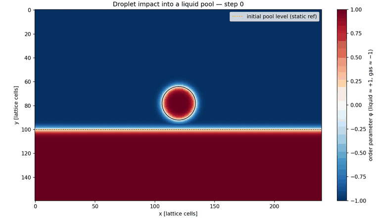

# 液滴入水案例说明书

**验收结论（2026-11-18，CPU/FP64）**　二维液滴入池通过数值健康、受驱动液桥和静滴 Laplace 压差检查。动态实验误差尚无可报告值，归档为 `pending`。本页的运行步骤面向液滴入池；刚性楔体另有载荷基准。[液滴判定记录](../../benchmarks/pending/droplet_impact_2d_pool/result.json) · [楔体判定记录](../../benchmarks/pending/phasefield_water_entry/result.json)

## 1. 物理问题与模型范围

二维液滴从静止气相中在重力作用下落向静止液池，随后发生撞击、界面变形与并合。该算例使用 TensorLBM 现有的 D2Q9 Free-Energy / phase-field 两相流实现，属于二维定性研究基准；它不是三维真实液滴、真实水-空气密度比或完整实验复现。`--density-ratio` 只改变 Boussinesq 重力系数；默认槽顶封闭，`--top-bc pressure` 只重建动量密度，相场仍不可穿透。

本案例首先验证四件事：

1. **可运行性**：初始化、时间推进、可视化与结果落盘形成完整闭环。
2. **界面演化**：输出液相序参量 \(\phi\) 云图及 \(\phi=0\) 界面。
3. **数值健康度**：监测序参量总和漂移、最大速度和速度能量代理量。
4. **可复现性**：保存参数、运行环境、CSV 历史与 JSON 元数据。

### 选对运行入口

| 研究对象 | 可运行入口 | 当前可解释的输出 |
|---|---|---|
| 液滴进入同种液池 | [droplet_impact.py](../../examples/droplet_impact.py) | 独立液滴轨迹、格点液桥和数值健康度，本页有复算记录 |
| 二维刚性楔体拍击 | [S2 楔体](../../benchmarks/pending/phasefield_water_entry/README.md) | 整楔动量交换力；4° / 100 格工况在有效拟合前失稳 |
| 圆柱或球体进入两相液池 | [multiphase_water_entry.py](../../examples/multiphase_water_entry.py) | 二维圆柱、三维球体的探索性运行；正式 S3/S4 参考载荷或运动曲线待验收 |
| 固定球体相对来流 | [sphere_water_entry.py](../../examples/sphere_water_entry.py) | D3Q19 单相速度场、Fz 与 Cd；其固定球入流边界不跟踪球体穿越气液界面 |

## 2. 环境准备

在 TensorLBM 仓库根目录执行：

```bash
python -m venv .venv
source .venv/bin/activate
pip install -e ".[dev]"
```

Windows 用户请将 `source .venv/bin/activate` 替换为对应虚拟环境激活命令。

## 3. 快速冒烟测试

```bash
PYTHONPATH=src python examples/droplet_impact.py --fast --overwrite
```

该模式使用较小网格与较少时间步，仅检查代码路径、结果输出和绘图是否正常，**不能用于物理结论或性能比较**。

## 4. 标准运行

CPU：

```bash
PYTHONPATH=src python examples/droplet_impact.py \
  --nx 240 --ny 160 --radius 14 --gap 8 \
  --water-level 100 --g 2e-5 --n-steps 4500 --require-contact \
  --output-interval 150 --output-root outputs/droplet_impact \
  --run-name baseline_cpu --overwrite
```

CUDA（需要可用 CUDA 与匹配的 PyTorch 安装）：

```bash
PYTHONPATH=src python examples/droplet_impact.py \
  --device cuda --run-name baseline_cuda --overwrite
```

若运行目录已存在且不为空，脚本默认拒绝覆盖；使用新的 `--run-name` 或显式传入 `--overwrite`。

默认采用 `--geq-convention lee_lin --dtype float64 --tau-g 1.0`，相迁移率
`M=Gamma*(tau_g-0.5)=0.25`。`A=B=0.004`，tanh 宽度 `xi=3`，由
`kappa=A*xi**2/2=0.018` 保持初始化与自由能一致，解析表面张力 `sigma=0.008`。
只指定 `--kappa` 时自动推导宽度；同时指定不相容的宽度会报错。
`swift` 选项仅用于复现带额外相场扩散的旧公式。求解器 API 为兼容仍默认 `swift`，
所以直接调用时必须在初始化和每个碰撞步骤都显式传入 `geq_convention="lee_lin"`。

[2026-11-17 实算与适用范围](../audits/ch_core_20261117/README.md)包含 3,000 步健康记录，
以及较强表面张力配置的长期失稳证据。通过健康检查不表示已经发生撞击、并合或飞溅。

默认步数从 3,000 延长到 4,500。初始液滴从静止释放。使用
`--drop-speed U` 可在液滴内设置向下的初速度，速度剖面为
`U * max(tanh((R-r)/xi), 0)`，池内初始速度仍为零。U 是初始化的速度尺度，
实际接近池面时的速度需从轨迹测量。

通过 `--track-interval N` 设置观测间隔（默认 10 步）。每次观测沿上下左右四个方向
追踪 `phi>0` 液体单元，检测原液滴与深水池是否连通，并检查相邻两次观测中液滴区域
至少有一半以上重合。接触记录为区间 `(上一次分离步, 第一次连通步]`。
点状对角相邻、初始已连通、失去目标均不能通过接触判据。该定义测量格点液桥，
界面厚度与采样间隔会影响读数。首次连通后，池体顶部包含已连入的液滴，
此时中心线的池体顶部坐标不能用于计算气穴深度。

`--require-contact` 可用于需要出现液桥的工况。健康检查失败或在规定时长内没有观测到
要求的液桥时，程序写入诊断文件并以非零码结束。配对实验还要检查无驱动对照在相同时间窗
是否保持分离。完整数值、输入和动画见[入水实算](../audits/entry_20261118/README.md)。

## 5. 输出文件

每次运行会生成一个独立目录，例如 `outputs/droplet_impact/baseline_cpu/`：

| 文件 | 内容 | 用途 |
|---|---|---|
| `contours/phase_XXXXXXX.png` | 序参量云图、零等值线、速度矢量和初始液位 | 查看液滴下落、撞击与并合演化 |
| `diagnostic_curves.png` | 相质量漂移、全部液相质心、最大速度、动能代理量曲线 | 快速判断数值行为与异常 |
| `interface_history.csv`、`interface_curves.png` | 独立液滴质心、中心线零等值线间隙和池体顶部位置 | 判断分离、连通及后续演化 |
| `history.csv` | 每个采样时刻的诊断数据 | 后处理、对比和回归测试 |
| `run_metadata.json` | 完整参数、设备/软件版本、最终指标和限制说明 | 追溯、自动化评估与归档 |

序参量约定为液相约 \( +1 \)、气相约 \( -1 \)，界面由 \( \phi=0 \) 等值线表示。图中的虚线表示**初始**液池界面；液池实际界面会随时间演化。

从已有运行目录导出动画：

```bash
python benchmarks/water_entry/animate.py outputs/droplet_impact/baseline_cpu --output outputs/droplet_impact/baseline_cpu/entry.gif
```

## 6. 诊断量如何解读

- **relative_phase_mass_drift**：仅对流体单元统计序参量总和漂移，除以初始流体单元 `sum(abs(phi))`。漂移增大可能意味着离散误差、边界影响或数值不稳定；它不是液体真实质量误差的直接等价物。
- **liquid_centroid_y**：全部液相（包含液池）的权重质心，始终不是独立液滴轨迹。
- **max_speed**：流体单元的原始动量速度 `j/rho` 最大值（不含半步力修正），用于发现异常速度增长。
- **kinetic_energy_proxy**：基于当前密度和原始动量速度构造的代理量，**不是经过物理单位标定的动能**。
- **phi_min / phi_max**：监测相场是否出现过冲。出现明显越界时，应检查参数、时间步和模型稳定性。

每步检查有限性、正密度、速度不超过 0.15、`abs(phi)` 不超过 1.2、归一化相场漂移不超过 1e-4。越界时先写 JSON/CSV 证据，再以失败状态退出。它们是数值健康阈值，不是物理精度验收；正常结束仍标记为探索性结果。

## 7. 验收实录与复算

以下均为同一版本、CPU 单线程、双精度的实算。静止释放组与关重力对照组使用相同求解器、初始几何和 4,500 步观测窗。

| 观测 | 基准或判据 | 实测 | 判定 |
|---|---|---|---|
| 首次液桥 | 受驱动连通，零驱动全程分离 | 驱动组 (3,220, 3,230] 步；对照组末态气隙 3.7894 格 | 配对回归通过 |
| 驱动组数值健康 | 每步相场漂移 ≤ 1e-4、速度 ≤ 0.15、相场绝对值 ≤ 1.2、密度正且有限 | 最大漂移 9.97e-17、最大速度 0.01194、最大相场绝对值 1.0950 | 通过 |
| 同一闭槽静滴 | 2D Young–Laplace 压差 Δp = σ/R；三半径末段误差各 < 15%，拟合斜率误差 < 15%，另检查压力平稳性与寄生速度 | R 初值 10、14、18 格，末步误差 2.36%、0.63%、0.79%；拟合斜率 0.008364，输入 σ=0.008，偏差 +4.55% | 静态前置检查通过 |
| 动态网格敏感性 | 同无量纲参数、同物理时间 | **带初速的另一组**在 1.5 倍加密后，首个液桥的区间中点相差约 6.0% | 两档敏感性记录 |
| 入水实验 | 对齐几何、撞击速度、物性及时间原点，比较气穴深度曲线和最大深度 | 当前液滴为二维平面截面；尚无匹配实验误差 | 待验证 |

5 格间隙另有反例：撤去重力和初速后，弥散界面仍在 (1,437, 1,438] 步连通。使用这组条件时，单次连通记录无法区分受驱动撞击与界面自行并合。[七组轨迹、压力测量和云图](../audits/entry_20261118/README.md)



### 从干净的输出目录复算

在仓库根目录执行。相场图每 1,500 步输出，液桥仍每 10 步采样。两个观测序列各含 451 条数据。

```bash
export PYTHONPATH=src OMP_NUM_THREADS=1 MKL_NUM_THREADS=1 OPENBLAS_NUM_THREADS=1
out=outputs/entry_qualification
python examples/droplet_impact.py --require-contact --output-interval 1500 --output-root "$out" --run-name driven
python examples/droplet_impact.py --g 0 --output-interval 1500 --output-root "$out" --run-name control
python benchmarks/water_entry/paired.py "$out/driven" "$out/control" --output "$out/pair.json"
python benchmarks/water_entry/static_drop.py --steps 2500 --output "$out/laplace.json"
```

核对 `pair.json` 中的 `checks`、`driven_bridge` 与 `control_bridge`；核对 `laplace.json` 中每个半径的 `settled`、`passed` 和压力历史。本次复算的两组界面 CSV 按字段比较与已有记录完全一致。使用 `--require-contact` 时程序以非零状态退出，可从 `run_metadata.json` 分别检查数值失稳、时窗内仍分离或目标跟踪丢失。[配置、参考来源、数据摘要及 SHA-256](../../benchmarks/pending/droplet_impact_2d_pool/result.json)

### 与实验比什么

选定外部参照为 *Crater Depth after the Impact of Multiple Drops into Deep Pools* 第 5 图中 **1.4 m/s 单滴**的实验标记。图中连续线为论文作者的数值结果。实验单滴直径范围 2.27–2.32 mm，观测量是气穴深度除以落滴直径随时间的变化。原始实验来自 Santini 等（2017）。[第 5 图和工况](https://doi.org/10.3390/fluids7020050) · [原始实验](https://www.sciencedirect.com/science/article/abs/pii/S0997754616302977)

晋级时需保留实验点、取点不确定度和单位，使用轴对称或三维球形液滴，或另行预注册同几何的平面参考；按实测撞击速度核对 Re、We、Fr、液气密度比、黏度比和相对池深。从真实自由面直接提取气穴底部，以实验首触为时间原点，在预先锁定的时刻比较曲线，并比较最大深度。记录不同网格和时间步的误差；按仓库通用标准核对直接观测量误差 ≤3%、至少两档网格误差单调减小。当前的液桥区间、连通后池体顶部、静滴压差均不能给出该实验误差。[仓库晋级规则](../../benchmarks/pending/README.md)

## 8. 与现有多相流基准的关系

本算例补充现有多相流验证链，而不是替代它：

1. 静态液滴：界面、寄生流和 Laplace 压差基础检查。
2. 自由能液滴弛豫：相场守恒、半径漂移与有界性。
3. 本液滴入水算例：重力驱动、瞬态界面变形、撞击与并合的端到端工作流。
4. 后续升级：网格收敛、实验对照、参数扫描，以及三维 D3Q19 验证。
