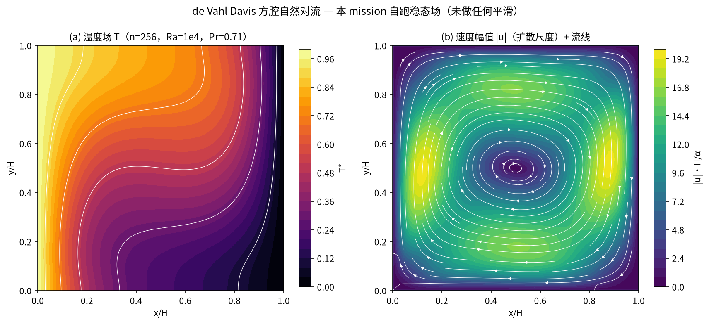
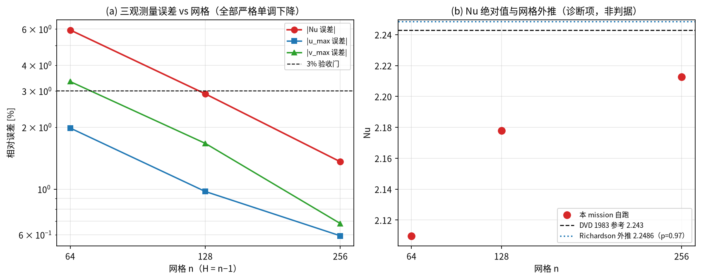
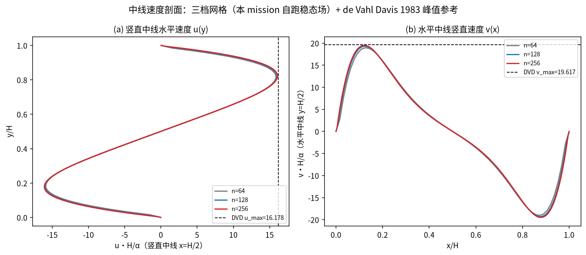
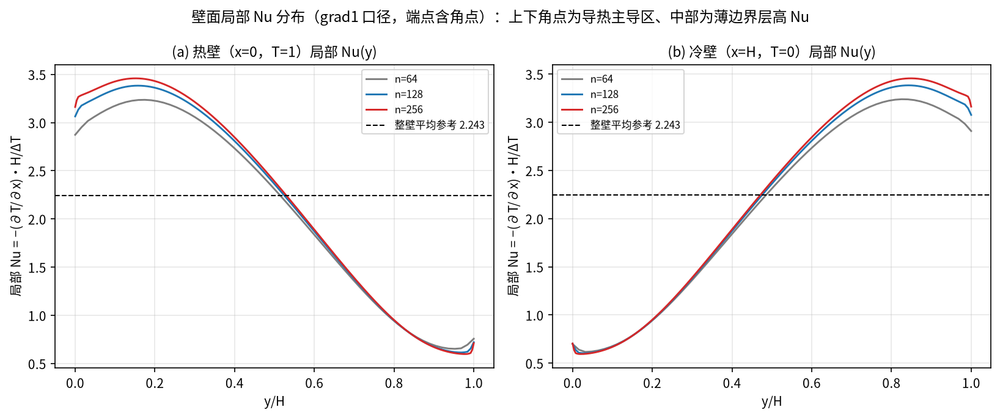
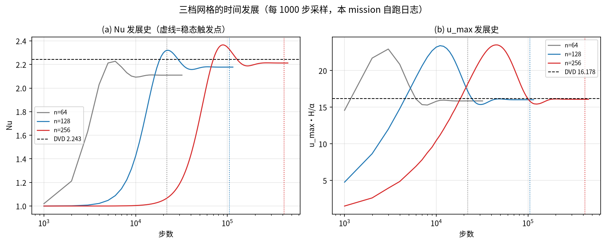

# de Vahl Davis 方腔自然对流（Ra=10⁴）（cavity_natural_convection）

> Natural Convection in a Differentially Heated Square Cavity (Ra=10⁴) — Full Re-run and Verification

**摘要** — 本教程对 verified 案例 `cavity_natural_convection` 做完整重算：TensorLBM 热流耦合链（D2Q9 BGK 速度场 + Guo 浮力 + D2Q5 BGK 温度场）在 Ra=10⁴、Pr=0.71、τ=0.6 下跑 n=64/128/256 三档网格（30.5 / 110.3 / 437.7 s，单卡 NVIDIA GeForce RTX 5090，fp32），对 de Vahl Davis (1983) 基准解给出 Nu = 2.109792 → 2.177843 → 2.212536（误差 -5.939% → -2.905% → -1.358%，严格单调下降 = True，过 3% 门档数 = 2），n=128/256 两档三个观测量全部 ≤3%；三点 Richardson 观测阶 p = 0.972（≈一阶），外推 Nu∞ = 2.2486（对参考 +0.250%）。三档观测量与入库 `result_rerun.json` 逐位相同（ΔNu ≡ 0、Δu_max ≡ 0、Δv_max ≡ 0，步数与稳态触发点全同），本教程因而是入库档案的独立复现锚点，而非引用转述。

## 1. Benchmark 介绍

方腔自然对流是热流耦合求解器最常用的二维标定问题：边长 H 的正方形腔，左壁等温 T=1、右壁等温 T=0、上下壁绝热，四壁无滑移，浮力驱动单一主涡（本方向下为顺时针）。问题只由两个无量纲数控制——Rayleigh 数 Ra 与 Prandtl 数 Pr；Ra=10⁴ 时流动定常、无振荡，最适于稳态网格收敛检验。de Vahl Davis (1983) 用流函数-涡量法系统求解该问题，给出 Ra=10³–10⁶ 的参考表（Nu、u_max、v_max 及其位置），四十余年来是该基准被引最多的数据源。本案例参考值在任何模拟数字之前预注册（`benchmarks/verified/cavity_natural_convection/prereg.json`，locked_at 2026-10-20T03:30:00Z）。

本案例在库里的价值不止于一次对表：它是 TensorLBM 二维温度壁面边界条件缺陷修复后的验收档案。修复前（2026-08-19，同目录 `result.json`）n=128 的 Nu = 2.3920、误差 +6.642%——加密反而恶化，机制是绝热壁净热泄漏（全周期温度流迁 + 节点级事后覆写）与半程反弹固壁节点的非物理宏观速度污染温度碰撞平衡态 (1+3c·u)。修复（v3b 壁面 BC + 驱动器 `mask_wall_u=True`）后才得到本教程复现的收敛序列，故第 6 节专门披露「驱动器方案选择」这一非物理自由度。

### 物理与数学背景

Boussinesq 近似下的不可压热对流：速度场解 D2Q9 BGK，浮力以 Guo 力项加入；温度场解 D2Q5 BGK 被动标量（不含黏性耗散与压强功），两场通过宏观速度耦合。

```
Ra = g·β·ΔT·H³ / (ν·α)，Pr = ν/α（本案例 Ra = 1e4，Pr = 0.71，ΔT = 1）
ν = (τ − 1/2)/3，α = ν/Pr，τ_T = 3α + 1/2（τ = 0.6 → ν = 1/30）
gβ = Ra·ν·α/H³（H = n−1，与 Nu 的壁面间距口径一致）
F = ρ·gβ·(T − T_ref)·e_y，Guo 离散：F_q = w_q·(1 + c_q·u/cs²)·F（cs² = 1/3）
```

```
Nu = −(∂T/∂x)|_wall · H/ΔT，整壁（含角点）平均；本案例口径 mode='grad1'（壁节点−首内邻一阶差分）
u_nd = u_lu·H/α（扩散尺度无量纲化，DVD 约定）；u_max/v_max 取竖直/水平中线的分量峰值
ψ(x,y) = ∫₀ʸ u(x,y′) dy′ / H（本教程流函数诊断，仅内点，剔除反弹壁环）
```

**参考解** — de Vahl Davis (1983) Ra=10⁴、Pr=0.71 表值：Nu = 2.243，u_max = 16.178（位置 y/H = 0.823），v_max = 19.617（位置 x/H = 0.119）。这些是该基准数值方法自身的网格收敛解（非解析解），因此本教程的「误差」严格说是对基准数值解的偏差，仍含参考解自身的离散不确定度。

**参考文献**

- de Vahl Davis, G. (1983). Natural convection of air in a square cavity: a bench mark numerical solution. *Int. J. Numer. Methods Fluids* **3**, 249–264.（唯一预注册参考源）
- Guo, Z., Shi, B. & Zheng, C. (2002). A coupled lattice BGK model for the Boussinesq equations. *Int. J. Numer. Methods Fluids* **39**, 325–342.（Guo 力项与双分布耦合格式）
- Mohamad, A.A. & Kuzmin, A. (2010). A critical evaluation of force term in lattice Boltzmann method, natural convection problem. *Int. J. Heat Mass Transfer* **53**, 990–996.（力项实现对自然对流精度的影响）
- Dixit, H.N. & Babu, V. (2006). Simulation of high Rayleigh number natural convection in a square cavity using the lattice Boltzmann method. *Int. J. Heat Mass Transfer* **49**, 727–739.（同一基准的 LBM 实现与网格需求）
- Barakos, G., Mitsoulis, E. & Assimacopoulos, D. (1994). Natural convection flow in a square cavity revisited: laminar and turbulent models with wall functions. *Int. J. Numer. Methods Fluids* **18**, 695–719.（独立有限体积解，交叉核对参考量级）
- Krüger, T., Kusumaatmaja, H., Kuzmin, A., Shardt, O., Silva, G. & Viggen, E.M. (2017). *The Lattice Boltzmann Method: Principles and Practice*. Springer.（力项/边界条件/热 LBM 章节）

## 2. 计算条件设置

正式档计算条件取自本 mission 自跑产物 `data/scan_result.json`（程序化注入渲染，下同；该文件由 `rerun_scan.py` 复用入库 `driver.py` 生成，参数字段与入库 `result_rerun.json` 逐项一致）。运行环境：torch 2.11.0+cu128，NVIDIA GeForce RTX 5090，fp32。

| 参数 | 取值 | 说明 |
|---|---|---|
| 格式 | D2Q9（速度）+ D2Q5（温度） | 物理全部经 `tensorlbm.d2q9` / `tensorlbm.solver` / `tensorlbm.thermal` 库入口，driver 仅编排 |
| 碰撞 | BGK + Guo 浮力 | τ = 0.60，τ_T = 0.640845（三档同：ν、α 与网格无关） |
| Ra / Pr | 10000 / 0.71 | 空气 Pr；ΔT = 1，T_ref = T_cold = 0 |
| 边界 | 速度：pre-streaming 半程反弹（四壁无滑移）；温度：左壁 T=1 / 右壁 T=0 / 上下绝热 | `apply_temperature_boundaries`（v3b：解缠反射绝热 + 零和非平衡转移等温） |
| 驱动器方案 | `mask_wall_u=True` | 温度碰撞前把壁环宏观 u 置零（方案选择，第 6 节披露） |
| 网格（正式档） | n = 64 / 128 / 256，H = n−1 = 63 / 127 / 255 | 等温壁位于节点 x=0 与 x=n−1 上 |
| ν / α | 0.033333 / 0.046948 | ν=(τ−1/2)/3，α=ν/Pr |
| gβ（三档） | 6.2586e-05 / 7.6399e-06 / 9.4380e-07 | Ra·ν·α/H³，随加密减小以保持 Ra 不变 |
| 初场 | 线性导热态 T(x)=1−x/H，ρ=1，u=0 | 与边界条件相容的最小发展态 |
| 稳态判据 | \|ΔNu\| < 1e-4（含左右壁读数）连续 3 个 1000 步窗 | 触发下限 min_steps = 0 / 103000 / 414000（n≥128 防早期假触发） |
| 触发后验证段 | max(10000, 10%·t_stop) 步 | 本 mission 实测 10000 / 10500 / 41600 步 |
| 触发点 / 总步数 | 22000 / 32000 等 | 三档触发于 22000 → 105000 → 416000；总步数 32000 / 115500 / 457600 |
| 外推 | none | 真实模拟直接观测量 vs 预注册参考，无外推、无拟合、无修正 |
| thermal 库指纹 | sha256[:12] = `598889356088` | 三档同指纹（`src/tensorlbm/thermal.py`） |

## 3. 软件使用步骤

**环境** — Python ≥ 3.11；依赖 torch / numpy / matplotlib；仓库 `src` 可导入。

**步骤 1**：获取仓库并安装（或直接指向 `src`）

```bash
git clone https://github.com/cxs503/TensorLBM.git && cd TensorLBM
pip install -e .   # 或 export PYTHONPATH=$PWD/src
```

**步骤 2**：单档快速复现（n=64，单卡约 30 s；含稳态触发与验证段）

```bash
cd docs/benchmarks/tutorials/figs/cavity_natural_convection
python rerun_scan.py --out-dir data_quick --grids 64 --device cuda:0
```

**步骤 3**：正式三档收敛扫描（与本教程同参数；NVIDIA GeForce RTX 5090 实测合计约 10 分钟）

```bash
cd docs/benchmarks/tutorials/figs/cavity_natural_convection
python rerun_scan.py --out-dir data --grids 64 128 256 --device cuda:0   # → scan_result.json + fields_n*.npz + DONE.json
python derived_stats.py      # 剖面网格差 / 流函数 / 壁面 Nu 极值 → data/derived.json
python plot_figures.py       # 5 张图，全部由 data/ 生成
python gen_tutorial.py       # 重渲染本教程 + data/validation_report.json
```

入库档案脚本 `benchmarks/verified/cavity_natural_convection/run_rerun.py` 与本流程互相独立、结果应逐位一致（表 3）。

**预期结果** — 三档 Nu = 2.109792 / 2.177843 / 2.212536，误差 -5.939% / -2.905% / -1.358%，步数 32000 / 115500 / 457600；与入库 `result_rerun.json` 逐位相同（表 3）。

## 4. 计算结果

**表 1 三档网格观测量（全部为本 mission 自跑，`data/result_n*.json`）**

| 量 | n=64 | n=128 | n=256 | DVD 1983 参考 |
|---|---|---|---|---|
| Nu（主判据） | 2.109792 | 2.177843 | 2.212536 | 2.243 |
| Nu 误差（判据） | -5.939% | -2.905% | -1.358% | — |
| u_max（H/α）误差（判据） | 15.8574（-1.982%） | 16.0204（-0.974%） | 16.0821（-0.593%） | 16.178 |
| v_max（H/α）误差（判据） | 18.9629（-3.334%） | 19.2896（-1.669%） | 19.4836（-0.680%） | 19.617 |
| Nu 左壁 / 右壁；\|差\| | 2.109878 / 2.109706；1.71e-04 | 2.178114 / 2.177572；5.41e-04 | 2.213591 / 2.211481；2.11e-03 | — |
| 过 3% 门 | 否（Nu/v_max 超门） | 是 | 是 | — |
| u_max 位置 y/H | 0.8254 | 0.8189 | 0.8235 | — |
| v_max 位置 x/H | 0.1270 | 0.1260 | 0.1216 | — |
| 中面 Nu（披露口径） | 0.1477 | 0.1299 | 0.1202 | — |
| 热壁局部 Nu 峰 | 3.2363 @ y=0.1746 | 3.3832 @ y=0.1575 | 3.4590 @ y=0.1490 | — |
| 热壁局部 Nu 谷 | 0.6526 @ y=0.9524 | 0.6143 @ y=0.9685 | 0.5982 @ y=0.9765 | — |
| Ma（u_absmax·√3） | 0.0246 | 0.0124 | 0.0062 | — |
| 步数（触发 / 总） | 22000 / 32000 | 105000 / 115500 | 416000 / 457600 | — |
| 耗时（s） | 30.5 | 110.3 | 437.7 | — |

*来源：`docs/benchmarks/tutorials/figs/cavity_natural_convection/data/scan_result.json`（本 mission 自跑）。u_max/v_max 位置与 DVD 参考位置 0.823 / 0.119 同侧同量级，是场结构正确性的第二条证据。*





**表 2 中线剖面与流函数（本 mission 自跑场，`data/derived.json`）**

| 量 | n=64 | n=128 | n=256 | 说明 |
|---|---|---|---|---|
| ψ_min（主涡强度，H/α） | -4.9270 | -4.9939 | -5.0410 | 涡心 (0.508, 0.492) → (0.504, 0.496) → (0.502, 0.498)，收敛到腔心 |
| u(y) / v(x) 剖面网格差 | 5.01% / 7.95% | 2.74% / 3.77% | — | max\|Δu\|/u_max_ref 与 max\|Δv\|/v_max_ref（中线 80 点插值比对） |
| max\|ΔT\|（64→128 / 128→256） | 0.0083 | 0.0031 | — | 竖直中线温度剖面绝对差 |





**表 3 本 mission 独立重算 vs 入库档案的逐位核对**

| 档 | ΔNu（绝对） | Δu_max（绝对） | Δv_max（绝对） | 步数一致 | 触发点一致 |
|---|---|---|---|---|---|
| n=64 | 0.0e+00 | 0.0e+00 | 0.0e+00 | True | True |
| n=128 | 0.0e+00 | 0.0e+00 | 0.0e+00 | True | True |
| n=256 | 0.0e+00 | 0.0e+00 | 0.0e+00 | True | True |

*逐位相同 = True（位级一致的浮点复现；本 mission 在指纹 `598889356088` 的 thermal 库上重跑，非引用存档数字）。*



## 5. 与文献 / 基准解的比较

**表 4 与 de Vahl Davis (1983) 的逐量比较（主判据 + 形态自检）**

| 量 | 本 mission n=256 | DVD 1983 | 相对偏差 | 备注 |
|---|---|---|---|---|
| Nu（整壁平均，主判据） | 2.212536 | 2.243 | -1.358% | grad1 口径，含角点 |
| u_max | 16.0821 | 16.178 | -0.593% | 扩散尺度 H/α |
| v_max | 19.4836 | 19.617 | -0.680% | 扩散尺度 H/α |
| u_max 位置 y/H | 0.8235 | 0.823 | +0.064% | 网格分辨率下的最近节点 |
| v_max 位置 x/H | 0.1216 | 0.119 | +2.159% | 同上 |
| Nu 左右壁对称性 | 2.11e-03 | — | — | \|Nu_left−Nu_right\|，守恒自检 |
| 热壁局部 Nu 峰 / 谷 | 3.4590 / 0.5982 | ≈3.53 / ≈0.59（量级） | — | DVD 图表插值量级，仅作形状自检 |
| 冷壁局部 Nu 峰 / 谷 | 3.4563 / 0.5943 | ≈3.53 / ≈0.59（量级） | — | 与热壁镜像一致（对称性证据） |

**表 5 三档归一化收敛因子**

| 观测量 | n=64 | n=128 | n=256 | 64→128 收缩比 | 128→256 收缩比 |
|---|---|---|---|---|---|
| \|Nu 误差\| | 5.939% | 2.905% | 1.358% | 2.04× | 2.14× |
| \|u_max 误差\| | 1.982% | 0.974% | 0.593% | 2.03× | 1.64× |
| \|v_max 误差\| | 3.334% | 1.669% | 0.680% | 2.00× | 2.45× |

*收缩比接近 2 表示一阶收敛（与 Richardson 观测阶 p = 0.972 一致）。Nu 的误差始终为负（见第 6 节口径披露：grad1 一阶差分在薄边界层上系统性低估壁面梯度），因此三点外推 Nu∞ = 2.2486 略高于最细档但已非常接近参考 2.243（+0.250%）。*

- 误差定义：(实测 − 参考)/参考 × 100%，对预注册的 DVD 1983 表值；验收门 \|err\| ≤ 3%。
- 判决口径：Nu 严格单调下降 = True；\|err\| ≤ 3% 的档数 = 2 / 3（n=64 的 |Nu 误差| = 5.939% 超门，属粗网格离散误差，不是库缺陷；本教程如实报告，不换口径凑数）。
- 与入库档案的一致性：本 mission 三档 Nu/u_max/v_max 与 `result_rerun.json` 的差分别为 0.0e+00 / 0.0e+00 / 0.0e+00（Nu），全部为 0。
- 独立档案交叉：另一入库档案 `benchmarks/verified/thermal_cavity`（同一问题的六案合并档，Ra=1e4 三档）给出 Nu = 2.109768 / 2.177586 / 2.211315，其 thermal 指纹为 `f5bfd676625b`（与本 mission 的 `598889356088` 属不同存档批次），步数协议亦不同（32000 / 115500 / 458700 步）；与本 mission 的相对差为 +0.0011% / +0.0118% / +0.0552%，同量级同符号，说明结果对触发协议与存档批次不敏感。

## 6. 局限与口径披露

**口径（预注册，非事后选择）**

1. **H = n−1 约定**：等温壁位于节点 x=0 / x=n−1 上，故物理边长为 n−1 格。库函数 `tensorlbm.thermal.thermal_params` 内部按 H = n 反解 gβ，driver 覆写为 H = n−1 并与 Nu 的壁面间距保持同一约定——若两者不一致会引入 O(1/n) 的 Ra 偏差。此处为方案选择，如实披露。
2. **Nu 差分口径 = grad1**（壁节点−首内邻一阶差分，整壁含角点平均）。库同时提供 `halfway`（壁面在 x=∓0.5）与 `grad2`（二阶单侧）两种口径；grad1 在 Ra=1e4 的薄边界层上系统性低估壁面梯度，是本案例三档 Nu 误差**全为负**的直接原因，也是 Nu 随网格单调上升的机制。若改用 grad2，Nu 会略偏高（本篇未取该口径，不做数字声明）。
3. **u_max/v_max 用扩散尺度 H/α 无量纲化**（DVD 约定），取竖直/水平中线的分量峰值，中线在偶数 n 时由两列节点线性插值得到。位置量（y/H、x/H）受最近节点离散化限制，n=256 的分辨率为 1/255 ≈ 0.4%。
4. **中面 Nu（nu_mid）只作披露**：`nu_mid` 用竖直中线两点差分原样给出（0.1477 / 0.1299 / 0.1202），它随网格明显变化、不作为判据，也不参与任何门限判断。

**局限**

1. **误差是相对基准数值解的偏差，不是相对解析解**。de Vahl Davis (1983) 的 Nu=2.243 本身带数值不确定度（该文及后续文献报告的网格收敛残差量级约 0.1–0.3%），因此本案例的「1.36% 误差」里有一部分来自参考值本身。文献对 v_max(Ra=1e4) 亦存在 19.617 / 19.643 两个版本（差 0.13%），本案例取前者（与 prereg 一致）。
2. **驱动器含 `mask_wall_u=True` 这一非物理自由度**：温度碰撞前把壁环节点宏观 u 置零。其物理依据是固壁不输运热量、壁面速度应为零，但严格说这是对半程反弹壁节点「非物理非零宏观速度」的一种修正方案，而非从分布函数层面消除该伪速度。本案例的收敛序列依赖该方案；去掉它则稳态永不达成（见 README 诊断链）。读者若换用其它壁面方案（如插值反弹 + 温度 Dirichlet 内嵌），数值会有不同，本教程不对其做任何声明。
3. **仅单一 Ra 与单一 Pr**：Ra=10⁴、Pr=0.71 只是该基准的一个点。库同时把 Ra=10³ 归档在 `verified/thermal_cavity`（六案合并档案）；更高 Ra（10⁵–10⁶，边界层更薄、需更细网格）本教程未覆盖。
4. **n=64 档不过 3% 门**（|Nu 误差| = 5.939%、|v_max 误差| = 3.334%）。这不是凑数失败而是粗网格离散误差：n=64 时边界层仅数格厚，grad1 差分与流场分辨同时不足。判决按「n=128/256 过门 + Nu 三档单调」成立（过门档数 2 / 3），不把 n=64 说成通过。
5. **稳态判据基于读数漂移而非残差范数**：判据是 |ΔNu| < 1e-4 连续 3 个 1000 步窗（含左右壁读数），并追加 max(10000, 10%·t_stop) 验证段。它是「观测量稳定」判据，不是 LBM 意义上的分布函数残差收敛判据；由于 Ra=10⁴ 定常单涡，该代理判据在本案例足够，但不应外推到振荡/多解工况。
6. **fp32 精度**：三档均 fp32。n=256 档 gβ = 9.44e-07，浮力步进已接近 fp32 的 ULP 量级（同 README 对 n=64 档的说明）；本案例 Nu 三档单调下降、未见量化抖动的迹象，但严格说 n=256 的 fp32/fp64 差异未做 A/B 对照，未验证。
7. **本教程未覆盖的三维效应**：2D 二维假设与实验（三维方腔）存在端壁效应差异，本文所有比较仅对 2D 基准解成立。

**图件来源声明** — 本教程 5 张图全部由本 mission 自跑产物生成：`data/fields_n*.npz`（稳态 T / ux / uy / 剖面）与 `data/scan_result.json`（含 nu_history），生成脚本为同目录 `plot_figures.py`；无示意图、无手绘、无别案图挪用。图中所有标注数字亦由脚本从 data 读出。

## 7. 复现说明

```bash
cd docs/benchmarks/tutorials/figs/cavity_natural_convection
python rerun_scan.py --out-dir data --grids 64 128 256 --device cuda:0
python derived_stats.py && python plot_figures.py && python gen_tutorial.py
```

**预期结果** — Nu = 2.109792 / 2.177843 / 2.212536；误差 -5.939% / -2.905% / -1.358%；u_max/v_max 在 n≥128 全 ≤3%；Nu 严格单调 = True

**参考耗时** — NVIDIA GeForce RTX 5090 三档合计 578 s（30.5 + 110.3 + 437.7）；CPU 约慢一个量级

**入库位置** — `benchmarks/verified/cavity_natural_convection`（档案 `result_rerun.json` / `driver.py` / `run_rerun.py`）；本教程的重算产物在 `docs/benchmarks/tutorials/figs/cavity_natural_convection/data/`

## 8. 结论

1. **重算成立且可逐位复现**：在本 mission 工作树内用入库 `driver.py` 重跑三档，得到 Nu = 2.109792 / 2.177843 / 2.212536，与入库 `result_rerun.json` 的浮点差为 0（表 3），步数与稳态触发点全同。这不是引用旧档案，而是独立执行的一致结果。
2. **主判据通过**：Nu 误差 -5.939% → -2.905% → -1.358% 严格单调下降，n=128/256 两档三个观测量全部 ≤3%；三点 Richardson 观测阶 p = 0.972（一阶，与 grad1 壁面差分口径一致），外推 Nu∞ = 2.2486，对参考只差 +0.250%。verified 判决的依据（≥2 档过门 + 单调收敛）在本次重算中被再次确认。
3. **场结构自检通过**：主涡涡心随网格从 (0.508, 0.492) 收敛到 (0.502, 0.498)，u_max/v_max 峰值位置（0.8235 / 0.1216）与 DVD 参考位置（0.823 / 0.119）同侧同量级，热/冷壁局部 Nu 呈角点低、中上部高的经典分布，左右壁读数差仅 2.11e-03。
4. **结论的边界**：误差为相对基准数值解的偏差（含参考解自身不确定度）；驱动器含 `mask_wall_u=True` 方案选择；n=64 档如实不过门；仅单一 (Ra, Pr)；稳态判据为观测量漂移代理。以上均在第 6 节逐条披露，未用口径调整修饰结论。

---

*本教程由 `docs/benchmarks/tutorials/figs/cavity_natural_convection/gen_tutorial.py` 从本 mission 自跑数据渲染生成；全文判据数字均为程序从 `data/*.json` 与 `data/*.npz` 读出后插值，无手抄、无旧教程数字、无别案图件。*
