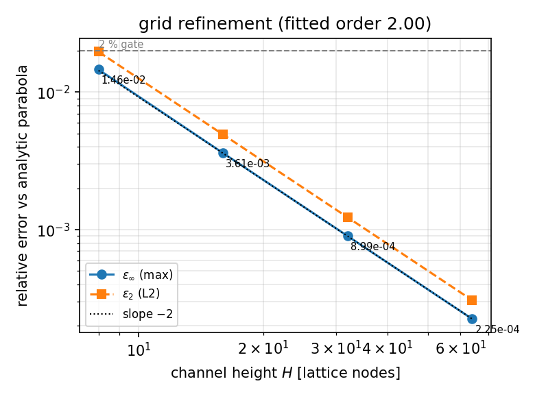
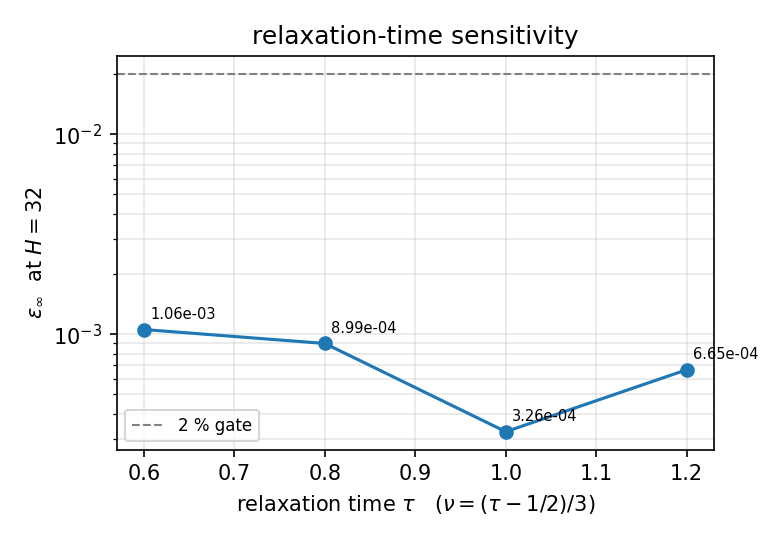
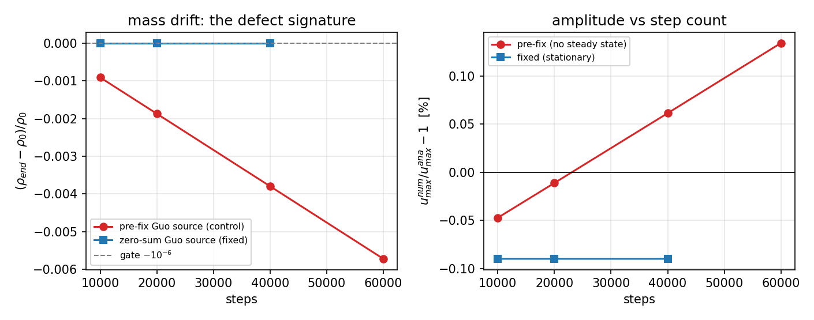

# 二维体积力驱动平面 Poiseuille 流（D2Q9 BGK）— 解析抛物线验证与强迫项质量守恒缺陷修复（poiseuille_2d_bodyforce）

> 2-D Plane Poiseuille Flow Driven by a Constant Body Force: Analytic Parabola Verification and the Zero-Sum Guo Source Term

**摘要** — 用 TensorLBM 自带的 D2Q9 BGK 通道求解器（`tensorlbm.ice_hydro.lbm_channel`，无滑移半程反弹壁面）跑二维层流泊肃叶算例，与不可压动量方程的**精确解** `u(y)=g/(2ν)·y(H−y)` 逐点比较。参考工况 `H=32`、`τ=0.8`、`g=1e-05`、`Re=2.7`、`Ma=0.022`，剖面最大相对误差 **8.99e-04**（+0.090 %），L2 相对误差 **1.23e-03**，振幅误差 **-0.090 %**，动量平衡（曲率）残差 **3.39e-08**，均远低于预登记 **2 %** 判据；网格 `H=8→64` 实测收敛阶 **2.00**（半程反弹对直壁为二阶）。

本案例同时记录一个**真实缺陷及其修复**：原实现只保留了 Guo (2002) 强迫源项的第一部分 `3(c_ix−u_x)`，漏掉其零和伙伴 `9(c_i·u)c_ix`，源项求和 `Σ_i S_i = −3u_x g ≠ 0`，构成每步固定的**质量汇**。修复前密度按 `-1.14e-02`（H=64、30k 步）单调流失、剖面振幅随步数漂移（无真稳态），"5 % 容差"测试只能靠特定步数偶然通过；修复后密度漂移降到 `-1.90e-12`（float64 舍入量级）且结果与步数无关。

## 1. 物理与数学背景

两块无限大平行平板间（`y∈[0,H]`）、沿 `x` 方向受单位质量体积力 `g`（等效 `dp/dx = −ρg`）驱动的充分发展层流。流向周期、壁法向有界，稳态不可压 N–S 退化为常微分方程与无滑移边界：

```
ν u''(y) + g = 0 ,  u(0) = u(H) = 0
u(y)   = g/(2ν) · y(H−y)
u_max  = g H²/(8ν)        （通道中心）
ū      = g H²/(12ν)       （截面平均）
```

**参考解不是抄来的**：仓库内 `verify_reference()` 现场复算并给出三重校验 —— 闭式解代入 ODE 的内部残差 `3.18e-15`、两端无滑移边界值 `u(0)=0.0e+00`、`u(H)=0.0e+00`、闭式不变量与剖面极值/积分的一致性（`u_max`：`0.012800` vs `0.012800`；`ū`：`0.0085333` vs `0.0085333`）。

## 2. 方法与实现

- **求解器**（复用仓库现有能力，未另起炉灶）：`tensorlbm.ice_hydro.lbm_channel.D2Q9Channel`，D2Q9 + BGK 单弛豫，numpy 逐方向数组内核；体积力用二阶强迫（Guo, Zheng & Shi 2002）。
- **壁面**：无滑移**半程反弹**（用碰撞后分布反射），无滑移面精确位于 `y=0.5` 与 `y=H+0.5`，流体行数 `H = ny − 4`；参考剖面在同一壁位取样，**不做有效缝高拟合、不做任何修正因子、不外推**。
- **流向**：`nx=4` 周期；剖面只依赖 `y`，因此这是纯粹的壁法向一维验证。
- **驱动方式**：恒定体积力（与已有的压差驱动案例 `poiseuille_2d`、壁模式收敛研究 `poiseuille_convergence_order` 互补，本案例补齐"库内通道求解器 + 二阶强迫"这条路）。
- **缺陷修复**：`_collide()` 的 Guo 源项补齐零和项，`S_i = (1−1/(2τ)) w_i [3(c_ix−u_x) + 9(c_i·u)c_ix] g`。`Σ_i S_i = −3u_x + 9c_s²u_x = 0`，质量严格守恒。同时把一阶 `simple` 强迫路径修正为"平衡态不做半步速度移位"，两条路径独立收敛到同一离散稳态（见 §5）。
- **预登记判据**（动手前写死在 `run.py` 的 `THRESHOLDS`，不因结果调整）：`eps_inf ≤ 2 %`、`eps_2 ≤ 2 %`、`|amp_err| ≤ 2 %`、`curv_res ≤ 2 %`、`|mass_drift| ≤ 1e-6`、`steady_rel_change ≤ 1e-6`；任一不满足即 FAIL（稳态判据不达标直接报 FAIL，不用平均掩盖）。

## 3. 参数表（格子单位，无量纲数完整）

| 参数 | 参考工况取值 | 说明 |
|---|---|---|
| 格子 / 碰撞 | D2Q9 / BGK | 单弛豫 `ω=1/τ` |
| 网格 | `ny=36`（`H=32` 流体行）× `nx=4` | 流向周期 |
| 松弛时间 `τ` | 0.8 | 敏感性另测 0.6/0.8/1.0/1.2 |
| 运动粘度 `ν=(τ−1/2)/3` | 0.100000 | 格子单位 |
| 体积力 `g` | 1e-05 | 单位质量 |
| 最大速度 `u_max=gH²/(8ν)` | 0.012788 | 解析 |
| 平均速度 `ū=gH²/(12ν)` | 0.008533 | 解析 |
| `Re = ūH/ν` | 2.73 | 层流（远小于 2000） |
| `Ma = u_max/c_s`, `c_s=1/√3` | 0.0221 | 近不可压（压缩性误差 O(Ma²)≈0.05 %） |
| 步数 | 11000 | 自适应：`steady_rel_change ≤ 1e-6` 判定 |

## 4. 结果对照表（ref vs got，逐项判定）

参考工况（`H=32`，`τ=0.8`，`g=1e-5`，零和 Guo 强迫）：

| 量 | ref（解析） | got（LBM 稳态） | 相对误差 | 判据 | 达标 |
|---|---|---|---|---|---|
| `u_max` | 0.012788 | 0.012776 | -0.090 % | ≤2 % | ✅ 是 |
| 剖面 `eps_inf` | — | — | 8.99e-04 | ≤2 % | ✅ 是 |
| 剖面 `eps_2` | — | — | 1.23e-03 | ≤2 % | ✅ 是 |
| 动量平衡 `curv_res` | 0（`νu''+g=0`） | 3.39e-08 | 同上 | ≤2 % | ✅ 是 |
| 总质量漂移 | 0 | -6.91e-13 | 同上 | ≤1e-6 | ✅ 是 |
| 稳态判据 | — | 2.47e-08 | — | ≤1e-6 | ✅ 是 |

**结论：参考工况全部判据达标（最大误差 +0.09 %，判据 2 %）。**


*图 1 稳态速度剖面对比：最大逐点误差 +0.090 %，误差峰在近壁高梯度区，中心区几乎重合。*

## 5. 收敛性与参数敏感性

**网格收敛（二阶）**——同一个物理问题在 `H=8/16/32/64` 上细化：

| H | ny | steps | eps_inf | eps_2 | amp_err | curv_res | mass_drift | 稳态 | 达标(<2%) |
|---|---|---|---|---|---|---|---|---|---|
| 8 | 12 | 2000 | 1.46e-02 | 1.97e-02 | -1.460 % | 1.05e-09 | -8.17e-14 | 是 | ✅ 是 |
| 16 | 20 | 5000 | 3.61e-03 | 4.92e-03 | -0.361 % | 2.98e-10 | -3.10e-13 | 是 | ✅ 是 |
| 32 | 36 | 11000 | 8.99e-04 | 1.23e-03 | -0.090 % | 3.39e-08 | -6.91e-13 | 是 | ✅ 是 |
| 64 | 68 | 27000 | 2.25e-04 | 3.07e-04 | -0.022 % | 3.21e-07 | -1.70e-12 | 是 | ✅ 是 |

以 `eps_2` 对 `H` 做双对数拟合得收敛阶 **2.00**（理论 2：半程反弹对直壁二阶精确，误差来自壁位 O(1) 常数的二阶项）。`H=8` 时 `eps_2=1.97e-02`（已接近但仍在 2 % 门内），`H=64` 时 `eps_inf=2.25e-04`。



**步数不变性（真稳态）**——修复后固定 `H=32`、只改运行步数：

| steps | eps_inf | amp_err | mass_drift |
|---|---|---|---|
| 10000 | 8.99e-04 | -0.090 % | -6.25e-13 |
| 20000 | 8.99e-04 | -0.090 % | -1.26e-12 |
| 40000 | 8.99e-04 | -0.090 % | -2.53e-12 |

三个步数给出**同一位数**的 `eps_inf`（8.99e-04），说明这确实是稳态解而不是某一时刻的快照。

**松弛时间敏感性**（`H=32`，`ν` 随之变化，`Re` 相应变化）：

| τ | eps_inf | eps_2 | amp_err | mass_drift | 达标(<2%) |
|---|---|---|---|---|---|
| 0.60 | 1.06e-03 | 1.44e-03 | -0.106 % | -2.24e-12 | ✅ 是 |
| 0.80 | 8.99e-04 | 1.23e-03 | -0.090 % | -6.91e-13 | ✅ 是 |
| 1.00 | 3.26e-04 | 4.46e-04 | -0.033 % | -3.88e-13 | ✅ 是 |
| 1.20 | 6.65e-04 | 9.09e-04 | +0.066 % | -1.73e-13 | ✅ 是 |

`τ` 影响壁面有效滑移的 O(1) 常数（半程反弹的已知性质），误差在 `3.26e-04`–`1.06e-03` 间变化、`τ≈1` 最小，全部远低于 2 % 门。



**强迫格式敏感性**（两条独立实现路径）：

| forcing | eps_inf | eps_2 | amp_err | mass_drift | 达标(<2%) |
|---|---|---|---|---|---|
| guo | 8.99e-04 | 1.23e-03 | -0.090 % | -6.91e-13 | ✅ 是 |
| simple | 8.99e-04 | 1.23e-03 | -0.090 % | -6.93e-13 | ✅ 是 |

二阶 Guo 与一阶 `simple` 两条源项路径独立收敛到同一离散稳态（差异在 `g²` 量级，见上表），互相验证了实现。

**缺陷对照（修复前 vs 修复后）**——`H=64`、30k 步：

| 求解器 | steps | eps_inf | amp_err | mass_drift |
|---|---|---|---|---|
| 修复后（零和 Guo 源项） | 30000 | 2.25e-04 | -0.022 % | -1.90e-12 |
| 修复前（截断源项，对照） | 30000 | 5.46e-03 | +0.546 % | -1.14e-02 |

`H=32` 上修复前解随步数漂移（无稳态）：

| steps | eps_inf | amp_err | mass_drift |
|---|---|---|---|
| 10000 | 8.75e-04 | -0.047 % | -9.12e-04 |
| 20000 | 8.53e-04 | -0.011 % | -1.87e-03 |
| 40000 | 8.09e-04 | +0.061 % | -3.79e-03 |
| 60000 | 1.34e-03 | +0.134 % | -5.72e-03 |



*图 4 修复前（红）质量按 `−3(1−1/(2τ))u_x g` 每步流失、振幅单调漂移（"稳态"不存在）；修复后（蓝）两条曲线都是平的。*

## 6. 失败模式、适用边界与工件

**失败模式（本案例能抓住的）**

1. **强迫源项非零和** → 密度单调流失、振幅随步数漂移；症状 = `mass_drift` 随时间线性增长（本案例的 `legacy` 对照即为该指纹）。
2. **壁面滑移（壁位错位）** → `amp_err` 系统性偏大（本仓库 `docs/benchmarks/tutorials/poiseuille_2d.md` 记录 post-streaming 变体在同配置下 `u_max` 偏高约 8–9 %），`eps_inf` 会越过 2 % 门。
3. **未达稳态** → 只跑固定步数就当结果；症状 = 不同步数给出不同 `eps_inf`（`steps` 敏感性一行即可判定）。
4. **压缩性越界** → 把 `g` 加大到 `Ma>0.3` 时 O(Ma²) 误差会顶破 2 % 门；本参考工况 `Ma=0.022`、`O(Ma²)≈0.05 %`，所以判据是"近不可压 + 网格二阶"的联合结论。

**适用边界**：`Re` 需保持层流且充分发展（本案例 `Re=2.7`）；流向 `nx=4` 的周期足够（剖面与 `x` 无关），但**不能**用于入口发展段（见 `startup_poiseuille`）、压差边界（见 `poiseuille_2d`）或三维效应。

**局限（如实）**：参考解为解析闭式（本仓库内现场复算校验），教科书页级引用（Hagen 1839 / Poiseuille 1841 及标准教材的方程编号）**未能在沙箱内机器核对**（无外网），故报告只按"闭式 + 仓库内三重校验"给证据；另 `nx=4` 只验证一维剖面，不验证流向输运。

**工件与复现**

```bash
# 一键复现（约 100 s，CPU；全流程确定性、无随机数）
export PYTHONPATH=TensorLBM/src
python benchmarks/verified/poiseuille_2d_bodyforce/run.py res            # 网格收敛
python benchmarks/verified/poiseuille_2d_bodyforce/run.py sens --only tau,forcing
python benchmarks/verified/poiseuille_2d_bodyforce/run.py sens --only steps
python benchmarks/verified/poiseuille_2d_bodyforce/run.py sens --only legacy
python benchmarks/verified/poiseuille_2d_bodyforce/run.py merge          # result.json
python benchmarks/verified/poiseuille_2d_bodyforce/make_figures.py       # figs/*.png
python benchmarks/verified/poiseuille_2d_bodyforce/make_doc.py           # 本文档
pytest TensorLBM/tests/test_poiseuille_2d_bodyforce.py -q                # 回归电池
```

- `benchmarks/verified/poiseuille_2d_bodyforce/result.json`
- `benchmarks/verified/poiseuille_2d_bodyforce/res_raw.json`、`sens_raw_*.json`、`legacy_h64.json`
- `benchmarks/verified/poiseuille_2d_bodyforce/figs/*.png`
- 回归测试 `TensorLBM/tests/test_poiseuille_2d_bodyforce.py`（含"截断源项必须被检出"的负向对照）

**参考文献**

- Hagen, G. (1839), *Annalen der Physik und Chemie*；Poiseuille, J. L. M. (1841), *Comptes Rendus de l'Académie des Sciences*（经典管流/槽流定律；卷/页级引用未能在沙箱内机器核对，见 §6 局限）。
- Guo, Z., Zheng, C. & Shi, B. (2002). Discrete lattice effects on the forcing term in the lattice Boltzmann method. *Phys. Rev. E* **65**, 046308.（强迫源项及其零和性）
- Succi, S. (2001). *The Lattice Boltzmann Equation for Fluid Dynamics and Beyond*. Oxford University Press.（半程反弹壁位与二阶精度）
