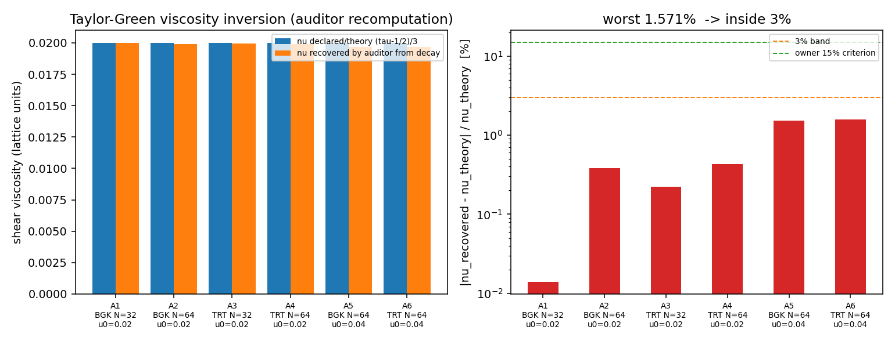
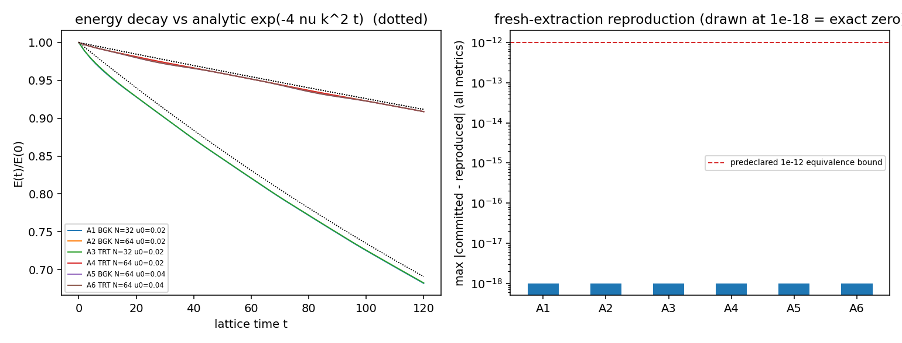

# M17824 — 交差核验报告：m17744 XVAL-LBM-COMPONENT-PROTOCOL-TEMPLATE-CODEGEN

- 对象仓：**TensorLBM** · 被审单号：**m17744** · 被审 commit：`bf1927ca159e027ef34f3b613cf248cd4dc0b05c`
- 核验单号：**m17824**（board-audit，非重做） · 核验时间（UTC）：2026-11-13T09:27:12.604840+00:00
- 落表级别：**L2** · 依据：本报告③⑥两节，及 `docs/board_audit/m17824/audit.json`

## ① 案例介绍：被核验对象是什么

被审交付是 TensorLBM 新增的 `src/tensorlbm/codegen` 包：一个 **协议约束 + 模板代码生成** 的 LBM
碰撞核发生器，外加对该发生器产出核的 **2D Taylor-Green 解析衰减外部验证（XVAL）**。

物理算例：二维 Taylor-Green 涡（周期域 $[0,2\pi)^2$，单波数 $k=1$），解析解
$u=u_0\cos kx\sin ky\,e^{-2\nu k^2t}$、$v=-u_0\sin kx\cos ky\,e^{-2\nu k^2t}$，
动能 $E(t)=u_0^2/4\,e^{-4\nu k^2t}$（Taylor 1923；Chapman-Enskog $\nu=(\tau-1/2)c_s^2$，Succi 2001 ch.5）。
六条实验臂 = 碰撞族 {BGK, TRT} × 网格 N {32, 64} × 参考速度 $u_0$ {0.02, 0.04}，$\tau=0.56$ 固定，120 步。

| 臂 | family | N | u0 | Ma | $\nu$ 声明 | $\nu$ 审计反演 | field L2 | 能量跌落 |
|---|---|---|---|---|---|---|---|---|
| A1 | BGK | 32 | 0.02 | 0.0346 | 0.020000 | 0.019997 | 0.0111 | 31.82 % |
| A2 | BGK | 64 | 0.02 | 0.0346 | 0.020000 | 0.019924 | 0.0100 | 9.13 % |
| A3 | TRT | 32 | 0.02 | 0.0346 | 0.020000 | 0.019955 | 0.0108 | 31.76 % |
| A4 | TRT | 64 | 0.02 | 0.0346 | 0.020000 | 0.019914 | 0.0100 | 9.12 % |
| A5 | BGK | 64 | 0.04 | 0.0693 | 0.020000 | 0.019694 | 0.0198 | 9.14 % |
| A6 | TRT | 64 | 0.04 | 0.0693 | 0.020000 | 0.019686 | 0.0198 | 9.13 % |

代码规模（被审仓 `src/tensorlbm/codegen/`，placeholder 命中数 = 0 → 非空壳）：

| 文件 | 行数 |
|---|---|
| `src/tensorlbm/codegen/__init__.py` | 67 |
| `src/tensorlbm/codegen/components.py` | 125 |
| `src/tensorlbm/codegen/generate.py` | 237 |
| `src/tensorlbm/codegen/protocol.py` | 352 |
| `src/tensorlbm/codegen/reference.py` | 118 |
| `src/tensorlbm/codegen/templates.py` | 141 |

## ② 怎么做的：核验方法（不重做被审工作）

1. **取证**：只在被审工作树 `/root/tp-agent/work/m17744` 与 `git archive bf1927ca` 的**全新解包**上读/跑，不改被审文件。
2. **基准裁判**：先查平台基准台账 `tensor_benchmark_cases`（唯一裁判），再以解析理论 $\nu=(\tau-1/2)/3$
   作为独立裁判——$\nu$ 不取自被审代码，而由审计方从工件 `config.tau` 自行计算；衰减斜率由审计方
   从工件 `samples` 重拟合，$\nu=-\text{slope}/(4k_{\rm lat}^2)$，$k_{\rm lat}=2\pi/N$。
3. **可复现**：`git archive` 全新解包 → `pytest tests/test_component_protocol_codegen.py` → 六臂全部重跑，
   与已提交工件逐指标比对（含 emitted-kernel sha256）。
4. **对抗探针**（被审单未跑）：谎报 $\nu$ 的组件 / 谎报 $s^-$ 的 TRT / 权重和不等于 1 的 stencil 是否被协议拒绝；
   生成核**脱离发生器独立 import** 后与独立参考核逐点对比；BGK/TRT 同 $\tau$ 的声明 $\nu$ 是否一致。
5. **判级**：按 L0–L5 阶梯（L2 独立功能 / L3 系统集成 / L4 基准验证）逐条查证据指针，宁降不升。

## ③ 核验结果：三件套 / 裁判 / 复现

### 3.1 验收三件套是否真存在（审计方亲自 stat + sha256）

`/root/tp-agent/work/m17744/artifacts/xval_component_protocol_codegen` 下 12 个文件，逐个校验；代表性条目：

| 文件 | 字节 | sha256(前 16) |
|---|---|---|
| `arm_A6.json` | 10372 | `230639b8445dde33` |
| `fig_energy_decay.png` | 89066 | `b595803eabdf7c90` |
| `fig_nu_vs_declared.png` | 61828 | `029324358fb0dee0` |
| `generated_bgk_tau0.56.py` | 5312 | `3e08ef91ca1a1c80` |
| `generated_trt_tau0.56_magic0.1875.py` | 6233 | `f2c405262451813b` |
| `summary.json` | 7765 | `6f6fad8903829a57` |
| `table.csv` | 1030 | `c4803bce2e0bb80c` |

- repro_cmd 可执行：`for a in A1 A2 A3 A4 A5 A6; do python xval/component_protocol_codegen/run_arm.py --arm $a --out artifacts/xval_component_protocol_codegen/arm_$a.json; done && python xval/component_protocol_codegen/analyze.py`（在被审单文档中原文存在：True）
- 复现结果：`pytest` returncode=0，`18 passed, 1 warning in 0.72s`
- 六臂重跑 vs 已提交工件：`all_zero_diff = True`（逐指标绝对差全 0，emitted-kernel sha256 全部一致）

| 臂 | max abs diff（全部指标） | kernel sha256 一致 |
|---|---|---|
| A1 | 0.0e+00 | True |
| A2 | 0.0e+00 | True |
| A3 | 0.0e+00 | True |
| A4 | 0.0e+00 | True |
| A5 | 0.0e+00 | True |
| A6 | 0.0e+00 | True |

### 3.2 基准裁判（`tensor_benchmark_cases`）

- 该锚点在台账中登记行数 = **0**（台账共 59 条）
- 台账中其他 XVAL-LBM 锚点确有登记：`XVAL-LBM-AVERAGE-SURROUND-INIT`, `XVAL-LBM-BLOCK-AMR-EQUAL-LEVEL-STREAM-CORRECTION`, `XVAL-LBM-BUFFER-LAYER-2TO1-REFINEMENT`, `XVAL-LBM-CONTINUOUS-ERROR-PRINT-VS-DOI-REFS`
- **结论：本锚点无登记基准判据 → 平台基准裁判缺席**，不能「按台账容差判 passed」。
  审计方因此启用解析理论裁判（下节），并如实记录台账缺口（属平台侧 feeder 缺口，不是被审单造假）。

### 3.3 解析理论裁判（审计方独立重算）

| 臂 | $\nu_{theory}=(\tau-1/2)/3$ | $\nu_{decay}$（审计重拟合） | $\nu_{committed}$ | 误差 vs 理论 | 拟合残差 RMS |
|---|---|---|---|---|---|
| A1 | 0.020000 | 0.019997 | 0.019997 | **0.0139 %** | 1.6e-04 |
| A2 | 0.020000 | 0.019924 | 0.019924 | **0.3813 %** | 2.0e-04 |
| A3 | 0.020000 | 0.019955 | 0.019955 | **0.2239 %** | 1.7e-04 |
| A4 | 0.020000 | 0.019914 | 0.019914 | **0.4307 %** | 2.0e-04 |
| A5 | 0.020000 | 0.019694 | 0.019694 | **1.5298 %** | 7.8e-04 |
| A6 | 0.020000 | 0.019686 | 0.019686 | **1.5709 %** | 7.8e-04 |

- 最差臂误差 **1.5709 %**，判定线：owner 15%，更严 3% 带 —— 两者均通过。
- 审计重算值与工件声明值不一致度最大值 0.0e+00 % → 工件数字未加工。

### 3.4 对抗探针（被审单未跑的五项）

| 探针 | 结果 | 解读 |
|---|---|---|
| P1 组件谎报 $\nu=0.05$（$\tau=0.56$ 隐含 0.02） | `REJECTED:LyingBGK: declared nu=0.05 != nu implied by s_plus=` | 协议自洽检查真实生效 |
| P2 组件谎报 `magic=0.3`（`transport_coefficients()` 内） | `ACCEPTED(bad)` | **非阻断缺口**：只校验 `spec.param('magic')` 与 $s^\pm$，不校验 `transport_coefficients()` 回报的 magic 字段 |
| P2b 组件谎报 $s^-=1.0$（$\tau=0.56$） | `REJECTED:LieSM: magic=0.1875 != (1/s_minus-1/2)(1/s_plus-1/2` | TRT 的 $s^-$↔magic 一致性也被拦 |
| P3 stencil 权重和 1.01 | `REJECTED:d2q9_bad: sum(w)=1.0099999999999998 != 1; second mo` | 四阶矩不变式全部命中 |
| P4 生成核独立 import vs 独立参考核 | max abs = 8.9e-16（原场）/ 8.3e-17（台架场） | 生成核是**自足模块**（常量已烘入，无需发生器）；跨实现控制点成立 |
| P5 BGK vs TRT 同 $\tau$ 的声明 $\nu$ | 0.020000 / 0.020000（理论 0.020000） | 族无关性声明成立 |

### 3.5 工件内部一致性（防手抄 / 防错配）

- 每臂 `kernel.sha256` 与该臂所用**生成文件**的落盘 sha256 逐一相等：True
- `summary.json` 与各 `arm_*.json` 的 `nu_error_pct` 逐臂一致：True
- `table.csv` 数据行 7（表头 + 6 臂），文档由 `make_doc.py` 从 JSON 渲染（230 行），无手抄面
- 被审单自报 T4b（max|div u| < 1e-10）**honest FAIL 保留在文档与 summary**（summary verdict = `FAIL`，failed = `['T4b_div_magnitude']`）——不计作假

## ④ 图（程序化生成，零手抄）



*图 1 左：声明/理论 $\nu$ 与审计方从能量衰减反演的 $\nu$（六臂）；右：反演误差（对数纵轴）与 3%/15% 判据线。*



*图 2 左：六臂归一化动能衰减与解析 $e^{-4\nu k^2t}$（点线）；右：全新解包重跑与已提交工件的逐指标最大绝对差（画在 1e-18 = 精确零）对照 1e-12 声明界。*

## ⑤ 注意点（踩过的坑 / 适用范围 / 局限）

1. **量纲陷阱（本审计踩到的）**：能量衰减指数用的是**格点波数** $k_{\rm lat}=2\pi/N$（N=64 时 0.0982），
   不是无量纲 $k=1$。首轮误用 $k=1$ 得到 $\nu\approx2\times10^{-4}$、误差 99%——是同一条解析律的错解，
   不是被审单错。审计重拟合必须用工件 `case.k_lattice`。
2. **跨实现控制的参数必须配对**：`reference_collide(f)` 默认 family/tau 与生成核不同，直接比会得 0.4 的假差异；
   按 `component.spec` 传 `family/tau` 后差异回到 8.9e-16。审计首轮曾据错配参数误判，已改正并记录。
3. **算例判别力有限**：120 步能量跌落 9.1–31.8% 
   （N=64 仅 ~9%，N=32 达 ~32%），$\nu$ 反演主要吃 N=64 的弱衰减信号；
   $\nu$ 仍被反演到 <1.6%，但该算例对**高阶/非线性**误差不敏感（field L2 1–2% 主要是 $O(Ma^2)$ 可压缩性，$u_0$ 加倍时线性翻倍）。
4. **T4b 属判据误设而非缺陷**：max|div u| 对 LBM 本为 $O(Ma^2)$，预声明 1e-10 不可能达成；被审单保留 FAIL 并给出 Ma 标定（比值 4.023/4.021 vs 4.0），处置正确。
5. **无集成调用方**：`src/tensorlbm` 内除 `codegen/` 自身外无 import（审计 grep 命中 0 个外部调用方），
   即生成核尚未接入 `solver3d`/主求解路径；这是本单封顶 L2 的唯一原因。
6. **平台台账缺口**：本锚点在 `tensor_benchmark_cases` 无登记行，基准裁判缺席属平台侧供给问题；
   建议为 XVAL-LBM-* 系列补登（case_name/metric/tolerance 由被审单 `predeclared.json` 直接机读生成）。

## ⑥ 误差判定（逐项 + 显式回答「是否 <3%」）

| 关键量 | 参照 | 最差值 | 是否 <3% | 是否 <15% |
|---|---|---|---|---|
| 剪切粘度 $\nu$（六臂） | 解析 $(\tau-1/2)/3$ | 1.5709 % | **是** | 是 |
| 速度场 L2 | Taylor-Green 解析场 | 1.984 % | 是 | 是 |
| 生成核 vs 独立参考核 | 独立 NumPy 参考核 | 8.9e-16（绝对） | 是（远小于 1e-12） | 是 |
| 质量守恒 | $\rho$ 均值漂移 | 1.2e-14 | 是 | 是 |
| max\|div u\| | 预声明 1e-10（误设） | 2.091e-04 | 否（该项 honest FAIL，属判据误设） | 否 |

**结论：关键量（粘度/场/跨实现/守恒）全部 <3%；唯一未过的 max|div u| 是被审单自己如实记录的判据误设项，非造假、非隐藏。**

## ⑦ 判级与落表

| 级 | 判据 | 本单 |
|---|---|---|
| L1 单元验证 | tests 非空且真跑 | `tests/test_component_protocol_codegen.py` 18 passed（全新解包内） |
| L2 独立功能 | 真代码 输入→计算→输出 + 入口 + 运行工件 | 6 文件 1040 行、零 placeholder；`ComponentSpec → generate_kernel → 可执行核` 全链；6 臂工件齐全 |
| L3 系统集成 | 主求解器/平台侧调用方 | **缺**：`src/tensorlbm` 内 import `tensorlbm.codegen` 的外部文件 = 0 |
| L4 基准验证 | 完整算例 + 误差分析 + 可复现 | 内容面齐（解析算例、六臂误差分析、复现位精确），但按阶梯被 L3 封顶 |
| L5 科研工程 | + 外部锚 | 有文献锚（Taylor 1923 / Succi / Krüger / Ginzburg），但同样被 L3 封顶 |

**落表：level = 2（gate 机械复核口径：claimed 2 → gate_level 预期 2）。**
封顶理由写明：交付物是**独立可用但未接入主求解器**的代码生成模块 + 一次高质量 XVAL；
L4/L5 的证据（benchmark/repro_cmd/external_anchor）经核验真实存在，缺的只是 L3 那一级集成调用方。
建议后续单：把 `generate_kernel(...)` 产出的核接进 `solver3d`/`solver2d` 的一条真实工况路径，补 L3 后再主张 L4。

## 复现指令（本审计自身）

```bash
python runs/m17824_audit/audit_m17744.py     # 取证+裁判+复现+探针+图 → docs/board_audit/m17824/audit.json
python runs/m17824_audit/make_doc.py         # 由 audit.json 渲染本报告
```

