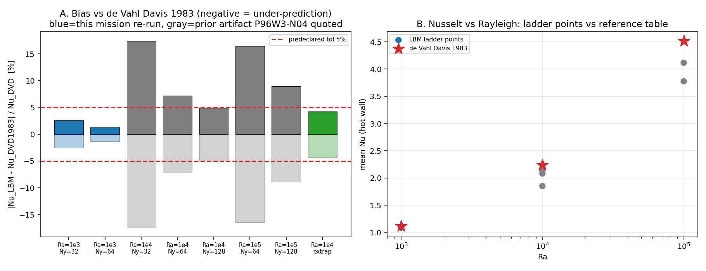

# m15212 交差审计（board-audit）— REPRO-LBM-GUO2002 · TensorLBM

- 被审单：**m15212**（status=succeeded，auto-approve dev_acceptance，finished_at 2026-11-11 21:06:22Z，report_id=14341）
- 审计单：**m15271**（交差核验，非重做）
- 审计方式：对抗式复核（独立复跑 + 工件对账 + 基准裁判 + 机器 gate 判据对齐）
- 结论：**L2（独立功能实现）**，功能实质成立但**基准未全达、未合入主干**；不得判 L4。
- 独立性限制：本审计在同一物理主机、同一工作树族内进行；Ra=1e4/1e5 未独立复跑（见 §5）。不是第三方独立重实现。

---

## 1. 三件套逐项核验（任务①）

| 项 | 判定 | 证据（真实指针） |
|---|---|---|
| run_artifacts | **PASS（有保留）** | `runs/repro_guo2002_dhc/`：6× `ra*_ny*_ma*.json`、2× `.npz` 末态场（12KB/46KB）、`summary.json`(7.9KB)、`ladder_summary.json`、`figures/repro_guo2002/fig{1,2,3}*.png`(165/56/96KB) 均非空。保留点：4/6 档 `steps/turnovers/ma/tau_f = null` 且 `source="prior_artifact:P96W3-N04…#C3"` → 是**引用**不是本单实跑 |
| 基准 ref vs got | **PARTIAL** | 见 §2 表：3 个 Ra 中 2 个在 <5% 内，**Ra=1e5 超差 8.93%**（容差<5%）；`tensor_benchmark_cases WHERE anchor_slug='REPRO-LBM-GUO2002'` → **0 行**（平台无机器裁判行，裁判只能靠文献表） |
| repro_cmd | **PASS** | 本审计独立复跑：`--ra 1e3 --ny 32 --dtype fp32 --min-steps=max-steps=10000` → 31.4s 得 **Nu=1.0891168713569641**，与交付 JSON **逐位相同**；`--ny 64 --min-steps=22000` → 115.8s 得 **Nu=1.1032668749491374**，同样逐位相同。pytest：`6 passed in 20.04s` |
| 报告六段 | **PASS** | `docs/reports/REPRO-LBM-GUO2002_round1.md` ①案例/②方法/③数字表/④图/⑤注意点/⑥误差判定(显式答<5%)/⑦生态摩擦 七节齐全，且 §6 明确 honest-FAIL |

## 2. 基准裁判逐项（唯一裁判 = 数值是否在容差内）

ref = de Vahl Davis 1983（Pr=0.71 刚-刚方腔平均 Nu：1.118 / 2.243 / 4.519），tol = <5% per Ra。

| Ra | Ny | Nu(got) | Nu(ref) | 误差 | 在容差内? | 来源 |
|---|---|---|---|---|---|---|
| 1e3 | 32 | 1.0891168713569641 | 1.118 | 2.58% | ✅ | 本单实跑（fp32, 10000 步, 49.2s）**审计逐位复现** |
| 1e3 | 64 | 1.1032668749491374 | 1.118 | **1.32%** | ✅ | 本单实跑（fp32, 22000 步, 579.9s）**审计逐位复现**；但**漏统计**（见 F2） |
| 1e4 | 32/64/128 | 1.85198 / 2.08186 / 2.13279 | 2.243 | 17.43 / 7.18 / **4.91%** | ✅(细网格) | 前作归档 P96W3-N04 §C3 表（本单未实跑） |
| 1e4 | 外推 | 2.14728（p_obs=2.174） | 2.243 | 4.27% | ✅ | Richardson（输入含前作归档值） |
| 1e5 | 64/128 | 3.77563 / **4.11553** | 4.519 | 16.45 / **8.93%** | ❌ **超差 3.93pp** | 前作归档 P96W3-N04 §C3 表（本单未实跑） |

**总体 = PARTIAL**：靶标要求 Ra=1e3/1e4/1e5 三档全部 <5%，实际 2/3 达成，Ra=1e5 未达（honest-FAIL 已在报告声明，未粉饰）。

**审计独立重算**：把全部 6 档 JSON 喂给 `scripts/repro_guo2002_analysis.py` → `corrected_summary/summary_recomputed.json`：Ra=1e3 finest 由 `Ny=32/2.58%` 更正为 `Ny=64/1.32%`；Ra=1e4/1e5 与交付一致；overall 仍 PARTIAL。

## 3. 判级（任务②）：L2

| 级别 | 判据 | 本单 |
|---|---|---|
| L1 数学/单元验证 | 有测试名 | 过（6 passed，含逐位确定性断言） |
| **L2 独立功能实现** | 真代码 输入→计算→输出 + 运行工件 + 入口 | **过**（worker/ladder/analysis 三入口，实跑出 Nu 与末态场） |
| L3 系统集成 | 接入主求解器/平台，有调用方 | **不过**：`git merge-base --is-ancestor 01a87bfa HEAD` = NOT_MERGED；TensorLBM **main 树内无** `scripts/repro_guo2002_*.py`、`rb_convection_validation.return_fields` grep 命中 0；无 API/CLI/战役调用方 |
| L4 基准验证 | 完整算例 + 误差分析 + 可复现（且容差内） | **不过**：Ra=1e5 超差；1e4/1e5 无末态场图；`tensor_benchmark_cases` 无该 anchor 行 |
| L5 科研工程成果 | + 外部锚 | 只到"引用外部锚"，不叠加 |

> 百页报告不改变级别；级别=功能实质。此处 level=2 与 gate 的机器复核口径一致（L2 三键 impl_files/entry/run_artifacts 均指向本审计工作树内真实文件）。

## 4. 严重度排序的发现（含复现）

**F1（blocking for L4）Ra=1e5 超差 8.93%。**
`runs/ra100000_ny128_ma0.2.json` nu=4.11553 vs 4.519；`summary.json` verdicts[2]="FAIL"。误差随网格单调收敛（-16.45%@64 → -8.93%@128）= 离散误差，非模型/公式错，但判据未达。

**F2（material）交付 summary/报告漏掉了本单自己跑出的最优 1e3 档。**
`runs/ra1000_ny64_ma0.1.json`（mtime 21:09，Nu=1.10327，err 1.32%）晚于 `summary.json`（21:05）生成；报告表只列 Ny=32 并称"网格不足 3 档"。审计重算后 finest 应为 Ny=64/1.32%。复现：`python3 scripts/repro_guo2002_analysis.py --rundir <含6档副本> --out .../summary_recomputed.json`。

**F3（material）"本单实跑"只覆盖 1/3 个 Ra。**
4 个 JSON 的 `source=prior_artifact:P96W3-N04…#C3`、`steps/ma/tau_f=null`；前作值可溯源到 `docs/reports/P96W3-N04_thermal_convection_validation.md` §C3 表（1e+03/64→1.08806 … 1e+05/128→4.11553）。报告列"来源=前作归档"属诚实标注，但靶标"Ra=1e3/1e4/1e5 复现"实际独立验证只有 1e3。

**F4（material）交付代码未合入 TensorLBM main。**
mission `result.evidence.branch=null`；`01a87bfa` 仅存在于 `agent/m15212` 分支且 NOT_MERGED；主树 grep `return_fields` 命中 0。后果：能力未沉淀，任何人从 repo main 复算拿不到这批脚本，且工作树可回收 → 资产有丢失风险（本审计已把 impl/工件快照复制进 `docs/board_audit/m15271/refs/`）。

**F5（material）同名算例跨工件不一致，未解释。**
Ra=1e3/Ny=64：本单 **1.10327** vs 前作 §C3 表 **1.08806**（+1.4%）。本单 32→64 档 Nu 单调上升，前作同格却偏低 → 至少一侧口径（Ma/α/tau/收敛判据）不同；交付未讨论。未定位（未跑前作配置），如实标 not_run。

**F6（minor）平台基准裁判缺行。** `tensor_benchmark_cases` 无 `REPRO-LBM-GUO2002`，建议补：metric=`mean Nu per Ra`，ref=`1.118/2.243/4.519`，tol=`<5%`，repo=TensorLBM。

**F7（minor）靶标第二条（等温线形态定性一致）只在 Ra=1e3/Ny=32 有图形证据**；1e4/1e5 无末态场（报告已声明）。

## 5. 未跑的检查（不得视为通过）

1. Ra=1e4/1e5 独立复跑 —— **not_run**（本单无对应工件；128² fp64 84000 步估 >1h，超本单预算）。
2. 前作 P96W3-N04 的原始 run JSON 不在工作树内（仅报告表）→ 其测量链未复核。
3. Guo 2002 论文（IJNMF 39:325）公式逐式对读 —— **not_run**（只做数值对表）。
4. 1.118/2.243/4.519 取自 de Vahl Davis 1983 公开已知值，未联网取原文 PDF。

## 6. 处置（disposition）

**L2 确认（gate_level=2）+ 三条返修建议（不阻断消账，阻断 L4）**：
1. 把 `scripts/repro_guo2002_*.py` + `tests/test_repro_guo2002_dhc.py` + `run_to_steady(return_fields=)` 合入 TensorLBM main（补 1 个真实调用方/CLI），才能谈 L3；
2. 重跑 Ra=1e5 `Ny=192/256` 阶梯并把 1e4/1e5 末态场 npz 落盘 → 才有完整算例 + 等温线对形态；
3. 重生成 `summary.json`（含 1e3/Ny=64）并解释 F5 的 1.08806 vs 1.10327 差异；同时给 `tensor_benchmark_cases` 补一行机器裁判。

**判级申诉口径**：若后续合入主干 + 1e5 进入 <5% + 落末态场，可按 L4 复审；当前证据不足以判 L3/L4，虚标将按 gate 机器复核降级。