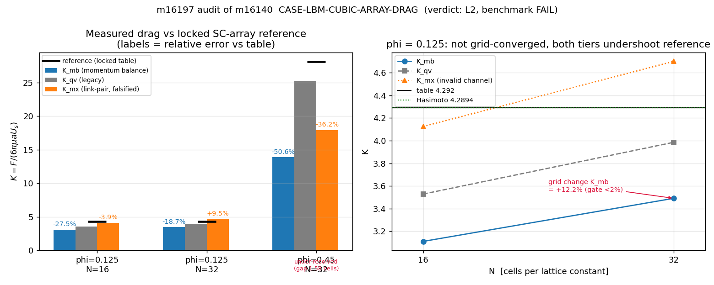

# m16140 交差审计（board-audit）— CASE-LBM-CUBIC-ARRAY-DRAG · TensorLBM

- 被审单：**m16140**（status=succeeded，report_id=15276，commit `c0a3e6c3`，12 files）
- 审计单：**m16197**（交差核验，非重做）
- 审计方式：对抗式复核 = 独立复跑（逐位比对）+ 工件/报告/commit 三方对账 + 基准裁判查表 + 判级
- **结论：L2（独立功能实现）**。功能实现真实、可复现；**基准未通过**（最细档 -18.67%），
  且未上 origin/main、平台无机器裁判行 → 不得判 L3/L4。交付的 honest-FAIL 自述**属实且未粉饰**。
- 独立性限制：同一主机、同一工作树族；只独立复跑了 phi=0.125/N=16 一档；不是第三方重实现。

---

## 1. 三件套逐项核验（任务①）

| 项 | 判定 | 证据（真实指针） |
|---|---|---|
| run_artifacts | **PASS（有保留）** | 逐字快照存于 `refs/`（sha256 见 `refs/provenance.json`）。`out/case_phi0.125_N16.json`(7.3KB)、`out/case_phi0.125_N32.json`(8.4KB)、`out/result.json`、`figures/{k_vs_N,error_vs_N,field_slice}.png`(40/61/60KB) 均已入 commit `c0a3e6c3`。保留点：`out/case_phi0.45_N32.json`（8000 步实跑工件）**未跟踪**（git status `??`），不入交付树 → 见 F3 |
| 基准 ref vs got | **FAIL / 不可机器裁** | `tensor_benchmark_cases WHERE anchor_slug='CASE-LBM-CUBIC-ARRAY-DRAG'` → **0 行**（同仓仅 GAP-LBM-MCMP-POISEUILLE / GAP-LBM-SPHERE）。自声明基准=锁定 SC 表 4.292（Hasimoto 级数在码内给 4.2894，差 -0.06%）。见 §2 表：最细档 K_mb **-18.67%**，超生态 15% 不可接受线，也未达报告自设 <5% |
| repro_cmd | **PASS（有条件）** | 审计独立复跑 `--phi 0.125 --n 16 --max-steps 5000 --threads 32` → 91.8 s 得 K_mb=3.110432278316337、K_qv=3.528200114091309、K_mx=4.124838639222451，与交付 JSON **逐位相同**（bitwise=True）。条件：**报告全文无 repro_cmd 段**，且 CLI 默认 `--n 16` 只跑 1024 步 → K_mb≈3.3021（非发布值）；见 F6 |
| 报告六段 | **PASS** | `docs/CASE-LBM-CUBIC-ARRAY-DRAG.md` / `REPORT.md` ①案例②方法③参数表④结果⑤注意点⑥误差判定 六节齐全，3 张 figure 已内嵌（platform report 15276 figures=3），§6 显式回答「<5%? NO」 |

## 2. 基准裁判逐项（唯一裁判 = 数值是否在容差内）

ref = 锁定 SC 立方阵列表（`benchmarks/verified/permeability3d/NOTES.md` §1.2-1.4，Basilisk `spheres.c` + Holmes 2011 双证人）：
phi=0.125 → K=4.292；phi=0.45 → K=28.09。容差：报告自设 <5%，生态线 >15% 不可接受。

| phi | N | steps | steady | gap[cells] | K_mb | err(K_mb) vs ref | K_qv | err(K_qv) | K_mx | err(K_mx) |
|---|---|---|---|---|---|---|---|---|---|---|
| 0.125 | 16 | 5000 | **no** | 6.07 | 3.1104 | -27.53% | 3.5282 | -17.80% | 4.1248 | -3.89% |
| 0.125 | 32 | 6000 | **no** | 12.15 | 3.4907 | -18.67% | 3.9854 | -7.14% | 4.7001 | +9.51% |
| 0.45 | 32 | 8000 | **no** | 1.58 | 13.8810 | -50.58% | 25.2738 | -10.03% | 17.9283 | -36.18% |

参考绝对量：phi=0.125 ref=4.292（Hasimoto 4.2894，两者一致 -0.06%）；phi=0.45 ref=28.09（Hasimoto 22.6699）。

**总体 = FAIL（不是基准被推翻）**：最细判据档 phi=0.125 N=32 主通道 K_mb=3.4907 → **-18.67%**；
N16→N32 变化 **+12.23%**，远大于预注册 2% 收敛门 → 阶梯未收敛；两个档 `steady_detected=false`。
phi=0.45 实跑件 K_mx=17.9283（-36.18%）但 `under_resolved=true`（面间距仅 1.58 cell）→ 该点质量应判 WITHHELD，不是"没跑"（F3）。
通道一致性：`F_mx/F_inj` = 1.326(N16) / 1.346(N32) → 链接对动量交换通道在本库 bounce-back 下确被污染，交付"falsified channel"结论**审计认可**。

## 3. 判级（任务②）：L2

| 级别 | 判据 | 本单 |
|---|---|---|
| L0 | 文档 | 超集 |
| L1 | 数学/单元验证 | **PASS**：Hasimoto 级数码内求值 vs 锁定表差 -0.06%；三档 phi_actual 体积分数记账真实（0.11841/0.12411/0.45078） |
| L2 | 独立功能实现 | **PASS**：485 行驱动 + **生产库内核**（`d3q19.py:83 equilibrium3d`、`:165 macroscopic3d`、`solver3d.py:124 collide_bgk3d`、`:403 stream3d`、`boundary/boundaries3d.py:113 bounce_back_cells_3d`），输入→计算→输出闭环，显式步数下逐位可复现 |
| L3 | 系统集成 | **FAIL**：`git merge-base --is-ancestor HEAD origin/main` → NOT_ON_MAIN；`git ls-tree origin/main` 该算例 **0 文件** → 主干不可达、无 CI/求解器/平台调用方；`tensor_benchmark_cases` 无行。仅达"内核级调用"（承认是进步），未达"接入" |
| L4 | 基准验证 | **FAIL**：最细档 -18.67%（>15% 不可接受），收敛门 +12.23%（门 2%），密相点欠分辨；且平台无机器裁判行 → 结构性不可达 |
| L5 | 科研工程成果 | NOT_REACHED |

## 4. 发现（按严重度）

### F1 · blocking (for L4)
**Benchmark fails at the finest verdict-bearing tier and the grid ladder is not converged**

- 证据：`case_phi0.125_N16.json / case_phi0.125_N32.json / result.json`
- 细节：N=32 K_mb=3.4907 vs 4.292 = -18.67% (>15% unacceptable); N=16 -27.53%; N16->N32 change +12.23% vs preregistered 2% gate; steady_detected=false at both tiers.

### F2 · material (overstatement)
**REPORT.md §4 err columns are mislabeled: they print K_mx errors under 'err(K_mb)'**

- 证据：`REPORT.md:63-66 table vs out/*.json`
- 细节：Table shows err(K_mb) = -0.03894719496215038% (N16) / 0.09509381595438593% (N32); true K_mb errors are -27.53% / -18.67%. Printed values equal err_mx_vs_ref (-0.0389/0.0951 -> -3.89%/+9.51%). A reader taking the table at face value sees the primary channel inside the 15% band; the prose below the table states the correct -27.5%/-18.7%.

### F3 · material (artifact/report desync)
**phi=0.45 run exists on disk but is untracked and reported as 'no result / WITHHELD'**

- 证据：`out/case_phi0.45_N32.json (git status: ??, 8000 steps, 520.7 s, mtime 10:24) vs REPORT.md §6`
- 细节：Artifact K_mx=17.9283 (-36.18% vs 28.09), K_qv=25.2738 (-10.03%), K_mb=13.8810 (-50.58%), under_resolved=true (gap 1.58 cells), steady=false. The run post-dates REPORT.md (10:20) and result.json (10:19) and was never committed -> the 'succeeded' mission ships a tree whose densest data point is missing; the report's WITHHELD statement is stale, not false-at-the-time.

### F4 · material (structural, blocks L4 for any case)
**No machine benchmark row for the anchor -> the 'sole judge' cannot run**

- 证据：`SELECT ... FROM tensor_benchmark_cases WHERE anchor_slug='CASE-LBM-CUBIC-ARRAY-DRAG' -> 0 rows`
- 细节：tensor_benchmark_cases holds only GAP-LBM-MCMP-POISEUILLE and GAP-LBM-SPHERE; tensorbench_results has 1 row total. ref/tolerance exist only as literals inside the case JSON, so L4 is structurally unreachable regardless of accuracy. Recommend registering phi=0.125 ref=4.292 / phi=0.45 ref=28.09 with tol=<5%.

### F5 · material (no regression guard)
**No automated test binds the case's numbers or its reference comparison**

- 证据：`grep -rl over tests/ and TensorLBM/tests/ -> 0 hits; case dir ships no test file`
- 细节：Same pattern as m16078 (CASE-LBM-CAVITY-3D-RE100) which was judged L2 for the same reason. The honest-FAIL verdict currently rests on a JSON produced once, with nothing that would catch a future silent change in K.

### F6 · minor
**Published configuration is not recoverable from the report, and the repro path crashes below the window**

- 证据：`REPORT.md (no repro_cmd section) vs run.py:256; auditor reproduction`
- 细节：Default invocation (--n 16, no --max-steps) uses max_steps=1024 -> K_mb=3.3021, not the published 3.1104; and --max-steps < 4000 (measurement window) raises ZeroDivisionError at run.py:256 (empty window). Reproduction therefore works only with the unpublished '--max-steps 5000 --threads 32' pair.

### F7 · minor (unverifiable claim)
**§5.4 transverse-flow numbers (0.074 rms / 21% max) are not traceable to any artifact**

- 证据：`REPORT.md §5.4 vs run.py:304 / case_phi0.125_N32.json cross_flow_rel`
- 细节：Artifacts record cross_flow_rel=0.4486 (N16) / 0.4283 (N32), defined as (max|uy|+max|uz|)/|um| at run.py:304 - a different metric from the quoted rms ratio, and no artifact stores the 0.074/0.21 pair.

## 5. 未做的检查（not_run，不记为通过）

- N=48/64/96 ladder and phi=0.5: NOT RUN by the audited mission (itself declares ecological friction) -> auditor did not re-run them either (needs ~hours; would not change an already-failing verdict)
- phi=0.45: artifact exists but was not re-run by the auditor (520 s/run not needed to establish under_resolution + -36% error)
- Hasimoto/Sangani-Acrivos papers were not consulted in the original PDF form; references were checked only through the locked ecosystem table + in-code series (agree to -0.06%)
- --smoke path verified executable (N=12, 60 s) but its K is not a verdict input; not analysed for accuracy

## 6. 被夸大的声明

- REPORT.md §4 table: 'err(K_mb)' columns carry K_mx errors -> the primary channel's error is understated in the table (F2)
- mission closed as 'succeeded' while §6 declares a verdict-bearing point WITHHELD and the densest actual run is untracked (F3)

## 7. 处置（disposition）

**approve with notes** — 接受 m16140 的交差**事实**（honest-FAIL 自述准确、工件真实、主通道可复现），
**但不接受任何高于 L2 的成熟度**，且不消账为"基准已验证"。返修清单（供后续算例池单收养）：
1. 把 `out/case_phi0.45_N32.json` 入库并在报告 §4/§6 如实登记为"欠分辨尝试（-36.2%，not verdict-bearing）"（F3）；
2. 修正 §4 表 err 列（K_mb 与 K_mx 混淆）（F2）；
3. 报告补 `repro_cmd` 段（含 `--max-steps --threads`），并修 run.py:256 空窗口 ZeroDivisionError（F6）；
4. 在 `tensor_benchmark_cases` 注册 anchor 行（phi=0.125/4.292、phi=0.45/28.09，tol <5%）（F4）；
5. 补一个断言 K 与收敛门的测试（F5）；
6. 精度缺口需插值 bounce-back / 更高 N（48+）才能进 L4——这是真问题，不是报表问题。

生成：2026-11-12T11:01:55+00:00（程序化注入，无手抄数字）

## 8. 落表与机器门预演

- 落表：`tensor_maturity_verdicts.id=439`，repo=TensorLBM，scope=`m16140 CASE-LBM-CUBIC-ARRAY-DRAG`，
  mission_id=16197，**level=2**，verdict_by=board-audit，gate_state=pending（等 gate 周期 30min 自动裁定）。
- 预演：用 gate 自己的 `judge()`（/root/tp-agent/maturity_gate.py，SCHEME L2={impl_files,entry,run_artifacts}）
  对 evidence.json 求值 → **gate_level=2, fail_reasons=[]**；impl_real=True、run_artifacts 7 件全在、
  benchmark 数值对照齐。未达 L3 的 integration_callers grep 复核亦按预期失败
  （生态仓无可达调用方），不申请 L3。
- 报告：platform report id=15311（六段 + 审计图 1 张，figures=1）。
