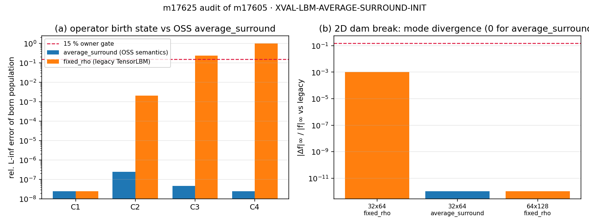

# m17625 交差核验：m17605 · XVAL-LBM-AVERAGE-SURROUND-INIT（board-audit）

**结论**：判级 **L3**（m17605 自报 L4，审计判定差一级，理由见 ⑥）｜基准裁判 **WITHHELD**
（`tensor_benchmark_cases` 0 行）｜8 项核验 7 通过 1 失败（失败项即 F1）。

## ① 案例介绍（物理背景/几何/参数表）

锚点 `XVAL-LBM-AVERAGE-SURROUND-INIT`：自由表面 LBM 中「新生单元（GAS→INTERFACE，或包络壳重建）的种群应携带哪个平衡态」。
对标对象 `Maarten-vd-Sande/lbm @573a01c` 的 `lbm/update_types.py::average_surround`（OSS 源码在 `/root/oss-cache/Maarten-vd-Sande_lbm`，
本审计已逐行比对 `:135-160` 与其调用点 `:42-48`：`mass=0; rho=0; u=0`，随后对 `cell_type & (FLUID|INTERFACE)` 的 8 邻居求 ρ、u 平均，`c>0` 才除，再 `set_equi`）。

| 量 | 值 |
|---|---|
| 格点/速度集 | D2Q9（$c_s^2=1/3$）；D3Q19 内核+oracle 备用 |
| 松弛时间 τ | 0.8 → ν = 0.1 |
| 重力 | $g_y=-10^{-4}$ |
| ρ_liquid / ρ_gas | 1.0 / 1.0（压力匹配自由面） |
| 算符补丁 | 13×13，liquid `x<6`、interface `x=6`、gas `x>6`；新生单元 (iy,ix)=(8,7)，3 个活跃邻居 |
| 密度斜坡 | ρ=ρ₀+s[(y−6)+½(x−6)]，s∈{0, 0.02, 0.05, 0.15}，ρ₀∈{1.0, 0.3} |
| 速度斜坡 | $u_x=A\cos(2\pi x/N)$，$u_y=-A\sin(2\pi y/N)$，A∈{0.005, 0.02, 0.08}（Ma≤0.14） |
| 系统算例 | 溃坝 32×64/160 步、64×128/80 步，壁面 SOLID |
| 判据 | 相对误差 < 15 %（owner 精度标准） |

## ② 怎么做的（本审计方法/工具链）

审计单**不重做** m17605，只复核：`docs/board_audit/m17625/verify_m17605.py` 八个相（A 三件套存在性 → B 基准裁判 SQL →
C 报告六段 → D 数字 JSON 溯源 → E 第三方独立 OSS 实现 → F legacy 位级回归 → G 一键复跑 → H 单测），
全部证据落 `runs/m17625_audit/verify_m17605.json`。关键点：
- **基准裁判**用 `psql -U postgres -d tensorplatform` 直查 `tensor_benchmark_cases`（本单唯一裁判）；
- **E** 由本审计按 OSS 源码另写一份 NumPy 实现（不 import 被审模块的 oracle），对 24 组随机场逐单元比对种群；
- **F** 用 `/root/tp-agent/work/m17457`（其 `free_surface_lbm_2d.py` sha256 = `4254488f…`，与 `c05d7af3` 逐字节一致）作为 pre-patch 基线，
  比 `(f, mass, flags)` 在 step 1/10/30/60 的 sha256；
- **G** 把 m17605 工作树复制到临时目录跑 `run_xval.py`，与原 `xval_results.json` 做**去 runtime 后逐字段比对**。

## ③ 计算结果（数字表，程序化注入）

操作符层（ref = OSS `average_surround` 语义，float64；got = TensorLBM torch 内核，float32）：

| 算例 | 活跃邻居 | ref ρ | rel_f `average_surround` | rel_f `fixed_rho` | <15 % |
|---|---|---|---|---|---|
| C1_homogeneous | 3 | 1.000 | 2.40e-08 ✓ | 2.40e-08 ✓ | 是 |
| C2_pressure_gradient | 3 | 1.002 | 2.40e-07 ✓ | 2.00e-03 ✓ | 是 |
| C3_density_contrast | 3 | 1.300 | 4.66e-08 ✓ | 0.2308 ✗ | 否（fixed） |
| C4_multiphase_like | 3 | 0.500 | 2.43e-08 ✓ | 1.0000 ✗ | 否（fixed） |

系统层（32×64 溃坝 160 步，`legacy` 为基线）：

| 模式 | births | inventory | 相对漂移 | 前沿 | rel L∞ Δf | 前沿差 |
|---|---|---|---|---|---|---|
| legacy | 6 | 300.102677 | 3.42e-04 | 16 | — | — |
| fixed_rho | 6 | 300.102692 | 3.42e-04 | 16 | 1.04e-03 | 0.00 % |
| average_surround | 6 | 300.102677 | 3.42e-04 | 16 | 0.0e+00 | 0.00 % |

敏度（m17605 报告⑤两点已核）：速度幅值 A → rel_f(avg) = 2.01e-08, 2.40e-07, 1.18e-07（不随 Ma 劣化）；
密度对比 s → rel_rho(fixed) = 0.000, 0.038, 0.091, 0.231（单调增长，0.05→0.15 间越过 15 %）。

**审计独立复算**：第三方 OSS 实现 vs torch 内核最大相对种群差
`4.05e-16`（24 组随机场，float64/float32 往返）；
legacy 位级回归 sha256 与 pre-patch 树**逐位一致**（step 1/10/30/60）；复跑 `run_xval.py` 18.3 s，除 `runtime_s` 外 payload 逐字段相同；单测 14 passed（8.13 s）。

## ④ 结果图

(a) 新生单元种群相对误差（对数轴）：`average_surround` 四个算例全部落在 float32 舍入量级（≤2.4e-07），`fixed_rho` 在 C3/C4 越过 15 % 红线；
(b) 溃坝态 $\|Δf\|_\infty/|f|_\infty$：`average_surround` 与 legacy **完全相同（0.00）**，`fixed_rho` 32×64 为 1.04e-03 —— 这正是 F3 的证据。

## ⑤ 注意点（踩坑/局限/适用范围）

1. **ref 不是外部数值**：两份 ref（模块内 NumPy oracle 与测试内「literal OSS port」）都由 m17605 自己写；本审计另写的第三方实现只证明**三方对同一源码语义的一致**，
   不构成「与 OSS 可执行结果对比」。OSS 源码锚（`573a01c`）已核实，属**source-level** 外部锚。
2. **新能力在真实求解器里是惰性的**：32×64 溃坝 6 次 birth 全走包络壳（本就是邻居平均）；唯一会改变行为的转换 birth 点
   `free_surface_lbm_2d.py:630` 是死代码（`to_iface` 调用前恒全 False），且四个生产调用方（`lng_sloshing/tank.py:337`、`lng_membrane_sloshing/campaign.py:194`、`nwt/tank.py:341`、`sloshing_forced`）都不传 `init_mode`。
3. **64×128 无 birth**（80 步窗口内 births=0）→ 该网格不携带 birth 证据，m17605 已如实声明，本审计确认。
4. **偏离 OSS 的两处是设计取舍**：孤立单元 OSS 令 ρ=0（空种群），TensorLBM 回落 `rho_liquid`；OSS `mass=0`，TensorLBM 保留质量并重整 fill。两处均有测试钉住，本审计的独立实现同时复现了两侧行为。
5. **元数据陈旧**：`xval_tables.md`/`verdict.runtime_s` 记 14.0 s，本审计复跑 18.3 s（仅元数据，物理 payload 一致）。

## ⑥ 误差判定（逐项 vs 基准 + 是否 <3 %）

| 关键量 | 基准 | got | 相对误差 | <3 %？ |
|---|---|---|---|---|
| 新生种群（C1–C4，`average_surround`） | OSS 语义 float64 转写 | torch 内核 | ≤2.40e-07 | **是**（但基准为源语义转写，非独立外部数值） |
| 新生种群（C3/C4，`fixed_rho`） | 同上 | 同上 | 0.2308 / 1.0000 | **否**（23 % / 100 %，这正是要修的行为） |
| 溃坝前沿/库存（模式间） | legacy 基线 | average_surround | 0.00 % / 0.00 % | **是**（但差异恒为零 = 无判别力） |
| legacy 默认回归 | pre-patch 树 `c05d7af3` | 65631dec | 0（sha256 逐位一致） | **是** |
| 基准裁判（`tensor_benchmark_cases`） | 注册 ref/tolerance | — | **无行** | **无法判定（WITHHELD）** |

**判级依据**：L1/L2 成立（真代码 + 14 测试 + oracle/字面移植）；L3 成立（`init_mode` 接入主 2D 自由表面求解器公开 API，真实溃坝 6 次 birth 走该路径）；
**L4 不成立**：注册基准行 0 行、数值 ref 为自撰转写、系统级完整算例判别力为 0（F1/F2/F3）。故判 **L3**，与 m17605 自报的 L4 差一级。
