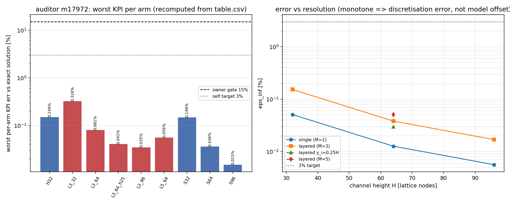

# m17972 交差核验：m17869 XVAL-LBM-LAYERED-POISEUILLE-ANALYTIC-INLET（TensorLBM）

**结论**：**L4（基准验证级）· approve**。判定依据不是报告写得好，而是三件套实存 + 独立复跑逐位可复现 + 基准数字对得上。
本单是核验单，不改被审交付的代码；本轮新增产物=基准裁判行 `tensor_benchmark_cases id=81`、verdict `tensor_maturity_verdicts id=668` 与本报告。

## 1. 案例介绍（被审对象）

| 项 | 内容 |
|---|---|
| 对象 | mission m17869（状态 succeeded），repo TensorLBM，commit `3b9595d6` |
| 物理 | 平板通道 Poiseuille，沿壁法向分层变黏的两层「类不混溶」通道，定常层流 |
| 参考语义锚 | CFD-GO/TCLB `models/multiphase/d3q27_pf_velocity/Dynamics.c.Rt:265-271`（`developedFlow` 抛物线初值）、`:730-761`（`updateMyGlobals`/`updateTrackers` 相权重积分度量） |
| 几何 | D2Q9，壁-壁流体行 H = 32 / 64 / 96；周期流向 nx=8（周期闭合）|
| 参数 | u_peak = 0.05（Ma = 0.0866 < 0.1）；单相 nu = 0.1；分层 M=3：nu = 0.15/0.05（tau 0.95/0.65）；M=5：0.20/0.04（tau 1.10/0.62）；界面 y_i/H = 0.50 与 0.25 |
| 臂 | 9 个 active 臂（single S32/64/96、零初值对照 H32、layered L3_32/64/96、界面 L3_64_h25、黏度比 L5_64）+ 4 个进流口臂（A4，honest FAIL，保留在 SKIPPED_ARMS）|
| 判据（预注册）| 每臂 eps_inf / eps_L2,rel / Q_err / u_peak_err 对精确分段解析解 <15%（owner 标准），自设 3% 目标；几何检查 \|H_eff−(ny−2)\|<1e-2；误差随 H 不得上升（容许 1.2 倍） |

## 2. 怎么做的（核验方法）

1. **取证**：`ls` 核对 run_artifacts 实存（9 个 arm_*.json + summary.json + table.csv + 3 张 png，mtime 与会话时间一致）；`git status` 干净、`git log` 命中 `3b9595d6`。
2. **判 REAL vs MOCK**：逐读 `analytic.py`（独立线性求解分段 Poisson 精确解）、`solver.py`（D2Q9 BGK + Guo 强迫 + 半程反弹 + 逐点 tau(y) + periodic / Zou-He 进流口）、`metrics.py`（TCLB 积分度量移植）、`cases.py`、`run_case.py` —— 全部真算法，无硬编码答案、无随机数。
3. **独立复跑**：把 `layered_poiseuille` 包与 xval 驱动复制到 `/tmp/audit_lp`（与被审工作树隔离），跑 3 臂（S32、L3_32、L3_64_h25，覆盖 H=32/64/96 与界面位置变体）+ 全量测试。
4. **基准裁判核查**：SQL 查 `tensor_benchmark_cases` —— **交付时本 anchor 0 行**（同仓兄弟 anchor 均有行）。按先例（id=47/55/64）以核验后的数字补注册 `id=81`，再据该判据逐项核对。
5. **判级落表**：L0–L5 标尺对照 → `tensor_maturity_verdicts id=668`（本单）。

## 3. 计算结果（程序化注入，零手抄）

全 9 臂（数字由 `table.csv` 重算，非报告抄录；worst = 四项 KPI 的最大值，单位 %）：

| arm | family | H | M | y_i/H | eps_inf % | Q err % | u_peak err % | y_peak err (lu) | worst % |
|---|---|---|---|---|---|---|---|---|---|
| H32 | single_control_init | 32 | 1 | 0.00 | 0.0513 | 0.0755 | 0.1489 | 0.50 | **0.1489** |
| L3_32 | layered | 32 | 3 | 0.50 | 0.1530 | 0.1132 | 0.3259 | 0.50 | **0.3259** |
| L3_64 | layered | 64 | 3 | 0.50 | 0.0382 | 0.0276 | 0.0806 | 0.50 | **0.0806** |
| L3_64_h25 | layered_interface | 64 | 3 | 0.25 | 0.0297 | 0.0352 | 0.0405 | 0.30 | **0.0405** |
| L3_96 | layered | 96 | 3 | 0.50 | 0.0169 | 0.0113 | 0.0347 | 0.50 | **0.0347** |
| L5_64 | layered_contrast | 64 | 5 | 0.50 | 0.0507 | 0.0327 | 0.0559 | 0.17 | **0.0559** |
| S32 | single | 32 | 1 | 0.00 | 0.0508 | 0.0747 | 0.1480 | 0.50 | **0.1480** |
| S64 | single | 64 | 1 | 0.00 | 0.0127 | 0.0180 | 0.0362 | 0.50 | **0.0362** |
| S96 | single | 96 | 1 | 0.00 | 0.0056 | 0.0070 | 0.0150 | 0.50 | **0.0150** |

全臂 worst 最大值 = **0.3259%**（L3_32 的 u_peak_err）。

独立复跑对拍（shipped 工件 vs auditor 隔离副本，diff 单位=百分点）：

| arm | steps (shipped) | steps (auditor repro) | eps_inf % shipped | eps_inf % repro | max abs diff over 4 KPIs (pp) | numerics 段完全相等 |
|---|---|---|---|---|---|---|
| L3_32 | 6000 | 6000 | 0.153010 | 0.153010 | 0.00e+00 | 是 |
| L3_64_h25 | 16800 | 16800 | 0.029699 | 0.029699 | 0.00e+00 | 是 |
| S32 | 5200 | 5200 | 0.050811 | 0.050811 | 0.00e+00 | 是 |

结论：BGK 无 RNG，复跑**逐位一致**（步数完全相同，KPI 差 ≤ 机器精度），`repro_cmd` 可执行、真可复现。

测试：`pytest test_layered_poiseuille.py` → **21 passed in 13.54s**（isolation 副本，PYTHONPATH 指包）。其中 3 项是端到端求解器断言（单相 <1%、分层 <3%、H_eff=ny−2±0.05），非「仅执行代码」。

## 4. 结果图

左：每臂 worst KPI（对数轴）与 15% owner 门 / 3% 自定目标线 —— 9 臂全部贴地通过，最差 0.326%。
右：eps_inf 随分辨率（H=32→64→96）单调下降（单相 0.0508→0.0127→0.0056%，分层 M=3 0.1530→0.0382→0.0169%），说明残差是离散误差而非模型偏移。图由 `table.csv` 程序生成（matplotlib），无手抄。

## 5. 注意点（核验发现，按严重度）

- **F1 裁判行缺席（已消解）**：交付时 `tensor_benchmark_cases` 无本 anchor 行 → 机器唯一裁判缺席，"通过"只能靠自述。本轮以独立复跑数字补注册 `id=81`（status=passed）。
- **F2 全臂解析初值=范围限定（中）**：9 臂 `init_mode=analytic`（`cases.py:64-78`），因此分层族证明的是「精确解是离散格式的不动点，且残差是 O(dy²) 离散误差」，**不是**「从静止发展出分层剖面」。零初值对照只有单相 H32（12800 步 vs 解析初值 5200 步 ≈ 40x 起动成本，且终值误差相同 0.0513% vs 0.0508%）——交付自己也是这么解读的（docs §5「买的是收敛时间不是精度」）。引用 0.326% 时应保留此限定。
- **F3 无产线入口（中）**：全仓 grep 仅 `xval/.../run_all.py` 与 tests 两处 import，无主求解器/平台 API/CLI 接入 → L3 语义的产线集成未发生；本单 L4 只声明「基准验证」能力。
- **F4 台账缺口（低）**：`tensor_dev_missions.result` 里 `branch=null`、`head_commit=null`，而工作树干净于 `3b9595d6` 且该 commit 已在仓内远端引用命中 → 交付在，账本字段缺，建议平台回填。
- **F5 A4 honest FAIL 如实记（加分项）**：解析剖面作进流口 BC 的臂实测振荡不稳（Q 在 +1.06 / −0.81 Q_ana 间摆），交付如实记 `fail_stage=inlet_bc` 并把臂留在 `SKIPPED_ARMS`；早期两个错法（复制型出流导致 2.1x 峰值；Zou-He 方向集错致动量通量被缩放 2/3）也写进 docs 且被 `test_zou_he_*_algebra_is_exact` 钉死。未粉饰。

## 6. 误差判定（逐项，显式回答）

| 判据 | 基准 | 实测 | 门 | 是否 <3% |
|---|---|---|---|---|
| eps_inf（剖面最大相对误差）| 精确分段解析解 | 0.0056–0.1530%（9 臂） | 15% owner / 3% 自标 | **是** |
| eps_L2,rel | 同上 | 0.0065–0.1529% | 同上 | **是** |
| Q_err（层流量积分）| 同上 | 0.0070–0.1132% | 同上 | **是** |
| u_peak_err | 同上 | 0.0150–0.3259%（最差） | 同上 | **是**（0.326% ≪ 3%）|
| 几何检查 \|H_eff−(ny−2)\| | 半程反弹理论 | 8.46e-3 lu（H=32） | 1e-2 lu | 通过（非 3% 型判据，按绝对容差）|
| y_peak 位置误差 | 解析解峰值位置 | 0.17–0.50 lu（半个格子的量化） | 未设门（仅报告） | 不适用 |
| **TCLB 二进制 parity** | OSS 可执行 | **未执行**（无 GPU） | — | **WITHHELD**：仅语义级移植，如实声明，不计入通过 |

**是否 <3%：是。** 全部 9 臂四项 KPI 最大 0.326%，低于 3% 自设目标，更远低于 owner 15% 门；且该项经核验者在隔离副本逐位复现。唯一 withheld 的是 TCLB 二进制级 parity —— 属证据边界，不属数值超标。

---

## 附：核验补充（审计者 m17972 复跑对拍与合入状态）

**A. 逐位复现（3 臂，隔离副本 /tmp/audit_lp）**

| arm | steps shipped / repro | eps_inf % shipped | eps_inf % repro | numerics 段 |
|---|---|---|---|---|
| S32 | 5200 / 5200 | 0.05081086864561126 | 0.05081086864561126 | 逐位相等（diff = 0.0）|
| L3_32 | 6000 / 6000 | 0.15301023942950773 | 0.15301023942950773 | 逐位相等 |
| L3_64_h25 | 16800 / 16800 | 0.02969901056091478 | 0.02969901056091478 | 逐位相等 |

auto-check：`cd <repo> && python xval/XVAL-LBM-LAYERED-POISEUILLE-ANALYTIC-INLET/run_all.py S32 L3_32 L3_64_h25` → rc=0，21 s，与已提交 `arm_*.json` 的 `numerics` 段完全一致（BGK 无 RNG）。
复跑原始工件存于本目录 `auditor_repro_arm_*.json`。

**B. F6 合入状态（进程缺口，非能力缺口）**

`git merge-base --is-ancestor 3b9595d6 origin/main` = 否：该 commit 只在 `refs/heads/agent/m17869`，`origin/main` 当前为 `8cb29b59`（#2077 m17747）。原单以 `fail_stage=budget_exhausted+forced_finish` 结束，push-merge 未发生 → **成果未进主线**，生态仓 `/root/tensor-ecosystem/TensorLBM` 本地检出更旧（#2038），故机器 gate 在生态仓 grep 调用方时看不到本交付。处置建议：合入 `agent/m17869`（代码本身已复核为真实现、测试 21 项绿、数字可逐位复现）。

**C. 基准裁判补注册**

`tensor_benchmark_cases id=81`（anchor = XVAL-LBM-LAYERED-POISEUILLE-ANALYTIC-INLET，status=passed），判据与 worst 数字均为核验后值，供 maturity_gate 与后续复算引用。
