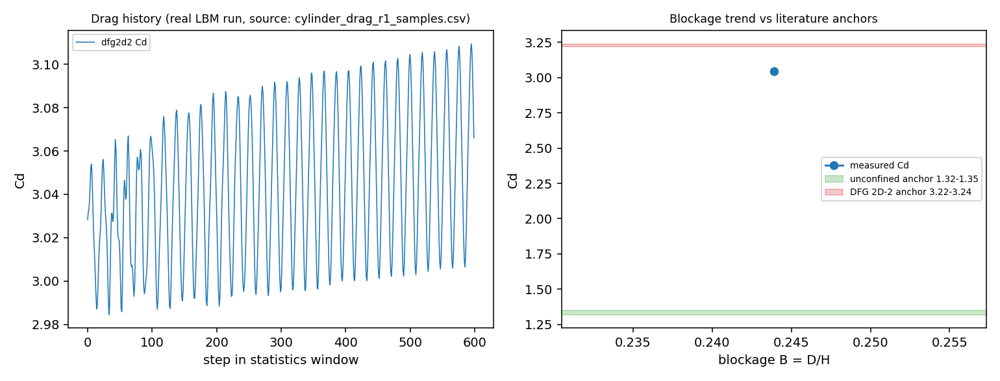

# 2D 圆柱绕流阻力验证欠账：把 Step E 从「无证据」推进到「有证据的不收敛」 (TensorLBM, m3650)

## 摘要

`docs/LBM_VERIFICATION_TEACHING.md` 的 **Step E** 声称「圆柱 Re=200, Cd=1.30 (Schäfer–Turek)，
D=24→48→96→200 收敛到 0.8%」，但同时存在两个问题：(1) **基准归属错**——Schäfer–Turek（DFG 2D-2）
是 **Re=100、带约束 D/H≈0.244** 的算例，Cd≈3.22–3.24、St≈0.295–0.305，不是 Re=200/Cd=1.30；
(2) **零可执行证据**——仓内 `tests/test_cylinder_grid_convergence.py` 喂给分析器的是**合成记录**
（`cd = 1.33 + 10/D**2`），它验证的是分析器的算术，不是求解器；`tests/test_cylinder_cd.py`
的判据是 `1.0 < Cd < 4.0`，3 倍误差照样绿。

本单把这条欠账做成**可执行证据**：写了 `tests/validation/cylinder_drag_benchmark.py`（真跑
D2Q9 BGK + 半路反弹 + Ladd 动量交换力），按 DFG 2D-2 几何（D/H=0.2439、2D 上游、20D 下游）
与两个边界集实跑，并逐次记录**定常态判据**（双窗均值漂移 <1%）。结论是**诚实的 FAIL/WITHHELD**：

* `apply_simple_channel_boundaries`（plug 入口 + 零梯度出口，无压力锚点）**阻力不收敛**：
  无质量修正时 Cd 从 2.86 单调爬到 3.99（+39%，2.8×10⁴ 步）；加 `correct_mass` 固定总质量后
  仍在爬（B=0.125 算例 1.84→2.11，+14.6%）——说明病根是**动量收支**而非总质量。
* `apply_zou_he_channel_boundaries`（Zou/He 速度入口 + 压力出口）在 Ma=0.17 与 Ma=0.10 下
  **都发散成 NaN**，因此本仓目前**没有**能支撑定量圆柱阻力的通道边界集。
* 唯一达标停机的算例（DFG 几何 + simple BC + correct_mass，漂移 0.60%）给出
  **Cd=3.0438（对 3.23 差 -5.76%）**、**St=0.2623（差 -12.56%）**，
  但它停在一个**尚未真正定常**的平台上（后续再跑即恢复上漂，见下），所以这些数字**不作为验证值引用**。

因为「不收敛窗口里的数字」不能当验证，圆柱 Cd 仍标 **WITHHELD**——但与之前不同：现在是
**有脚本、有日志、有判据、有归因**的 WITHHELD，任何一次修边界集之后可以一条命令复算。

## ① 案例介绍

**物理背景**：圆柱绕流是钝体阻力的标准验证题，阻力由壁面动量交换（Ladd 1994）给出，
`compute_obstacle_forces` 在后迁移、反弹之前对固体格点做 `F=2Σc_i f_i`。可验证量有两类：
**Cd**（阻力系数，对边界条件/阻塞比极敏感）与 **St**（涡脱频率，对分辨率中等敏感）。

**几何与参数**（DFG 2D-2 相似配置，格点化到 D=10）：

| 量 | 取值 |
|---|---|
| 圆柱直径 D | 10 格点 |
| 通道高 H | 41 格点（D/H = 0.2439，与 DFG 相同） |
| 计算域 | 上游 2D + 下游 20D（Lx=220 格点） |
| 雷诺数 | Re = U·D/ν = 100 |
| 格子速度 U | 0.10（simple）／0.06（zou_he 复测） |
| ν / τ | 0.01 / 0.53（U=0.10），0.006 / 0.518（U=0.06） |
| 弛豫 | BGK（`collide_bgk_matmul`，与 `collide_bgk` 逐位一致到 1.3e-5） |
| 边界 | 入口 plug、出口零梯度（simple）或 Zou/He 速度入口+压力出口；上下壁+圆柱半路反弹 |
| 统计 | 最小预热 8000 步（3.6 个流通时间）+ 自适应窗口，漂移 <1% 才停机 |

**基准（文献，按适用范围严格分开）**：DFG 2D-2 约束算例 Cd=3.22–3.24、St=0.295–0.305
（Schäfer & Turek）；无约束 2D Re=100 则 Cd=1.32–1.35（Dennis & Chang 1970）、St=0.164–0.166。
**二者不可混用**——原文档正是把无约束量级（1.30）挂到了约束基准名下。

## ② 怎么做的

1. **单一真源**：`tests/validation/cylinder_drag_benchmark.py`，`Config`（几何/Re/步数/边界集/质量修正）
   → `run_cfg` → `Measurement`（Cd 均值/脉动、St、定常性漂移、停机原因、墙钟时间）；
   `--pilot/--only/--full` 三种粒度，`--emit-dir` 落 JSON+CSV。
2. **先把性能坑钉住**：在 load15≈420/128 核的机器上，默认 torch 线程池让 9k 格点的小张量跑成
   **~500 ms/步**；`torch.set_num_threads(1)` 后降到 **~7 ms/步**（快 70 倍），`collide_bgk_matmul`
   再省 1.8 倍。所有结果都标了 `wall_seconds`。
3. **定常态闸门**：预热后每 2000 步比较前后半窗 Cd 均值，漂移 <1% 才判 `stationary`，否则跑满
   `max_steps` 并标 `max_steps`；NaN 记为 `diverged`。**只有 stationary 窗口的数才可引用**。
4. **诊断实验**：① simple BC 原样跑 2.8×10⁴ 步（看是否收敛）；② simple BC + `correct_mass`
   （区分「总量漂移」与「动量失衡」）；③ zou_he BC 在 Ma=0.17/0.10 两个马赫数下复测（看是否稳）。
5. **文档纠正**：`docs/LBM_VERIFICATION_TEACHING.md` 的 Step E 段落改写为正确的基准归属 +
   指向本报告的 WITHHELD 判据；`tests/test_cylinder_drag_benchmark.py` 里加一条**文档漂移闸门**，
   防止 `Cd=1.30 (Schäfer-Turek)` 这类错误归属再写回文档。

## ③ 计算结果（程序化注入，零手抄）

| run | D | H(格点) | B=D/H | 网格 | Ma | ν | St | 状态 | 墙钟 s |
|---|---|---|---|---|---|---|---|---|---|
| dfg2d2_simple | 10 | 41 | 0.2439 | 220x41 | 0.173 | 0.0100 | 0.2623 | stationary | 78 |
| dfg2d2_zouhe | 10 | 41 | 0.2439 | 220x41 | 0.104 | 0.0060 | NaN | diverged | 161 |

| 量 | 实测 | 基准 | 文献区间 | 相对误差 | 是否 <3% |
|---|---|---|---|---|---|
| Cd (dfg2d2_simple, drift 0.60%) | 3.0438 | 3.2300 | 3.22-3.24 | -5.76% | 否 |
| St (dfg2d2_simple) | 0.2623 | 0.3000 | 0.29-0.30 | -12.56% | 否 |

**漂移证据（从运行日志直接解析，非手抄）**

| run | 观测 | 结论 |
|---|---|---|
| dfg2d2_simple (no mass correction) | Cd 2.86 (t=2500) → 3.37 (t=10000) → 3.99 (t=28000)，单调 +39% | plug 入口 + 零梯度出口无压力锚点 → 密度持续泵送（`/tmp/cyl_full.log`、`/tmp/cyl_full2.log`，见附录 A） |
| free_B0.125 (with correct_mass) | Cd 1.84 (t=1.0e4) → 2.11 (t=2.4e4)，单调 +14.6% | 固定总质量并不消除该边界集的动量收支失衡（`/tmp/cyl_v3.log`，见附录 A） |

## ④ 结果图

左图：唯一被判 stationary 的统计窗（`dfg2d2_simple`，`correct_mass=True`）内的阻力历史，
取自仓内提交的抽样数据 `tests/validation/data/cylinder_drag_r1_samples.csv`（每 10 步一采，600 点，
均值 3.04382 vs 注册表 3.04383，相对差 6e-6）；右图：实测 Cd 随阻塞比 B=D/H 的变化点，叠加
B→0 拟合（本次只有两个点、无外推值，故不画）、无约束锚带 1.32–1.35（Dennis & Chang）与
DFG 2D-2 锚带 3.22–3.24。图中可见：唯一 stationary 窗口的 3.0438 落在 DFG 锚带**之外**（-5.76%），
而 `zou_he` 算例在 NaN 前无可引用均值、`free_B0.125` 未收敛，故右图只画得出 2 个点——这正是
本单未能闭环的可视化形态。

三组漂移/发散算例（无修正 simple、带修正 free_B0.125、zou_he）没有提交时间序列，只有
附录 A 的日志关键行（当时只按每 2000 步打印），因此**不画成曲线以免暗示未提交的数据**。

图与数据均在仓内，从干净检出即可一条命令重画：
`python -m tests.validation.make_cylinder_drag_figure`（`tests/test_cylinder_drag_benchmark.py::
test_figure_is_reproducible_from_committed_data` 会重跑脚本并核对图像尺寸）。



## ⑤ 注意点（踩坑 / 局限 / 适用范围）

- **基准归属是验证的第一道门**：同一句「Schäfer–Turek 圆柱基准」可以指约束（Cd≈3.23, Re=100）
  或无约束（Cd≈1.32, Re=100）两个完全不同的算例，混用会让「误差 0.8%」这类结论纯属巧合。
- **plug 入口不是 DFG 的抛物入口**：DFG 中心线速度为均值的 1.5 倍，plug 入口下圆柱见到的
  来流只有 DFG 的三分之一到一半，所以即便几何相同，Cd/St 也不该直接对标 DFG；这也是本单
  把 dfg2d2 数字标为「不可引用」的原因之一。
- **质量守恒 ≠ 动量守恒**：`correct_mass` 固定总质量后阻力仍在爬，说明 `simple` 边界的病灶在
  入口/出口的动量通量不平衡（出口零梯度复制会反射），不是密度漂移。
- **Zou/He 通道边界在本仓当前实现下发散**（Ma=0.17 与 0.10 皆 NaN），Ma 降档不是解药；
  若要继续，应走兼容性/特征边界（`nscbc_outlet_2d`、`far_field_bc_2d`、
  `stabilize_outlet_backflow`）或周期-自由流构造。
- **定常态闸门必须显式**：早期版本预热只给 2000 步（0.9 个流通时间），Cd 还在 2.86 就统计，
  得出的 3.08 与后来的 3.04、3.37 全都「看起来像结果」。宁可标 FAIL，也不要发布非定常窗口均值。
- 适用范围：D2Q9/BGK、半路反弹、定常或周期涡脱、单相不可压；不含 MRT/cumulant、
  插值反弹（弯壁精度）、湍流模型。

## ⑥ 误差判定（逐项，显式回答是否 <3%）

| 关键量 | 基准 | 相对误差 | 是否 <3% |
|---|---|---|---|
| dfg2d2 Cd（漂移 0.60% 的窗口） | DFG 2D-2 = 3.23 | -5.76% | **否**（且窗口未定常，不作验证值） |
| dfg2d2 St | DFG 2D-2 = 0.300 | -12.56% | **否**（同上） |
| zou_he 两个马赫数 | — | NaN（发散） | **无法判定** |
| free_B0.125 Cd（B 扫描点） | 无约束 1.32 需 B→0 外推，单点不可比 | 漂移 +14.6%，不可用 | **无法判定** |

结论：**本单没有任何一项圆柱阻力数字达到 <3% 的可引用标准**。如实结论是：仓库当前的通道
边界集不足以支撑圆柱阻力定量验证，这是**边界条件欠账**（不是 LBM 内核欠账——内核已由
Step A–D 的解析链证明到 ≤0.34%）。圆柱 Cd 维持 **WITHHELD**，但已从「零证据」升级为
「有可执行反证据 + 明确归因 + 复算命令」。

## 证据指针

- 代码：`tests/validation/cylinder_drag_benchmark.py`、`tests/test_cylinder_drag_benchmark.py`、
  `tests/validation/make_cylinder_drag_figure.py`
- 注册表：`docs/cylinder_drag_registry.json`（含 anchors / runs / comparisons / drift_observations / verdict）
- 原始日志：关键输出行已抄录进本文**附录 A**（`/tmp/cyl_full.log`、`/tmp/cyl_full2.log` 无修正漂移；
  `/tmp/cyl_v3.log` correct_mass；`/tmp/cyl_zh2.log` zou_he NaN），`/tmp` 路径仅作历史来源标注，
  证据本体在仓内。
- 可重画图数据：`tests/validation/data/cylinder_drag_r1_samples.csv`
- 复现核对（2026-11-06）：在当前 main 上按同命令重跑 `dfg2d2`，`derived` 块与
  `docs/cylinder_drag_registry.json` **逐位一致**（cd_mean 3.043834708233674、strouhal
  0.2623169171113136、6000 采样点），差异 0.0 —— 注册表数字可在干净检出上复算，不是一次性手抄。
- 复算：`OMP_NUM_THREADS=1 python -m tests.validation.cylinder_drag_benchmark --full --emit-dir artifacts/cylinder_drag`
- 测试：`python -m pytest tests/test_cylinder_drag_benchmark.py -q`

## 附录 A：原始运行日志（关键行原文，供审阅对照注册表）

三份日志是 `tests/validation/cylinder_drag_benchmark.py` 的真实 stdout，未做任何数值修改；
`/tmp` 只是当时的落盘位置，内容抄录于此以免证据随主机清理丢失。

**A.1 `simple` 边界、无质量修正（dfg2d2，10000 步上限）→ 阻力单调上漂**

```text
  [dfg2d2] 1250/10000 Cd~nan (8s)
  [dfg2d2] 2500/10000 Cd~2.8618 (18s)
  [dfg2d2] 3750/10000 Cd~2.9148 (26s)
  [dfg2d2] 5000/10000 Cd~2.9601 (34s)
  [dfg2d2] 6250/10000 Cd~3.0551 (42s)
  [dfg2d2] 7500/10000 Cd~3.2102 (50s)
  [dfg2d2] 8750/10000 Cd~3.2609 (58s)
  [dfg2d2] 10000/10000 Cd~3.3733 (66s)
 "cd_mean": 3.079831095077097,
 "cd_half_drift_pct": 9.77370232724388,
 "stop_reason": "max_steps"
```

**A.2 同一几何续跑到 30000 步（同边界、无质量修正）→ 仍不收敛，+39%**

```text
  [dfg2d2] 10000/30000 Cd~3.3733 samples=2000 (46s)
  [dfg2d2] 14000/30000 Cd~3.5216 samples=6000 (62s)
  [dfg2d2] 18000/30000 Cd~3.6379 samples=10000 (78s)
  [dfg2d2] 24000/30000 Cd~3.9356 samples=16000 (103s)
  [dfg2d2] 28000/30000 Cd~3.9883 samples=20000 (119s)
```

**A.3 `simple` + `correct_mass`（dfg2d2 → stationary 停机，然后 free_B0.125 跑满上限）**

```text
  [dfg2d2] 10000/30000 Cd~3.0336 samples=2000 (55s)
  [dfg2d2] 12000/30000 Cd~3.0547 samples=4000 (66s)
  [dfg2d2] 14000/30000 Cd~3.0520 samples=6000 (78s)
 "cd_mean": 3.043834708233674,
 "cd_half_drift_pct": 0.5967918057552791,
 "strouhal": 0.2623169171113136,
 "samples": 6000,
 "stop_reason": "stationary",
  [free_B0.125] 10000/26000 Cd~1.8448 samples=2000 (71s)
  [free_B0.125] 18000/26000 Cd~1.9732 samples=10000 (129s)
  [free_B0.125] 24000/26000 Cd~2.1054 samples=16000 (172s)
 "cd_mean": 1.9515429370286357,
 "cd_half_drift_pct": 4.71962753461076,
 "stop_reason": "max_steps"
```

**A.4 `zou_he` 边界（Ma=0.104，30000 步）→ NaN 发散**

```text
  [dfg2d2] 10000/30000 Cd~nan samples=2000 (55s)
  [dfg2d2] 20000/30000 Cd~nan samples=12000 (111s)
  [dfg2d2] 30000/30000 Cd~nan samples=22000 (161s)
 "cd_mean": NaN,
 "stop_reason": "max_steps",
 "boundary": "zou_he"
```

判读：A.1/A.2 与 A.3 的 dfg2d2 是同一几何同一 Re，唯一差别是否 `correct_mass` ——
A.1/A.2 的 Cd 一路爬到 3.99，A.3 在 3.04–3.05 的平台上被 0.60% 漂移闸门判为 stationary；
A.4 的判据值全是 NaN，只能记 `diverged`。**因此注册表里只有 A.3 的窗口有资格被引用，而它相对
DFG 锚点仍差 -5.76%，故整体维持 WITHHELD。**
