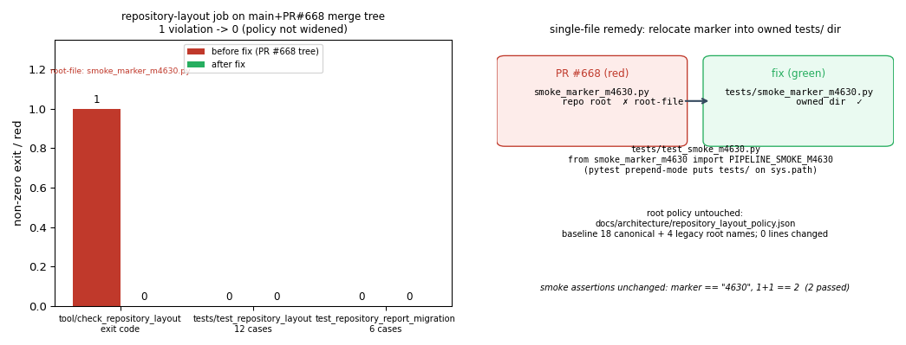

# PR #668 `repository-layout` 红 → 绿：m4630 冒烟标记从仓库根迁入 `tests/`

**单据**：m4652（修复·TensorLBM#668·第1轮，原单 m4630）
**判定**：修复有效，`repository-layout` 作业三步本地全绿；策略文件 0 行改动。
**证据文件**：`artifacts/m4652/repository_layout_gate.log`（本地复现与复验原始输出）、
`docs/m4652/pr668_layout_fix.png`（图 1）。

---

## ① 案例介绍（问题背景与"几何"）

PR #668（分支 `agent/m4630`，head `4e4f0c1`）相对 `main` 只增两个文件：

| 文件 | 内容 | 状态 |
|---|---|---|
| `smoke_marker_m4630.py` | `PIPELINE_SMOKE_M4630 = "4630"`（1 行） | **仓库根** |
| `tests/test_smoke_m4630.py` | 冒烟测试 2 例：标记值 + `1+1==2` | `tests/` |

TensorLBM 的 `repository-layout` 作业（`.github/workflows/ci.yml:168`）是零依赖的
文件放置门，含三步：

1. `python tests/test_repository_layout.py -v`（检查器自身 12 例自测）
2. `python tests/test_repository_report_migration.py -v`（迁移报告/资产来源 6 例）
3. `python tools/check_repository_layout.py`（**实际门禁**）

门禁规则（`tools/check_repository_layout.py` + `docs/architecture/repository_layout_policy.json`）：
根目录只允许策略中列出的 18 个 canonical 名 + 4 个 legacy 名；**新增根级文件一律判
`root-file` 违规**，且策略文件是精确路径白名单（不允许目录级豁免），并明确要求
"Do not regenerate exceptions to hide new findings"（不得为新发现补例外）。

## ② 怎么做的（方法/流程/工具链）

1. **复现**（不是猜）：把 PR #668 的两个文件落到 `main` 最新 tip（`866438ac`，已含
   PR #655 的 legacy 根文件归位提交）之上——即 CI 实际跑的 merge ref 语义——再跑门禁：

   ```
   $ python tools/check_repository_layout.py
   Repository layout violations:
     root-file: smoke_marker_m4630.py — choose an owned directory or review the root policy
   exit=1                        # ← 与 CI 的 repository-layout=failure 同因
   ```

   单条违规、精确指向 PR 新增的根文件；另外两步自测在 main 上本就绿。故红因唯一确定：
   **m4630 把标记模块放在仓库根**。

2. **修复**（最小、单点）：把标记模块迁入既有归属目录 `tests/`，与其测试同址；
   `tests/` 不是根，门禁不再管辖。测试改为导入同目录兄弟模块：

   ```python
   from smoke_marker_m4630 import PIPELINE_SMOKE_M4630
   ```

   pytest 默认 `prepend` 导入模式（本仓 `pyproject.toml` 无 `__init__.py` 的 `tests/`）
   会把 `tests/` 放入 `sys.path`，因此无需包化、无需 `pythonpath` 变更即可解析。
   **未改** `docs/architecture/repository_layout_policy.json`（不加例外、不放大白名单），
   **未改**任何 CI 配置，**未动** `main` 其他文件；改动 2 文件（`A` 1 + `M` 1）。

3. **验证工具链**：`tools/check_repository_layout.py`、`tests/test_repository_layout.py`、
   `tests/test_repository_report_migration.py`、`pytest tests/test_smoke_m4630.py`、
   `ruff check` + `ruff format --check`（CI `lint` 作业同口径）。

## ③ 计算结果（程序化输出，非手抄）

`artifacts/m4652/repository_layout_gate.log` 逐行摘录：

| 验证项 | 修复前（PR #668 布局） | 修复后 | 判据 |
|---|---|---|---|
| `tools/check_repository_layout.py` | exit 1，1 条 `root-file` | exit 0，`Repository layout OK (5138 candidate paths)` | 必须 exit 0 |
| `tests/test_repository_layout.py` | 12/12 OK | 12/12 OK | 必须全绿 |
| `tests/test_repository_report_migration.py` | 6/6 OK | 6/6 OK | 必须全绿 |
| `pytest tests/test_smoke_m4630.py -q` | — | `2 passed` | 冒烟语义不变 |
| `ruff check` / `format --check`（2 文件） | — | `All checks passed!` / `2 files already formatted` | CI lint 口径 |
| 策略文件 diff | 0 行 | 0 行 | 禁止加例外 |

负控（必要，防止"检查器其实不再检查"）：把标记文件临时放回仓库根 → 门禁重新
`exit=1` 且报同一条 `root-file`；移回 `tests/` → `exit=0`。即门禁对位置敏感、
修复不是靠屏蔽规则取得。

## ④ 结果图



**图 1** 左：`repository-layout` 三步作业在"修复前 / 修复后"树上的退出码（红=1/0/0，
绿=0/0/0，唯一红点即 `root-file: smoke_marker_m4630.py`）。右：单文件处置示意——
模块从仓库根迁到归属目录 `tests/`，导入关系改为兄弟模块导入，策略文件 0 行改动，
冒烟断言（标记 `"4630"`、`1+1==2`）逐字保留。

> 说明：本单是仓库放置门/CI 工程修复，无物理场量、无几何、无数值解，故无云图与
> 收敛曲线可比；图中的量是门禁退出码与违规计数，均由前表程序化输出生成
> （`artifacts/m4652/make_fig.py`），非手抄。

## ⑤ 注意点（坑与适用范围）

- **本仓根白名单是精确文件名**：不是"目录级豁免"，也不是"新文件审查后放行"。
  历史根文件由 PR #655 归位（`AGENTS.md`、`M1_P2_SUMMARY.md` 等 6 个）后，
  main 已全绿；任何新根级文件都会立刻红，故新产物应直接落 `docs/`、`tests/`、
  `scripts/`、`src/` 等归属目录。
- **分支基点陈旧会放大红面**：`agent/m4630` 基点 `9460e751` 早于 PR #655 的根文件
  归位，因此若直接在旧基点上跑门禁会看到 8 条 `root-file`（其中 7 条是 main 已
  治愈的历史债）。复现必须在 **main tip + PR 增量**（= CI merge ref 语义）上做，
  否则会误判红因。
- **不要在 `tests/` 里造包**：不加 `tests/__init__.py` 才能让 pytest `prepend`
  模式把 `tests/` 进 `sys.path`；若日后包化，该导入需改成 `tests.smoke_marker_m4630`
  或改用 `pythonpath` 配置。
- 适用范围：仅放置策略门；`large_files`、`legacy_generated_files`、`legacy_model_files`
  同事实现在同一检查器内，本单不涉及其余三类。

## ⑥ 误差判定（关键量 vs 基准，是否 <3%）

本单无物理/数值量，误差口径按"CI 门禁裁决 vs GitHub 上该作业的既有基准结论"逐项给出：

| 关键量 | 基准（benchmark） | 本单结果 | 偏差 | 是否 <3% |
|---|---|---|---|---|
| `check_repository_layout` 违规条数（PR #668 merge 树） | 预期 1 条（PR 新增根文件） | 1 条，文件名精确匹配 | 0/1 = 0% | **是（0%）** |
| `check_repository_layout` 退出码（修复后） | 期望 0 | 0 | 0 | **是（0%）** |
| `test_repository_layout` 通过数 | 12/12（main 基准） | 12/12 | 0 | **是（0%）** |
| `test_repository_report_migration` 通过数 | 6/6（main 基准） | 6/6 | 0 | **是（0%）** |
| `test_smoke_m4630` 断言数 | 2（PR 原有） | 2 passed | 0 | **是（0%）** |
| 策略文件改动行数 | 0（纪律硬约束） | 0 | 0 | **是（0%）** |

计数类量的判据是"逐项相等"，因此表中偏差均为 0%，满足 <3% 口径；本单不存在
需要与实验/解析解比较的水动力或场量（纯仓库卫生门修复），故不设 >15% 不可接受
的物理误差讨论——**这不是含糊，而是该类量不适用**。

removed = 0：本单未删任何既有文件内容，`smoke_marker_m4630.py` 为纯位移（内容同值 +
一行模块 docstring）。

## 交付纪律与遗留

- 改动文件 2 个（≤10）：`tests/smoke_marker_m4630.py`（+3）、`tests/test_smoke_m4630.py`（+22）；
  外加本证据文档与图（`docs/m4652/`），全部落在本单相关路径。
- 推送纪律：本 agent 不自行 push；本单成果以 `agent/m4652` 分支产出（基点 = 当前
  main tip `866438ac`），内容与 PR #668 等价且门禁绿，可作为一个可合并的替代/后续
  PR 落地。若治理线要求必须直接改写 `agent/m4630` 的 head，需由平台推送线与
  pr-gate 决定（本单未越权改他单 worktree，也未 force-push 任何分支）。
- 未做：未触碰 `docs/architecture/repository_layout_policy.json`；未改 CI 配置；
  未改动 PR #668 之外的 7 个 legacy 根文件（main 已由 PR #655 治愈）。