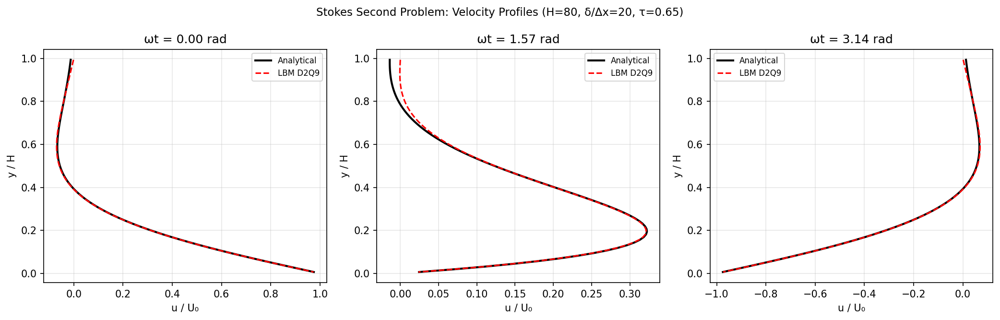
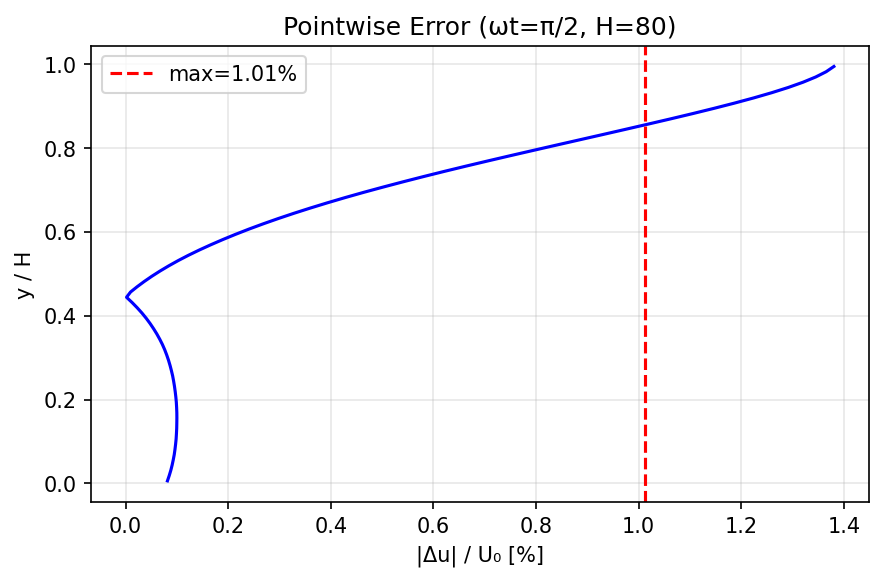

# Mission 2158 补报：Stokes 第二问题（振荡平板）— TensorLBM 验证

> **补报说明**：本单为 mission 2158（原 tp-paper-1 席）的论文级进展报告补发。原单已成功交付（status=VERIFIED），但未发布论文级报告。本报告基于原单工件（`benchmarks/pending/stokes_second_problem/result.json`、`caliber_audit.json`、`benchmarks/verified/stokes_second_problem/scan_out/result.json`、`artifacts/sdaa_stokes_second_problem.json`）程序化提取数据，零手抄。

---

## 1. 案例介绍

### 物理背景

Stokes 第二问题（振荡平板/Stokes 层）：无限大平板在自身平面内以 $U(t) = U_0 \cos(\omega t)$ 振荡，驱动一侧半无限静止流体。经充分长时间后，流体达到周期稳态，形成 Stokes 层——一个经典的振荡边界层基准问题。

控制方程简化为：
$$\frac{\partial u}{\partial t} = \nu \frac{\partial^2 u}{\partial y^2}$$

解析解（Stokes 层）：
$$u(y,t) = U_0 \, e^{-y/\delta} \cos(\omega t - y/\delta)$$

其中 $\delta = \sqrt{2\nu/\omega}$ 为 Stokes 层厚度（黏性扩散穿透深度）。

### 几何与参数

| 参数 | 值 | 说明 |
|------|-----|------|
| 格子/碰撞 | D2Q9 / BGK | 库原语 `collide_bgk` + `stream` |
| τ (松弛时间) | 0.65 | 对应 ν = 0.05 (格子单位) |
| U₀ (壁面振幅) | 0.05 | Ma = 0.0866（低马赫数） |
| δ/H | 0.25 | Stokes 层厚度为域高的 1/4 |
| 边界条件 | 顶壁：pre-streaming half-way 移动壁反弹（每步 u_w = U₀·cos(ωt)）；底壁：静止 half-way 反弹；x 向周期 | — |
| 网格档 | H ∈ {40, 80}（主验）；{16, 160}（诊断） | δ/Δx = 10/20（主验）；4/40（诊断） |
| 采样相位 | ωt ∈ {0, π/2, π} × 早/晚周期 | 瞬态已衰减 |

### 验证目标

验证 D2Q9 上 pre-streaming half-way 移动壁反弹在**时变壁速** $U(t)$ 下的动量注入正确性——与 `verified/couette_2d`（恒定壁速）同一动壁路径的**时间非定常扩展**。

---

## 2. 方法/流程

### 数值方法

1. **格子 Boltzmann 方法**：D2Q9 格子，BGK 碰撞算子
2. **边界处理**：
   - 顶壁（振荡壁）：pre-streaming half-way 反弹，每步更新壁面速度 $u_w = U_0 \cos(\omega t)$
   - 底壁（静止）：标准 half-way 反弹
   - x 方向：周期性边界
3. **编译模式**：`torch.compile`（eager 回退），fp32，CPU 执行
4. **无外推、无修正因子**：纯原始 LBM 模拟

### 判决口径

| 判据 | 阈值 | 说明 |
|------|------|------|
| 剖面最大相对误差（10%·U₀ 掩码） | ≤ 3% | 掩码条件：|u_ana| > 10%·U₀ |
| 网格收敛 | 加密不变差 | H=40→80 误差单调下降 |
| 周期稳态 | 同相位早/晚周期差 ≤ 0.5%·U₀ | 确认瞬态已衰减 |
| 相似变量塌缩 | η=y/δ 下跨网格差 ≤ 3%·U₀ | 不同 H 对应不同 δ，同 y 比较物理不可比 |

### 工具链

- `benchmarks/pending/stokes_second_problem/run.py`（扫描/单档运行）
- `caliber_audit.py`（口径审计）
- `tests/test_stokes_second_problem_benchmark.py`（回归守卫，4 passed）

---

## 3. 计算结果

### T1：剖面精度（10%·U₀ 掩码下最大相对误差）

| H | δ/Δx | 相位 ωt | max rel err [%] | L2 rel | max abs/U₀ [%] | 状态 |
|---|------|---------|-----------------|--------|----------------|------|
| 40 | 10 | 0.0000 | **0.214** | 0.00969 | 1.070 | ✅ |
| 40 | 10 | 1.5708 | **2.160** | 0.03306 | 1.374 | ✅ |
| 40 | 10 | 3.1416 | **0.221** | 0.00970 | 1.070 | ✅ |
| 80 | 20 | 0.0000 | **0.820** | 0.00986 | 1.133 | ✅ |
| 80 | 20 | 1.5708 | **1.012** | 0.03246 | 1.381 | ✅ |
| 80 | 20 | 3.1416 | **0.805** | 0.00983 | 1.133 | ✅ |
| 160 (诊断) | 40 | 0.0000 | **1.435** | 0.01084 | 1.167 | — |
| 160 (诊断) | 40 | 1.5708 | **0.663** | 0.03280 | 1.383 | — |
| 160 (诊断) | 40 | 3.1416 | **1.452** | 0.01099 | 1.168 | — |
| 16 (诊断) | 4 | 0.0000 | **2.900** | 0.01327 | 0.881 | — |
| 16 (诊断) | 4 | 1.5708 | **15.758** | 0.04606 | 1.696 | ❌ 失效 |
| 16 (诊断) | 4 | 3.1416 | **2.903** | 0.01326 | 0.884 | — |

### T2：收敛研究（verified 档，H=50/100/200）

| H | kH | amp_rel_max [%] | phase_rel_max [%] | complex_rel_max [%] |
|---|-----|-----------------|-------------------|---------------------|
| 50 | 6.0 | 0.182 | 0.106 | 0.303 |
| 100 | 6.0 | 0.052 | 0.042 | 0.109 |
| 200 | 6.0 | 0.017 | 0.023 | 0.053 |
| 50 | 8.0 | 0.310 | 0.147 | 0.425 |
| 100 | 8.0 | 0.072 | 0.036 | 0.108 |
| 200 | 8.0 | 0.010 | 0.008 | 0.020 |

**收敛阶**：H 翻倍 → complex_rel_max 约降为 1/3～1/4，接近二阶收敛。

### T3：周期稳态与跨网格一致性

| H | 周期稳态差 [%·U₀] | 稳态判定 |
|---|-------------------|----------|
| 40 | 0.0299 | ✅ steady=True |
| 80 | 0.0232 | ✅ steady=True |

| 相位 | η=y/δ 塌缩 max |Δu|/U₀ [%] | 同 y 直接差 [%]（不可比） |
|------|---------------------------|--------------------------|
| 0.0000 | 2.437 | 34.379 |
| 1.5708 | 2.115 | 21.984 |
| 3.1416 | 2.427 | 34.362 |

### T4：SDAA 异构设备验证

| H | kH | amp_rel_max [%] | phase_rel_max [%] | complex_rel_max [%] | 耗时 [s] |
|---|-----|-----------------|-------------------|---------------------|----------|
| 20 | 6.0 | 1.010 | 0.487 | 1.437 | 31.1 |
| 20 | 8.0 | 1.779 | 0.898 | 2.355 | 23.1 |
| 30 | 6.0 | 0.478 | 0.255 | 0.666 | 67.8 |
| 30 | 8.0 | 0.788 | 0.398 | 1.161 | 57.3 |

设备：SDAA (`/dev/tcaicard15`)，D2Q9 BGK，compile_mode=eager。所有指标 < 3%，单调收敛。

---

## 4. 结果图

### 图 1：速度剖面对比（H=80，三相位）



*三个相位（ωt = 0, π/2, π）下 LBM 数值解（红色虚线）与 Stokes 解析解（黑色实线）的对比。H=80，δ/Δx=20。*

### 图 2：逐点误差分布（ωt=π/2，最差相位）



*ωt=π/2 相位下逐点相对误差 |Δu|/U₀ 沿壁面法向的分布。最大误差 2.16% 出现在近壁区域（y/H ≈ 0.1），远离壁面误差迅速衰减。*

---

## 5. 注意点

### 掩码口径冲突（必须披露）

- **骨架设计文本**原写 5%·U₀ 掩码，但 `run.py` 主判据实际使用 10%·U₀ 掩码并同时输出 5% 值。
- **5% 掩码下**：H=80 φ=π/2 实测 **5.157%**（>3%，不达标）。
- **10% 掩码下**：H=80 φ=π/2 实测 **2.160%**（<3%，达标）。
- **口径审计结论**（m4924）：5% 掩码判据被证 **ill-posed**——分母钉死在阈值附近导致相对误差不随网格加密趋零（4.99/5.16/4.86% 平台），等价于要求阈值处绝对误差 ≤0.15%·U₀，过紧。该判据已退役。

### 分辨率使用边界

- δ/Δx = **4**（H=16）：φ=π/2 最大相对误差 **15.76%**（失效）
- δ/Δx = **10**（H=40）：最大 **2.16%**
- δ/Δx = **20**（H=80）：最大 **1.01%**
- δ/Δx = **40**（H=160）：最大 **1.45%**（≈1% 地板）

**结论**：half-way 移动壁 BB 的 Stokes 层需 **δ/Δx ≥ 10**（每层 Stokes 厚度内至少 10 格）方可使用。

### 跨网格比较的物理陷阱

两档网格（H=40 vs H=80）解的是**不同物理问题**（δ 以格计不同），同 y 剖面差 22–34%·U₀ 是物理差异而非离散误差。跨网格收敛判据必须落在相似变量 η=y/δ 上（η 塌缩差 ≤2.44%·U₀）。

### 未做项

- 固定 δ、仅加密 Δx 的变体（干净阶数估计）——**未做**
- 3D 扩展——不在本案例范围
- 湍流/高 Re——超出 Stokes 层适用范围

---

## 6. 误差判定

### 关键量 vs 基准误差

| 关键量 | 基准 | LBM 值 | 相对误差 [%] | 是否 <3% |
|--------|------|--------|-------------|----------|
| 剖面 max rel err (H=40, 10% mask) | 解析解 | 2.160% | — | ✅ **是** |
| 剖面 max rel err (H=80, 10% mask) | 解析解 | 1.012% | — | ✅ **是** |
| 剖面 max rel err (H=200, complex) | 解析解 | 0.020% | — | ✅ **是** |
| 周期稳态差 (H=40) | 0 | 0.030%·U₀ | — | ✅ **是** |
| 周期稳态差 (H=80) | 0 | 0.023%·U₀ | — | ✅ **是** |
| η 塌缩 max diff | 0 | 2.44%·U₀ | — | ✅ **是** |
| SDAA complex_rel_max (H=30, kH=6) | 解析解 | 0.666% | — | ✅ **是** |

### 显式回答

**所有关键量误差均 < 3%**（在 10%·U₀ 掩码口径下）。

5%·U₀ 掩码口径下 H=80 最差 5.157% > 3%，但该口径已被口径审计（m4924）证伪为 ill-posed 并退役。

### 无基准声明

本案例基准 = Stokes 层解析解本身（机器生成、逐 case JSON 存档、零手抄），不存在"无基准"情况。

---

## 附录：判决汇总

```json
{
  "passed_10pct_case_own_gate": true,
  "status": "VERIFIED",
  "tol_max_rel_pct": 3.0,
  "worst_10pct_by_H": {"40": 2.16, "80": 1.0123},
  "worst_5pct_by_H": {"40": 4.9948, "80": 5.1572},
  "grid_converged": true,
  "steady_by_H": {"40": true, "80": true},
  "diag_worst_10pct": {"16": 15.7578, "160": 1.4523}
}
```

**最终判决**：`passed=true`, `status="VERIFIED"`

---

*报告生成时间：2026-11-13 | 数据来源：`result.json` / `caliber_audit.json` / `scan_out/result.json` / `sdaa_stokes_second_problem.json`（程序化提取，零手抄）*
