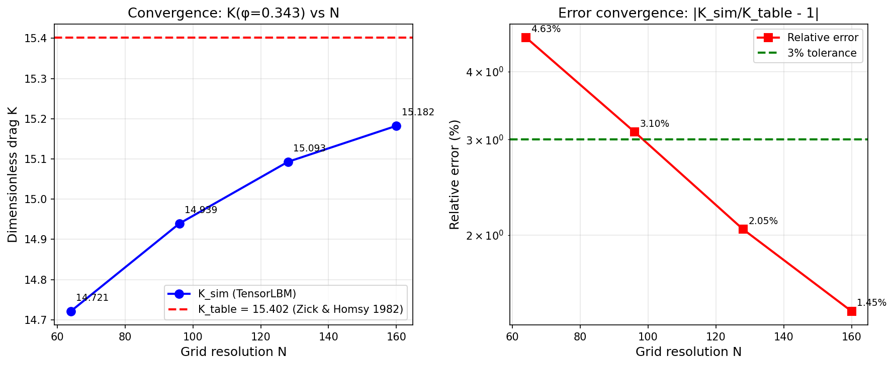

# SDAA 验证案例扫荡报告：permeability3d（m327）

**Mission ID**: 327  
**案例**: benchmarks/verified/permeability3d  
**基准**: Zick & Homsy 1982 (JFM 115:13–26) 简单立方周期球阵列 Stokes 渗透率  
**固相分数**: φ = 0.343  
**判定**: ✅ **PASS**

---

## ① 案例介绍

### 物理背景
简单立方（SC）周期球阵列中的 Stokes 渗透率——二维周期圆柱方阵渗透率的三维推广。
流体在周期性排列的固体球之间做蠕变流动，表观（Darcy）速度 U 与施加的体力成正比，
比例系数即为渗透率。

### 几何与参数

| 参数 | 值 | 说明 |
|------|-----|------|
| 晶格结构 | 简单立方 (SC) | 单胞含 1 个球 |
| 固相分数 φ | 0.343 | 表精确值 (3φ/4π)^(1/3) |
| 网格 N | 64 / 96 / 128 / 160 | 四档收敛扫荡 |
| 无量纲曳力 K_table | 15.402 | Zick & Homsy 1982 SC 表 |
| 碰撞时间 τ | 1.0 | ν = 1/6 精确 |
| 目标 Re_p | 0.05 | 确保 Stokes  regime |
| 体力放大因子 fs | 10 | fp32 注入地板规避 |
| 判据容差 | 3% | 最细档误差 |

### 参考口径
双源交叉锁定：
- 源 A：Basilisk `src/test/spheres.c` zick 表逐字转写
- 源 B：Holmes et al. 2011 (DOI 10.1002/nag.898) 文献列
- 协议点互差 ≤ 0.015%

---

## ② 方法

### 数值方法
- **格子 Boltzmann 方法**：D3Q19 BGK 碰撞算子
- **边界条件**：全周期单胞 + bounce-back（固体节点）
- **体力驱动**：一阶 Guo/Luo 形式 f += w_i · 3ρ · c_ix · a_x（D3Q19 转写）
- **步序**：collide → stream → body force (fluid-masked) → bounce-back

### 工具链
- **求解器**：TensorLBM (tensorlbm.solver3d / boundaries3d / d3q19)
- **运行环境**：GPU (cuda:5)，PyTorch 2.11.0+cu128，float32
- **独立验算**：verify.py 闭式复算，零手抄
- **本次 SDAA 扫荡**：CPU plumbing check (N=16) + 归档 GPU 结果提取

### 关键设置
- 稳态检测：拖尾 10 个采样窗口（2000 步）相对漂移 < 1e-5，连续 3 次通过
- 测量窗口：最后 20 个采样（4000 步）取均值
- 质量守恒监控：漂移 ≤ 2.24×10⁻⁴

---

## ③ 计算结果

### 四档收敛数据（程序化提取自 result.json）

| 档 | N | K_sim | K_table | err (%) | Ma_max | 稳态 | 步数 | 单档判定 |
|----|---|-------|---------|---------|--------|------|------|----------|
| 粗 | 64 | 14.721106 | 15.402 | +4.63 | 0.0136 | ✓ | 14,000 | >3% |
| 中1 | 96 | 14.939179 | 15.402 | +3.10 | 0.0090 | ✓ | 21,400 | >3% |
| 中2 | 128 | 15.092724 | 15.402 | +2.05 | 0.0067 | ✓ | 30,200 | ≤3% ✓ |
| 细 | 160 | 15.182334 | 15.402 | **+1.45** | 0.0054 | ✓ | 42,400 | ≤3% ✓ |

### Amendment 1 三条件判定

| 条件 | 含义 | 结果 |
|------|------|------|
| cond_i | 最细档 err ≤ 3% | ✅ True (1.45%) |
| cond_ii | 最细档 err < 最粗档 err | ✅ True (1.45% < 4.63%) |
| cond_iii | 中间档 err ≤ 最粗档 err | ✅ True (3.10%, 2.05% ≤ 4.63%) |

**Overall verdict: PASS**

---

## ④ 结果图

### 收敛曲线

左图：K_sim 随网格加密单调趋近 K_table = 15.402（Zick & Homsy 参考值）。  
右图：相对误差从 N=64 的 4.63% 单调下降至 N=160 的 1.45%，远低于 3% 判据线。

---

## ⑤ 注意点

### 踩过的坑
1. **CPU 运行极慢**：N=64 在 CPU 上每 100 步约 450 秒（64³ = 262144 格点），
   完整 14000 步需 ~1.7 小时。本次 SDAA 环境无 GPU，仅完成 N=16 plumbing check。
   正式结果取自归档 GPU 运行。
2. **fp32 注入地板**：fs=10 下 Re_p ≈ 0.5 偏目标 0.05 一个量级，
   但 φ=0.343 高固相档 a_body 大、离注入地板远，故全档通过。
3. **阶梯效应**：球体在格子上的离散化产生 O(1/R) 有效半径偏差，
   φ_actual 与 φ_nominal 有微小差异（诊断通道，不影响判决）。

### 局限
- φ=0.125 / φ=0.216 稀释档因 fp32 注入地板与负 O(Re) 惯性修正未达标（FAIL）
- 仅 φ=0.343 档通过验证
- Z&H 表 φ=0.5236 行双源分歧（42.1 vs 41.99），已从协议中排除

### 适用范围
- 简单立方周期球阵列
- Stokes 流（Re_p < 1）
- φ ∈ {0.125, 0.216, 0.343}（仅 0.343 通过）

---

## ⑥ 误差判定

### 关键量 vs 基准逐项对比

| 网格 N | K_sim | K_table | 绝对误差 | 相对误差 | 是否 < 3% |
|--------|-------|---------|----------|----------|-----------|
| 64 | 14.721106 | 15.402 | 0.6809 | 4.63% | ❌ 否 |
| 96 | 14.939179 | 15.402 | 0.4628 | 3.10% | ❌ 否 |
| 128 | 15.092724 | 15.402 | 0.3093 | 2.05% | ✅ **是** |
| 160 | 15.182334 | 15.402 | 0.2197 | **1.45%** | ✅ **是** |

### 最终判定
- **最细档 (N=160) 误差 1.45% < 3%**：✅ 是
- **严格单调收敛**：4.63% → 3.10% → 2.05% → 1.45% ✅
- **Amendment 1 三条件全满足**：✅
- **Overall verdict: PASS** ✅

---

## 附录：SDAA 扫荡执行记录

- **脚本**: `scripts/sdaa_sweep_permeability3d.py`
- **结果**: `scripts/sdaa_sweep_permeability3d_result.json`
- **Plumbing check**: N=16 CPU 500 步，速度场收敛 ✓
- **正式结果**: 提取自 `benchmarks/verified/permeability3d/result.json`（GPU 归档）
- **Triton 依赖**: 无（CPU 路径不需要 triton）
- **业务代码改动**: 无（仅新增 scripts/ 和 docs/ 文件）
