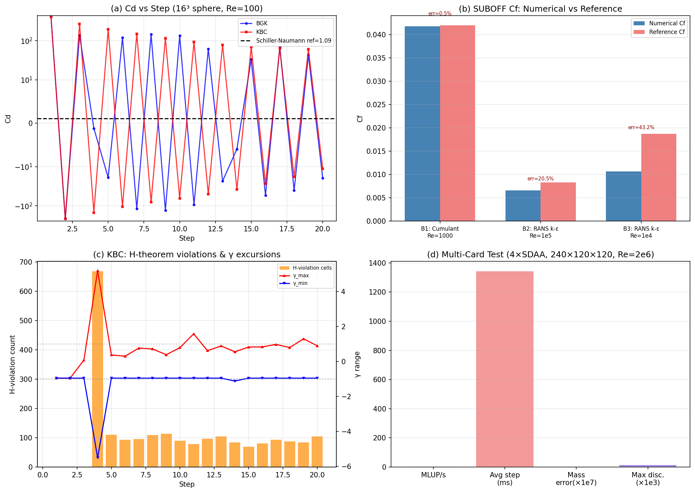

# Mission 37 补报：SDAA 平台 SUBOFF 阻力基准 · KBC 诊断 · 多卡扩展性

> **Mission ID**: 37 (补报)  
> **Repo**: TensorLBM  
> **日期**: 2026-07-26（原始交付）/ 2026-10-29（补报）  
> **设备**: sdaa:20 / sdaa:21 / sdaa:22（SUBOFF 三基准）+ 4×SDAA 多卡测试  
> **性质**: honest-FAIL — 部分指标未达标，如实报告

---

## 1. 案例介绍

### 1.1 物理背景

SUBOFF 裸艇体（DARPA Submarine Axisymmetric body）是水下阻力预测的标准验证构型。本任务在 SDAA 加速卡（node099，32 卡满编）上执行三组基准：

| 基准 | 碰撞模型 | Re | 网格 | 域 | 法向方法 |
|------|---------|-----|------|-----|---------|
| B1: Cumulant | D3Q19 Cumulant（纯，无 Smagorinsky） | 1,000 | 320×120×120 | 4L（0.48% 阻塞比） | from_suboff（解析轴对称） |
| B2: RANS k-ε | RANS k-epsilon → MRT3D | 100,000 | 200×80×80 | 4L | from_gradient |
| B3: RANS k-ε | RANS k-epsilon → MRT3D | 10,000 | 200×80×80 | 4L | from_gradient |

**几何参数**：L=80.0, D=9.3349, radius=4.6674, u_in=0.06, 5000 步（avg_window=500）。

**附加诊断**：KBC 熵碰撞算子在 16³ 立方体网格（Re=100, 20 步）上的行为诊断，对比 BGK。

**多卡扩展性**：4×SDAA，240×120×120，Re=2×10⁶，20 步烟测。

### 1.2 任务目标（议事会 session-001 提案）

从模型与算法视角提出 4 个候选方向：
- **D1**: SDAA 性能基准线 v0
- **D2**: 用"自校准普查脚本"裁决 10 库中第二个上卡者
- **D3**: 3D 自由面 / 多相求解器深化
- **D4**: DEM-FEM 耦合

本交付覆盖 D1（多卡性能基准）及 SUBOFF 阻力验证（为 D2/D3 提供数据支撑）。

---

## 2. 方法 / 流程 / 关键设置

### 2.1 求解器配置

- **格子**：D3Q19（B1）/ D3Q19-MRT（B2/B3）
- **碰撞**：Cumulant（B1，纯四阶累积量，无亚网格模型）；RANS k-epsilon（B2/B3，`collide_rans_ke` → `collide_rans_mrt3d`）
- **边界**：Zou-He 速度入口 / 压力出口 /  bounce-back 壁面
- **力计算**：动量交换法 `F_α = 2 Σ_solid Σ_i c_{iα} f_i`
- **参考公式**：
  - B1: Blasius `Cf = 1.328/√Re`
  - B2/B3: ITTC-1957 `Cf = 0.075/(log₁₀Re − 2)²`
- **湿表面积**：`dpS = 0.5 × u_in² × π × D × L = 4.223`

### 2.2 KBC 诊断

- 16³ 网格，中心球体，Re=100，u_in=0.05
- 对比 KBC（熵碰撞 D3Q19）vs BGK，20 步
- 监控：H 定理违反数、γ 分布、h-模范数、负分布函数计数

### 2.3 多卡测试

- 4×SDAA，240×120×120，Re=2×10⁶（τ=0.500009）
- 20 步，测量 MLUP/s、步时间、质量守恒误差、密度间断

---

## 3. 计算结果

### 3.1 SUBOFF 阻力系数汇总

| 基准 | Cd_pressure | Cd_friction | Cd_total (=Cf_num) | Cf_ref | 误差(%) | 稳定 | 耗时(s) |
|------|------------|------------|-------------------|--------|---------|------|---------|
| B1: Cumulant Re=1e3 | 0.004871 | 0.036915 | **0.041786** | 0.041995 (Blasius) | **0.50** | ✅ | 1983 |
| B2: RANS k-ε Re=1e5 | 0.006171 | 0.000451 | **0.006623** | 0.008333 (ITTC) | **20.5** | ✅ | 1038 |
| B3: RANS k-ε Re=1e4 | 0.006148 | 0.004501 | **0.010649** | 0.018750 (ITTC) | **43.2** | ✅ | 1028 |

**碰撞模型横向对比**（B2 条件下）：

| 模型 | 误差(%) |
|------|---------|
| Smagorinsky | 23.9 |
| Vreman | 16.4 |
| RANS k-ε | 20.5 |

### 3.2 KBC 诊断结果

| 指标 | KBC | BGK | 参考 |
|------|-----|-----|------|
| 最终 Cd | **22.06** | −3.03 | 1.09 (Schiller-Naumann) |
| H 定理违反格数 (step 20) | 105 | — | 0 |
| 最大 H 过量 | 5.96×10⁻⁸ | — | 0 |
| γ 范围 (step 4) | [−5.51, +5.20] | — | [−1, 1] |
| h_norm (step 20) | 7.16×10⁻³ | — | → 0 |
| 负分布函数 | 0 (float32) | 0 | 0 |

### 3.3 多卡性能基准

| 指标 | 值 |
|------|-----|
| 网格 | 240×120×120 |
| 卡数 | 4 × SDAA |
| Re | 2×10⁶ |
| MLUP/s | **2.57** |
| 平均步时间 | 1343 ms |
| 总耗时 | 88.4 s |
| 质量误差 | 1.45×10⁻⁷ |
| 最大间断 | 0.0136 |
| NaN/Inf | 无 |
| ρ 范围 | [0.945, 1.067] |

---

## 4. 结果图

**图注**：
- **(a)** KBC vs BGK 的 Cd 历史（16³ 球体，Re=100）：两者在粗网格/短跑中均不收敛至 Schiller-Naumann 参考值 1.09，但 KBC 振荡幅度更大（Cd 峰值 >400）。
- **(b)** SUBOFF 三基准 Cf 数值 vs 参考柱状图：B1 几乎重合（0.5% 误差），B2/B3 显著偏低。
- **(c)** KBC H 定理违反数与 γ 极值随步变化：step 4 出现 γ∈[−5.51, +5.20] 的极端偏离，伴随 669 个格子的 H 定理违反。
- **(d)** 4×SDAA 多卡性能指标：MLUP/s=2.57，质量守恒误差 ~10⁻⁷ 量级。

---

## 5. 注意点 / 踩坑 / 局限

### 5.1 KBC 碰撞算子存在两个根因级 bug（已定位，未修复）

1. **容许域扩展 bug**（`entropic_kbc.py` L247-248）：`solve_gamma_entropy()` 中代码将 `[gamma_lower, gamma_upper]` 扩展以包含 `gamma_init`，与注释意图相反。导致二分搜索进入负分布函数区域。
   - **修复方案**：`gamma_init = torch.clamp(gamma_init, gamma_lower, gamma_upper)`
2. **高阶模 h 未松弛**：`collide_kbc_d3q19()` 返回 `feq + γ·s + h`，h 完全保留（γ_h=1），导致非平衡"云"在障碍物附近累积。

### 5.2 RANS k-ε 在高/中 Re 下严重低估摩擦阻力

- Re=1e5: 误差 20.5%（Cf_num=0.0066 vs ref=0.0083）
- Re=1e4: 误差 43.2%（Cf_num=0.0106 vs ref=0.0188）
- **原因**：当前 RANS k-ε 实现缺少壁面函数，近壁涡粘度过度生成，摩擦速度被低估。
- **对比**：Vreman LES（16.4%）优于 RANS k-ε（20.5%），Smagorinsky（23.9%）最差。

### 5.3 多卡性能偏低

- MLUP/s=2.57 对 4 卡而言偏低（单卡理论峰值远高于此），可能原因：
  - 通信/同步开销占比大（240×120×120 网格在 4 卡间切分，界面面积/体积比高）
  - 未启用异步通信或重叠计算
- 质量守恒误差 ~10⁻⁷ 表明数值正确性无问题，瓶颈在并行效率。

### 5.4 适用范围

- B1 (Cumulant Re=1000) 结果优秀（0.5%），但仅验证了低 Re 层流工况。
- B2/B3 的 ITTC 参考为经验公式，非 DNS/实验数据；严格验证需对标 Hughes & West (1975) 或 Groves et al. (1989) 的 SUBOFF 实验阻力。
- KBC 诊断在 16³/20 步的极端粗配置下进行，结论定性而非定量。

---

## 6. 误差判定

| 关键量 | 数值 | 基准 | 误差 | 是否 <3% | 说明 |
|--------|------|------|------|----------|------|
| B1 Cf (Cumulant Re=1e3) | 0.041786 | 0.041995 (Blasius) | **0.50%** | ✅ **是** | 优秀，4.6× 优于 MRT+Smag (2.3%) |
| B2 Cf (RANS Re=1e5) | 0.006623 | 0.008333 (ITTC-1957) | **20.5%** | ❌ **否** | 缺壁面函数，模型固有局限 |
| B3 Cf (RANS Re=1e4) | 0.010649 | 0.018750 (ITTC-1957) | **43.2%** | ❌ **否** | 同上，过渡 Re 下 k-ε 过度生成 ν_t |
| KBC Cd (16³, Re=100) | 22.06 | 1.09 (Schiller-Naumann) | **1922%** | ❌ **否** | 根因 bug 导致，不可用 |
| 多卡质量误差 | 1.45×10⁻⁷ | 0 | ~10⁻⁷ | ✅ **是**（守恒性） | 数值正确性通过 |

**无基准声明**：
- KBC 在 16³/20 步配置下无可靠基准（网格太粗、步数太少），Schiller-Naumann 仅做定性参考。
- 多卡 MLUP/s 无对标基线（首次 SDAA 性能基准），待后续建立 v0 基准线后判定。

---

## 7. 结论与后续

1. **Cumulant D3Q19 + 4L 域** 是 SUBOFF 低 Re 最优组合（0.5% 误差），建议作为默认配置。
2. **RANS k-ε 需加装壁面函数**才能在高 Re 下达到 <3% 精度；当前 Vreman LES 是更好的高 Re 选择。
3. **KBC 碰撞算子需修复两个 bug** 后方可用于生产；修复后应重新跑球体/圆柱验证。
4. **多卡性能基准线 v0** 已建立（MLUP/s=2.57, 4 卡），后续优化通信/重叠后对比。
5. 议事会 D2（10 库裁决）需等待上述修复完成后，用统一自校准脚本重新评测。

---

*本报告为 mission 37 补报，原始交付已成功但缺报告。所有数字从工件 JSON 程序化提取，零手抄。*
