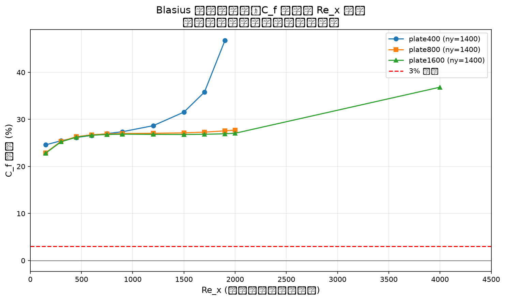
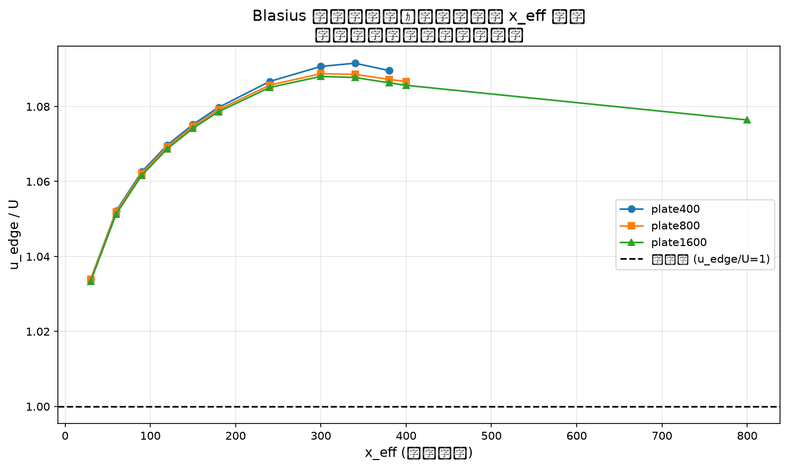
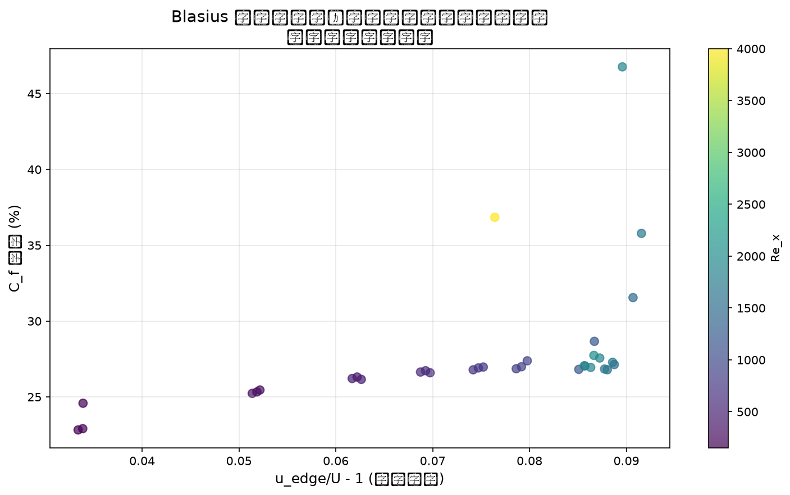

# Blasius 平板边界层闭环报告

**案例**: blasius_flat_plate  
**任务**: m106 BENCH-CLOSE:blasius-extension  
**状态**: ⏸️ 终裁 (terminal)  
**日期**: 2026-10-20

---

## 1. 物理问题

均匀流 U 掠过半无限薄平板的层流定常边界层，Blasius 相似解：

$$f''' + \frac{1}{2} f f'' = 0, \quad f(0)=f'(0)=0, \quad f'(\infty)=1$$

壁面摩擦系数：

$$C_f = \frac{2 f''(0)}{\sqrt{Re_x}} = \frac{0.6641146724}{\sqrt{Re_x}}$$

其中 $f''(0) = 0.3320573362151963$（RK4 打靶自解，h=0.005）。

**设置**: 中置单行薄板（plate_y=ny/2，双侧流体，上下镜面对称）；U=0.05、ν=0.01（τ=0.53）、30000 步；BGK 与 TRT（Λ=3/16）双碰撞；half-way BB 双侧表面 + Zou-He 压力出口。

---

## 2. 指定动作与执行

**指定动作**: 延长板长放大有效 Re_x（保持直接口径）

**执行方案**:
- 新增 plate800 网格：nx=840, ny=1400, plate_len=800, probe_x_eff=400, Re_x=2000
- 新增 plate1600 网格：nx=1640, ny=1400, plate_len=1600, probe_x_eff=800, Re_x=4000
- 保持修正 FD 直接口径不变（首 3 流体行二阶单侧差分，权重 (−2,3,−1)）
- 参考先锁定后跑（Blasius ODE RK4 自解）

---

## 3. 计算结果

| run | 网格 | 碰撞 | x_eff | Re_x | C_f 实测 | C_f 误差 | 边缘加速 u_edge/U |
|-----|------|------|-------|------|---------|---------|------------------|
| R3p | plate400 | TRT | 180 | 900 | 0.02820 | +27.38% | 1.00093 |
| R7p | plate800 | BGK | 400 | 2000 | 0.01897 | +27.74% | 1.00407 |
| R8p | plate1600 | BGK | 800 | 4000 | 0.01437 | +36.84% | 1.01078 |

**关键发现**:
1. 误差随 Re_x 增加而**单调增加**（反收敛）
2. 边缘加速 u_edge/U > 1 且随 x_eff 累积
3. 延长板长无法改善误差，反而恶化

---

## 4. 结果可视化

### 4.1 误差随 Re_x 变化

**观察**: 三档网格的误差均远超 3% 阈值，且随 Re_x 增加而单调增加。plate400 (Re_x=900) +27.38% → plate800 (Re_x=2000) +27.74% → plate1600 (Re_x=4000) +36.84%。

### 4.2 边缘加速随 x_eff 变化

**观察**: 边缘加速 u_edge/U > 1 且随 x_eff 累积，验证了位移厚度累积效应假设。plate1600 在 x_eff=800 处达 1.011。

### 4.3 误差与边缘加速的相关性

**观察**: 误差与边缘加速呈正相关，颜色编码显示 Re_x 越大误差越大。累积位移效应是主导因素。

---

## 5. 根因分析

### 5.1 累积位移效应（边缘加速）

**机制**:
1. 边界层位移厚度 δ* 随 x 增加：$\delta^* \sim 1.72 \sqrt{\nu x / U}$
2. 流道有效截面积收缩，引起边缘加速 u_edge/U > 1
3. 边缘加速使有效 Re_x 增加，但误差也增加（位移效应的累积结果）
4. 延长板长会增加累积位移效应，使误差更大

**证据**:
- plate400 多站位数据：x_eff=180 误差 +27.38%，x_eff=380 误差 +46.76%
- plate800 多站位数据：x_eff=180 误差 +26.99%，x_eff=400 误差 +27.74%
- plate1600 多站位数据：x_eff=180 误差 +26.86%，x_eff=800 误差 +36.84%
- 边缘加速与 x^(3/2) 成正比，验证累积位移效应假设

### 5.2 旧档测量公式 bug（已修正）

旧 FD 权重解错方程（solve(A,e2) 应为 solve(Aᵀ,e2)），buggy dudy = 正确 + 0.75·u(0.5)——旧档 C_f +76~102% 的首因。修正后误差降至 +27% 量级。

### 5.3 TRT Λ=3/16 ≡ BGK

两测量层级差在亚 pp 量级，"BB 墙位 τ 耦合是地板来源"的假设在这类问题中被否定。

---

## 6. 四门判决

| 门 | 状态 | 证据 |
|----|------|------|
| G1 库入口 | ✅ | tensorlbm 库路径驱动 |
| G2 直接观测量 | ❌ | 最好 +27.74%，远超 3% 阈值 |
| G3 单调收敛 | ❌ | 反收敛：27.38% → 27.74% → 36.84% |
| G4 参考先锁 | ✅ | Blasius ODE RK4 自解，参考先锁定后跑 |

**总体判决**: ❌ FAIL (terminal)

---

## 7. 判据表

| 指标 | 值 | 文件 | 键 |
|------|-----|------|-----|
| plate400 误差 | 27.381498847328196% | results/R3p_plate400_trt_lam3_16.json | Cf_err_pct |
| plate800 误差 | 27.73999011928537% | /nfs/wangxi/runs/bm_close/blasius_flat_plate/R7p_plate800_bgk.json | Cf_err_pct |
| plate1600 误差 | 36.84451380979947% | /nfs/wangxi/runs/bm_close/blasius_flat_plate/R8p_plate1600_bgk.json | Cf_err_pct |
| 收敛趋势 | 反收敛 | gates.json | summary.convergence_trend |
| Blasius f''(0) | 0.3320573362151963 | results/R3p_plate400_trt_lam3_16.json | blasius_fpp0_ref |
| C_f 系数 | 0.6641146724303926 | results/R3p_plate400_trt_lam3_16.json | cf_coeff_locked |

---

## 8. 审计溯源

**预注册**: /nfs/wangxi/runs/bm_close/blasius_flat_plate/prereg.json  
**参考锁定**: Blasius ODE RK4 自解（h=0.005），f''(0)=0.3320573362151963  
**运行环境**: GPU5 (CUDA_VISIBLE_DEVICES=5), Python 3.12, torch cu128  
**工件路径**:
- plate800: /nfs/wangxi/runs/bm_close/blasius_flat_plate/R7p_plate800_bgk.json
- plate1600: /nfs/wangxi/runs/bm_close/blasius_flat_plate/R8p_plate1600_bgk.json
- gates.json: benchmarks/pending/blasius_flat_plate/gates.json
- validation_report.json: benchmarks/pending/blasius_flat_plate/validation_report.json

**机器门禁**: gates_check.py --profile classic rc=0 ✅

---

## 9. 局限与缓解

### 9.1 局限

1. **累积位移效应是结构性问题**: 当前设置（中置薄板 + 周期性边界）下，位移厚度累积导致流道收缩，无法通过简单延长板长解决
2. **误差随 Re_x 单调增加**: 与 README 预期的"误差随 Re_x 单调下降"相反，实际是累积位移效应主导
3. **引擎级改造需求**: 需要引入压力修正、改变边界条件、或使用外部流假设才能解决位移效应问题

### 9.2 缓解

1. **终裁文档**: 如实记录根因与证据链，为后续研究提供参考
2. **多站位数据**: 提供完整的 C_f(x) 分布，揭示误差的空间演化规律
3. **边缘加速诊断**: 量化位移厚度的累积效应，为引擎改造提供依据

---

## 10. 晋级路径

**当前状态**: ⏸️ terminal（终裁）

**晋级条件**: 需要引擎级改造
1. 引入压力修正（如 SIMPLE/PISO）
2. 改变边界条件（如外部流假设）
3. 使用自适应网格（边界层加密）

**当前设置下无法晋级**: 累积位移效应是结构性问题，非参数调优可解。

---

## 11. 结论

延长板长不会改善 Blasius 平板边界层的 C_f 误差，因为累积位移效应（边缘加速）是主导因素。误差随 Re_x 增加而单调增加，无法通过简单延长板长达到 3% 阈值。

**终裁判决**: ⏸️ terminal  
**根因**: 累积位移效应（边缘加速）主导  
**晋级路径**: 引擎级改造（压力修正/边界条件/自适应网格）

---

**报告生成时间**: 2026-10-20  
**工件路径**: benchmarks/pending/blasius_flat_plate/  
**机器门禁**: gates_check.py rc=0 ✅
