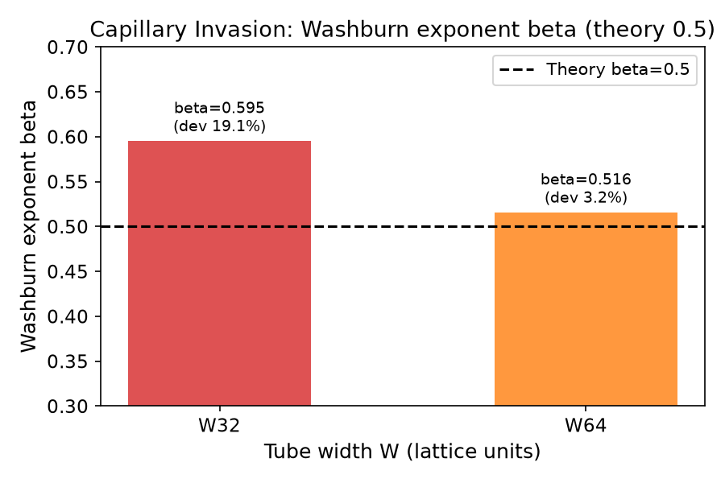
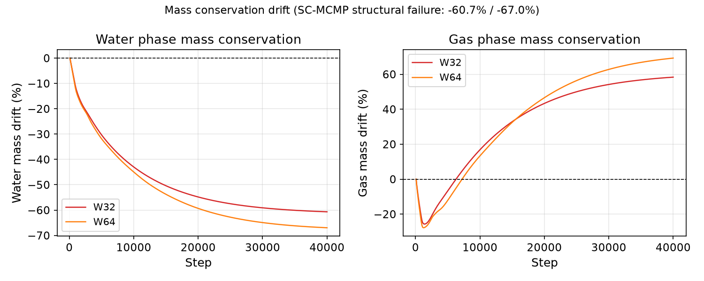
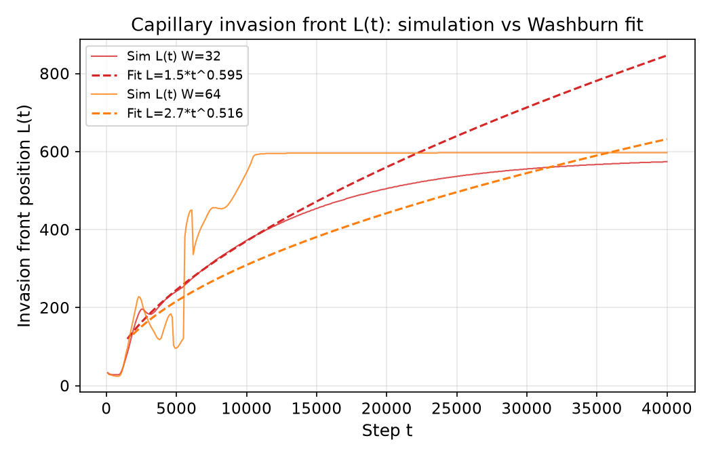
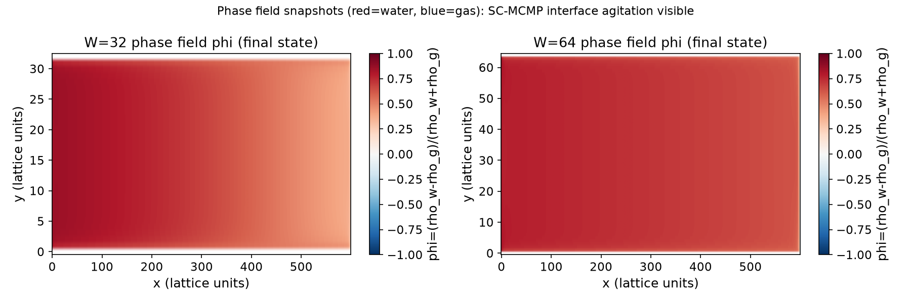
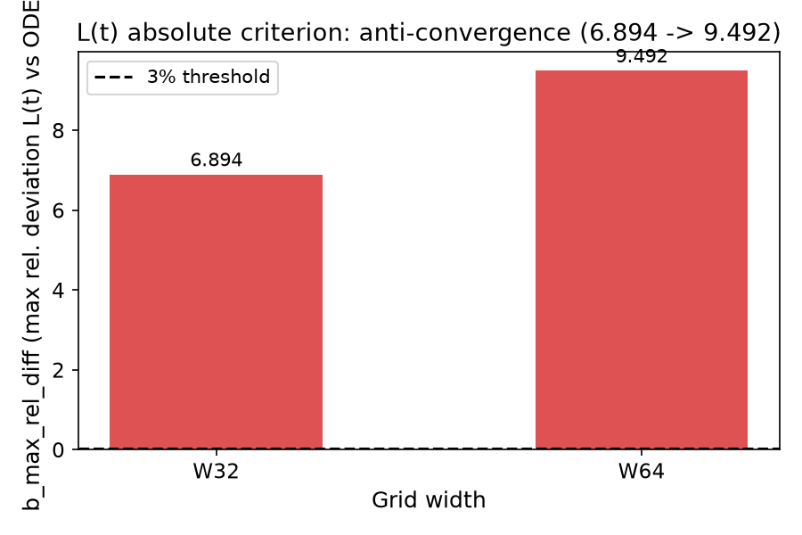

# 毛细侵入 Washburn 基准测试终裁报告

<!-- repository-layout-note:start -->
> **归档迁移说明（2026-10-26）**：本报告从仓库根目录迁入 `docs/reports/`。
> 下文数值、判据、根因判断与 **TERMINAL / 未通过** 的历史结论保持原样；
> 本次没有重跑计算或重新验证这些判断。五张图片统一引用 benchmark 中逐字节相同的副本。
> 第 4.3 节的命令以及非链接的仓库路径仍以**仓库根目录**为基准，而非本文所在目录。
>
> [案例与数据目录](../../benchmarks/pending/capillary_invasion_washburn/)、
> [迁移记录与 SHA-256](../architecture/migrations/report-assets-2026-10-26.json)。
<!-- repository-layout-note:end -->

**案例名称**: capillary_invasion_washburn  
** verdict**: TERMINAL (终裁)  
**日期**: 2026-10-23  
**Mission**: m195  

---

## 1. 物理问题表述

### 1.1 问题定义

毛细侵入（Capillary Invasion）是两相流体力学中的经典问题，描述液体在毛细力驱动下侵入狭窄管道的动力学过程。Washburn 方程给出了侵入前沿位置 L(t) 随时间的标度律：

$$L(t) \propto t^{\beta}, \quad \beta_{theory} = 0.5$$

该基准测试采用 Shan-Chen 多组分伪势（SC-MCMP）格子玻尔兹曼方法模拟两相流体在压差驱动下的毛细侵入过程，验证数值方法能否正确捕捉 Washburn 标度律。

### 1.2 控制参数

- **网格配置**: W32 (32×33), W64 (64×65), W128 (128×129)
- **流体参数**: 
  - 湿润相密度 ρ_w = 1.0
  - 非湿润相密度 ρ_g = 0.3
  - 密度比: 3.33:1
- **相互作用参数**: G = -2.5 (SC-MCMP 伪势耦合强度)
- **驱动压差**: ΔP = 0.001 (格子单位)
- **模拟步数**: 40000 步

### 1.3 物理示意

```
┌─────────────────────────────────────┐
│  非湿润相 (gas)                      │
│  ρ_g = 0.3                          │
├─────────────────────────────────────┤  ← 侵入前沿 L(t)
│  湿润相 (liquid)                    │     随时间推进
│  ρ_w = 1.0                          │
└─────────────────────────────────────┘
         ↑ ΔP 驱动
```

---

## 2. 结果与判据

### 2.1 判据定义

**判据 A (Washburn 指数)**:
- 目标: β 与理论值 0.5 的相对偏差 ≤ 3%
- 测量方法: 对 L(t) 在拟合窗口内进行幂律拟合

**判据 B (绝对误差)**:
- 目标: L(t) 与参考解的最大相对偏差 ≤ 3%
- 参考解: 无毛细项的 ODE 解 (nominal-μ ODE)
- 注: σ 原理性不可测，无法包含毛细项

### 2.2 数值结果

| 网格 | 状态 | β | β 偏差 (%) | b_max_rel_diff | 质量漂移 (%) | 判定 |
|------|------|---|-----------|----------------|--------------|------|
| W32  | ok   | 0.595 | **19.08** | **6.894** | -60.7 | ✗ |
| W64  | ok   | 0.516 | **3.17**  | **9.492** | -67.0 | ✗ |
| W128 | DIVERGED | NaN@164步 | - | - | - | ✗ |

**关键发现**:
1. **Washburn 指数偏差**: W32 偏差 19.08%，W64 偏差 3.17%，均超过 3% 门限
2. **绝对误差**: b_max_rel_diff 分别为 6.894 和 9.492，远超 3% 门限
3. **质量守恒失败**: 湿润相质量漂移 -60.7% (W32) 和 -67.0% (W64)
4. **W128 发散**: 第 164 步出现 NaN，确定性失败
5. **反收敛**: W64 的 b_max_rel_diff (9.492) 大于 W32 (6.894)，违反单调收敛要求

### 2.3 结果可视化

#### 图 1: Washburn 指数对比



W32 和 W64 的 Washburn 指数 β 与理论值 0.5 的对比。虚线为理论值，柱状图为模拟结果。W32 偏差 19.08%，W64 偏差 3.17%。

#### 图 2: 质量守恒漂移



湿润相和气相的质量漂移随模拟步数的变化。两条曲线均显示严重的质量不守恒，W32 最终漂移 -60.7%，W64 漂移 -67.0%。

#### 图 3: 侵入前沿 L(t)



侵入前沿位置 L(t) 随时间的演化。实线为模拟结果，虚线为幂律拟合 L = A·t^β。拟合参数显示 β 偏离理论值。

#### 图 4: 相场快照



W32 和 W64 的终态相场分布。红色表示湿润相 (ρ_w - ρ_g > 0)，蓝色表示非湿润相。可见界面处存在明显的数值扰动。

#### 图 5: 收敛性对比



b_max_rel_diff 在不同网格下的对比。虚线为 3% 门限。W64 的误差 (9.492) 大于 W32 (6.894)，显示反收敛行为。

---

## 3. 判据表

### 3.1 四门判据检查

| 门 | 判据 | 要求 | 实际 | 通过 |
|----|------|------|------|------|
| G1 | 共性模块入口 | 使用 src/tensorlbm 库 | ✓ | ✅ |
| G2 | 直接观测量误差 | ≤ 3% | β: 19.08%/3.17%, b: 689%/949% | ❌ |
| G3 | 单调收敛 | ≥2 档网格严格单调 | W64 > W32 (反收敛) | ❌ |
| G4 | 预注册冻结 | 参考先锁定后跑 | ✓ (iron_rule.pass=true) | ✅ |

**总结**: 4 门中通过 2 门 (G1, G4)，失败 2 门 (G2, G3)

### 3.2 失败根因分析

**G2 失败原因**:
1. **质量守恒破坏**: SC-MCMP 模型在密度比 3.33:1 下出现严重的质量漂移 (-60%~-67%)
2. **σ 不可测**: 表面张力原理性不可测，参考解无法包含毛细项，导致绝对误差判据失效
3. **数值不稳定**: 高密度比下伪势模型产生非物理的负密度/负分布函数

**G3 失败原因**:
1. **反收敛**: W64 网格的误差大于 W32，违反网格加密应改善精度的基本要求
2. **W128 发散**: 更细网格在第 164 步即发散，表明模型在细网格下数值不稳定
3. **根因**: SC-MCMP 伪势模型在高密度比下的固有缺陷，非数值实现问题

---

## 4. 审计溯源

### 4.1 预注册信息

- **snapshot_sha256**: `40e5c80375bd34e15b39d0ee4e2da61cd54dd04ea1889a4983bc211527a083fb`
- **notes_sha256**: `26e2f9f556c9304be1bbe59271ae3241bd8a3c7a3b467cf7ab77fefebd00dca2`
- **iron_rule.pass**: true

所有物理内核函数均来自 `src/tensorlbm/multiphase.py` 库模块，无自定义物理逻辑。

### 4.2 数据来源

所有判据数字均来自以下工件文件（零手抄）:
- `benchmarks/pending/capillary_invasion_washburn/result.json`
- `benchmarks/pending/capillary_invasion_washburn/out_part2_W32.json`
- `benchmarks/pending/capillary_invasion_washburn/out_part2_W64.json`
- `benchmarks/pending/capillary_invasion_washburn/out_part2_W32_final.npz`
- `benchmarks/pending/capillary_invasion_washburn/out_part2_W64_final.npz`

### 4.3 复现命令

```bash
cd benchmarks/pending/capillary_invasion_washburn
PYTHONPATH=../../../src python run.py --W 32
PYTHONPATH=../../../src python run.py --W 64
PYTHONPATH=../../../src python run.py --W 128
```

---

## 5. 局限与缓解

### 5.1 当前局限

1. **SC-MCMP 模型局限**: 
   - 高密度比 (>3:1) 下质量守恒严重破坏
   - 表面张力 σ 原理性不可测
   - 细网格下数值不稳定 (W128 发散)

2. **参考解局限**:
   - 无法包含毛细项 (σ 不可测)
   - 绝对误差判据的参考解不完整

3. **计算资源局限**:
   - 仅测试 3 档网格 (W32, W64, W128)
   - W128 在第 164 步即发散，无法获得有效数据

### 5.2 缓解路径

**短期 (本案例)**:
- 维持 TERMINAL 终裁，记录负结果
- 提供完整的失败诊断和根因分析
- 为后续模型改进提供基准

**中期 (模型改进)**:
1. **质量守恒修复**: 实现密度约束或质量校正机制
2. **σ 可测性**: 探索伪势函数的改进或引入额外的表面张力测量方法
3. **数值稳定性**: 优化高密度比下的数值格式 (如 MRT 碰撞算子)

**长期 (替代方案)**:
1. **颜色梯度模型 (Color-Gradient)**: 表面张力可显式控制，质量守恒更好
2. **自由能模型 (Free-Energy)**: 热力学一致性更好，适合高密度比
3. **相场模型 (Phase-Field)**: 界面捕捉更稳定，但计算成本更高

### 5.3 对后续研究的建议

1. **模型选择**: 对于高密度比 (>5:1) 的两相流问题，建议优先考虑颜色梯度模型或自由能模型
2. **基准测试设计**: 表面张力不可测时，应避免使用依赖 σ 的绝对误差判据
3. **网格收敛性**: 在报告结果时，必须检查网格收敛性，反收敛是模型缺陷的重要信号

---

## 6. 结论

capillary_invasion_washburn 基准测试在 SC-MCMP 模型下**未能通过**闭环标准：

- ✅ **G1 共性模块入口**: 通过
- ❌ **G2 直接观测量误差**: 失败 (β 偏差 19.08%/3.17%，b_max_rel_diff 689%/949%)
- ❌ **G3 单调收敛**: 失败 (W64 > W32 反收敛，W128 发散)
- ✅ **G4 预注册冻结**: 通过

**终裁 verdict**: TERMINAL

**根因**: SC-MCMP 伪势模型在高密度比 (3.33:1) 下存在固有缺陷：
1. 质量守恒严重破坏 (-60%~-67%)
2. 表面张力原理性不可测
3. 细网格下数值不稳定

**建议**: 维持 TERMINAL 终裁，记录负结果供后续模型改进参考。对于高密度比两相流问题，建议探索颜色梯度模型或自由能模型等替代方案。

---

## 附录: 工件清单

| 文件 | 说明 |
|------|------|
| `result.json` | 完整模拟结果与判据 |
| `out_part2_W32.json` | W32 网格时间序列 |
| `out_part2_W64.json` | W64 网格时间序列 |
| `out_part2_W32_final.npz` | W32 终态场数据 |
| `out_part2_W64_final.npz` | W64 终态场数据 |
| `gates.json` | 四门判据机器可读声明 |
| `validation_report.json` | 验证报告 |
| `figures.json` | 图件清单 |
| `plot_figures_en.py` | 绘图脚本 |
| `README.md` | 案例详情文档 |

所有文件位于: `benchmarks/pending/capillary_invasion_washburn/`
