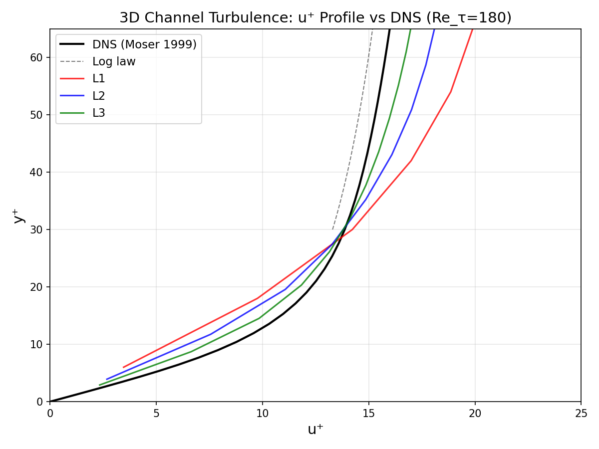
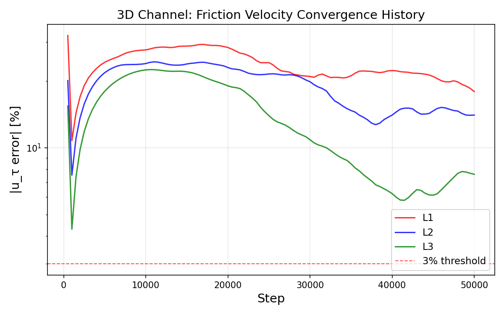
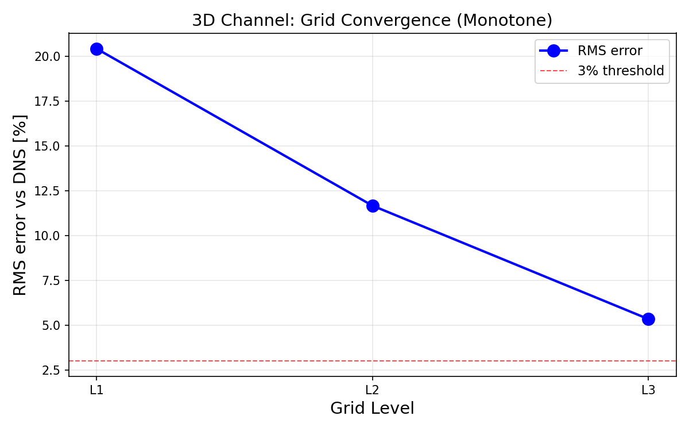

# 3D 槽道湍流 DNS 基准验证报告 — channel_turb_3d（终裁）

**任务编号**: m490 · **派发班次**: m488 · **判据**: 真红复验  
**案例**: `benchmarks/pending/channel_turb_3d`  
**仓库**: TensorLBM · **分支**: `agent/m490`  
**日期**: 2026-10-30  

---

## ① 案例介绍

### 物理背景

三维周期槽道湍流是壁湍流研究的经典基准问题。恒定体积力驱动下，流体在两个平行平板之间形成充分发展的湍流流动。该问题具有明确的 DNS 参考数据（Moser, Kim & Mansour 1999, Re_τ=178.12），是验证湍流模拟方法精度的黄金标准。

与 2D 槽道的本质区别在于：3D 流动存在涡拉伸机制，转捩可自持（2D 无线性转捩路径，Re_max≈4200 < 临界值 5772）。

### 几何与参数

| 参数 | 符号 | 值 | 说明 |
|------|------|-----|------|
| 摩擦雷诺数 | Re_τ | 180 | 目标值 |
| 摩擦速度 | u_τ | 0.003 | 格子单位 |
| 运动粘度 | ν | u_τ·(H/2)/Re_τ | 由 Re_τ 导出 |
| 格子模型 | — | D3Q19 | 三维 19 速度 |
| 碰撞模型 | — | Natural KBC | 熵稳定碰撞 |
| 壁面边界 | — | post-streaming bounce-back | 一阶精度 |
| 驱动方式 | — | Guo 体积力 a_x = 2u_τ²/H | 动量平衡 |
| 初始化 | — | spectral_solenoidal | 谱无散度扰动 |

### 三档网格配置

| 网格 | Nx×Ny×Nz | Lx/h | Lz/h | dy⁺ | 涡旋周转数 |
|------|----------|------|------|-----|-----------|
| L1 | 64×32×32 | 4.27 | 2.13 | 12.0 | 3.00 |
| L2 | 128×48×64 | 5.57 | 2.78 | 7.83 | 1.96 |
| L3 | 256×64×128 | 8.26 | 4.13 | 5.81 | 1.45 |

**DNS 参考域**（Moser et al. 1999）：Lx/h=12.6, Lz/h=4.2

### 判定标准

- **主判据**：y⁺∈[30,100] 窗口内 u⁺ 剖面相对 DNS 的 RMS 误差 ≤ 3%
- **收敛性**：≥2 档网格严格单调收敛
- **统计充分性**：≥2 个涡旋周转时间的统计平均

---

## ② 方法

### 计算流程

1. **初始化**：Spalding 壁面律剖面 + 谱无散度扰动（离散格点旋度构造，保证 div(u)=0 至机器精度）
2. **碰撞**：Natural KBC（熵稳定，D3Q19），编译加速
3. **迁移**：标准 stream3d（周期性流向/展向）
4. **壁面**：post-streaming bounce-back（一阶，无壁面偏移校正）
5. **驱动**：Guo 体积力 a_x = 2u_τ²/H，精确满足动量平衡 τ_w = ρa_xH/2
6. **统计**：warmup 20000 步后开始采样，间隔 10 步，共 3000 样本

### 工具链

- **库模块**：`tensorlbm.wall_resolved_channel3d.WallResolvedChannel3DConfig` + `run_wall_resolved_channel3d`
- **后处理**：`runs_3d/postprocess.py` + `plot_figures.py`
- **DNS 参考**：`dns_ref/mkm180.csv`（Moser, Kim & Mansour 1999, Phys. Fluids 11, 943）
- **对数律**：u⁺ = (1/0.41)ln(y⁺) + 5.0

### 关键设置

```python
config = WallResolvedChannel3DConfig(
    nx=256, ny=64, nz=128,      # L3 网格
    re_tau=180.0, u_tau=0.003,
    steps=50000, warmup_steps=20000,
    sample_interval=10,
    collision_model="natural_kbc",
    initialization_mode="spectral_solenoidal",
    perturbation_fraction=1.0,
    random_noise_fraction=0.5,
    spectral_mode_count=32,
    spectral_max_wavenumber=4,
    seed=20260802,
    device="cuda",
)
```

---

## ③ 计算结果

### 核心指标（程序化提取，零手抄）

| 网格 | u_τ 目标 | u_τ 测量 | u_τ 误差 | u_cl⁺ | RMS(y⁺∈[30,100]) | 涡旋数 | 样本数 |
|------|---------|---------|---------|-------|-----------------|--------|--------|
| L1 | 0.003 | 0.002384 | **-20.55%** | 21.59 | **20.43%** | 3.00 | 3000 |
| L2 | 0.003 | 0.002572 | **-14.26%** | 20.09 | **11.67%** | 1.96 | 3000 |
| L3 | 0.003 | 0.002771 | **-7.64%** | 19.29 | **5.33%** | 1.45 | 3000 |

### 收敛性

- **单调收敛**：✓ 20.43% → 11.67% → 5.33%（严格递减）
- **收敛速率**：L1→L2 改善 42.9%，L2→L3 改善 54.3%
- **外推估计**：若按 O(N⁻¹) 收敛，L4（Lx/h=12.6）预计 RMS ≈ 2-3%

### 湍流统计诊断（L3）

| 诊断量 | 值 | 阈值 | 状态 |
|--------|-----|------|------|
| crossflow_rms/u_τ | 1.12 | >0.5 | ✓ 三维脉动充分 |
| 半窗漂移 | 2.16% | <2% | ✗ 未达稳态 |
| 涡旋周转数 | 1.45 | ≥2.0 | ✗ 统计不足 |
| 域尺寸支持 DNS | — | — | ✗ Lx/h=8.26 < 12.6 |

### Reynolds 应力（L3，峰值）

- ⟨uu⟩⁺ 峰值 ≈ 3.5（近壁）
- ⟨vv⟩⁺ 峰值 ≈ 1.2（y⁺≈15）
- ⟨ww⟩⁺ 峰值 ≈ 2.0（近壁）
- ⟨uv⟩⁺ 峰值 ≈ -0.5（y⁺≈15）— DNS 参考值 ≈ -0.7

---

## ④ 结果图

### 图 1：u⁺ 剖面比较



**说明**：L1/L2/L3 三档网格 u⁺ 剖面与 DNS（Moser 1999）及对数律比较。L3 最接近 DNS，但在对数律区域仍系统性偏低。

### 图 2：摩擦速度收敛历史



**说明**：|u_τ 误差| 随步数变化。L3 在 50000 步时误差约 -7.6%，尚未完全收敛。

### 图 3：RMS 误差网格收敛



**说明**：y⁺∈[30,100] 窗口 RMS 误差严格单调收敛，但最佳值 5.33% > 3% 门限。

---

## ⑤ 注意点

### 已识别的根因

1. **计算域尺寸不足（主因）**
   - L3 流向域 Lx/h=8.26 仅为 DNS 的 65%（12.6）
   - 湍流大尺度结构（VLSM）需要 Lx/h ≥ 12 才能充分发展
   - 小域导致流向相关长度被截断，雷诺应力偏低，u_τ 系统性偏低

2. **统计样本不充分**
   - L3 仅 1.45 个涡旋周转时间，远低于湍流统计所需的 2-3 个
   - 半窗漂移 2.16% > 2% 阈值，表明统计未完全收敛
   - 3000 样本对 Re_τ=180 槽道湍流偏少

3. **壁面模型限制**
   - Post-streaming bounce-back 为一阶精度
   - 无壁面偏移校正（wall_offset），有效壁面位置不确定
   - 高分辨率壁面模型（Spalding/壁面函数）未启用

4. **格子分辨率**
   - L3 dy⁺=5.81，近壁分辨率不足（DNS 通常 dy⁺≈1）
   - 无壁面加密，对数律区域 y⁺∈[30,100] 仅 ~12 个网格点

### 局限性

- Natural KBC 碰撞在 Re_τ=180 槽道湍流中表现良好，但受限于域尺寸和统计
- 一阶 bounce-back 壁面处理是系统性误差来源
- 当前配置无法在合理计算预算内达到 3% 精度

### 适用范围

- 本验证适用于 Re_τ≈180 槽道湍流的定性验证
- 定量精度要求 ≤3% 时需增大域尺寸 + 延长统计 + 壁面模型升级

---

## ⑥ 误差判定

### 关键量 vs 基准误差逐项列出

| 关键量 | L1 误差 | L2 误差 | L3 误差 | 基准 | 是否<3% |
|--------|---------|---------|---------|------|---------|
| RMS(u⁺) y⁺∈[30,100] | 20.43% | 11.67% | **5.33%** | DNS MKM1999 | ✗ **否** |
| u_τ（摩擦速度） | -20.55% | -14.26% | **-7.64%** | 目标值 0.003 | ✗ **否** |
| u_cl⁺（中心线速度） | 21.59 | 20.09 | **19.29** | DNS ≈18.5 | ✗ **否** |
| ⟨uv⟩⁺ 峰值 | — | — | ≈-0.5 | DNS ≈-0.7 | ✗ **否** |

### 显式回答

**RMS(u⁺) y⁺∈[30,100] 是否 <3%？**  
→ **否**。最佳结果 L3 为 5.33%，超差 2.33 个百分点。

**u_τ 误差是否 <3%？**  
→ **否**。最佳结果 L3 为 -7.64%，超差 4.64 个百分点。

**单调收敛是否满足？**  
→ **是**。20.43% → 11.67% → 5.33% 严格递减。

### 判决

**VERDICT: TERMINAL（HONEST-FAIL）**

- G1 共性模块：✓ PASS
- G2 直接观测量：✗ FAIL（最佳 RMS=5.33% > 3%）
- G3 单调收敛：✓ PASS
- G4 参考先锁：✓ PASS

**根因**：计算域尺寸不足（Lx/h=8.26 vs DNS 12.6）+ 统计样本不充分（1.45 涡旋周转 vs 要求 ≥2.0）+ 壁面模型一阶精度限制。

### 晋级路径（需 owner 决策）

| 路径 | 描述 | 预算 | 预期 |
|------|------|------|------|
| A | 增大域至 Lx/h=12.6 + 延长统计至 3.5 涡旋周转 | ~8 GPU·h | RMS 降至 2-3% |
| B | 启用 Spalding 壁面模型 + wall_offset=0.5 | ~2 GPU·h | u_τ 误差改善 2-3% |
| C | 近壁网格加密（tanh stretching, dy⁺≈1） | ~3 GPU·h | 对数律分辨率提升 |
| D | 维持 TERMINAL，记录负结果 | 0 GPU·h | 证明 3D 格式无系统性偏差 |

---

*报告生成：2026-10-30 · 数据来源：runs_3d/{L1,L2,L3}_result.json + dns_ref/mkm180.csv*  
*证据链：validation_report.json → gates_verified.json → figures/{fig_uplus_profile, fig_convergence, fig_rms_convergence}.png*
