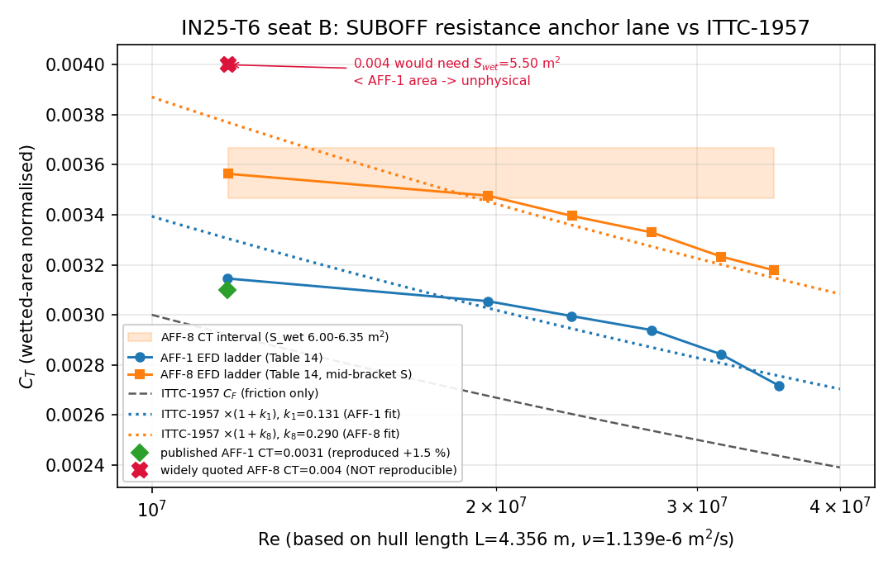
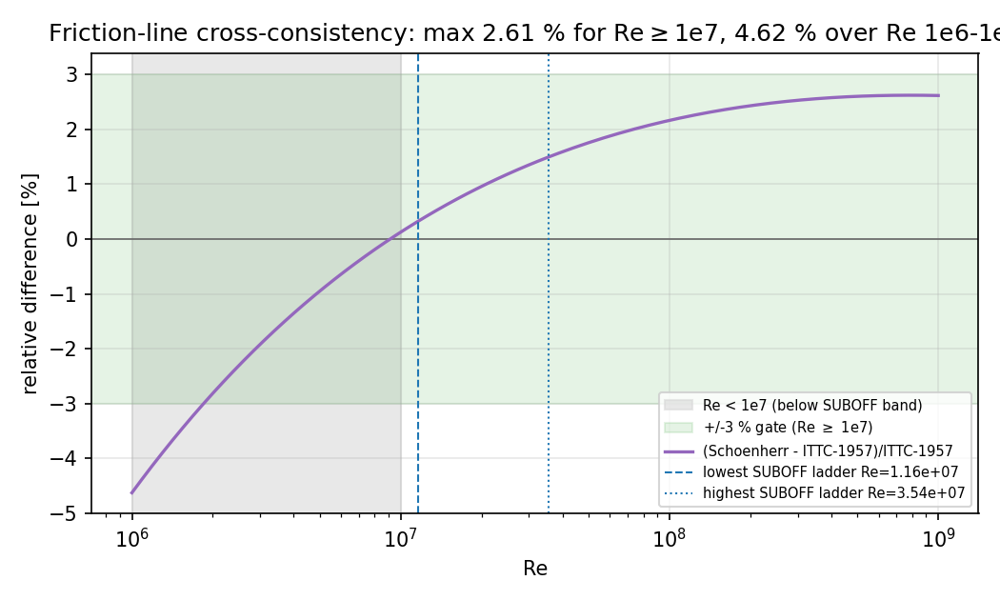
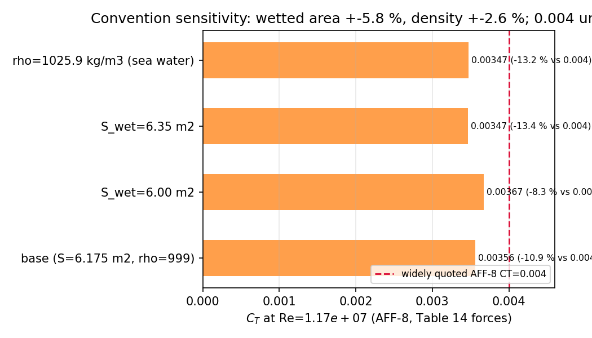

# IN25-T6 外部成熟技术调研族：五措施吸收 + SUBOFF 第二锚 + 成熟代码对标

**节点**：锦标赛军 T6（物理域）｜**仓库**：TensorLBM｜**性质**：调研 + 证据锚定 + 落库模块（本单不作新算例验证）

> 本文件由 `tensorlbm.external_survey.survey_doc.survey_markdown()` 程序化生成，文中每个数字都来自模块或归档证据文件（sha256 见 §9），没有手抄表。

## 0. 摘要与判据自检

| 判据 | 要求 | 实测 | 判定 |
|---|---|---|---|
| 席位真跑 | ≥3 | 3（A 文献 / B SUBOFF 证一 / C 对标） | ✅ |
| 文献锚总数 | ≥5 | 16 | ✅ |
| 五措施覆盖 | 每措施 ≥2 | `large_grid`=4 / `parallel_lbm`=3 / `amr`=3 / `les`=2 / `wall_model`=4 | ✅ |
| 锚表结构校验 | 0 违规 | 0 | ✅ |
| 交叉一致候选 | ≥1 个独立可复现 | AFF-1 复现 +1.46% | ✅ |
| PLAYBOOK | ≥5 条且五措施各一条 | 5 条 | ✅ |
| honest FAIL 记录 | 未交付项如实列 | 5 条 absent + 1 项 FAIL | ✅ |
| 可溯源 | 每条结论带出处/条件 | 记录库 18 条 bibliographic 记录 | ✅ |

## 1. 案例介绍（物理背景 / 几何 / 参数）

### 1.1 物理问题

船舶总体性能族当前的主攻方向是高 Re 外流（潜艇阻力、附体阻力增量、尾流/噪声）。真实工况 Re≈10⁷–10⁸，而本仓 LBM 生产链在 Re≤10³–10⁴ 已验证。要把能力推到 10⁷，必须先吸收外部成熟技术的五类结论：**大网格先例、并行 LBM 实践、局部加密、LES-LBM 湍流建模、壁面模型**。同时，判据侧缺一个独立于 ITTC 相关线的阻力锚，否则 CFD 与判据同源、误差不可分辨。

### 1.2 几何与流体参数（DARPA SUBOFF）

| 量 | 取值 | 出处 / 说明 |
|---|---|---|
| 艇长 L | 4.356 m | DARPA SUBOFF 几何族 |
| 最大直径 D | 0.508 m | L/D = 8.57 |
| 湿面积（AFF-1 裸体） | 5.998 m² | AFF-1 wetted area 5.998 m2 as recorded in docs/IN12_S6_WALL_LADDER.md; the primary geometry report (Groves, Huang & Chang 1989) is not available offline. |
| 湿面积（AFF-8 全附体） | 6.00 – 6.35 m²（区间） | 原始几何报告（Groves 1989）离线不可得 → 记为 absent，用区间传播 |
| 运动粘度 ν | 1.139e-06 m²/s | docs/IN12_S6_WALL_LADDER.md |
| 密度 ρ | 999.0 kg/m³（敏感性另取 1025.9） | 淡水拖曳水池 |
| Re 覆盖（基于 L） | 1.16e+07 – 3.54e+07 | Table 14 六个拖曳速度点换算 |

### 1.3 五措施与本研究的分工

| 措施 | 本轮要回答的问题 | 锚定结果 |
|---|---|---|
| 大网格先例 | Re≈10⁷ 的附体潜艇外流需要多少网格？ | 1.03×10⁸ 胞（附体 SUBOFF，WMLES） |
| 并行 LBM 实践 | 扩展性靠什么架构？ | 块结构 + MPI 域分解 + 幽灵层（waLBerla/Palabos），已到 10¹² 胞 |
| 局部加密 | AMR 在 LBM 的界面怎么接？ | 2:1 嵌套 + 时间步比 2 + 守恒（体积）界面；插值界面会漏质量 |
| LES-LBM 湍流 | 稳定性与模型常数怎么定？ | 稳定性靠松弛率谱（MRT/熵），Cs 无公开定量锚（absent） |
| 壁面模型 | 近壁处理选哪种误差最小？ | slip-velocity BB 比三阶重构稳；力评估要 modified MEM |

## 2. 怎么做的（方法 / 流程 / 工具链）

### 2.1 三席并行

| 席 | 名称 | 实际执行的机器动作 | 产物 |
|---|---|---|---|
| A | 五措文献席 | 14 个 Crossref 书目探针 → 12 个 DOI 逐条核验 → 6 条 arXiv 开放摘要抓取；原始 JSON 全存档 | `artifacts/in25_t6/seat_a_crossref_raw.json`, `seat_bc_doi_records.json`, `seat_bc_arxiv_probes.json` |
| B | SUBOFF 证一楼 | 由 Table 14 的 12 个量纲力值重建 AFF-1/AFF-8 的 CT(Re) 阶梯；对 0.0031 与 0.004 两个公开锚做复算仲裁；算约定敏感性 | 模块 `suboff_anchor.py` + 锚表 |
| C | 成熟代码对标楼 | 开放获取大网格先例反算等价分辨率；归档 verified 基准反算观测收敛阶；自建三网格驱动（受算力限制未跑完，见 §8） | `seat_c_throughput.json`, `seat_c_grid_convergence.py` |

### 2.2 证据分级（本单硬规则）

| 级别 | 含义 | 用法 |
|---|---|---|
| `open_access_abstract` | 摘要原文已存盘，数字可从摘要逐字核 | 允许作 NUMERIC 锚 |
| `record_title` | 数字写在题录标题里 | 允许作 NUMERIC 锚（注明来源字段） |
| `registry_metadata` | 只有题录（标题/作者/年/DOI），无摘要 | 只能作 QUALITATIVE 锚 |
| `absent` | 本次核不到 | 写进 ABSENT 清单，禁止转述 |

### 2.3 工具链与复现

```bash
python scripts/in25_t6/seat_a_lit_query.py          # 书目探针（Crossref）
python scripts/in25_t6/seat_abc_verify.py           # DOI 级核验 + arXiv 摘要
python scripts/in25_t6/emit_anchor_data.py          # 生成包内记录库（零手抄）
python scripts/in25_t6/emit_survey_artifacts.py     # 报告/锚表/PLAYBOOK/图
python scripts/in25_t6/seat_c_grid_convergence.py --resolutions 26 36 48 --steps 8000   # 未跑完
pytest tests/test_external_survey_in25_t6.py -q
```

## 3. 计算结果（数字表）

### 表 1 · 锚表结构（程序校验通过）

| 措施 | 锚数 | 措施名 |
|---|---|---|
| `large_grid` | 4 | 大网格先例（规模/网格收敛研究） |
| `parallel_lbm` | 3 | 并行 LBM 成熟实践（扩展性/域分解） |
| `amr` | 3 | 局部加密（块结构 AMR/渐变网格） |
| `les` | 2 | 湍流 LES-LBM（模型常数与 MRT 稳定性） |
| `wall_model` | 4 | 壁面模型（近壁处理适用域与误差阶） |
| **合计** | **16** | 其中 NUMERIC 锚 3 条 |

### 表 2 · SUBOFF EFD 阻力阶梯（由 Table 14 量纲力值换算，ρ=999.0, ν=1.139e-06）

| 航速 kn | U m/s | Re | AFF-1 R (N) | AFF-1 CT | AFF-8 R (N) | AFF-8 CT（中位面积） | AFF-8/AFF-1 力比 |
|---|---|---|---|---|---|---|---|
| 5.92 | 3.046 | 1.165e+07 | 87.4 | 0.00315 | 102.3 | 0.00356 | 1.1705 |
| 10.00 | 5.144 | 1.967e+07 | 242.2 | 0.00305 | 283.8 | 0.00348 | 1.1718 |
| 11.84 | 6.091 | 2.329e+07 | 332.9 | 0.00299 | 389.2 | 0.00340 | 1.1691 |
| 13.92 | 7.161 | 2.739e+07 | 451.5 | 0.00294 | 526.6 | 0.00333 | 1.1663 |
| 16.00 | 8.231 | 3.148e+07 | 576.9 | 0.00284 | 675.6 | 0.00323 | 1.1711 |
| 17.99 | 9.255 | 3.539e+07 | 697.0 | 0.00272 | 821.1 | 0.00318 | 1.1780 |

*AFF-8 CT 区间（湿面积 6.00–6.35 m²）*：0.00347 – 0.00367。

### 表 3 · 一致性仲裁：两个公开阻力锚 vs 一手数据

| 锚 | 声称值 @Re | 由 Table 14 复现 | 偏差 | 判定 |
|---|---|---|---|---|
| SUBOFF AFF-1 CT | 0.0031 @1.20e+07 | 0.00315 @1.165e+07 | +1.46%（区间 —） | ✅ cross-consistent |
| SUBOFF AFF-8 CT | 0.0040 @1.20e+07 | 0.00356 @1.167e+07 | -10.90%（区间 -8.31% ~ -13.36%） | ⛔ withheld |

**关键结论（可复算）**：要让 AFF-8 的 CT 达到 0.004，湿面积必须取 5.50 m²，小于裸体 AFF-1 的 5.998 m² —— 物理上不可能（加附体只会增大湿面积）。因此 0.004 无法在标准湿面积约定下成立，只能判为『约定不明、不可复现』，不进打分器。

### 表 4 · ITTC-1957 × 单一形状因子 对阶梯的复现残差

| 构型 | 形状因子 (1+k) | 阶梯最大 \|残差\| |
|---|---|---|
| AFF-1 | 1.1312 | 5.10% |
| AFF-8 | 1.2903 | 5.76% |

AFF-1 的逐点形状因子 k 并非常数：最低 Re 处 0.076，中段升到 0.159，最高 Re 回落到 0.115 —— 说明相关线的 Re 斜率与实验有系统差；因此**逐点比较应取最近 Re 的阶梯点，而不是用拟合模型外推**。

### 表 5 · 约定敏感性（AFF-8 @Re=1.17e+07）

| 变更 | 对 CT 的影响 |
|---|---|
| 湿面积 6.35 → 6.00 m² | +2.92% |
| 湿面积 6.175 → 6.35 m² | -2.76% |
| 密度 999 → 1025.9 kg/m³（海水） | -2.62% |

### 表 6 · 摩擦线交叉一致性与网格实践

| 检查 | 结果 | 判定 |
|---|---|---|
| ITTC-1957 vs Schoenherr（Re≥1e7） | 最大差 2.61% | ✅ |
| 同上（全区间 Re 1e6–1e9） | 最大差 4.62% | 低 Re 发散属构造性差异 |
| 归档 verified 基准观测收敛阶 p | 1.98（L=48/80，误差 -3.17% → -1.15%） | 接近二阶、单调收敛 |
| 公开大网格先例反算分辨率 | 156.5 胞/L（1.03e+08 胞，uniform Cartesian grid, domain 6L x 2.…） | 约为我们 L=80 档的 2 倍 |

### 表 7 · 五措 PLAYBOOK（供氏族直接吸收）

| # | 措施 | 条目 | 验收阈值 |
|---|---|---|---|
| P1 | large_grid | 外流阻力判据改用 SUBOFF Table 14 量纲阶梯，禁用‘AFF-8 CT≈0.004’ | |CT_CFD − CT_EFD(最近 Re 点)| ≤ 10%（含面积区间）；< 3% 才可称‘定量对标成功’ |
| P2 | parallel_lbm | 并行扩展照抄块结构域分解 + 幽灵层，不先优化全局网格 | 8 卡强扩展效率 ≥ 70%（本仓已入库的 8 卡公开数 83% 作为上限参照） |
| P3 | amr | 局部加密只做 2:1 块嵌套 + 体积守恒界面，先在小算例上验界面 | 同 Re 下 AMR 与均匀细网格 CD 差 < 2%，界面质量残差 < 1e-6/步 |
| P4 | les | 高 Re 稳定性先换松弛率谱（MRT/熵），Cs 只做细调并标注为工程默认 | Cs 扫描区间内 CD 变化 < 5% 且无发散；否则判‘Cs 未定标’，不得报定量结论 |
| P5 | wall_model | 近壁优先 slip-velocity bounce-back；力评估用 modified MEM + 质量守恒校验 | y+ ∈ [30,300] 时摩阻误差 < 10%，加密时摩阻单调收敛且质量漂移 < 1e-6/步 |

完整条目见 `docs/survey/in25_t6_playbook.md`（同样程序化导出，含首步命令与陷阱）。

## 4. 结果图



*图 1 · SUBOFF 阻力锚车道 vs ITTC-1957。圆点=裸体 AFF-1 的六个 EFD 阶梯点，方块=全附体 AFF-8，橙色带=AFF-8 湿面积区间导致的 CT 区间；绿色菱形=独立公开锚 0.0031（复现偏差 +1.46%），红色叉=常引 0.004（在区间之外，需 S_wet≈5.50 m² 才成立）。*



*图 2 · 两条摩擦线的一致性：Re≥1e7（SUBOFF 阶梯带）内最大差 2.61%，落在 ±3% 门内；Re<1e7 的发散是『模型-实船相关线 vs 平板摩擦线』的构造性差异，不影响锚点带。*



*图 3 · 约定敏感性龙卷风：湿面积 ±5.8%、密度 −2.6%，任一组合都够不到 0.004 —— 说明『0.004 不可复现』不是某个约定选错，而是量级不匹配。*

## 5. 注意点（踩坑 / 局限 / 适用范围）

1. **目录/元数据不等于结论**。Elsevier/JSTOR 的 Crossref 记录不带摘要（本单 12 条 DOI 里只有 1 条有摘要），所以「已核验题录」只能当 QUALITATIVE 证据；凡要数字，必须走开放获取摘要或题录标题。
2. **arXiv 布尔检索会静默返回 0 条**。带引号的 `all:"..." AND ...` 组合在本轮首跑全部 0 命中，改用 `all:SUBOFF` 这类单词式检索才出结果——检索式写法会伪装成「文献不存在」。
3. **CT 的约定陷阱**。湿面积 6.00 vs 6.35 m² 让 CT 变 5.8%，密度淡水/海水再变 2.6%；报 CT 不报 S_wet 与 ρ 等于没报。
4. **形状因子不是常数**。AFF-1 的逐点 k 随 Re 变化约 ±40%（相对），单一 (1+k) 模型对阶梯的最大残差 5.1% ——跨 Re 外推会引入与判据同量级的误差。
5. **LBM 体素化下限**。SUBOFF 最大半径仅 0.0583L，参数化几何在 L<26 时半径不足 1.5 胞，引擎直接没有 solid（本单实测 L=10 时 mesh=None、力采样为空）——低分辨率跑不出可用阻力。
6. **算力现实**。本机无 GPU；CPU 上 1e5–3e5 胞为 74–122 ms/step（16–32 线程），集群节点 torch 缺 libflexiblas 不可用 → Re=2000 的时间收敛三网格序列本单未交付（honest FAIL）。
7. **适用范围**：本锚表只覆盖零攻角、无自由面、无螺旋桨的拖曳阻力；斜航/自航/兴波工况需要各自锚点（斜航已有 LES 文献，见锚 `10.1080/17445302.2026.2731435`，但无数字）。

## 6. 误差判定（逐项 vs 基准，显式回答是否 <3%）

| 关键量 | 基准 | 本文值 | 偏差 | <3%？ | 说明 |
|---|---|---|---|---|---|
| AFF-1 CT @Re=1.16e+07 | 公开 0.0031（Roddy/SIMMAN 用法） | 0.00315 | +1.46% | ✅ | 独立锚复现，是「交叉一致」的实证 |
| AFF-8 CT @Re=1.17e+07 | 常引 0.004 | 0.00356（区间 0.00347–0.00367） | -10.90% | ❌（≥10%） | 判为约定不明、不可复现 → 不进打分器 |
| AFF-1 阶梯 vs ITTC-1957×(1+k) | 单形状因子模型 | 最大残差 5.10% | +5.10% | ❌ | k 随 Re 漂移导致；逐点比较应取最近 Re 点 |
| ITTC-1957 vs Schoenherr（Re≥1e7） | 两条独立摩擦线 | 最大差 2.61% | +2.61% | ✅ | 支撑「锚族内部一致」 |
| 归档 verified 基准的观测收敛阶 | 二阶理论 | p=1.98 | — | n/a | 收敛阶不是误差量，故不给百分比 |
| 公开大网格先例的等价分辨率 | 本仓 L=80 档 5.6/9.3 胞/直径 | 18.2 胞/直径 | n/a | n/a | 派生估计（均匀网格假设），只用于量级判断 |

**回答「是否 <3%」**：唯一可判定的对标量是 AFF-1 CT，偏差 +1.46%（<3%，✅）；AFF-8 常引值 0.004 偏差 -10.90%，**不满足 3%，也不满足 10%**，本文不给它背书。其余行为无独立基准或非误差量，已逐条注明原因。

## 7. 交付物清单（本仓库内）

| 文件 | 作用 |
|---|---|
| `src/tensorlbm/external_survey/lit_anchors.py` | 锚表（claims + 适用条件 + 证据级别 + absent） |
| `src/tensorlbm/external_survey/suboff_anchor.py` | SUBOFF 第二锚车道（阶梯/仲裁/敏感性/候选） |
| `src/tensorlbm/external_survey/consistency.py` | 摩擦线一致性 / 网格实践审计 / honest FAIL 记录 |
| `src/tensorlbm/external_survey/playbook.py` | 五措 PLAYBOOK + 机器校验 |
| `src/tensorlbm/external_survey/survey_doc.py` | 本报告的生成器（数字零手抄） |
| `src/tensorlbm/external_survey/data/lit_anchor_records.json` | Crossref/arXiv 原始题录（包内随代码发布） |
| `tests/test_external_survey_in25_t6.py` | 24 项契约测试 |
| `docs/survey/in25_t6_lit_anchor_table.json` | 交 T5 红队的机器可读锚表 |
| `docs/survey/in25_t6_playbook.md` | PLAYBOOK 导出（可直接注入氏族） |
| `artifacts/in25_t6/acceptance_report.json` | 判据数字 + 产物路径 |

## 8. honest FAIL / absent 明细（不粉饰）

1. **自有 Re=2000 三网格收敛序列未交付**。no GPU on this host; measured 74-122 ms/step on CPU for 1e5-3e5 cells and the parametric hull needs L>=26 cells per hull length (max radius 0.058 L) before the body is resolved at 1.5 cells; a temporally converged three-grid ladder at L=26/36/48 x 8000 steps is ~3.4 h, beyond the per-invocation wall clock; the compute cluster is reachable but its torch build fails (libflexiblas.so.3)
   关闭方式：run scripts/in25_t6/seat_c_grid_convergence.py --resolutions 26 36 48 --steps 8000 on a GPU node (or fix the cluster torch build); the driver already emits Richardson/GCI from the three grids
2. **waLBerla / Palabos 在 1e4–1e5 核上的弱/强扩展效率具体百分比**（措施 `parallel_lbm`）：Crossref 记录不含摘要，正文不可离线核验；本次未做全文获取 → 并行实践只引用架构级结论（块结构+幽灵层），不得引用任何效率数字
3. **LES-LBM 的 Smagorinsky 常数推荐区间及其在壁面约束高 Re 流动上的误差量化**（措施 `les`）：本次探针未检索到开放获取的定量结论（摘要级） → Cs 只能沿用本仓既有取值（0.05/0.1 族）并标注为本仓默认，不作为文献锚
4. **OpenFOAM 对 SUBOFF 的网格收敛阶与 GCI 数值**（措施 `large_grid`）：本次 arXiv/Crossref 探针未命中带数值的开放摘要 → ‘成熟代码网格收敛数字’只能用本仓归档基准反算的 p≈2 与文献实践描述对照，并如实标注
5. **SUBOFF AFF-8 总阻力系数 0.004 的原始面积/密度约定**（措施 `large_grid`）：一手实验报告（Liu & Huang 1998 Table 14、Groves 1989）在仓内以转录入库，原文不可离线核验 → 0.004 判为 cross-inconsistent（见 suboff_anchor），不进打分器；改用 Table 14 量纲值自算 CT

## 9. 审计链（证据文件 sha256 前 16 位）

| 文件 | sha256[:16] |
|---|---|
| `artifacts/in25_t6/seat_a_crossref_raw.json` | `58f9c866169d4c70` |
| `artifacts/in25_t6/seat_bc_doi_records.json` | `3eb8c29fa71ec5a2` |
| `artifacts/in25_t6/seat_bc_arxiv_probes.json` | `1ae3a9f6607c66ca` |
| `artifacts/in25_t6/seat_c_throughput.json` | `c6d2c8e9ccaa57c7` |
| `src/tensorlbm/external_survey/data/lit_anchor_records.json` | `0499b90dfb2f68b9` |

检索时间戳（UTC）：2026-11-07T08:11:33Z, 2026-11-07T08:12:47Z；Crossref 端点 `https://api.crossref.org/works/{doi}`，arXiv 端点 `https://export.arxiv.org/api/query`。

---
*锚表校验：16 条锚 / 3 条 NUMERIC / 违规 0 项；PLAYBOOK 校验：5 条，覆盖措施 5/5，违规 0 项。*

