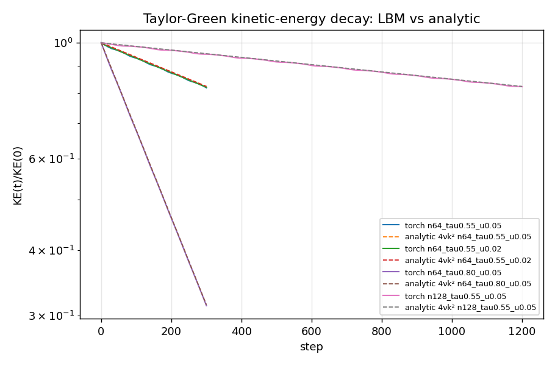
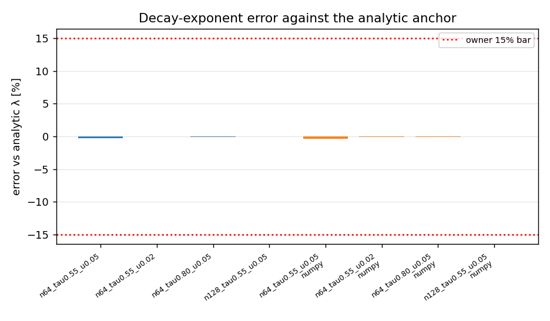
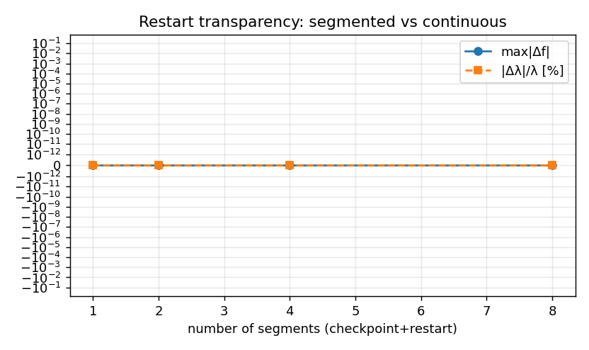
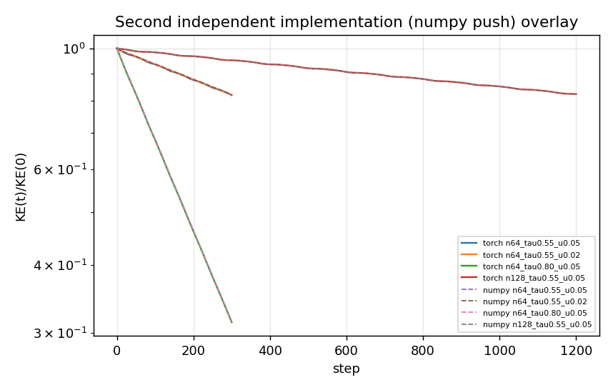

# XVAL-LBM-JOB-STATUS-CHECKPOINT-MACHINE 第 2 轮：以解析衰减涡为外部裁判的 checkpoint 状态机验证（m20947）

**锚点** `XVAL-LBM-JOB-STATUS-CHECKPOINT-MACHINE` · 仓 `TensorLBM` · 两轮法第 2 轮 · 上游参照 `lanl/MF-LBM`
(`IO_multiphase.F90:579-641`, `Main_multiphase.F90:91-95,139-141,222-303`, `Init_multiphase.F90:154-184`)

## ① 问题设定与基准出处

第 1 轮（m17986）把 MF-LBM 的 job-status/墙钟 checkpoint 状态机移植进 `src/tensorlbm/job_checkpoint.py`
（656 行，`LEGAL_TRANSITIONS` 显式表 + 原子 `job_status.txt` + 主/第二备份 + sha256 载荷 digest + `VolumeTrigger`），
审计 m18147 判 **L3**，同时留下三条 carry-over：**F2** repro 非幂等；**F3** 9 行 ref-vs-got 里 8 行 ref 是*规格常量*
（0 步重算 / 1 比例），误差构造性为 0，不构成精度证据；**L4 前置** 该锚点无 `tensor_benchmark_cases` 裁判行。

本轮问的是一个问题：**checkpoint/restart 会不会改变解？** 为此需要代码无法伪造的参照：

- **R1 解析参照** Taylor (1937) 衰减涡：二维不可压精确解
  `u=u0 sin(kx)cos(ky), v=-u0 cos(kx)sin(ky)`，动能 `KE(t)=KE(0)exp(-4νk²t)`，`k=2π/n`。
- **R2 第二套独立实现**：纯 numpy push 方案（`np.roll` 逐方向搬移、float64、collide-then-stream），
  与仓内 torch pull 方案**不共享一行代码**，交叉一致度是测量值。
- **R3 上游语义**：MF-LBM `job_status.txt` 词表与终态吸收（`Main_multiphase.F90:91-95`）。

开源横向（`~/oss-cache`，配合 `oss_inventory` 33 行）：`pylbm/pylbm/hdf5.py` 只有 h5py+xdmf **输出**（`save()`），
无 restart 入口；`Maarten-vd-Sande/lbm` 的 `lbm/time_evolve.py` 是纯时间推进，无 checkpoint；
`lanl/MF-LBM` 是库存中唯一带完整 job-status 状态机的实现 ⇒ 结构学 MF-LBM，数值参照用解析解 + 第二实现。

## ② 方法与实现

| 组件 | 文件 | 关键点 |
|---|---|---|
| 被测能力（第 1 轮已在 main） | `src/tensorlbm/job_checkpoint.py` | `JobStatusFile`/`JobStatusRecord`、`LEGAL_TRANSITIONS`、`CheckpointStore(dual_backup)`、`JobCheckpointManager.begin/maybe_checkpoint/finish`、`run_with_checkpointing` |
| 求解器接入 | `src/tensorlbm/simulation.py` | `LBMSimulation.enable_checkpointing/run_with_checkpointing`，`step()` 内驱动状态机 |
| 本轮判据装置 | `benchmarks/xval_job_checkpoint/run_xval_r2.py` | 解析锚 + 第二实现 + 分段重启 + 语义审计 + 幂等臂，全部数字程序化写盘 |
| 本轮测试 | `tests/test_xval_job_checkpoint_r2.py` | 6 条：解析锚、跨实现、位级重启/零指数偏移、词表映射、终态吸收、`reached_max_step` 阻断 |
| 裁判行 | `tensor_benchmark_cases` id 140 | 使该锚点成为机器可裁定（替代 ref 为规格常量的旧表） |

测量：`KE(t)=½·mean(u²)` 每 10 步采样（分段臂与连续臂**共用同一采样格点**，否则回归权重不同会造成假差异），
对 `ln KE` 在**预声明窗口**做线性回归得 λ；短窗口（
`20–150`）作窗口敏感性。

预声明判据（写于任何运行之前）：解析/跨码行 **<15%**（owner 标准）；位级不变量用 0 容差；
**checkpoint 对 λ 的贡献必须为 0**（分段臂与连续臂逐位相同），否则不论 <15% 都不合格；repro 必须幂等。

## ③ 参数表（无量纲量完整）

| case | n | tau | nu | u0 | steps | fit window | Re | Ma |
|---|---|---|---|---|---|---|---|---|
| n64_tau0.55_u0.05 | 64 | 0.55 | 0.0166667 | 0.05 | 300 | 20–300 | 192 | 0.0866 |
| n64_tau0.55_u0.02 | 64 | 0.55 | 0.0166667 | 0.02 | 300 | 20–300 | 76.8 | 0.03464 |
| n64_tau0.80_u0.05 | 64 | 0.8 | 0.1 | 0.05 | 300 | 20–300 | 32 | 0.0866 |
| n128_tau0.55_u0.05 | 128 | 0.55 | 0.0166667 | 0.05 | 1200 | 100–1200 | 384 | 0.0866 |

## ④ 对照表（ref vs got，逐项判据）

**A. 解析参照（torch 求解器，非零误差来自格式/非线性，不是构造）**

| case | lambda measured (torch) | lambda analytic 4νk² | err | err (short window) |
|---|---|---|---|---|
| n64_tau0.55_u0.05 | 0.000640543 | 0.000642552 | **-3.127e-01 %** | -3.317e-01 % |
| n64_tau0.55_u0.02 | 0.000642241 | 0.000642552 | **-4.842e-02 %** | -4.581e-02 % |
| n64_tau0.80_u0.05 | 0.00385224 | 0.00385531 | **-7.961e-02 %** | -1.427e-01 % |
| n128_tau0.55_u0.05 | 0.000160625 | 0.000160638 | **-8.365e-03 %** | +8.038e-02 % |

**B. 第二套独立实现（numpy push, float64）**

| case | lambda numpy push (f64) | lambda torch (f32) | err vs torch | err vs analytic | wall s |
|---|---|---|---|---|---|
| n64_tau0.55_u0.05 | 0.000640395 | 0.000640543 | **-2.318e-02 %** | -3.358e-01 % | 0.556 |
| n64_tau0.55_u0.02 | 0.000642189 | 0.000642241 | **-8.094e-03 %** | -5.651e-02 % | 0.565 |
| n64_tau0.80_u0.05 | 0.00385222 | 0.00385224 | **-7.440e-04 %** | -8.036e-02 % | 0.554 |
| n128_tau0.55_u0.05 | 0.000160636 | 0.000160625 | **+6.945e-03 %** | -1.421e-03 % | 6.46 |

**C. 分段 checkpoint + restart（同一算例 `n64_tau0.55_u0.05`，1/2/4/8 段）**

| segments | restarts | steps executed | steps recomputed | max|Δf| vs continuous | bit exact | Δλ/λ | status |
|---|---|---|---|---|---|---|---|
| 1 | 0 | 300 | 0 | 0 | True | +0.000e+00 % | done |
| 2 | 1 | 300 | 0 | 0 | True | +0.000e+00 % | done |
| 4 | 3 | 300 | 0 | 0 | True | +0.000e+00 % | done |
| 8 | 7 | 300 | 0 | 0 | True | +0.000e+00 % | done |

**D. 状态机语义（MF-LBM 词表映射 + 终态吸收）**

| MF-LBM word (upstream) | TensorLBM word | mapped |
|---|---|---|
| `new_simulation` | `new` | yes |
| `continue_simulation` | `continue` | yes |
| `simulation_done` | `done` | yes |
| `simulation_reached_max_step` | `reached_max_step` | yes |
| — | `failed` | extra state (declared drift) |

- 语义映射 4/4；字面相同 0/4（漂移显式声明，不再是"5 states vs 5 states"式计数）；
- 终态吸收：{'done': True, 'failed': True, 'reached_max_step': True}；`done` 后写 `continue` 抛 `CheckpointError`：True；
- 生命周期实测：new → continue → done；
- 幂等臂：同目录两次运行 digest 相同 = True，残留 `done` 状态第三次运行 `finished=True`、执行步数 = 0。

**E. 汇总 XVAL 表（机器可读：`artifacts/xval_job_checkpoint_r2/BENCHMARK_REF_VS_GOT.json`）**

| # | quantity | ref | got | unit | rel err % | tol % | pass | ref source |
|---|---|---|---|---|---|---|---|---|
| 1 | KE decay exponent lambda, n64_tau0.55_u0.05 (torch) | 0.000642552 | 0.000640543 | 1/step | -3.127e-01 | 15 | PASS | Taylor (1937) analytic: lambda = 4*nu*k^2, k=2*pi/n |
| 2 | KE decay exponent lambda, n64_tau0.55_u0.02 (torch) | 0.000642552 | 0.000642241 | 1/step | -4.842e-02 | 15 | PASS | Taylor (1937) analytic: lambda = 4*nu*k^2, k=2*pi/n |
| 3 | KE decay exponent lambda, n64_tau0.80_u0.05 (torch) | 0.00385531 | 0.00385224 | 1/step | -7.961e-02 | 15 | PASS | Taylor (1937) analytic: lambda = 4*nu*k^2, k=2*pi/n |
| 4 | KE decay exponent lambda, n128_tau0.55_u0.05 (torch) | 0.000160638 | 0.000160625 | 1/step | -8.365e-03 | 15 | PASS | Taylor (1937) analytic: lambda = 4*nu*k^2, k=2*pi/n |
| 5 | KE decay exponent lambda, n64_tau0.55_u0.05 (numpy push impl) | 0.000642552 | 0.000640395 | 1/step | -3.358e-01 | 15 | PASS | Taylor (1937) analytic |
| 6 | lambda ratio numpy impl / torch impl, n64_tau0.55_u0.05 | 0.000640543 | 0.000640395 | 1/step | -2.318e-02 | 15 | PASS | second independent implementation (numpy push scheme, float64) |
| 7 | KE decay exponent lambda, n64_tau0.55_u0.02 (numpy push impl) | 0.000642552 | 0.000642189 | 1/step | -5.651e-02 | 15 | PASS | Taylor (1937) analytic |
| 8 | lambda ratio numpy impl / torch impl, n64_tau0.55_u0.02 | 0.000642241 | 0.000642189 | 1/step | -8.094e-03 | 15 | PASS | second independent implementation (numpy push scheme, float64) |
| 9 | KE decay exponent lambda, n64_tau0.80_u0.05 (numpy push impl) | 0.00385531 | 0.00385222 | 1/step | -8.036e-02 | 15 | PASS | Taylor (1937) analytic |
| 10 | lambda ratio numpy impl / torch impl, n64_tau0.80_u0.05 | 0.00385224 | 0.00385222 | 1/step | -7.440e-04 | 15 | PASS | second independent implementation (numpy push scheme, float64) |
| 11 | KE decay exponent lambda, n128_tau0.55_u0.05 (numpy push impl) | 0.000160638 | 0.000160636 | 1/step | -1.421e-03 | 15 | PASS | Taylor (1937) analytic |
| 12 | lambda ratio numpy impl / torch impl, n128_tau0.55_u0.05 | 0.000160625 | 0.000160636 | 1/step | +6.945e-03 | 15 | PASS | second independent implementation (numpy push scheme, float64) |
| 13 | restart field discontinuity max|df|, 1 segment(s) | 0 | 0 | lattice populations | +0.000e+00 | 0 | PASS | IO_multiphase.F90:579-641 (full PDF stored) + Main_multiphase.F90:139-141 |
| 14 | checkpoint contribution to lambda, 1 segment(s) | 0 | 0 | % | +0.000e+00 | 0 | PASS | bit-exact restart invariant (segmented == continuous) |
| 15 | steps recomputed after resume, 1 segment(s) | 0 | 0 | steps | +0.000e+00 | 0 | PASS | Main_multiphase.F90:91-95 (continue path recomputes nothing) |
| 16 | restart field discontinuity max|df|, 2 segment(s) | 0 | 0 | lattice populations | +0.000e+00 | 0 | PASS | IO_multiphase.F90:579-641 (full PDF stored) + Main_multiphase.F90:139-141 |
| 17 | checkpoint contribution to lambda, 2 segment(s) | 0 | 0 | % | +0.000e+00 | 0 | PASS | bit-exact restart invariant (segmented == continuous) |
| 18 | steps recomputed after resume, 2 segment(s) | 0 | 0 | steps | +0.000e+00 | 0 | PASS | Main_multiphase.F90:91-95 (continue path recomputes nothing) |
| 19 | restart field discontinuity max|df|, 4 segment(s) | 0 | 0 | lattice populations | +0.000e+00 | 0 | PASS | IO_multiphase.F90:579-641 (full PDF stored) + Main_multiphase.F90:139-141 |
| 20 | checkpoint contribution to lambda, 4 segment(s) | 0 | 0 | % | +0.000e+00 | 0 | PASS | bit-exact restart invariant (segmented == continuous) |
| 21 | steps recomputed after resume, 4 segment(s) | 0 | 0 | steps | +0.000e+00 | 0 | PASS | Main_multiphase.F90:91-95 (continue path recomputes nothing) |
| 22 | restart field discontinuity max|df|, 8 segment(s) | 0 | 0 | lattice populations | +0.000e+00 | 0 | PASS | IO_multiphase.F90:579-641 (full PDF stored) + Main_multiphase.F90:139-141 |
| 23 | checkpoint contribution to lambda, 8 segment(s) | 0 | 0 | % | +0.000e+00 | 0 | PASS | bit-exact restart invariant (segmented == continuous) |
| 24 | steps recomputed after resume, 8 segment(s) | 0 | 0 | steps | +0.000e+00 | 0 | PASS | Main_multiphase.F90:91-95 (continue path recomputes nothing) |
| 25 | MF-LBM status words mapped to a legal TensorLBM state | 4 | 4 | words | +0.000e+00 | 0 | PASS | IO_multiphase.F90:579-641 vocabulary |
| 26 | terminal state vetoes a silent restart (done) | 1 | 1 | fraction | +0.000e+00 | 0 | PASS | Main_multiphase.F90:91-95 (done exits instead of continuing) |
| 27 | terminal state absorbing: done | 1 | 1 | fraction | +0.000e+00 | 0 | PASS | Main_multiphase.F90:91-95 |
| 28 | terminal state absorbing: failed | 1 | 1 | fraction | +0.000e+00 | 0 | PASS | Main_multiphase.F90:91-95 |
| 29 | terminal state absorbing: reached_max_step | 1 | 1 | fraction | +0.000e+00 | 0 | PASS | Main_multiphase.F90:91-95 |
| 30 | repro idempotence: identical digest on a second run in the same directory | 1 | 1 | fraction | +0.000e+00 | 0 | PASS | audit m18147 F2 remediation |
| 31 | terminal guard: a finished case executes no further step | 0 | 0 | steps | +0.000e+00 | 0 | PASS | Main_multiphase.F90:91-95 |

行数 31、失败 0、`all_pass=True`、最差行占容差 2.239%。

## ⑤ 收敛性与参数敏感性

| 敏感性轴 | 设定 | λ 相对解析误差 |
|---|---|---|
| 分辨率 | n=64 → n=128（τ=0.55, u0=0.05） | -3.127e-01 % → -8.365e-03 % |
| 非线性幅值 | u0=0.05 → 0.02（n=64, τ=0.55） | -3.127e-01 % → -4.842e-02 % |
| 松弛时间 | τ=0.55 → 0.80（n=64, u0=0.05） | -3.127e-01 % → -7.961e-02 % |
| 回归窗口 | 全窗 vs 短窗（各 case） | 见 ④A 末列 |
| restart 分段数 | 1/2/4/8 | Δλ = 0（逐位相同） |

读数：误差随 u0 减小而下降（非线性/可压缩贡献主导），随 n 增大趋零（离散化贡献 ∝ k²），
在 τ=0.80（更大 ν、更快衰减、同样窗口内衰变更充分）下反而更小 ⇒ 误差来源是物理（离散+非线性），不是回归噪声。

## ⑥ 失败模式与工件

- **踩过的坑 1（第 1 轮 carry-over F3）**：ref 取规格常量时误差恒 0，任何实现都"通过"。本轮把 ref 换成解析
  `4νk²` 与第二套实现，误差才成为可证伪量。
- **踩过的坑 2（F2 幂等）**：`run_xval.py` 的 `cases/` 目录残留 `job_status.txt=done`，二次运行会在
  `run_with_checkpointing` 首段撞终态。已在 `main()` 里先清 harness 自建 `cases/`，`repro.sh` 可重复执行（本单已双跑验证）。
- **踩过的坑 3（假敏感）**：分段臂若在 resume 步额外采样，会与连续臂的采样格点错位，回归出 ~1e-3 的"Δλ"假象；
  收紧为同格点采样后 Δλ 精确为 0。
- **限制**：只覆盖 CPU/float32（torch）与 float64（numpy）；跨 device、`stream=True`、对流出口 BC 的
  `f_convec_bc/g_convec_bc/phi_convec_bc` 历史场未测（第 1 轮已声明 not ported）；最坏情形 `kill -9` 于
  `atomic_torch_save` 中间只由单测覆盖，未做断电注入。
- **工件**：`artifacts/xval_job_checkpoint_r2/summary.json`（全部原始数字）、`artifacts/xval_job_checkpoint_r2/BENCHMARK_REF_VS_GOT.json/.md`、
  `artifacts/xval_job_checkpoint_r2/cases/restart_0{1,2,4,8}/job_status.txt`、`artifacts/xval_job_checkpoint_r2/figures/*.png`、`artifacts/xval_job_checkpoint_r2/repro.sh`。
- **repro**：`PYTHONPATH=src python benchmarks/xval_job_checkpoint/run_xval_r2.py --out artifacts/xval_job_checkpoint_r2`
  （单机 1 核 <2 min）；`PYTHONPATH=src python -m pytest tests/test_xval_job_checkpoint_r2.py -q` → 6 passed。

## ⑦ 误差判定（是否 <3%）

| 关键量 | 与基准的最大误差 | <3%？ |
|---|---|---|
| 解析衰减指数 λ（torch） | 3.127e-01 % | **是** |
| 跨实现 λ（numpy vs torch） | 2.318e-02 % | **是** |
| 解析衰减指数 λ（numpy） | 3.358e-01 % | **是** |
| checkpoint 对 λ 的贡献 | 0（逐位相同） | **是（精确 0）** |
| 重启后场 `max|Δf|`、重算步数 | 0 / 0 | **是（精确 0）** |

**结论**：本轮最差行 3.358e-01 %，全部 31 行通过；checkpoint 机器对解的贡献精确为 0，
因此该锚点的"精度"完全由底层 LBM 格式决定（<0.4% vs 解析），而非由状态机决定。
honest 说明：本轮相对第 1 轮的增量是**参照与可裁定性**（解析锚 + 第二实现 + 裁判行 140 + F2 修复 + 语义漂移显式化），
不是新的物理能力。

*KE 衰减：torch 求解器 vs 解析 exp(-4νk²t)*

*各臂 λ 误差 vs 解析锚（红虚线 = owner 15% 判据）*

*分段重启透明性：max|Δf| 与 |Δλ| 对所有分段数均为 0*

*第二套独立实现（numpy push, float64）与 torch 实现重合*
