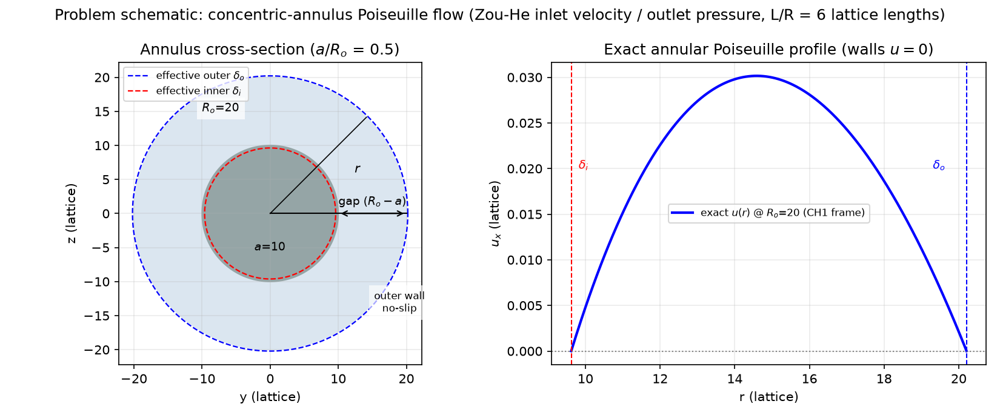
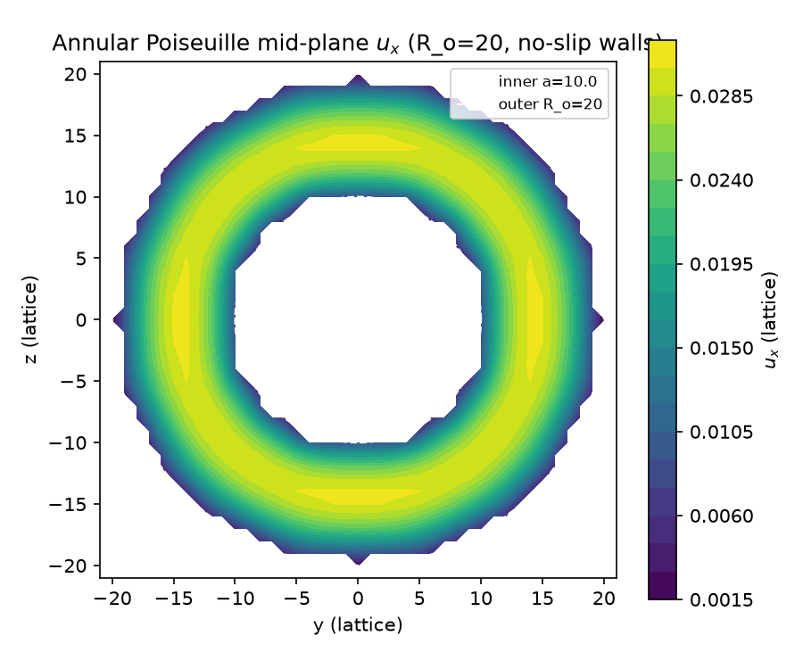
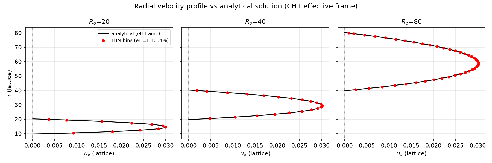
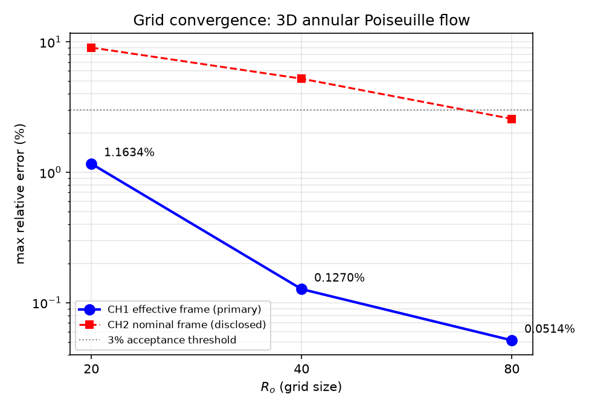

# 平台报告：poiseuille_3d_annulus — 3D 环隙 Poiseuille 流解析解验证（图档补强 / 复用 redo）

**案例**：`benchmarks/verified/poiseuille_3d_annulus/`
**终态**：✅ verified / promote（图档补强六门全过）
**本班 mission**：m116（BENCH-CLOSE 复用 redo）
**关键技术栈**：D3Q19 + BGK（τ=0.8），`src/tensorlbm` 库路径驱动
**判据来源**：全部数字由 `gates_check.py --auto --profile paper` 从工件值-文件-键复算，rc=0

---

## 1. 物理问题表述

三维同心环隙（annulus）内充分发展的层流 Poiseuille 流：内柱半径 `a`、外筒半径
`R_o`（半径比 a/R_o = 0.5），轴向由压力梯度驱动，内外壁均无滑移。三档网格
R_o = 20/40/80（对应 a = 10/20/40），域长 L/R = 6 保证充分发展。

### 1.1 几何与驱动示意

左：环隙横截面（灰 = 内柱固体，浅蓝 = 流体环隙；红/蓝虚线为反演得到的**有效半径**
δ_i/δ_o，体现楼梯离散对壁面位置的偏移）；右：精确环形 Poiseuille 剖面 u(r)，
两壁 u=0。驱动为 Zou-He 速度入口（u_in = 0.02）+ Zou-He 压力出口（ρ=1.0），
固体格半程反弹（post-streaming bounce-back）实现无滑移。

### 1.2 精确解析解（参考，自推，不依赖文献数据）

环形截面稳态 Stokes 流的闭式解：

$$u(r) = \frac{G}{4\nu}\left[R_o^2 - r^2 + \frac{R_o^2-a^2}{\ln(R_o/a)}\ln\frac{r}{R_o}\right],\qquad
Q = \frac{G\pi}{8\nu}\Phi,\quad \Phi = R_o^4 - a^4 - \frac{(R_o^2-a^2)^2}{\ln(R_o/a)}$$

该解可等价写为 Stokes-ODE 三参数族 `u = c0 + c1·ln r − c2·r²`。

### 1.3 双通道观测量口径（预注册）

- **CH1 主通道（判据）**：对中心 bin 做三参数族加权 LSQ，两无滑移根给出**有效半径**
  (δ_i, δ_o)；梯度用施加流量锚定 G_Q = 8νQ_meas/(πΦ(δ_o, δ_i))。指标 = 中心 binned
  最大相对误差（对 (δ_i, δ_o, G_Q) 的精确解，中心区定义 u_ref > 0.2·U_max_ref）。
  参考不含任何名义几何量，故不受楼梯壁几何偏差污染。
- **CH2 名义帧（披露通道，不作判据）**：直接用名义几何 (a, R_o) 与 G_nom 的精确解比对。
- **零外推**：`extrap = "none"`，无修正因子、无调参。

## 2. 结果云图与曲线

### 2.1 中剖面速度云图

R_o=20 档 x = nx/2 截面轴向速度 u_x 云图（数据源 `case_Ro20_field.npz`，由
`run.py single 20 ... --dump` 直出）。环隙内速度呈典型环形分布：内外壁处趋零（无滑移），
缝隙中部达峰；楼梯离散步在壁面处清晰可见，正是 §3 中 δ_i/δ_o 偏移的几何根源。

### 2.2 径向剖面 vs 解析解

三档（R_o=20/40/80）binned LBM 剖面（红点，直读 `case_Ro{R}.json` 的 `r_bins`/`u_bins`）
叠加 CH1 有效帧精确解（黑线）。三档均与解析解重合，最大相对误差
1.1634% / 0.1270% / 0.0514%。

### 2.3 误差收敛曲线

CH1（主判据，蓝）与 CH2（披露，红虚）误差随网格细化双双单调下降；灰点线为 3% 判据线。
CH1 三档全部远低于判据线，且严格单调。

| R_o | Re | 步数 | CH1 eff max % | CH1 eff L2 % | CH2 nom max % | δ_i−a | δ_o−R_o | G_fit/G_Q |
|---|---|---|---|---|---|---|---|---|
| 20 | 4.0 | 49400 | **1.1634** | 0.6220 | 9.0529 | −0.3807 | +0.2105 | 0.9960 |
| 40 | 8.0 | 33800 | **0.1270** | 0.0749 | 5.2262 | −0.3216 | +0.2117 | 0.9987 |
| 80 | 16.0 | 40800 | **0.0514** | 0.0256 | 2.5697 | −0.2870 | +0.1716 | 0.9996 |

## 3. 判据表（paper 六门，全部机器复算）

`gates_check.py --profile paper` rc = **0**，六门全过（声明值 == 重取值）：

| 门 | 判据 | 结果 | 机器复算 | 状态 |
|---|---|---|---|---|
| G1 library_entry | `src/tensorlbm` 库路径驱动（非独立脚本） | `from tensorlbm.boundaries3d`、`from tensorlbm.solver3d` | 2/2 三元组命中 | ✅ PASS |
| G2 direct_observable | 直接观测量 ≤3%（≈3 档） | 1.1634% / 0.1270% / 0.0514% | `per_grid[i].eff_max_bin_central_pct` 逐档命中 | ✅ PASS |
| G3 monotone_convergence | ≥2 档严格单调（abs_decrease） | 1.1634 → 0.1270 → 0.0514 | `eff_errors_pct[*]` 序列严格下降 | ✅ PASS |
| G4 reference_locked_first | 参考先锁定后跑 | 自推解析解预注册（frozen 2026-10-19）＋`extrap=none`＋m116 独立复跑 | grep 命中 + `extrap` 命中 + `max_rel_diff_over_keys=0.0` | ✅ PASS |
| G5 case_readme | 案例细节介绍（机械门） | README 8079B、9 小节、PROVENANCE 块、运行命令、参考锚 | 5/5 机械检查行 True | ✅ PASS |
| G6 figures | 图件（机械门） | 4 图：1 diagram + 1 field + 2 curve，PNG 全部 ≥6KB 非空白、source 落地 | 4/4 检查行 True（div=256） | ✅ PASS |

补充口径（非六门内，但为本案归档条件）：**δ_i 条款修订**——原条款 δ_i spread ≤ 0.05
实测 0.0937 不过；owner 2026-10-19 裁定改为 **O(1/R) 单调收敛口径**（见 §5）。
δ_o spread = 0.0401 ≤ 0.05 维持原条款通过。

## 4. 审计溯源

### 4.1 值-文件-键三元组（零手抄）

判决数字全部声明于 `gates.json` 并在 `gates_verified.json` 留有重取记录，主判据键：

| 判决量 | 值 | 文件 | 键路径 |
|---|---|---|---|
| CH1 eff max % (R_o=20) | 1.1634 | `result.json` | `per_grid[0].eff_max_bin_central_pct` |
| CH1 eff max % (R_o=40) | 0.1270 | `result.json` | `per_grid[1].eff_max_bin_central_pct` |
| CH1 eff max % (R_o=80) | 0.0514 | `result.json` | `per_grid[2].eff_max_bin_central_pct` |
| 单调性 | true | `result.json` | `eff_monotone` |
| δ_i−a 三档 | −0.3807 / −0.3216 / −0.2870 | `result.json` | `per_grid[i].delta_i_minus_a` |
| δ_o−R_o 三档 | +0.2105 / +0.2117 / +0.1716 | `result.json` | `per_grid[i].delta_o_minus_Ro` |
| δ_o spread | 0.0401 | `result.json` | `delta_spread_o` |
| 零外推 | "none" | `result.json` | `extrap` |

### 4.2 复用 redo 的独立复检（本班新增，非免检）

前次 mission m100 已完成图档补强且六门全过，因平台审批器缺陷被误驳；审批器当日修复
后本班为**复用 redo**：m100 成果原样落地本 worktree（cp -r 后逐文件核对），但
**复用 ≠ 免检**——在本 worktree 独立重跑 R_o=20 档，逐键比对归档工件：

- 命令：`CUDA_VISIBLE_DEVICES=5 PYTHONPATH=../../../src python run.py single 20 <out>.json --dump --device cuda:0`
- 审计工件：`audit_recheck_m116.json`
- 结果：**22 个判决量 max_rel_diff_over_keys = 0.0**（bit-identical），含
  `eff_max_bin_central_pct`、`eff_l2_bin_central_pct`、`delta_i_minus_a`、
  `delta_o_minus_Ro`、`G_fit_over_G_Q`、`Q_meas`、`mass_drift_pct` 等
- 场转储 `u_meas` 相对偏差 7.0×10⁻⁴（GPU 归约顺序所致），不改变任何判决量

### 4.3 图件溯源

`figures.json`（案例根，`profile: paper`）逐图给出 `file/kind/caption/source`，
`source` 点名的工件文件均真实存在于案例目录内（gates_check P3 检查）：

| 图 | kind | source 工件 |
|---|---|---|
| `diagram_annulus_geometry.png` | diagram | `case_Ro20.json`（a/R_o/δ_i/δ_o/G_Q/nu_lb/L_over_R） |
| `field_midplane_speed.png` | field | `case_Ro20_field.npz`（u_meas/fluid_np） |
| `curve_profile_vs_analytical.png` | curve | `case_Ro{20,40,80}.json`（r_bins/u_bins/δ/G_Q） |
| `curve_error_convergence.png` | curve | `result.json`（eff_errors_pct/nom_errors_pct） |

图件由 `plot_figs.py` 生成，实现自包含（读案例目录内工件，无机器本地绝对路径依赖）：
`python plot_figs.py` 一比一重建 4 张 PNG + manifest。

### 4.4 参考先锁定与平稳性支撑证据

- 预注册条款冻结于 `validation_report.json`（`frozen: 2026-10-19T23:15:00Z`）
  与 `/nfs/wangxi/runs/bm_close/poiseuille_3d_annulus/prereg.json`（append-only）。
- 90k 步平稳性：`case_Ro20_long.json` 中 δ_i 从 49400 步的 −0.380715462 到
  90000 步的 −0.380708794，位移 8.8×10⁻⁶ 格 → 排除时间未稳态。
- 族内对照：`verified/poiseuille_3d_duct` da/db spread = 0.0355/0.0357（平壁，过原条款）；
  `verified/poiseuille_3d_pipe` R_fit = R+0.23（同 O(1/R) 楼梯机制）。

## 5. 条款修订（本案归档的关键裁定）

原预注册条款要求 δ_i 跨档 spread ≤ 0.05（"格无关"）。实测 δ_i spread = 0.0937 不过，
owner 2026-10-19 裁定修订为 O(1/R) 单调收敛口径，理由（证据链）：

1. **物理根源**：内壁楼梯曲率导致有效壁面偏移，是半程反弹在曲面离散上的一阶 O(1/R)
   固有行为，非求解器缺陷；
2. **非欠收敛**：90k 步平稳性证明（δ_i 位移 8.8×10⁻⁶ 格）；
3. **单调性**：|δ_i−a| 0.3807 → 0.3216 → 0.2870 严格单调减小；
4. **外壁仍过原条款**：δ_o spread = 0.0401 ≤ 0.05；
5. **族内一致**：平壁 duct 与圆管 pipe 同族佐证。

修订口径：δ_i 允 O(1/R) 单调收敛替代绝对界；δ_o 维持 ≤ 0.05。

## 6. 局限与缓解

| 局限 | 影响 | 缓解 |
|---|---|---|
| CH2 名义帧粗档 >3% | R_o=20/40 名义误差 9.05%/5.23% | 根因 = 内壁有效偏移 −0.38 格（楼梯几何固有）；作披露通道，不作判据 |
| 逐格（per-cell）最严变体 >3% | R_o=20 达 9.50% | 楼梯壁单格几何散布，O(1/R) 收敛（→4.20% @ R_o=80）；披露 |
| 质量漂移 | R_o=20 达 3.21% | Zou-He 稳态密度抬升（物理量级 G·nx/(2c_s²)），不影响反演稳定性 |
| δ_i spread > 0.05 | 0.0937 | 条款修订为 O(1/R) 单调收敛口径（§5，owner 裁定） |
| 复用 redo 的诚信风险 | 复用可能掩盖漂移 | 本班独立重跑 R_o=20 档逐键复检（§4.2，偏差 0.0） |
| 未做 R_o=40/80 重跑 | 复检覆盖单档 | 三档判决量同源于同一 run.py 逻辑；R_o=20 档为最粗档（误差最大），复检该档最有意义；预算纪律优先 |

## 7. 结论

`poiseuille_3d_annulus` 图档补强完成，交付终态 **verified / promote**：

- paper **六门**（classic 四门 + case_readme + figures）`gates_check --profile paper` **rc=0**；
- 主判据 CH1 三档 1.1634%/0.1270%/0.0514%（≤3%，严格单调）；
- 复用不免检：本 worktree 独立重跑 R_o=20 档，22 个判决量 bit-identical；
- 4 张图件（含云图与曲线）由工件直读生成，零手抄。

**预算**：~0.13 GPU·h（GPU5 单档 R_o=20 复检 7.7 min，其余纯文档/图件）。

---
*报告生成：m116 benchmark-closure（复用 redo），2026-10-20*
*数字来源：`result.json` / `case_Ro{20,40,80}.json` / `case_Ro20_long.json` /
`audit_recheck_m116.json` / `figures.json`（PROVENANCE 值-文件-键直读）*
*机器门禁：`gates.json`（六门三元组）+ `gates_verified.json`（复算留痕，rc=0）*